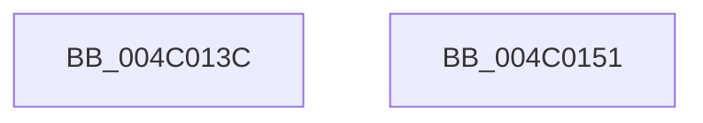

# MmQueryApiSetSchema

- RVA: `0x004C013C`–`0x004C0152` (길이 `22` bytes)
- VA: `0x00000001404C013C`
- 실행 섹션: `.text`
- PDB 이름 있음: `예`; PDB Function 태그: `아니요`
- unwind 정보 RVA: `0x000DB714`
- 디코드: `6`개 명령, `22/22` bytes 표시
- 미해석 바이트: `0` (있으면 어셈블리에 `.byte`로 보존)

> 이 문서는 커널 이미지의 기계어와 PDB 기호를 분석해 생성했습니다. 4번과 5번은 함수 원형과 자료형을 바이너리 사용 방식에서 추정한 C 해석이며 원본 소스 복구 결과는 아닙니다.

## 1. Dependencies

- 직접 호출 지점: **0**; 고유 호출 대상: **0**
- 직접 호출자로 확인된 함수: **4**
- RIP 상대 이미지 참조: **2**

### Outgoing calls
- 직접 디코드된 call 명령이 없습니다.

### Direct callers
- [KiMarkBugCheckRegions](../50/KiMarkBugCheckRegions_function_0050A188.md) at `0x0050A4F3`
- [PsQueryCurrentApiSetSchema](../../page/A2/PsQueryCurrentApiSetSchema_function_00A24300.md) at `0x00A2431D`
- [sub_00B316B4](../../page/B3/Unknown_function_00B316B4.md) at `0x00B31F76`
- [sub_00BF16D0](../../init/BF/Unknown_function_00BF16D0.md) at `0x00C0637B`

### Static image references
- `0x004C013C` → RVA `0x00E2D7E0` (`.data`; read)
- `0x004C0146` → RVA `0x00E2D7E8` (`.data`; read)

## 2. Other-region calls and transfers

- 다른 실행 섹션으로 향하는 call: **0**
- 별도 외부 분기/꼬리 이동을 확인하지 못했습니다.

## 3. Assembly (complete function range)

```asm
004C013C  48 8D 05 9D D6 96 00            lea rax, [rip + 0x96d69d]
004C0143  48 89 01                        mov qword ptr [rcx], rax
004C0146  48 8D 05 9B D6 96 00            lea rax, [rip + 0x96d69b]
004C014D  48 89 02                        mov qword ptr [rdx], rax
004C0150  C3                              ret
004C0151  CC                              int3
```

## 4. C-style interpretation (structured pseudocode)

```c
__int64 __fastcall MmQueryApiSetSchema(__int64 a1, __int64 a2)
{
    *(unsigned __int64 *)(a1) = v_rip + 9885341;
    *(unsigned __int64 *)(a2) = v_rip + 9885339;
    return v_rip + 9885339;
}
```

## 5. (Beta) C Style

```c
int64_t MmQueryApiSetSchema(void *Arg1, void *Arg2)
{
    uint8_t *arg1 = (uint8_t *)Arg1;
    uint8_t *arg2 = (uint8_t *)Arg2;

    *(uint64_t *)(arg1) = v_rip + 9885341;
    *(uint64_t *)(arg2) = v_rip + 9885339;
    return v_rip + 9885339;
}
```

### 관측된 메모리 오프셋

구조체 형식이 확인되지 않은 접근은 인자 기준의 오프셋으로만 기록했습니다.

| 기준 인자 | 오프셋 표현 | 폭 (bit) | 접근 |
|---|---:|---:|---|
| `Arg1` | `+ 0x0` | `64` | `W` |
| `Arg2` | `+ 0x0` | `64` | `W` |

## 6. Execution-region graph

[열기: 2D/3D 그래프와 함수 탐색 컨트롤 패널](../../../control-panel.html?section=text&rva=0x004C013C&view=graph)

- 2D 그래프는 위에서 아래로 흐르고, 3D 그래프는 빈 공간을 드래그해 회전합니다. Shift+드래그는 이동, 휠은 확대·축소, 함수 노드 선택은 대상 보고서 이동입니다.

### Static fallback


