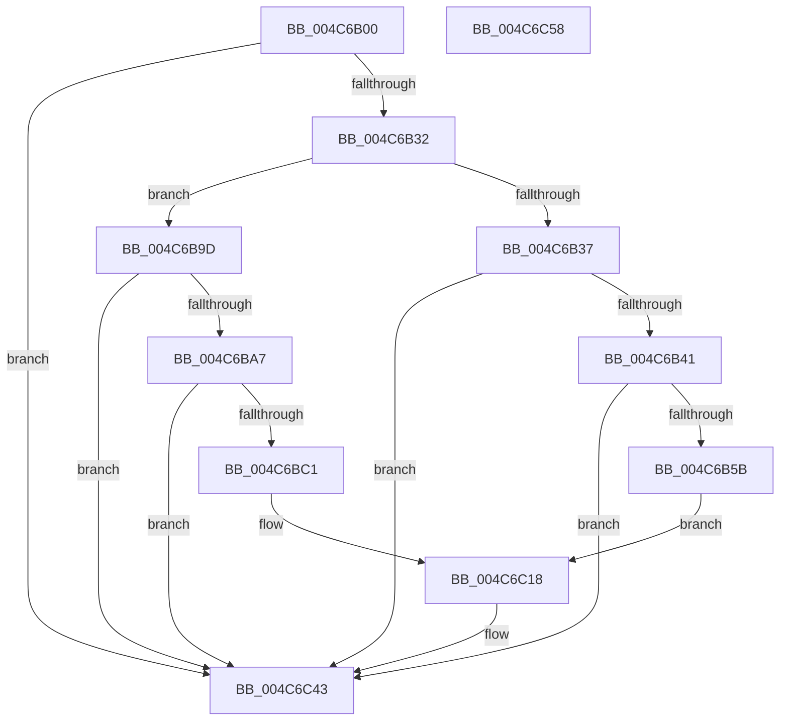

# MmStoreLogConsumedPoison

- RVA: `0x004C6B00`–`0x004C6C59` (길이 `345` bytes)
- VA: `0x00000001404C6B00`
- 실행 섹션: `.text`
- PDB 이름 있음: `예`; PDB Function 태그: `아니요`
- unwind 정보 RVA: `0x000BAEE4`
- 디코드: `77`개 명령, `345/345` bytes 표시
- 미해석 바이트: `0` (있으면 어셈블리에 `.byte`로 보존)

> 이 문서는 커널 이미지의 기계어와 PDB 기호를 분석해 생성했습니다. 4번과 5번은 함수 원형과 자료형을 바이너리 사용 방식에서 추정한 C 해석이며 원본 소스 복구 결과는 아닙니다.

## 1. Dependencies

- 직접 호출 지점: **4**; 고유 호출 대상: **3**
- 직접 호출자로 확인된 함수: **1**
- RIP 상대 이미지 참조: **4**

### Outgoing calls
- `0x004C6B4E` → [tlgKeywordOn](../42/tlgKeywordOn_function_0042EAA0.md) (function, `0x0042EAA0`)
- `0x004C6BB4` → [tlgKeywordOn](../42/tlgKeywordOn_function_0042EAA0.md) (function, `0x0042EAA0`)
- `0x004C6C3E` → [tlgWriteEx_EtwWriteEx](../4A/tlgWriteEx_EtwWriteEx_function_004AA348.md) (function, `0x004AA348`)
- `0x004C6C4A` → [_security_check_cookie](../6A/_security_check_cookie_function_006AC640.md) (function, `0x006AC640`)

### Direct callers
- [SmLogConsumedPoison](SmLogConsumedPoison_function_004C6ADC.md) at `0x004C6AEC`

### Static image references
- `0x004C6B0E` → RVA `0x00E0A740` (`.data`; read)
- `0x004C6B1C` → RVA `0x00E37618` (`.data`; read)
- `0x004C6B7B` → RVA `0x00059EF4` (`.rdata`; read)
- `0x004C6BCD` → RVA `0x00059E8B` (`.rdata`; read)

## 2. Other-region calls and transfers

- 다른 실행 섹션으로 향하는 call: **0**
- 별도 외부 분기/꼬리 이동을 확인하지 못했습니다.

## 3. Assembly (complete function range)

```asm
004C6B00  40 55                           push rbp
004C6B02  48 8D 6C 24 A9                  lea rbp, [rsp - 0x57]
004C6B07  48 81 EC D0 00 00 00            sub rsp, 0xd0
004C6B0E  48 8B 05 2B 3C 94 00            mov rax, qword ptr [rip + 0x943c2b]
004C6B15  48 33 C4                        xor rax, rsp
004C6B18  48 89 45 47                     mov qword ptr [rbp + 0x47], rax
004C6B1C  4C 8B 15 F5 0A 97 00            mov r10, qword ptr [rip + 0x970af5]
004C6B23  44 8B CA                        mov r9d, edx
004C6B26  4C 8B D9                        mov r11, rcx
004C6B29  4D 85 D2                        test r10, r10
004C6B2C  0F 84 11 01 00 00               je 0x1404c6c43
004C6B32  4D 85 C0                        test r8, r8
004C6B35  75 66                           jne 0x1404c6b9d
004C6B37  41 83 3A 05                     cmp dword ptr [r10], 5
004C6B3B  0F 86 02 01 00 00               jbe 0x1404c6c43
004C6B41  48 BA 02 00 00 00 00 40 00 00   movabs rdx, 0x400000000002
004C6B4B  49 8B CA                        mov rcx, r10
004C6B4E  E8 4D 7F F6 FF                  call 0x14042eaa0
004C6B53  84 C0                           test al, al
004C6B55  0F 84 E8 00 00 00               je 0x1404c6c43
004C6B5B  48 8D 45 CF                     lea rax, [rbp - 0x31]
004C6B5F  4C 89 5D CF                     mov qword ptr [rbp - 0x31], r11
004C6B63  48 89 45 07                     mov qword ptr [rbp + 7], rax
004C6B67  41 8D 48 08                     lea ecx, [r8 + 8]
004C6B6B  48 8D 45 C7                     lea rax, [rbp - 0x39]
004C6B6F  48 C7 45 D7 00 00 00 01         mov qword ptr [rbp - 0x29], 0x1000000
004C6B77  48 89 45 17                     mov qword ptr [rbp + 0x17], rax
004C6B7B  48 8D 15 72 33 B9 FF            lea rdx, [rip - 0x46cc8e]
004C6B82  48 8D 45 D7                     lea rax, [rbp - 0x29]
004C6B86  48 89 45 27                     mov qword ptr [rbp + 0x27], rax
004C6B8A  48 8D 45 E7                     lea rax, [rbp - 0x19]
004C6B8E  48 89 44 24 38                  mov qword ptr [rsp + 0x38], rax
004C6B93  C7 44 24 30 05 00 00 00         mov dword ptr [rsp + 0x30], 5
004C6B9B  EB 7B                           jmp 0x1404c6c18
004C6B9D  41 83 3A 05                     cmp dword ptr [r10], 5
004C6BA1  0F 86 9C 00 00 00               jbe 0x1404c6c43
004C6BA7  48 BA 02 00 00 00 00 40 00 00   movabs rdx, 0x400000000002
004C6BB1  49 8B CA                        mov rcx, r10
004C6BB4  E8 E7 7E F6 FF                  call 0x14042eaa0
004C6BB9  84 C0                           test al, al
004C6BBB  0F 84 82 00 00 00               je 0x1404c6c43
004C6BC1  83 65 43 00                     and dword ptr [rbp + 0x43], 0
004C6BC5  48 8D 45 D7                     lea rax, [rbp - 0x29]
004C6BC9  48 89 45 07                     mov qword ptr [rbp + 7], rax
004C6BCD  48 8D 15 B7 32 B9 FF            lea rdx, [rip - 0x46cd49]
004C6BD4  48 8D 45 C7                     lea rax, [rbp - 0x39]
004C6BD8  4C 89 5D D7                     mov qword ptr [rbp - 0x29], r11
004C6BDC  48 89 45 17                     mov qword ptr [rbp + 0x17], rax
004C6BE0  B9 08 00 00 00                  mov ecx, 8
004C6BE5  49 8B 00                        mov rax, qword ptr [r8]
004C6BE8  48 89 45 CF                     mov qword ptr [rbp - 0x31], rax
004C6BEC  48 8D 45 CF                     lea rax, [rbp - 0x31]
004C6BF0  48 89 45 27                     mov qword ptr [rbp + 0x27], rax
004C6BF4  48 8D 45 DF                     lea rax, [rbp - 0x21]
004C6BF8  48 89 45 37                     mov qword ptr [rbp + 0x37], rax
004C6BFC  48 8D 45 E7                     lea rax, [rbp - 0x19]
004C6C00  48 89 44 24 38                  mov qword ptr [rsp + 0x38], rax
004C6C05  C7 44 24 30 06 00 00 00         mov dword ptr [rsp + 0x30], 6
004C6C0D  48 C7 45 DF 00 00 00 01         mov qword ptr [rbp - 0x21], 0x1000000
004C6C15  89 4D 3F                        mov dword ptr [rbp + 0x3f], ecx
004C6C18  83 65 13 00                     and dword ptr [rbp + 0x13], 0
004C6C1C  83 65 23 00                     and dword ptr [rbp + 0x23], 0
004C6C20  83 65 33 00                     and dword ptr [rbp + 0x33], 0
004C6C24  44 89 4D C7                     mov dword ptr [rbp - 0x39], r9d
004C6C28  41 B9 01 00 00 00               mov r9d, 1
004C6C2E  89 4D 0F                        mov dword ptr [rbp + 0xf], ecx
004C6C31  89 4D 2F                        mov dword ptr [rbp + 0x2f], ecx
004C6C34  49 8B CA                        mov rcx, r10
004C6C37  C7 45 1F 04 00 00 00            mov dword ptr [rbp + 0x1f], 4
004C6C3E  E8 05 37 FE FF                  call 0x1404aa348
004C6C43  48 8B 4D 47                     mov rcx, qword ptr [rbp + 0x47]
004C6C47  48 33 CC                        xor rcx, rsp
004C6C4A  E8 F1 59 1E 00                  call 0x1406ac640
004C6C4F  48 81 C4 D0 00 00 00            add rsp, 0xd0
004C6C56  5D                              pop rbp
004C6C57  C3                              ret
004C6C58  CC                              int3
```

## 4. C-style interpretation (structured pseudocode)

```c
__int64 __fastcall MmStoreLogConsumedPoison(__int64 a1, int a2, __int64 a3)
{
    __int64 result;
    __int64 v_rsp;
    unsigned __int64 v_stack_m18;
    unsigned int v_stack_m1C;
    unsigned int v_stack_m20;
    unsigned __int64 v_stack_m28;
    unsigned int v_stack_m2C;
    unsigned int v_stack_m30;
    unsigned __int64 v_stack_m38;
    unsigned int v_stack_m3C;
    unsigned int v_stack_m40;
    unsigned __int64 v_stack_m48;
    unsigned int v_stack_m4C;
    unsigned int v_stack_m50;
    unsigned __int64 v_stack_m58;
    unsigned __int64 v_stack_m5F;
    unsigned __int64 v_stack_m78;
    unsigned __int64 v_stack_m80;
    unsigned __int64 v_stack_m88;
    unsigned __int64 v_stack_m90;
    unsigned __int64 v_stack_m98;
    unsigned __int64 v_stack_mA0;
    unsigned int v_stack_mA8;

    v_rsp = (v_rsp) - (208);
    result = (*(unsigned __int64 *)(v_rip + 9714731)) ^ (v_rsp);
    v_stack_m18 = result;
    if (*(unsigned __int64 *)(v_rip + 9898741) == 0) goto loc_004C6C43;
    if (a3 != 0) goto loc_004C6B9D;
    if ((*(unsigned int *)(*(unsigned __int64 *)(v_rip + 9898741))) <= 5) goto loc_004C6C43;
    result = tlgKeywordOn(*(unsigned __int64 *)(v_rip + 9898741), a2, a3, (unsigned int)(a2));
    if ((unsigned __int8)(result) == 0) goto loc_004C6C43;
    v_stack_m90 = a1;
    v_stack_m58 = v_stack_m90;
    v_stack_m88 = 0x1000000ULL;
    v_stack_m48 = v_stack_m98;
    v_stack_m38 = v_stack_m88;
    v_stack_mA0 = v_stack_m78;
    v_stack_mA8 = 5;
    goto loc_004C6C18;
loc_004C6B9D:
    if ((*(unsigned int *)(*(unsigned __int64 *)(v_rip + 9898741))) <= 5) goto loc_004C6C43;
    result = tlgKeywordOn(*(unsigned __int64 *)(v_rip + 9898741), v_rip - 4639886, a3, (unsigned int)(a2));
    if ((unsigned __int8)(result) == 0) goto loc_004C6C43;
    v_stack_m58 = v_stack_m88;
    v_stack_m88 = a1;
    v_stack_m48 = v_stack_m98;
    v_stack_m90 = *(unsigned __int64 *)(a3);
    v_stack_m38 = v_stack_m90;
    v_stack_m28 = v_stack_m80;
    v_stack_mA0 = v_stack_m78;
    v_stack_mA8 = 6;
    v_stack_m80 = 0x1000000ULL;
    v_stack_m20 = 8;
loc_004C6C18:
    v_stack_m98 = (unsigned int)((unsigned int)(a2));
    v_stack_m50 = 8;
    v_stack_m30 = 8;
    v_stack_m40 = 4;
    result = tlgWriteEx_EtwWriteEx(*(unsigned __int64 *)(v_rip + 9898741), v_rip - 4640073, a3, 1);
loc_004C6C43:
    a1 = (v_stack_m18) ^ (v_rsp);
    result = _security_check_cookie(a1, v_rip - 4640073, a3, 1);
    v_rsp = (v_rsp) + (208);
    return result;
}
```

## 5. (Beta) C Style

```c
int64_t MmStoreLogConsumedPoison(int64_t Arg1, int32_t Arg2, int64_t Arg3)
{
    int64_t result;
    int64_t local_rsp;
    uint64_t v_stack_m18;
    uint32_t v_stack_m1C;
    uint32_t v_stack_m20;
    uint64_t v_stack_m28;
    uint32_t v_stack_m2C;
    uint32_t v_stack_m30;
    uint64_t v_stack_m38;
    uint32_t v_stack_m3C;
    uint32_t v_stack_m40;
    uint64_t v_stack_m48;
    uint32_t v_stack_m4C;
    uint32_t v_stack_m50;
    uint64_t v_stack_m58;
    uint64_t v_stack_m5F;
    uint64_t v_stack_m78;
    uint64_t v_stack_m80;
    uint64_t v_stack_m88;
    uint64_t v_stack_m90;
    uint64_t v_stack_m98;
    uint64_t v_stack_mA0;
    uint32_t v_stack_mA8;

    local_rsp = (local_rsp) - (208);
    result = (*(uint64_t *)(v_rip + 0x943C2B)) ^ (local_rsp);
    v_stack_m18 = result;
    if (*(uint64_t *)(v_rip + 0x970AF5) == 0) goto loc_004C6C43;
    if (Arg3 != 0) goto loc_004C6B9D;
    if ((*(uint32_t *)(*(uint64_t *)(v_rip + 0x970AF5))) <= 5) goto loc_004C6C43;
    result = tlgKeywordOn(*(uint64_t *)(v_rip + 0x970AF5), Arg2, Arg3, (uint32_t)(Arg2));
    if ((uint8_t)(result) == 0) goto loc_004C6C43;
    v_stack_m90 = Arg1;
    v_stack_m58 = v_stack_m90;
    v_stack_m88 = 0x1000000ULL;
    v_stack_m48 = v_stack_m98;
    v_stack_m38 = v_stack_m88;
    v_stack_mA0 = v_stack_m78;
    v_stack_mA8 = 5;
    goto loc_004C6C18;
loc_004C6B9D:
    if ((*(uint32_t *)(*(uint64_t *)(v_rip + 0x970AF5))) <= 5) goto loc_004C6C43;
    result = tlgKeywordOn(*(uint64_t *)(v_rip + 0x970AF5), v_rip - 4639886, Arg3, (uint32_t)(Arg2));
    if ((uint8_t)(result) == 0) goto loc_004C6C43;
    v_stack_m58 = v_stack_m88;
    v_stack_m88 = Arg1;
    v_stack_m48 = v_stack_m98;
    v_stack_m90 = *(uint64_t *)(Arg3);
    v_stack_m38 = v_stack_m90;
    v_stack_m28 = v_stack_m80;
    v_stack_mA0 = v_stack_m78;
    v_stack_mA8 = 6;
    v_stack_m80 = 0x1000000ULL;
    v_stack_m20 = 8;
loc_004C6C18:
    v_stack_m98 = (uint32_t)((uint32_t)(Arg2));
    v_stack_m50 = 8;
    v_stack_m30 = 8;
    v_stack_m40 = 4;
    result = tlgWriteEx_EtwWriteEx(*(uint64_t *)(v_rip + 0x970AF5), v_rip - 4640073, Arg3, 1);
loc_004C6C43:
    Arg1 = (v_stack_m18) ^ (local_rsp);
    result = _security_check_cookie(Arg1, v_rip - 4640073, Arg3, 1);
    local_rsp = (local_rsp) + (208);
    return result;
}
```

## 6. Execution-region graph

[열기: 2D/3D 그래프와 함수 탐색 컨트롤 패널](../../../control-panel.html?section=text&rva=0x004C6B00&view=graph)

- 2D 그래프는 위에서 아래로 흐르고, 3D 그래프는 빈 공간을 드래그해 회전합니다. Shift+드래그는 이동, 휠은 확대·축소, 함수 노드 선택은 대상 보고서 이동입니다.

### Static fallback


