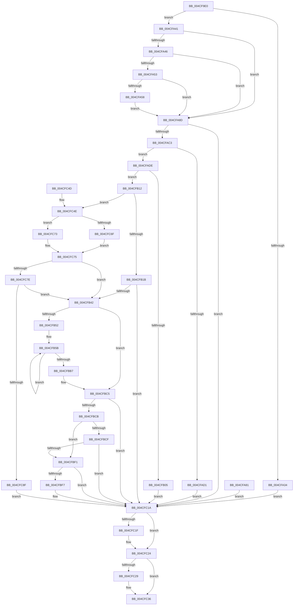

# NtSubmitIoRing

- RVA: `0x004CF9E0`–`0x004CFC99` (길이 `697` bytes)
- VA: `0x00000001404CF9E0`
- 실행 섹션: `.text`
- PDB 이름 있음: `예`; PDB Function 태그: `아니요`
- unwind 정보 RVA: `0x000BDAE4`
- 디코드: `183`개 명령, `697/697` bytes 표시
- 미해석 바이트: `0` (있으면 어셈블리에 `.byte`로 보존)

> 이 문서는 커널 이미지의 기계어와 PDB 기호를 분석해 생성했습니다. 4번과 5번은 함수 원형과 자료형을 바이너리 사용 방식에서 추정한 C 해석이며 원본 소스 복구 결과는 아닙니다.

## 1. Dependencies

- 직접 호출 지점: **7**; 고유 호출 대상: **6**
- 직접 호출자로 확인된 함수: **0**
- RIP 상대 이미지 참조: **1**

### Outgoing calls
- `0x004CFAAD` → [ObReferenceObjectByHandle](../../page/86/ObReferenceObjectByHandle_function_00868DB0.md) (function, `0x00868DB0`)
- `0x004CFB31` → [IopIoRingSetupCompletionWait](IopIoRingSetupCompletionWait_function_004CFCA0.md) (function, `0x004CFCA0`)
- `0x004CFBAD` → [IopProcessIoRingEntry](../../page/70/IopProcessIoRingEntry_function_00700A38.md) (function, `0x00700A38`)
- `0x004CFBE4` → [IopIoRingSetupCompletionWait](IopIoRingSetupCompletionWait_function_004CFCA0.md) (function, `0x004CFCA0`)
- `0x004CFC11` → [IopIoRingWaitForCompletionEvent](../59/IopIoRingWaitForCompletionEvent_function_0059890C.md) (function, `0x0059890C`)
- `0x004CFC31` → [ObfDereferenceObjectWithTag](../2F/ObfDereferenceObjectWithTag_function_002F78E0.md) (function, `0x002F78E0`)
- `0x004CFC81` → [IopIoRingGetAvailableCqSlots](../59/IopIoRingGetAvailableCqSlots_function_00598810.md) (function, `0x00598810`)

### Direct callers
- 이 함수 시작 RVA로 연결되는 직접 call은 확인되지 않았습니다. 간접 호출은 완전히 역산할 수 없습니다.

### Static image references
- `0x004CFA8D` → RVA `0x00FC7078` (`ALMOSTRO`; read)

## 2. Other-region calls and transfers

- 다른 실행 섹션으로 향하는 call: **2**
  - `0x004CFAAD` → [ObReferenceObjectByHandle](../../page/86/ObReferenceObjectByHandle_function_00868DB0.md) (`.text` → `PAGE`)
  - `0x004CFBAD` → [IopProcessIoRingEntry](../../page/70/IopProcessIoRingEntry_function_00700A38.md) (`.text` → `PAGE`)
- 별도 외부 분기/꼬리 이동을 확인하지 못했습니다.

## 3. Assembly (complete function range)

```asm
004CF9E0  4C 89 4C 24 20                  mov qword ptr [rsp + 0x20], r9
004CF9E5  44 89 44 24 18                  mov dword ptr [rsp + 0x18], r8d
004CF9EA  89 54 24 10                     mov dword ptr [rsp + 0x10], edx
004CF9EE  53                              push rbx
004CF9EF  56                              push rsi
004CF9F0  57                              push rdi
004CF9F1  41 54                           push r12
004CF9F3  41 55                           push r13
004CF9F5  41 56                           push r14
004CF9F7  41 57                           push r15
004CF9F9  48 81 EC A0 00 00 00            sub rsp, 0xa0
004CFA00  45 8B E8                        mov r13d, r8d
004CFA03  4C 8B D1                        mov r10, rcx
004CFA06  33 DB                           xor ebx, ebx
004CFA08  89 5C 24 34                     mov dword ptr [rsp + 0x34], ebx
004CFA0C  65 48 8B 04 25 88 01 00 00      mov rax, qword ptr gs:[0x188]
004CFA15  44 8A 88 32 02 00 00            mov r9b, byte ptr [rax + 0x232]
004CFA1C  44 88 4C 24 39                  mov byte ptr [rsp + 0x39], r9b
004CFA21  8B FB                           mov edi, ebx
004CFA23  44 8A E3                        mov r12b, bl
004CFA26  48 89 5C 24 50                  mov qword ptr [rsp + 0x50], rbx
004CFA2B  88 5C 24 30                     mov byte ptr [rsp + 0x30], bl
004CFA2F  66 85 D2                        test dx, dx
004CFA32  74 0D                           je 0x1404cfa41
004CFA34  C7 44 24 34 01 00 46 C0         mov dword ptr [rsp + 0x34], 0xc0460001
004CFA3C  E9 D9 01 00 00                  jmp 0x1404cfc1a
004CFA41  45 85 ED                        test r13d, r13d
004CFA44  74 47                           je 0x1404cfa8d
004CFA46  48 8B 8C 24 F8 00 00 00         mov rcx, qword ptr [rsp + 0xf8]
004CFA4E  48 85 C9                        test rcx, rcx
004CFA51  74 3A                           je 0x1404cfa8d
004CFA53  45 84 C9                        test r9b, r9b
004CFA56  74 35                           je 0x1404cfa8d
004CFA58  48 B8 00 00 FF FF FF 7F 00 00   movabs rax, 0x7fffffff0000
004CFA62  48 3B C8                        cmp rcx, rax
004CFA65  48 0F 42 C1                     cmovb rax, rcx
004CFA69  90                              nop
004CFA6A  48 8B 00                        mov rax, qword ptr [rax]
004CFA6D  48 89 44 24 50                  mov qword ptr [rsp + 0x50], rax
004CFA72  48 8D 44 24 50                  lea rax, [rsp + 0x50]
004CFA77  48 89 84 24 F8 00 00 00         mov qword ptr [rsp + 0xf8], rax
004CFA7F  EB 0C                           jmp 0x1404cfa8d
004CFA81  33 DB                           xor ebx, ebx
004CFA83  8B FB                           mov edi, ebx
004CFA85  44 8A E3                        mov r12b, bl
004CFA88  E9 8D 01 00 00                  jmp 0x1404cfc1a
004CFA8D  4C 8B 05 E4 75 AF 00            mov r8, qword ptr [rip + 0xaf75e4]
004CFA94  48 89 5C 24 40                  mov qword ptr [rsp + 0x40], rbx
004CFA99  48 89 5C 24 28                  mov qword ptr [rsp + 0x28], rbx
004CFA9E  48 8D 44 24 40                  lea rax, [rsp + 0x40]
004CFAA3  48 89 44 24 20                  mov qword ptr [rsp + 0x20], rax
004CFAA8  33 D2                           xor edx, edx
004CFAAA  49 8B CA                        mov rcx, r10
004CFAAD  E8 FE 92 39 00                  call 0x140868db0
004CFAB2  48 8B 7C 24 40                  mov rdi, qword ptr [rsp + 0x40]
004CFAB7  89 44 24 34                     mov dword ptr [rsp + 0x34], eax
004CFABB  85 C0                           test eax, eax
004CFABD  0F 88 57 01 00 00               js 0x1404cfc1a
004CFAC3  B9 01 00 00 00                  mov ecx, 1
004CFAC8  33 C0                           xor eax, eax
004CFACA  F0 0F B1 4F 60                  lock cmpxchg dword ptr [rdi + 0x60], ecx
004CFACF  74 0D                           je 0x1404cfade
004CFAD1  C7 44 24 34 06 00 46 C0         mov dword ptr [rsp + 0x34], 0xc0460006
004CFAD9  E9 3C 01 00 00                  jmp 0x1404cfc1a
004CFADE  44 8A E1                        mov r12b, cl
004CFAE1  4C 8B 7F 40                     mov r15, qword ptr [rdi + 0x40]
004CFAE5  8B 47 18                        mov eax, dword ptr [rdi + 0x18]
004CFAE8  89 44 24 48                     mov dword ptr [rsp + 0x48], eax
004CFAEC  41 8B 47 04                     mov eax, dword ptr [r15 + 4]
004CFAF0  89 44 24 3C                     mov dword ptr [rsp + 0x3c], eax
004CFAF4  44 8B F0                        mov r14d, eax
004CFAF7  45 2B 37                        sub r14d, dword ptr [r15]
004CFAFA  48 8B 74 24 40                  mov rsi, qword ptr [rsp + 0x40]
004CFAFF  44 3B 76 14                     cmp r14d, dword ptr [rsi + 0x14]
004CFB03  76 0D                           jbe 0x1404cfb12
004CFB05  C7 44 24 34 07 00 46 C0         mov dword ptr [rsp + 0x34], 0xc0460007
004CFB0D  E9 08 01 00 00                  jmp 0x1404cfc1a
004CFB12  45 85 ED                        test r13d, r13d
004CFB15  0F 84 33 01 00 00               je 0x1404cfc4e
004CFB1B  48 8D 44 24 30                  lea rax, [rsp + 0x30]
004CFB20  48 89 44 24 20                  mov qword ptr [rsp + 0x20], rax
004CFB25  45 33 C9                        xor r9d, r9d
004CFB28  45 8B C5                        mov r8d, r13d
004CFB2B  41 8B D6                        mov edx, r14d
004CFB2E  48 8B CE                        mov rcx, rsi
004CFB31  E8 6A 01 00 00                  call 0x1404cfca0
004CFB36  89 44 24 34                     mov dword ptr [rsp + 0x34], eax
004CFB3A  85 C0                           test eax, eax
004CFB3C  0F 88 D8 00 00 00               js 0x1404cfc1a
004CFB42  45 8B 37                        mov r14d, dword ptr [r15]
004CFB45  8A C3                           mov al, bl
004CFB47  88 5C 24 31                     mov byte ptr [rsp + 0x31], bl
004CFB4B  44 3B 74 24 3C                  cmp r14d, dword ptr [rsp + 0x3c]
004CFB50  74 73                           je 0x1404cfbc5
004CFB52  44 8B 6C 24 3C                  mov r13d, dword ptr [rsp + 0x3c]
004CFB57  8B 5C 24 48                     mov ebx, dword ptr [rsp + 0x48]
004CFB5B  48 8B CB                        mov rcx, rbx
004CFB5E  41 8B C6                        mov eax, r14d
004CFB61  48 23 C8                        and rcx, rax
004CFB64  48 C1 E1 06                     shl rcx, 6
004CFB68  42 0F 10 44 39 10               movups xmm0, xmmword ptr [rcx + r15 + 0x10]
004CFB6E  0F 29 44 24 60                  movaps xmmword ptr [rsp + 0x60], xmm0
004CFB73  42 0F 10 4C 39 20               movups xmm1, xmmword ptr [rcx + r15 + 0x20]
004CFB79  0F 29 4C 24 70                  movaps xmmword ptr [rsp + 0x70], xmm1
004CFB7E  42 0F 10 44 39 30               movups xmm0, xmmword ptr [rcx + r15 + 0x30]
004CFB84  0F 29 84 24 80 00 00 00         movaps xmmword ptr [rsp + 0x80], xmm0
004CFB8C  42 0F 10 4C 39 40               movups xmm1, xmmword ptr [rcx + r15 + 0x40]
004CFB92  0F 29 8C 24 90 00 00 00         movaps xmmword ptr [rsp + 0x90], xmm1
004CFB9A  41 FF C6                        inc r14d
004CFB9D  45 89 37                        mov dword ptr [r15], r14d
004CFBA0  4C 8D 44 24 31                  lea r8, [rsp + 0x31]
004CFBA5  48 8D 54 24 60                  lea rdx, [rsp + 0x60]
004CFBAA  48 8B CE                        mov rcx, rsi
004CFBAD  E8 86 0E 23 00                  call 0x140700a38
004CFBB2  45 3B F5                        cmp r14d, r13d
004CFBB5  75 A4                           jne 0x1404cfb5b
004CFBB7  8A 44 24 31                     mov al, byte ptr [rsp + 0x31]
004CFBBB  33 DB                           xor ebx, ebx
004CFBBD  44 8B AC 24 F0 00 00 00         mov r13d, dword ptr [rsp + 0xf0]
004CFBC5  38 5C 24 30                     cmp byte ptr [rsp + 0x30], bl
004CFBC9  74 4F                           je 0x1404cfc1a
004CFBCB  84 C0                           test al, al
004CFBCD  74 22                           je 0x1404cfbf1
004CFBCF  48 8D 44 24 30                  lea rax, [rsp + 0x30]
004CFBD4  48 89 44 24 20                  mov qword ptr [rsp + 0x20], rax
004CFBD9  45 8A CC                        mov r9b, r12b
004CFBDC  45 8B C5                        mov r8d, r13d
004CFBDF  33 D2                           xor edx, edx
004CFBE1  48 8B CE                        mov rcx, rsi
004CFBE4  E8 B7 00 00 00                  call 0x1404cfca0
004CFBE9  89 44 24 34                     mov dword ptr [rsp + 0x34], eax
004CFBED  85 C0                           test eax, eax
004CFBEF  78 29                           js 0x1404cfc1a
004CFBF1  38 5C 24 30                     cmp byte ptr [rsp + 0x30], bl
004CFBF5  74 23                           je 0x1404cfc1a
004CFBF7  44 8B 84 24 E8 00 00 00         mov r8d, dword ptr [rsp + 0xe8]
004CFBFF  45 22 C4                        and r8b, r12b
004CFC02  4C 8B 8C 24 F8 00 00 00         mov r9, qword ptr [rsp + 0xf8]
004CFC0A  8A 54 24 39                     mov dl, byte ptr [rsp + 0x39]
004CFC0E  48 8B CE                        mov rcx, rsi
004CFC11  E8 F6 8C 0C 00                  call 0x14059890c
004CFC16  89 44 24 34                     mov dword ptr [rsp + 0x34], eax
004CFC1A  45 84 E4                        test r12b, r12b
004CFC1D  74 05                           je 0x1404cfc24
004CFC1F  8B C3                           mov eax, ebx
004CFC21  87 47 60                        xchg dword ptr [rdi + 0x60], eax
004CFC24  48 85 FF                        test rdi, rdi
004CFC27  74 0D                           je 0x1404cfc36
004CFC29  BA 44 66 6C 74                  mov edx, 0x746c6644
004CFC2E  48 8B CF                        mov rcx, rdi
004CFC31  E8 AA 7C E2 FF                  call 0x1402f78e0
004CFC36  8B 44 24 34                     mov eax, dword ptr [rsp + 0x34]
004CFC3A  48 81 C4 A0 00 00 00            add rsp, 0xa0
004CFC41  41 5F                           pop r15
004CFC43  41 5E                           pop r14
004CFC45  41 5D                           pop r13
004CFC47  41 5C                           pop r12
004CFC49  5F                              pop rdi
004CFC4A  5E                              pop rsi
004CFC4B  5B                              pop rbx
004CFC4C  C3                              ret
004CFC4D  CC                              int3
004CFC4E  4C 8B 46 78                     mov r8, qword ptr [rsi + 0x78]
004CFC52  48 8B 74 24 40                  mov rsi, qword ptr [rsp + 0x40]
004CFC57  48 8B 46 50                     mov rax, qword ptr [rsi + 0x50]
004CFC5B  8B 48 04                        mov ecx, dword ptr [rax + 4]
004CFC5E  2B 08                           sub ecx, dword ptr [rax]
004CFC60  48 03 4E 70                     add rcx, qword ptr [rsi + 0x70]
004CFC64  49 2B C8                        sub rcx, r8
004CFC67  8B 46 1C                        mov eax, dword ptr [rsi + 0x1c]
004CFC6A  48 3B C8                        cmp rcx, rax
004CFC6D  72 04                           jb 0x1404cfc73
004CFC6F  8B C3                           mov eax, ebx
004CFC71  EB 02                           jmp 0x1404cfc75
004CFC73  2B C1                           sub eax, ecx
004CFC75  44 3B F0                        cmp r14d, eax
004CFC78  0F 86 C4 FE FF FF               jbe 0x1404cfb42
004CFC7E  48 8B CE                        mov rcx, rsi
004CFC81  E8 8A 8B 0C 00                  call 0x140598810
004CFC86  44 3B F0                        cmp r14d, eax
004CFC89  0F 86 B3 FE FF FF               jbe 0x1404cfb42
004CFC8F  C7 44 24 34 08 00 46 C0         mov dword ptr [rsp + 0x34], 0xc0460008
004CFC97  EB 81                           jmp 0x1404cfc1a
```

## 4. C-style interpretation (structured pseudocode)

```c
__int64 __fastcall NtSubmitIoRing(__int64 a1, int a2, int a3, __int64 a4)
{
    __int64 result;
    __int64 v_r14;
    __int64 v_rbx;
    __int64 v_rsp;
    unsigned __int64 v_stack_m48;
    unsigned __int64 v_stack_m58;
    unsigned __int64 v_stack_m68;
    unsigned __int64 v_stack_m78;
    unsigned __int64 v_stack_m88;
    unsigned int v_stack_m90;
    unsigned __int64 v_stack_m98;
    unsigned int v_stack_m9C;
    unsigned __int8 v_stack_m9F;
    unsigned int v_stack_mA4;
    unsigned __int8 v_stack_mA7;
    unsigned __int8 v_stack_mA8;
    unsigned __int64 v_stack_mB0;
    unsigned __int64 v_stack_mB8;
    unsigned int v_stack_p10;
    unsigned int v_stack_p18;
    unsigned __int64 v_stack_p20;
    unsigned int v_stack_p34;
    unsigned __int64 v_stack_p40;

    v_stack_p20 = a4;
    v_stack_p18 = a3;
    v_stack_p10 = a2;
    v_rsp = (v_rsp) - (160);
    v_rbx = 0;
    v_stack_mA4 = 0;
    v_stack_m9F = (unsigned __int8)(*(unsigned __int8 *)(*(unsigned __int64 *)(gs_base + (0 + 392)) + 562));
    v_stack_m88 = 0;
    v_stack_mA8 = 0;
    if ((unsigned __int16)(a2) == 0) goto loc_004CFA41;
    v_stack_mA4 = 0xC0460001ULL;
    goto loc_004CFC1A;
loc_004CFA41:
    if ((unsigned int)((unsigned int)(a3)) == 0) goto loc_004CFA8D;
    if (v_stack_p20 == 0) goto loc_004CFA8D;
    if ((unsigned __int8)(*(unsigned __int8 *)(*(unsigned __int64 *)(gs_base + (0 + 392)) + 562)) == 0) goto loc_004CFA8D;
    result = *(unsigned __int64 *)(gs_base + (0 + 392));
    if (v_stack_p20 < (*(unsigned __int64 *)(gs_base + (0 + 392)))) { result = v_stack_p20; }
    v_stack_m88 = *(unsigned __int64 *)(result);
    v_stack_p20 = v_stack_m88;
    goto loc_004CFA8D;
loc_004CFA8D:
    v_stack_m98 = 0;
    v_stack_mB0 = 0;
    v_stack_mB8 = v_stack_m98;
    a2 = 0;
    result = ObReferenceObjectByHandle(a1, a2, *(unsigned __int64 *)(v_rip + 11498980), *(unsigned __int8 *)(*(unsigned __int64 *)(gs_base + (0 + 392)) + 562));
    v_stack_mA4 = (unsigned int)(result);
    if (sign_flag) goto loc_004CFC1A;
    result = 0;
    if (condition_is_equal) goto loc_004CFADE;
    v_stack_mA4 = 0xC0460006ULL;
    goto loc_004CFC1A;
loc_004CFADE:
    v_stack_m90 = (unsigned int)((unsigned int)(*(unsigned int *)(v_stack_m98 + 24)));
    v_stack_m9C = (unsigned int)((unsigned int)(*(unsigned int *)(*(unsigned __int64 *)(v_stack_m98 + 64) + 4)));
    v_r14 = (unsigned int)(((unsigned int)((unsigned int)((unsigned int)(*(unsigned int *)(*(unsigned __int64 *)(v_stack_m98 + 64) + 4))))) - (*(unsigned int *)(*(unsigned __int64 *)(v_stack_m98 + 64))));
    if (((unsigned int)(v_r14)) <= (*(unsigned int *)(v_stack_m98 + 20))) goto loc_004CFB12;
    v_stack_mA4 = 0xC0460007ULL;
    goto loc_004CFC1A;
loc_004CFB12:
    if ((unsigned int)((unsigned int)(a3)) == 0) goto loc_004CFC4E;
    v_stack_mB8 = v_stack_mA8;
    a4 = 0;
    result = IopIoRingSetupCompletionWait(v_stack_m98, (unsigned int)((unsigned int)(v_r14)), (unsigned int)((unsigned int)((unsigned int)(a3))), a4);
    v_stack_mA4 = (unsigned int)(result);
    if (sign_flag) goto loc_004CFC1A;
loc_004CFB42:
    v_stack_mA7 = 0;
    if (((unsigned int)((unsigned int)(*(unsigned int *)(*(unsigned __int64 *)(v_stack_m98 + 64))))) == v_stack_m9C) goto loc_004CFBC5;
loc_004CFB5B:
    a1 = ((unsigned int)(v_stack_m90)) & ((unsigned int)((unsigned int)((unsigned int)(*(unsigned int *)(*(unsigned __int64 *)(v_stack_m98 + 64))))));
    a1 = (a1) << (6);
    v_stack_m78 = v_xmm0;
    v_stack_m68 = v_xmm1;
    v_stack_m58 = v_xmm0;
    v_stack_m48 = v_xmm1;
    v_r14 = (unsigned int)(((unsigned int)(*(unsigned int *)(*(unsigned __int64 *)(v_stack_m98 + 64)))) + 1);
    *(unsigned int *)(*(unsigned __int64 *)(v_stack_m98 + 64)) = (unsigned int)(v_r14);
    result = IopProcessIoRingEntry(v_stack_m98, v_stack_m78, v_stack_mA7, a4);
    if (((unsigned int)(v_r14)) != ((unsigned int)((unsigned int)(v_stack_m9C)))) goto loc_004CFB5B;
    v_rbx = 0;
loc_004CFBC5:
    if (v_stack_mA8 == 0) goto loc_004CFC1A;
    if ((unsigned __int8)(v_stack_mA7) == 0) goto loc_004CFBF1;
    v_stack_mB8 = v_stack_mA8;
    a2 = 0;
    result = IopIoRingSetupCompletionWait(v_stack_m98, a2, (unsigned int)((unsigned int)((unsigned int)(v_stack_p18))), 1);
    v_stack_mA4 = (unsigned int)(result);
    if (sign_flag) goto loc_004CFC1A;
loc_004CFBF1:
    if (v_stack_mA8 != 0) {
        a3 = v_stack_p10;
        a3 = (unsigned __int8)((a3) & (1));
        a4 = v_stack_p20;
        a2 = v_stack_m9F;
        a1 = v_stack_m98;
        result = IopIoRingWaitForCompletionEvent(a1, a2, a3, a4);
        v_stack_mA4 = (unsigned int)(result);
    }
    if (1 != 0) {
        result = 0;
    }
    if (v_stack_m98 != 0) {
        a2 = 0x746C6644ULL;
        a1 = v_stack_m98;
        result = ObfDereferenceObjectWithTag(a1, a2, a3, a4);
    }
    v_rsp = (v_rsp) + (160);
    return (unsigned int)(v_stack_mA4);
loc_004CFC4E:
    a1 = (unsigned int)(((unsigned int)(*(unsigned int *)(*(unsigned __int64 *)(v_stack_p40 + 80) + 4))) - (*(unsigned int *)(*(unsigned __int64 *)(v_stack_p40 + 80))));
    a1 = (a1) + (*(unsigned __int64 *)(v_stack_p40 + 112));
    a1 = (a1) - (*(unsigned __int64 *)(v_stack_m98 + 120));
    if (a1 < ((unsigned int)(*(unsigned int *)(v_stack_p40 + 28)))) goto loc_004CFC73;
    goto loc_004CFC75;
loc_004CFC73:
    result = (unsigned int)((0) - ((unsigned int)(a1)));
loc_004CFC75:
    if (((unsigned int)(v_r14)) <= ((unsigned int)(result))) goto loc_004CFB42;
    result = IopIoRingGetAvailableCqSlots(v_stack_p40, a2, *(unsigned __int64 *)(v_stack_m98 + 120), a4);
    if (((unsigned int)(v_r14)) <= ((unsigned int)(result))) goto loc_004CFB42;
    v_stack_p34 = 0xC0460008ULL;
    goto loc_004CFC1A;
}
```

## 5. (Beta) C Style

```c
int64_t NtSubmitIoRing(int64_t Arg1, int32_t Arg2, int32_t Arg3, int64_t Arg4)
{
    int64_t result;
    int64_t local_r14;
    int64_t local_rbx;
    int64_t local_rsp;
    uint64_t v_stack_m48;
    uint64_t v_stack_m58;
    uint64_t v_stack_m68;
    uint64_t v_stack_m78;
    uint64_t v_stack_m88;
    uint32_t v_stack_m90;
    uint64_t v_stack_m98;
    uint32_t v_stack_m9C;
    uint8_t v_stack_m9F;
    uint32_t v_stack_mA4;
    uint8_t v_stack_mA7;
    uint8_t v_stack_mA8;
    uint64_t v_stack_mB0;
    uint64_t v_stack_mB8;
    uint32_t v_stack_p10;
    uint32_t v_stack_p18;
    uint64_t v_stack_p20;
    uint32_t v_stack_p34;
    uint64_t v_stack_p40;

    v_stack_p20 = Arg4;
    v_stack_p18 = Arg3;
    v_stack_p10 = Arg2;
    local_rsp = (local_rsp) - (160);
    local_rbx = 0;
    v_stack_mA4 = 0;
    v_stack_m9F = (uint8_t)(*(uint8_t *)(*(uint64_t *)(gs_base + (0 + 0x188)) + 0x232));
    v_stack_m88 = 0;
    v_stack_mA8 = 0;
    if ((uint16_t)(Arg2) == 0) goto loc_004CFA41;
    v_stack_mA4 = 0xC0460001ULL;
    goto loc_004CFC1A;
loc_004CFA41:
    if ((uint32_t)((uint32_t)(Arg3)) == 0) goto loc_004CFA8D;
    if (v_stack_p20 == 0) goto loc_004CFA8D;
    if ((uint8_t)(*(uint8_t *)(*(uint64_t *)(gs_base + (0 + 0x188)) + 0x232)) == 0) goto loc_004CFA8D;
    result = *(uint64_t *)(gs_base + (0 + 0x188));
    if (v_stack_p20 < (*(uint64_t *)(gs_base + (0 + 0x188)))) { result = v_stack_p20; }
    v_stack_m88 = *(uint64_t *)(result);
    v_stack_p20 = v_stack_m88;
    goto loc_004CFA8D;
loc_004CFA8D:
    v_stack_m98 = 0;
    v_stack_mB0 = 0;
    v_stack_mB8 = v_stack_m98;
    Arg2 = 0;
    result = ObReferenceObjectByHandle(Arg1, Arg2, *(uint64_t *)(v_rip + 0xAF75E4), *(uint8_t *)(*(uint64_t *)(gs_base + (0 + 0x188)) + 0x232));
    v_stack_mA4 = (uint32_t)(result);
    if (sign_flag) goto loc_004CFC1A;
    result = 0;
    if (condition_is_equal) goto loc_004CFADE;
    v_stack_mA4 = 0xC0460006ULL;
    goto loc_004CFC1A;
loc_004CFADE:
    v_stack_m90 = (uint32_t)((uint32_t)(*(uint32_t *)(v_stack_m98 + 0x18)));
    v_stack_m9C = (uint32_t)((uint32_t)(*(uint32_t *)(*(uint64_t *)(v_stack_m98 + 0x40) + 0x4)));
    local_r14 = (uint32_t)(((uint32_t)((uint32_t)((uint32_t)(*(uint32_t *)(*(uint64_t *)(v_stack_m98 + 0x40) + 0x4))))) - (*(uint32_t *)(*(uint64_t *)(v_stack_m98 + 0x40))));
    if (((uint32_t)(local_r14)) <= (*(uint32_t *)(v_stack_m98 + 0x14))) goto loc_004CFB12;
    v_stack_mA4 = 0xC0460007ULL;
    goto loc_004CFC1A;
loc_004CFB12:
    if ((uint32_t)((uint32_t)(Arg3)) == 0) goto loc_004CFC4E;
    v_stack_mB8 = v_stack_mA8;
    Arg4 = 0;
    result = IopIoRingSetupCompletionWait(v_stack_m98, (uint32_t)((uint32_t)(local_r14)), (uint32_t)((uint32_t)((uint32_t)(Arg3))), Arg4);
    v_stack_mA4 = (uint32_t)(result);
    if (sign_flag) goto loc_004CFC1A;
loc_004CFB42:
    v_stack_mA7 = 0;
    if (((uint32_t)((uint32_t)(*(uint32_t *)(*(uint64_t *)(v_stack_m98 + 0x40))))) == v_stack_m9C) goto loc_004CFBC5;
loc_004CFB5B:
    Arg1 = ((uint32_t)(v_stack_m90)) & ((uint32_t)((uint32_t)((uint32_t)(*(uint32_t *)(*(uint64_t *)(v_stack_m98 + 0x40))))));
    Arg1 = (Arg1) << (6);
    v_stack_m78 = v_xmm0;
    v_stack_m68 = v_xmm1;
    v_stack_m58 = v_xmm0;
    v_stack_m48 = v_xmm1;
    local_r14 = (uint32_t)(((uint32_t)(*(uint32_t *)(*(uint64_t *)(v_stack_m98 + 0x40)))) + 1);
    *(uint32_t *)(*(uint64_t *)(v_stack_m98 + 0x40)) = (uint32_t)(local_r14);
    result = IopProcessIoRingEntry(v_stack_m98, v_stack_m78, v_stack_mA7, Arg4);
    if (((uint32_t)(local_r14)) != ((uint32_t)((uint32_t)(v_stack_m9C)))) goto loc_004CFB5B;
    local_rbx = 0;
loc_004CFBC5:
    if (v_stack_mA8 == 0) goto loc_004CFC1A;
    if ((uint8_t)(v_stack_mA7) == 0) goto loc_004CFBF1;
    v_stack_mB8 = v_stack_mA8;
    Arg2 = 0;
    result = IopIoRingSetupCompletionWait(v_stack_m98, Arg2, (uint32_t)((uint32_t)((uint32_t)(v_stack_p18))), 1);
    v_stack_mA4 = (uint32_t)(result);
    if (sign_flag) goto loc_004CFC1A;
loc_004CFBF1:
    if (v_stack_mA8 != 0) {
        Arg3 = v_stack_p10;
        Arg3 = (uint8_t)((Arg3) & (1));
        Arg4 = v_stack_p20;
        Arg2 = v_stack_m9F;
        Arg1 = v_stack_m98;
        result = IopIoRingWaitForCompletionEvent(Arg1, Arg2, Arg3, Arg4);
        v_stack_mA4 = (uint32_t)(result);
    }
    if (1 != 0) {
        result = 0;
    }
    if (v_stack_m98 != 0) {
        Arg2 = 0x746C6644ULL;
        Arg1 = v_stack_m98;
        result = ObfDereferenceObjectWithTag(Arg1, Arg2, Arg3, Arg4);
    }
    local_rsp = (local_rsp) + (160);
    return (uint32_t)(v_stack_mA4);
loc_004CFC4E:
    Arg1 = (uint32_t)(((uint32_t)(*(uint32_t *)(*(uint64_t *)(v_stack_p40 + 0x50) + 0x4))) - (*(uint32_t *)(*(uint64_t *)(v_stack_p40 + 0x50))));
    Arg1 = (Arg1) + (*(uint64_t *)(v_stack_p40 + 0x70));
    Arg1 = (Arg1) - (*(uint64_t *)(v_stack_m98 + 0x78));
    if (Arg1 < ((uint32_t)(*(uint32_t *)(v_stack_p40 + 0x1C)))) goto loc_004CFC73;
    goto loc_004CFC75;
loc_004CFC73:
    result = (uint32_t)((0) - ((uint32_t)(Arg1)));
loc_004CFC75:
    if (((uint32_t)(local_r14)) <= ((uint32_t)(result))) goto loc_004CFB42;
    result = IopIoRingGetAvailableCqSlots(v_stack_p40, Arg2, *(uint64_t *)(v_stack_m98 + 0x78), Arg4);
    if (((uint32_t)(local_r14)) <= ((uint32_t)(result))) goto loc_004CFB42;
    v_stack_p34 = 0xC0460008ULL;
    goto loc_004CFC1A;
}
```

## 6. Execution-region graph

[열기: 2D/3D 그래프와 함수 탐색 컨트롤 패널](../../../control-panel.html?section=text&rva=0x004CF9E0&view=graph)

- 2D 그래프는 위에서 아래로 흐르고, 3D 그래프는 빈 공간을 드래그해 회전합니다. Shift+드래그는 이동, 휠은 확대·축소, 함수 노드 선택은 대상 보고서 이동입니다.

### Static fallback


