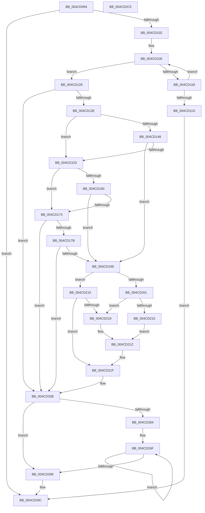

# PerfLogSpinLockRelease

- RVA: `0x004CD094`–`0x004CD2C6` (길이 `562` bytes)
- VA: `0x00000001404CD094`
- 실행 섹션: `.text`
- PDB 이름 있음: `예`; PDB Function 태그: `아니요`
- unwind 정보 RVA: `0x000BD830`
- 디코드: `136`개 명령, `562/562` bytes 표시
- 미해석 바이트: `0` (있으면 어셈블리에 `.byte`로 보존)

> 이 문서는 커널 이미지의 기계어와 PDB 기호를 분석해 생성했습니다. 4번과 5번은 함수 원형과 자료형을 바이너리 사용 방식에서 추정한 C 해석이며 원본 소스 복구 결과는 아닙니다.

## 1. Dependencies

- 직접 호출 지점: **2**; 고유 호출 대상: **2**
- 직접 호출자로 확인된 함수: **5**
- RIP 상대 이미지 참조: **5**

### Outgoing calls
- `0x004CD24F` → [EtwTraceKernelEvent](../23/EtwTraceKernelEvent_function_00235350.md) (function, `0x00235350`)
- `0x004CD2A3` → [_security_check_cookie](../6A/_security_check_cookie_function_006AC640.md) (function, `0x006AC640`)

### Direct callers
- [KiReleaseQueuedSpinLockInstrumented](../21/KiReleaseQueuedSpinLockInstrumented_function_002179F0.md) at `0x00217A6A`
- [ExpReleaseSpinLockExclusiveFromDpcLevelInstrumented](../2C/ExpReleaseSpinLockExclusiveFromDpcLevelInstrumented_function_002C0F44.md) at `0x002C0F60`
- [ExpTryConvertSharedSpinLockExclusiveInstrumented](../2E/ExpTryConvertSharedSpinLockExclusiveInstrumented_function_002EF988.md) at `0x002EFA9A`
- [ExpReleaseSpinLockSharedFromDpcLevelInstrumented](../2F/ExpReleaseSpinLockSharedFromDpcLevelInstrumented_function_002F0F48.md) at `0x002F0F68`
- [KiReleaseSpinLockInstrumented](../39/KiReleaseSpinLockInstrumented_function_00392EF0.md) at `0x00392F0B`

### Static image references
- `0x004CD0B2` → RVA `0x00E0A740` (`.data`; read)
- `0x004CD13E` → RVA `0x00FC50D4` (`ALMOSTRO`; read)
- `0x004CD158` → RVA `0x00FC5150` (`ALMOSTRO`; read)
- `0x004CD169` → RVA `0x00FC5158` (`ALMOSTRO`; read)
- `0x004CD18B` → RVA `0x00FC5154` (`ALMOSTRO`; read)

## 2. Other-region calls and transfers

- 다른 실행 섹션으로 향하는 call: **0**
- 별도 외부 분기/꼬리 이동을 확인하지 못했습니다.

## 3. Assembly (complete function range)

```asm
004CD094  48 8B C4                        mov rax, rsp
004CD097  48 89 58 08                     mov qword ptr [rax + 8], rbx
004CD09B  48 89 70 10                     mov qword ptr [rax + 0x10], rsi
004CD09F  48 89 78 18                     mov qword ptr [rax + 0x18], rdi
004CD0A3  4C 89 70 20                     mov qword ptr [rax + 0x20], r14
004CD0A7  55                              push rbp
004CD0A8  48 8B EC                        mov rbp, rsp
004CD0AB  48 81 EC 80 00 00 00            sub rsp, 0x80
004CD0B2  48 8B 05 87 D6 93 00            mov rax, qword ptr [rip + 0x93d687]
004CD0B9  48 33 C4                        xor rax, rsp
004CD0BC  48 89 45 F8                     mov qword ptr [rbp - 8], rax
004CD0C0  0F 57 C0                        xorps xmm0, xmm0
004CD0C3  33 C0                           xor eax, eax
004CD0C5  0F 11 45 B0                     movups xmmword ptr [rbp - 0x50], xmm0
004CD0C9  48 89 45 E0                     mov qword ptr [rbp - 0x20], rax
004CD0CD  4D 8B D8                        mov r11, r8
004CD0D0  0F 11 45 C0                     movups xmmword ptr [rbp - 0x40], xmm0
004CD0D4  4C 8B F2                        mov r14, rdx
004CD0D7  4C 8B D1                        mov r10, rcx
004CD0DA  0F 11 45 D0                     movups xmmword ptr [rbp - 0x30], xmm0
004CD0DE  65 48 8B 04 25 20 00 00 00      mov rax, qword ptr gs:[0x20]
004CD0E7  48 8B 98 A8 8B 00 00            mov rbx, qword ptr [rax + 0x8ba8]
004CD0EE  48 83 C3 10                     add rbx, 0x10
004CD0F2  40 8A B3 00 01 00 00            mov sil, byte ptr [rbx + 0x100]
004CD0F9  40 84 F6                        test sil, sil
004CD0FC  0F 84 9A 01 00 00               je 0x1404cd29c
004CD102  40 8A FE                        mov dil, sil
004CD105  40 80 C7 FF                     add dil, 0xff
004CD109  44 0F B6 C7                     movzx r8d, dil
004CD10D  49 C1 E0 05                     shl r8, 5
004CD111  4D 39 54 18 08                  cmp qword ptr [r8 + rbx + 8], r10
004CD116  74 10                           je 0x1404cd128
004CD118  40 84 FF                        test dil, dil
004CD11B  75 E8                           jne 0x1404cd105
004CD11D  FF 83 08 01 00 00               inc dword ptr [rbx + 0x108]
004CD123  E9 74 01 00 00                  jmp 0x1404cd29c
004CD128  65 4C 8B 0C 25 20 00 00 00      mov r9, qword ptr gs:[0x20]
004CD131  80 BB 01 01 00 00 00            cmp byte ptr [rbx + 0x101], 0
004CD138  0F 85 1D 01 00 00               jne 0x1404cd25b
004CD13E  8B 0D 90 7F AF 00               mov ecx, dword ptr [rip + 0xaf7f90]
004CD144  85 C9                           test ecx, ecx
004CD146  74 0B                           je 0x1404cd153
004CD148  41 8B C3                        mov eax, r11d
004CD14B  41 2B 04 18                     sub eax, dword ptr [r8 + rbx]
004CD14F  3B C1                           cmp eax, ecx
004CD151  77 46                           ja 0x1404cd199
004CD153  41 8B 4C 18 14                  mov ecx, dword ptr [r8 + rbx + 0x14]
004CD158  3B 0D F2 7F AF 00               cmp ecx, dword ptr [rip + 0xaf7ff2]
004CD15E  72 13                           jb 0x1404cd173
004CD160  41 8B 81 C4 8E 00 00            mov eax, dword ptr [r9 + 0x8ec4]
004CD167  33 D2                           xor edx, edx
004CD169  F7 35 E9 7F AF 00               div dword ptr [rip + 0xaf7fe9]
004CD16F  85 D2                           test edx, edx
004CD171  74 26                           je 0x1404cd199
004CD173  85 C9                           test ecx, ecx
004CD175  0F 85 E0 00 00 00               jne 0x1404cd25b
004CD17B  41 8B 81 C0 8E 00 00            mov eax, dword ptr [r9 + 0x8ec0]
004CD182  33 D2                           xor edx, edx
004CD184  41 2B 81 C4 8E 00 00            sub eax, dword ptr [r9 + 0x8ec4]
004CD18B  F7 35 C3 7F AF 00               div dword ptr [rip + 0xaf7fc3]
004CD191  85 D2                           test edx, edx
004CD193  0F 85 C2 00 00 00               jne 0x1404cd25b
004CD199  41 8A 51 20                     mov dl, byte ptr [r9 + 0x20]
004CD19D  C6 83 01 01 00 00 01            mov byte ptr [rbx + 0x101], 1
004CD1A4  4C 89 55 B0                     mov qword ptr [rbp - 0x50], r10
004CD1A8  4C 89 75 B8                     mov qword ptr [rbp - 0x48], r14
004CD1AC  4C 89 5D C8                     mov qword ptr [rbp - 0x38], r11
004CD1B0  65 48 8B 04 25 88 01 00 00      mov rax, qword ptr gs:[0x188]
004CD1B9  8B 88 10 05 00 00               mov ecx, dword ptr [rax + 0x510]
004CD1BF  89 4D D8                        mov dword ptr [rbp - 0x28], ecx
004CD1C2  40 88 75 E1                     mov byte ptr [rbp - 0x1f], sil
004CD1C6  44 0F 20 C0                     mov rax, cr8
004CD1CA  88 45 E0                        mov byte ptr [rbp - 0x20], al
004CD1CD  49 8B 04 18                     mov rax, qword ptr [r8 + rbx]
004CD1D1  48 89 45 C0                     mov qword ptr [rbp - 0x40], rax
004CD1D5  41 8B 44 18 10                  mov eax, dword ptr [r8 + rbx + 0x10]
004CD1DA  89 45 D0                        mov dword ptr [rbp - 0x30], eax
004CD1DD  41 8B 44 18 14                  mov eax, dword ptr [r8 + rbx + 0x14]
004CD1E2  89 45 D4                        mov dword ptr [rbp - 0x2c], eax
004CD1E5  41 8B 89 40 86 00 00            mov ecx, dword ptr [r9 + 0x8640]
004CD1EC  41 2B 4C 18 18                  sub ecx, dword ptr [r8 + rbx + 0x18]
004CD1F1  89 4D DC                        mov dword ptr [rbp - 0x24], ecx
004CD1F4  41 8A 4C 18 1C                  mov cl, byte ptr [r8 + rbx + 0x1c]
004CD1F9  88 4D E2                        mov byte ptr [rbp - 0x1e], cl
004CD1FC  80 FA 01                        cmp dl, 1
004CD1FF  75 14                           jne 0x1404cd215
004CD201  65 8B 04 25 3C 3A 00 00         mov eax, dword ptr gs:[0x3a3c]
004CD209  A9 01 00 01 00                  test eax, 0x10001
004CD20E  74 09                           je 0x1404cd219
004CD210  80 C9 40                        or cl, 0x40
004CD213  EB 07                           jmp 0x1404cd21c
004CD215  84 D2                           test dl, dl
004CD217  74 06                           je 0x1404cd21f
004CD219  80 C9 80                        or cl, 0x80
004CD21C  88 4D E2                        mov byte ptr [rbp - 0x1e], cl
004CD21F  83 65 F4 00                     and dword ptr [rbp - 0xc], 0
004CD223  48 8D 45 B0                     lea rax, [rbp - 0x50]
004CD227  41 B9 29 05 00 00               mov r9d, 0x529
004CD22D  48 89 45 E8                     mov qword ptr [rbp - 0x18], rax
004CD231  BA 01 00 00 00                  mov edx, 1
004CD236  C7 45 F0 38 00 00 00            mov dword ptr [rbp - 0x10], 0x38
004CD23D  41 B8 00 00 01 20               mov r8d, 0x20010000
004CD243  C7 44 24 20 02 06 00 00         mov dword ptr [rsp + 0x20], 0x602
004CD24B  48 8D 4D E8                     lea rcx, [rbp - 0x18]
004CD24F  E8 FC 80 D6 FF                  call 0x140235350
004CD254  C6 83 01 01 00 00 00            mov byte ptr [rbx + 0x101], 0
004CD25B  40 80 C6 FF                     add sil, 0xff
004CD25F  40 3A FE                        cmp dil, sil
004CD262  73 32                           jae 0x1404cd296
004CD264  40 0F B6 CF                     movzx ecx, dil
004CD268  48 C1 E1 05                     shl rcx, 5
004CD26C  48 03 CB                        add rcx, rbx
004CD26F  40 0F B6 C7                     movzx eax, dil
004CD273  40 FE C7                        inc dil
004CD276  48 FF C0                        inc rax
004CD279  48 C1 E0 05                     shl rax, 5
004CD27D  0F 10 04 18                     movups xmm0, xmmword ptr [rax + rbx]
004CD281  0F 10 4C 18 10                  movups xmm1, xmmword ptr [rax + rbx + 0x10]
004CD286  0F 11 01                        movups xmmword ptr [rcx], xmm0
004CD289  0F 11 49 10                     movups xmmword ptr [rcx + 0x10], xmm1
004CD28D  48 8D 49 20                     lea rcx, [rcx + 0x20]
004CD291  40 3A FE                        cmp dil, sil
004CD294  72 D9                           jb 0x1404cd26f
004CD296  FE 8B 00 01 00 00               dec byte ptr [rbx + 0x100]
004CD29C  48 8B 4D F8                     mov rcx, qword ptr [rbp - 8]
004CD2A0  48 33 CC                        xor rcx, rsp
004CD2A3  E8 98 F3 1D 00                  call 0x1406ac640
004CD2A8  4C 8D 9C 24 80 00 00 00         lea r11, [rsp + 0x80]
004CD2B0  49 8B 5B 10                     mov rbx, qword ptr [r11 + 0x10]
004CD2B4  49 8B 73 18                     mov rsi, qword ptr [r11 + 0x18]
004CD2B8  49 8B 7B 20                     mov rdi, qword ptr [r11 + 0x20]
004CD2BC  4D 8B 73 28                     mov r14, qword ptr [r11 + 0x28]
004CD2C0  49 8B E3                        mov rsp, r11
004CD2C3  5D                              pop rbp
004CD2C4  C3                              ret
004CD2C5  CC                              int3
```

## 4. C-style interpretation (structured pseudocode)

```c
__int64 __fastcall PerfLogSpinLockRelease(__int64 a1, __int64 a2, __int64 a3)
{
    __int64 result;
    __int64 v_rbx;
    __int64 v_rdi;
    __int64 v_rsi;
    __int64 v_rsp;
    unsigned __int64 v_stack_m10;
    unsigned int v_stack_m14;
    unsigned int v_stack_m18;
    unsigned __int64 v_stack_m20;
    unsigned __int8 v_stack_m26;
    unsigned __int8 v_stack_m27;
    unsigned __int64 v_stack_m28;
    unsigned int v_stack_m2C;
    unsigned int v_stack_m30;
    unsigned int v_stack_m34;
    unsigned __int64 v_stack_m38;
    unsigned __int64 v_stack_m40;
    unsigned __int64 v_stack_m48;
    unsigned __int64 v_stack_m50;
    unsigned __int64 v_stack_m58;
    unsigned int v_stack_m68;
    unsigned __int64 v_stack_m8;

    *(unsigned __int64 *)(v_rsp + 8) = v_rbx;
    *(unsigned __int64 *)(v_rsp + 16) = v_rsi;
    *(unsigned __int64 *)(v_rsp + 24) = v_rdi;
    *(unsigned __int64 *)(v_rsp + 32) = v_r14;
    v_rsp = (v_rsp) - (128);
    result = (*(unsigned __int64 *)(v_rip + 9688711)) ^ (v_rsp);
    v_stack_m10 = result;
    result = 0;
    v_stack_m58 = v_xmm0;
    v_stack_m28 = 0;
    v_stack_m48 = v_xmm0;
    v_stack_m38 = v_xmm0;
    v_rbx = (*(unsigned __int64 *)(*(unsigned __int64 *)(gs_base + (0 + 32)) + 35752)) + (16);
    if ((unsigned __int8)(*(unsigned __int8 *)(v_rbx + 256)) == 0) goto loc_004CD29C;
loc_004CD105:
    v_rdi = (unsigned __int8)(((unsigned __int8)(*(unsigned __int8 *)(v_rbx + 256))) + (255));
    a3 = ((unsigned __int8)(v_rdi)) << (5);
    if ((*(unsigned __int64 *)(a3 + v_rbx * 1 + 8)) == a1) goto loc_004CD128;
    if ((unsigned __int8)(v_rdi) != 0) goto loc_004CD105;
    goto loc_004CD29C;
loc_004CD128:
    if ((*(unsigned __int8 *)(v_rbx + 257)) != 0) goto loc_004CD25B;
    if ((unsigned int)((unsigned int)(*(unsigned int *)(v_rip + 11501456))) == 0) goto loc_004CD153;
    result = (unsigned int)(((unsigned int)((unsigned int)(a3))) - (*(unsigned int *)(a3 + v_rbx * 1)));
    if (((unsigned int)(result)) > ((unsigned int)((unsigned int)(*(unsigned int *)(v_rip + 11501456))))) goto loc_004CD199;
loc_004CD153:
    if (((unsigned int)((unsigned int)(*(unsigned int *)(a3 + v_rbx * 1 + 20)))) < (*(unsigned int *)(v_rip + 11501554))) goto loc_004CD173;
    a2 = 0;
    if (0 == 0) goto loc_004CD199;
loc_004CD173:
    if ((unsigned int)((unsigned int)(*(unsigned int *)(a3 + v_rbx * 1 + 20))) != 0) goto loc_004CD25B;
    a2 = 0;
    result = (unsigned int)(((unsigned int)(*(unsigned int *)(*(unsigned __int64 *)(gs_base + (0 + 32)) + 36544))) - (*(unsigned int *)(*(unsigned __int64 *)(gs_base + (0 + 32)) + 36548)));
    if (0 != 0) goto loc_004CD25B;
loc_004CD199:
    *(unsigned __int8 *)(v_rbx + 257) = 1;
    v_stack_m58 = a1;
    v_stack_m50 = 0;
    v_stack_m40 = a3;
    v_stack_m30 = (unsigned int)((unsigned int)(*(unsigned int *)(*(unsigned __int64 *)(gs_base + (0 + 392)) + 1296)));
    v_stack_m27 = (unsigned __int8)(*(unsigned __int8 *)(v_rbx + 256));
    v_stack_m28 = (unsigned __int8)(v_cr8);
    v_stack_m48 = *(unsigned __int64 *)(a3 + v_rbx * 1);
    v_stack_m38 = (unsigned int)((unsigned int)(*(unsigned int *)(a3 + v_rbx * 1 + 16)));
    v_stack_m34 = (unsigned int)((unsigned int)(*(unsigned int *)(a3 + v_rbx * 1 + 20)));
    a1 = (unsigned int)(((unsigned int)(*(unsigned int *)(*(unsigned __int64 *)(gs_base + (0 + 32)) + 34368))) - (*(unsigned int *)(a3 + v_rbx * 1 + 24)));
    v_stack_m2C = (unsigned int)(a1);
    v_stack_m26 = (unsigned __int8)(*(unsigned __int8 *)(a3 + v_rbx * 1 + 28));
    if (((unsigned __int8)(*(unsigned __int8 *)(*(unsigned __int64 *)(gs_base + (0 + 32)) + 32))) != 1) goto loc_004CD215;
    if ((((unsigned int)((unsigned int)(*(unsigned int *)(gs_base + (0 + 14908))))) & (0x10001ULL)) == 0) goto loc_004CD219;
    a1 = (unsigned __int8)((*(unsigned __int8 *)(a3 + v_rbx * 1 + 28)) | (64));
    goto loc_004CD21C;
loc_004CD215:
    if ((unsigned __int8)(*(unsigned __int8 *)(*(unsigned __int64 *)(gs_base + (0 + 32)) + 32)) == 0) goto loc_004CD21F;
loc_004CD219:
    a1 = (unsigned __int8)((a1) | (128));
loc_004CD21C:
    v_stack_m26 = (unsigned __int8)(a1);
loc_004CD21F:
    v_stack_m20 = v_stack_m58;
    v_stack_m18 = 56;
    v_stack_m68 = 0x602ULL;
    result = EtwTraceKernelEvent(v_stack_m20, 1, (unsigned int)(0x20010000ULL), (unsigned int)(0x529ULL));
    *(unsigned __int8 *)(v_rbx + 257) = 0;
loc_004CD25B:
    v_rsi = (unsigned __int8)((*(unsigned __int8 *)(v_rbx + 256)) + (255));
    if (((unsigned __int8)(v_rdi)) >= ((unsigned __int8)(v_rsi))) goto loc_004CD296;
    a1 = ((unsigned __int8)(v_rdi)) << (5);
    a1 = (a1) + (v_rbx);
loc_004CD26F:
    v_rdi = (unsigned __int8)((v_rdi) + 1);
    result = ((unsigned __int8)(v_rdi)) + 1;
    result = (result) << (5);
    *(unsigned __int64 *)(a1) = v_xmm0;
    *(unsigned __int64 *)(a1 + 16) = v_xmm1;
    if (((unsigned __int8)(v_rdi)) < ((unsigned __int8)(v_rsi))) goto loc_004CD26F;
loc_004CD296:
loc_004CD29C:
    a1 = (v_stack_m10) ^ (v_rsp);
    result = _security_check_cookie(a1, 1, (unsigned int)(0x20010000ULL), (unsigned int)(0x529ULL));
    return result;
}
```

## 5. (Beta) C Style

```c
int64_t PerfLogSpinLockRelease(int64_t Arg1, int64_t Arg2, int64_t Arg3)
{
    int64_t result;
    int64_t local_rbx;
    int64_t local_rdi;
    int64_t local_rsi;
    int64_t local_rsp;
    uint64_t v_stack_m10;
    uint32_t v_stack_m14;
    uint32_t v_stack_m18;
    uint64_t v_stack_m20;
    uint8_t v_stack_m26;
    uint8_t v_stack_m27;
    uint64_t v_stack_m28;
    uint32_t v_stack_m2C;
    uint32_t v_stack_m30;
    uint32_t v_stack_m34;
    uint64_t v_stack_m38;
    uint64_t v_stack_m40;
    uint64_t v_stack_m48;
    uint64_t v_stack_m50;
    uint64_t v_stack_m58;
    uint32_t v_stack_m68;
    uint64_t v_stack_m8;

    *(uint64_t *)(local_rsp + 0x8) = local_rbx;
    *(uint64_t *)(local_rsp + 0x10) = local_rsi;
    *(uint64_t *)(local_rsp + 0x18) = local_rdi;
    *(uint64_t *)(local_rsp + 0x20) = local_r14;
    local_rsp = (local_rsp) - (128);
    result = (*(uint64_t *)(v_rip + 0x93D687)) ^ (local_rsp);
    v_stack_m10 = result;
    result = 0;
    v_stack_m58 = v_xmm0;
    v_stack_m28 = 0;
    v_stack_m48 = v_xmm0;
    v_stack_m38 = v_xmm0;
    local_rbx = (*(uint64_t *)(*(uint64_t *)(gs_base + (0 + 0x20)) + 0x8BA8)) + (16);
    if ((uint8_t)(*(uint8_t *)(local_rbx + 0x100)) == 0) goto loc_004CD29C;
loc_004CD105:
    local_rdi = (uint8_t)(((uint8_t)(*(uint8_t *)(local_rbx + 0x100))) + (255));
    Arg3 = ((uint8_t)(local_rdi)) << (5);
    if ((*(uint64_t *)(Arg3 + local_rbx * 1 + 0x8)) == Arg1) goto loc_004CD128;
    if ((uint8_t)(local_rdi) != 0) goto loc_004CD105;
    goto loc_004CD29C;
loc_004CD128:
    if ((*(uint8_t *)(local_rbx + 0x101)) != 0) goto loc_004CD25B;
    if ((uint32_t)((uint32_t)(*(uint32_t *)(v_rip + 0xAF7F90))) == 0) goto loc_004CD153;
    result = (uint32_t)(((uint32_t)((uint32_t)(Arg3))) - (*(uint32_t *)(Arg3 + local_rbx * 1)));
    if (((uint32_t)(result)) > ((uint32_t)((uint32_t)(*(uint32_t *)(v_rip + 0xAF7F90))))) goto loc_004CD199;
loc_004CD153:
    if (((uint32_t)((uint32_t)(*(uint32_t *)(Arg3 + local_rbx * 1 + 0x14)))) < (*(uint32_t *)(v_rip + 0xAF7FF2))) goto loc_004CD173;
    Arg2 = 0;
    if (0 == 0) goto loc_004CD199;
loc_004CD173:
    if ((uint32_t)((uint32_t)(*(uint32_t *)(Arg3 + local_rbx * 1 + 0x14))) != 0) goto loc_004CD25B;
    Arg2 = 0;
    result = (uint32_t)(((uint32_t)(*(uint32_t *)(*(uint64_t *)(gs_base + (0 + 0x20)) + 0x8EC0))) - (*(uint32_t *)(*(uint64_t *)(gs_base + (0 + 0x20)) + 0x8EC4)));
    if (0 != 0) goto loc_004CD25B;
loc_004CD199:
    *(uint8_t *)(local_rbx + 0x101) = 1;
    v_stack_m58 = Arg1;
    v_stack_m50 = 0;
    v_stack_m40 = Arg3;
    v_stack_m30 = (uint32_t)((uint32_t)(*(uint32_t *)(*(uint64_t *)(gs_base + (0 + 0x188)) + 0x510)));
    v_stack_m27 = (uint8_t)(*(uint8_t *)(local_rbx + 0x100));
    v_stack_m28 = (uint8_t)(v_cr8);
    v_stack_m48 = *(uint64_t *)(Arg3 + local_rbx * 1);
    v_stack_m38 = (uint32_t)((uint32_t)(*(uint32_t *)(Arg3 + local_rbx * 1 + 0x10)));
    v_stack_m34 = (uint32_t)((uint32_t)(*(uint32_t *)(Arg3 + local_rbx * 1 + 0x14)));
    Arg1 = (uint32_t)(((uint32_t)(*(uint32_t *)(*(uint64_t *)(gs_base + (0 + 0x20)) + 0x8640))) - (*(uint32_t *)(Arg3 + local_rbx * 1 + 0x18)));
    v_stack_m2C = (uint32_t)(Arg1);
    v_stack_m26 = (uint8_t)(*(uint8_t *)(Arg3 + local_rbx * 1 + 0x1C));
    if (((uint8_t)(*(uint8_t *)(*(uint64_t *)(gs_base + (0 + 0x20)) + 0x20))) != 1) goto loc_004CD215;
    if ((((uint32_t)((uint32_t)(*(uint32_t *)(gs_base + (0 + 0x3A3C))))) & (0x10001ULL)) == 0) goto loc_004CD219;
    Arg1 = (uint8_t)((*(uint8_t *)(Arg3 + local_rbx * 1 + 0x1C)) | (64));
    goto loc_004CD21C;
loc_004CD215:
    if ((uint8_t)(*(uint8_t *)(*(uint64_t *)(gs_base + (0 + 0x20)) + 0x20)) == 0) goto loc_004CD21F;
loc_004CD219:
    Arg1 = (uint8_t)((Arg1) | (128));
loc_004CD21C:
    v_stack_m26 = (uint8_t)(Arg1);
loc_004CD21F:
    v_stack_m20 = v_stack_m58;
    v_stack_m18 = 56;
    v_stack_m68 = 0x602ULL;
    result = EtwTraceKernelEvent(v_stack_m20, 1, (uint32_t)(0x20010000ULL), (uint32_t)(0x529ULL));
    *(uint8_t *)(local_rbx + 0x101) = 0;
loc_004CD25B:
    local_rsi = (uint8_t)((*(uint8_t *)(local_rbx + 0x100)) + (255));
    if (((uint8_t)(local_rdi)) >= ((uint8_t)(local_rsi))) goto loc_004CD296;
    Arg1 = ((uint8_t)(local_rdi)) << (5);
    Arg1 = (Arg1) + (local_rbx);
loc_004CD26F:
    local_rdi = (uint8_t)((local_rdi) + 1);
    result = ((uint8_t)(local_rdi)) + 1;
    result = (result) << (5);
    *(uint64_t *)(Arg1) = v_xmm0;
    *(uint64_t *)(Arg1 + 0x10) = v_xmm1;
    if (((uint8_t)(local_rdi)) < ((uint8_t)(local_rsi))) goto loc_004CD26F;
loc_004CD296:
loc_004CD29C:
    Arg1 = (v_stack_m10) ^ (local_rsp);
    result = _security_check_cookie(Arg1, 1, (uint32_t)(0x20010000ULL), (uint32_t)(0x529ULL));
    return result;
}
```

## 6. Execution-region graph

[열기: 2D/3D 그래프와 함수 탐색 컨트롤 패널](../../../control-panel.html?section=text&rva=0x004CD094&view=graph)

- 2D 그래프는 위에서 아래로 흐르고, 3D 그래프는 빈 공간을 드래그해 회전합니다. Shift+드래그는 이동, 휠은 확대·축소, 함수 노드 선택은 대상 보고서 이동입니다.

### Static fallback


