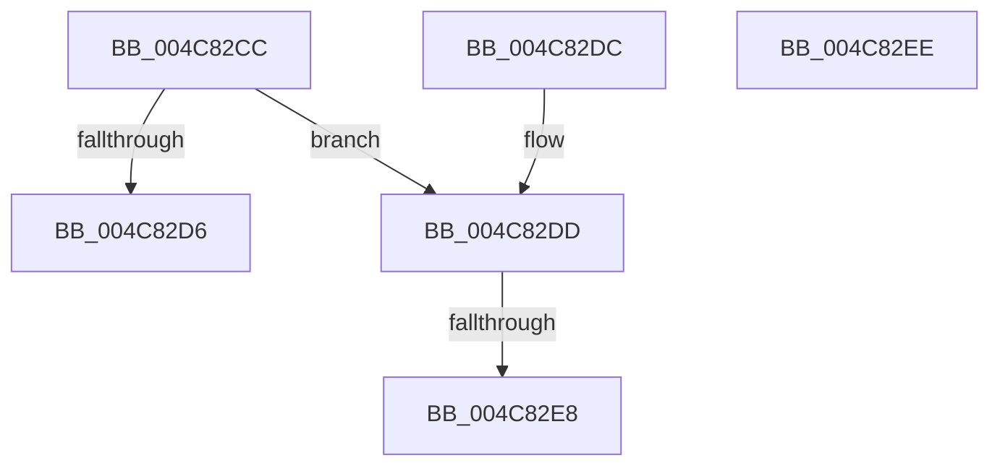

# PfVolumeSupportedForPrefetch

- RVA: `0x004C82CC`–`0x004C82EF` (길이 `35` bytes)
- VA: `0x00000001404C82CC`
- 실행 섹션: `.text`
- PDB 이름 있음: `예`; PDB Function 태그: `예`
- unwind 정보 RVA: `0x000DB714`
- 디코드: `13`개 명령, `35/35` bytes 표시
- 미해석 바이트: `0` (있으면 어셈블리에 `.byte`로 보존)

> 이 문서는 커널 이미지의 기계어와 PDB 기호를 분석해 생성했습니다. 4번과 5번은 함수 원형과 자료형을 바이너리 사용 방식에서 추정한 C 해석이며 원본 소스 복구 결과는 아닙니다.

## 1. Dependencies

- 직접 호출 지점: **0**; 고유 호출 대상: **0**
- 직접 호출자로 확인된 함수: **1**
- RIP 상대 이미지 참조: **0**

### Outgoing calls
- 직접 디코드된 call 명령이 없습니다.

### Direct callers
- [PfpVolumeOpenAndVerify](../../page/93/PfpVolumeOpenAndVerify_function_009381F4.md) at `0x0093835E`

### Static image references
- 디코드된 RIP-relative 메모리 참조가 없습니다.

## 2. Other-region calls and transfers

- 다른 실행 섹션으로 향하는 call: **0**
- call이 아닌 외부 분기/꼬리 이동: **1**
  - `0x004C82E2` → `0x006FCC6A` (`tail-transfer`)

## 3. Assembly (complete function range)

```asm
004C82CC  8B 11                           mov edx, dword ptr [rcx]
004C82CE  83 EA 07                        sub edx, 7
004C82D1  83 FA 01                        cmp edx, 1
004C82D4  76 07                           jbe 0x1404c82dd
004C82D6  B8 01 00 00 00                  mov eax, 1
004C82DB  C3                              ret
004C82DC  CC                              int3
004C82DD  8B 41 04                        mov eax, dword ptr [rcx + 4]
004C82E0  A8 10                           test al, 0x10
004C82E2  0F 84 82 49 23 00               je 0x1406fcc6a
004C82E8  B8 02 00 00 00                  mov eax, 2
004C82ED  C3                              ret
004C82EE  CC                              int3
```

## 4. C-style interpretation (structured pseudocode)

```c
__int64 __fastcall PfVolumeSupportedForPrefetch(__int64 a1)
{
    a2 = (unsigned int)(((unsigned int)(*(unsigned int *)(a1))) - (7));
    if (((unsigned int)(a2)) <= 1) goto loc_004C82DD;
    return 1;
loc_004C82DD:
    return 2;
}
```

## 5. (Beta) C Style

```c
int64_t PfVolumeSupportedForPrefetch(void *Arg1)
{
    uint8_t *arg1 = (uint8_t *)Arg1;

    a2 = (uint32_t)(((uint32_t)(*(uint32_t *)(arg1))) - (7));
    if (((uint32_t)(a2)) <= 1) goto loc_004C82DD;
    return 1;
loc_004C82DD:
    return 2;
}
```

### 관측된 메모리 오프셋

구조체 형식이 확인되지 않은 접근은 인자 기준의 오프셋으로만 기록했습니다.

| 기준 인자 | 오프셋 표현 | 폭 (bit) | 접근 |
|---|---:|---:|---|
| `Arg1` | `+ 0x0` | `32` | `R` |
| `Arg1` | `+ 0x4` | `32` | `R` |

## 6. Execution-region graph

[열기: 2D/3D 그래프와 함수 탐색 컨트롤 패널](../../../control-panel.html?section=text&rva=0x004C82CC&view=graph)

- 2D 그래프는 위에서 아래로 흐르고, 3D 그래프는 빈 공간을 드래그해 회전합니다. Shift+드래그는 이동, 휠은 확대·축소, 함수 노드 선택은 대상 보고서 이동입니다.

### Static fallback


