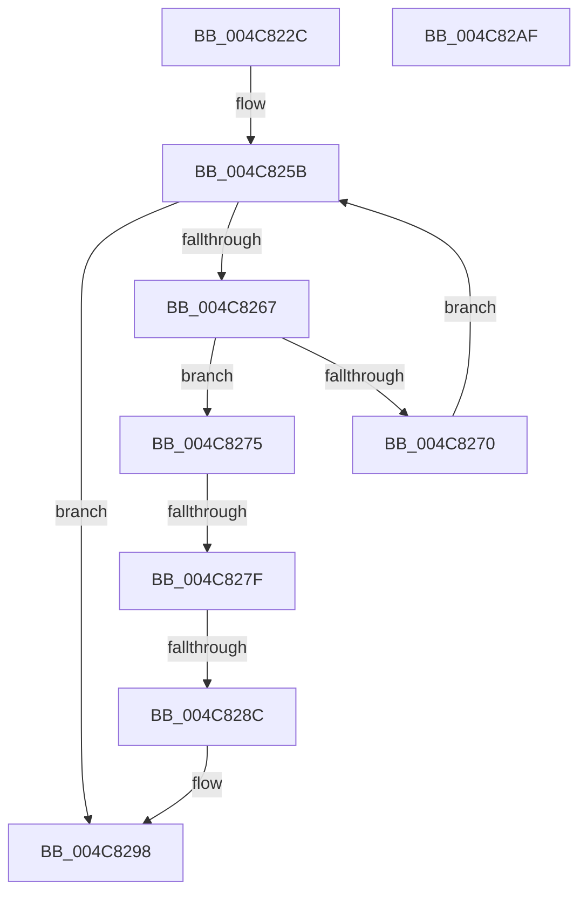

# PiDmaGuardQueueRemoveEntry

- RVA: `0x004C822C`–`0x004C82B0` (길이 `132` bytes)
- VA: `0x00000001404C822C`
- 실행 섹션: `.text`
- PDB 이름 있음: `예`; PDB Function 태그: `예`
- unwind 정보 RVA: `0x0005CF00`
- 디코드: `33`개 명령, `132/132` bytes 표시
- 미해석 바이트: `0` (있으면 어셈블리에 `.byte`로 보존)

> 이 문서는 커널 이미지의 기계어와 PDB 기호를 분석해 생성했습니다. 4번과 5번은 함수 원형과 자료형을 바이너리 사용 방식에서 추정한 C 해석이며 원본 소스 복구 결과는 아닙니다.

## 1. Dependencies

- 직접 호출 지점: **4**; 고유 호출 대상: **4**
- 직접 호출자로 확인된 함수: **1**
- RIP 상대 이미지 참조: **2**

### Outgoing calls
- `0x004C824F` → [ExAcquireResourceExclusiveLite](../21/ExAcquireResourceExclusiveLite_function_00214E20.md) (function, `0x00214E20`)
- `0x004C8293` → [PipDgqFreeEntry](../../page/74/PipDgqFreeEntry_function_007446BC.md) (function, `0x007446BC`)
- `0x004C829F` → [ExReleaseResourceLite](../25/ExReleaseResourceLite_function_0025FA10.md) (function, `0x0025FA10`)
- `0x004C82A4` → [KeLeaveCriticalRegion](../25/KeLeaveCriticalRegion_function_0025D8B0.md) (function, `0x0025D8B0`)

### Direct callers
- [sub_00B49BD6](../../page/B4/Unknown_function_00B49BD6.md) at `0x00B49C98`

### Static image references
- `0x004C8240` → RVA `0x00F8A800` (`.data`; read)
- `0x004C8254` → RVA `0x00F8A7F0` (`.data`; read)

## 2. Other-region calls and transfers

- 다른 실행 섹션으로 향하는 call: **1**
  - `0x004C8293` → [PipDgqFreeEntry](../../page/74/PipDgqFreeEntry_function_007446BC.md) (`.text` → `PAGE`)
- call이 아닌 외부 분기/꼬리 이동: **2**
  - `0x004C8279` → [sub_006FCC62](../6F/Unknown_function_006FCC62.md) (`tail-transfer`)
  - `0x004C8286` → [sub_006FCC62](../6F/Unknown_function_006FCC62.md) (`tail-transfer`)

## 3. Assembly (complete function range)

```asm
004C822C  40 53                           push rbx
004C822E  48 83 EC 20                     sub rsp, 0x20
004C8232  65 48 8B 04 25 88 01 00 00      mov rax, qword ptr gs:[0x188]
004C823B  48 8B D9                        mov rbx, rcx
004C823E  B2 01                           mov dl, 1
004C8240  48 8D 0D B9 25 AC 00            lea rcx, [rip + 0xac25b9]
004C8247  66 FF 88 E4 01 00 00            dec word ptr [rax + 0x1e4]
004C824E  90                              nop
004C824F  E8 CC CB D4 FF                  call 0x140214e20
004C8254  48 8B 0D 95 25 AC 00            mov rcx, qword ptr [rip + 0xac2595]
004C825B  48 8D 05 8E 25 AC 00            lea rax, [rip + 0xac258e]
004C8262  48 3B C8                        cmp rcx, rax
004C8265  74 31                           je 0x1404c8298
004C8267  48 8B 01                        mov rax, qword ptr [rcx]
004C826A  48 39 59 10                     cmp qword ptr [rcx + 0x10], rbx
004C826E  74 05                           je 0x1404c8275
004C8270  48 8B C8                        mov rcx, rax
004C8273  EB E6                           jmp 0x1404c825b
004C8275  48 39 48 08                     cmp qword ptr [rax + 8], rcx
004C8279  0F 85 E3 49 23 00               jne 0x1406fcc62
004C827F  48 8B 51 08                     mov rdx, qword ptr [rcx + 8]
004C8283  48 39 0A                        cmp qword ptr [rdx], rcx
004C8286  0F 85 D6 49 23 00               jne 0x1406fcc62
004C828C  48 89 02                        mov qword ptr [rdx], rax
004C828F  48 89 50 08                     mov qword ptr [rax + 8], rdx
004C8293  E8 24 C4 27 00                  call 0x1407446bc
004C8298  48 8D 0D 61 25 AC 00            lea rcx, [rip + 0xac2561]
004C829F  E8 6C 77 D9 FF                  call 0x14025fa10
004C82A4  E8 07 56 D9 FF                  call 0x14025d8b0
004C82A9  48 83 C4 20                     add rsp, 0x20
004C82AD  5B                              pop rbx
004C82AE  C3                              ret
004C82AF  CC                              int3
```

## 4. C-style interpretation (structured pseudocode)

```c
__int64 __fastcall PiDmaGuardQueueRemoveEntry(__int64 a1)
{
    __int64 result;
    __int64 v_rsp;

    v_rsp = (v_rsp) - (32);
    result = ExAcquireResourceExclusiveLite(v_rip + 11281849, 1, a3, a4);
loc_004C825B:
    if ((*(unsigned __int64 *)(v_rip + 11281813)) == (v_rip + 11281806)) goto loc_004C8298;
    if ((*(unsigned __int64 *)(*(unsigned __int64 *)(v_rip + 11281813) + 16)) == a1) goto loc_004C8275;
    goto loc_004C825B;
loc_004C8275:
    *(unsigned __int64 *)(*(unsigned __int64 *)(*(unsigned __int64 *)(*(unsigned __int64 *)(v_rip + 11281813)) + 8)) = *(unsigned __int64 *)(*(unsigned __int64 *)(v_rip + 11281813));
    *(unsigned __int64 *)(*(unsigned __int64 *)(*(unsigned __int64 *)(v_rip + 11281813)) + 8) = *(unsigned __int64 *)(*(unsigned __int64 *)(*(unsigned __int64 *)(v_rip + 11281813)) + 8);
    result = PipDgqFreeEntry(*(unsigned __int64 *)(*(unsigned __int64 *)(v_rip + 11281813)), *(unsigned __int64 *)(*(unsigned __int64 *)(*(unsigned __int64 *)(v_rip + 11281813)) + 8), a3, a4);
loc_004C8298:
    result = ExReleaseResourceLite(v_rip + 11281761, *(unsigned __int64 *)(*(unsigned __int64 *)(*(unsigned __int64 *)(v_rip + 11281813)) + 8), a3, a4);
    result = KeLeaveCriticalRegion(v_rip + 11281761, *(unsigned __int64 *)(*(unsigned __int64 *)(*(unsigned __int64 *)(v_rip + 11281813)) + 8), a3, a4);
    v_rsp = (v_rsp) + (32);
    return result;
}
```

## 5. (Beta) C Style

```c
int64_t PiDmaGuardQueueRemoveEntry(int64_t Arg1)
{
    int64_t result;
    int64_t local_rsp;

    local_rsp = (local_rsp) - (32);
    result = ExAcquireResourceExclusiveLite(v_rip + 11281849, 1, a3, a4);
loc_004C825B:
    if ((*(uint64_t *)(v_rip + 0xAC2595)) == (v_rip + 11281806)) goto loc_004C8298;
    if ((*(uint64_t *)(*(uint64_t *)(v_rip + 0xAC2595) + 0x10)) == Arg1) goto loc_004C8275;
    goto loc_004C825B;
loc_004C8275:
    *(uint64_t *)(*(uint64_t *)(*(uint64_t *)(*(uint64_t *)(v_rip + 0xAC2595)) + 0x8)) = *(uint64_t *)(*(uint64_t *)(v_rip + 0xAC2595));
    *(uint64_t *)(*(uint64_t *)(*(uint64_t *)(v_rip + 0xAC2595)) + 0x8) = *(uint64_t *)(*(uint64_t *)(*(uint64_t *)(v_rip + 0xAC2595)) + 0x8);
    result = PipDgqFreeEntry(*(uint64_t *)(*(uint64_t *)(v_rip + 0xAC2595)), *(uint64_t *)(*(uint64_t *)(*(uint64_t *)(v_rip + 0xAC2595)) + 0x8), a3, a4);
loc_004C8298:
    result = ExReleaseResourceLite(v_rip + 11281761, *(uint64_t *)(*(uint64_t *)(*(uint64_t *)(v_rip + 0xAC2595)) + 0x8), a3, a4);
    result = KeLeaveCriticalRegion(v_rip + 11281761, *(uint64_t *)(*(uint64_t *)(*(uint64_t *)(v_rip + 0xAC2595)) + 0x8), a3, a4);
    local_rsp = (local_rsp) + (32);
    return result;
}
```

## 6. Execution-region graph

[열기: 2D/3D 그래프와 함수 탐색 컨트롤 패널](../../../control-panel.html?section=text&rva=0x004C822C&view=graph)

- 2D 그래프는 위에서 아래로 흐르고, 3D 그래프는 빈 공간을 드래그해 회전합니다. Shift+드래그는 이동, 휠은 확대·축소, 함수 노드 선택은 대상 보고서 이동입니다.

### Static fallback


