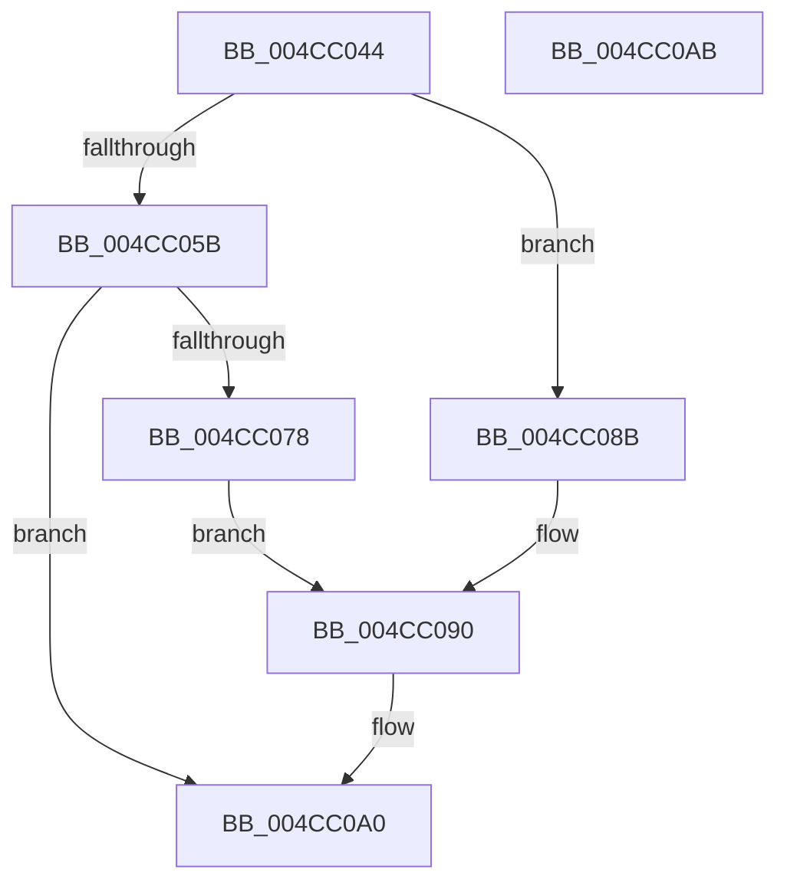

# PnpDuplicateUnicodeString

- RVA: `0x004CC044`–`0x004CC0AC` (길이 `104` bytes)
- VA: `0x00000001404CC044`
- 실행 섹션: `.text`
- PDB 이름 있음: `예`; PDB Function 태그: `아니요`
- unwind 정보 RVA: `0x0005CAAC`
- 디코드: `30`개 명령, `104/104` bytes 표시
- 미해석 바이트: `0` (있으면 어셈블리에 `.byte`로 보존)

> 이 문서는 커널 이미지의 기계어와 PDB 기호를 분석해 생성했습니다. 4번과 5번은 함수 원형과 자료형을 바이너리 사용 방식에서 추정한 C 해석이며 원본 소스 복구 결과는 아닙니다.

## 1. Dependencies

- 직접 호출 지점: **2**; 고유 호출 대상: **2**
- 직접 호출자로 확인된 함수: **9**
- RIP 상대 이미지 참조: **0**

### Outgoing calls
- `0x004CC06A` → [ExAllocatePool2](../../poolcode/B8/ExAllocatePool2_function_00B820F0.md) (function, `0x00B820F0`)
- `0x004CC084` → [memcpy](../6C/memcpy_function_006C6840.md) (function, `0x006C6840`)

### Direct callers
- [PiDevCfgAppendMultiSz](../../page/73/PiDevCfgAppendMultiSz_function_00731B28.md) at `0x00731C0D`
- [PiDevCfgProcessDeviceCallback](../../page/73/PiDevCfgProcessDeviceCallback_function_00734080.md) at `0x00734259`
- [PiDevCfgQueryDriverNode](../../page/73/PiDevCfgQueryDriverNode_function_0073435C.md) at `0x0073464D`
- [PiDevCfgQueryIncludedDriverNode](../../page/73/PiDevCfgQueryIncludedDriverNode_function_00734D88.md) at `0x00734E1E`
- [PiDevCfgQueryIncludedDriverNode](../../page/73/PiDevCfgQueryIncludedDriverNode_function_00734D88.md) at `0x007350F6`
- [PiDevCfgQueryIncludedDriverConfigurations](../../page/97/PiDevCfgQueryIncludedDriverConfigurations_function_009754BC.md) at `0x00975731`
- [PiDevCfgConfigureDevice](../../page/97/PiDevCfgConfigureDevice_function_00977BB4.md) at `0x00977F0D`
- [PiDevCfgConfigureDevice](../../page/97/PiDevCfgConfigureDevice_function_00977BB4.md) at `0x00977F2F`
- [PiDevCfgConfigureDevice](../../page/97/PiDevCfgConfigureDevice_function_00977BB4.md) at `0x00977F50`
- [PiDevCfgConfigureDevice](../../page/97/PiDevCfgConfigureDevice_function_00977BB4.md) at `0x00977F74`
- [PiDevCfgConfigureDevice](../../page/97/PiDevCfgConfigureDevice_function_00977BB4.md) at `0x00977F98`
- [PiDevCfgConfigureDevice](../../page/97/PiDevCfgConfigureDevice_function_00977BB4.md) at `0x00977FBC`
- [PiDevCfgConfigureDevice](../../page/97/PiDevCfgConfigureDevice_function_00977BB4.md) at `0x00977FE0`
- [PiDevCfgBuildIndirectString](../../page/97/PiDevCfgBuildIndirectString_function_0097A890.md) at `0x0097AB6B`
- [PiDevCfgConfigureDeviceLocation](../../page/AA/PiDevCfgConfigureDeviceLocation_function_00AA88C0.md) at `0x00AA8A7E`
- [PiDevCfgLogDeviceConfigured](../../page/AD/PiDevCfgLogDeviceConfigured_function_00ADCDD4.md) at `0x00ADDC99`
- [PiDevCfgLogDeviceConfigured](../../page/AD/PiDevCfgLogDeviceConfigured_function_00ADCDD4.md) at `0x00ADDD05`
- [PiDevCfgLogDeviceConfigured](../../page/AD/PiDevCfgLogDeviceConfigured_function_00ADCDD4.md) at `0x00ADDD71`
- [PiDevCfgLogDeviceConfigured](../../page/AD/PiDevCfgLogDeviceConfigured_function_00ADCDD4.md) at `0x00ADDDE4`

### Static image references
- 디코드된 RIP-relative 메모리 참조가 없습니다.

## 2. Other-region calls and transfers

- 다른 실행 섹션으로 향하는 call: **1**
  - `0x004CC06A` → [ExAllocatePool2](../../poolcode/B8/ExAllocatePool2_function_00B820F0.md) (`.text` → `POOLCODE`)
- 별도 외부 분기/꼬리 이동을 확인하지 못했습니다.

## 3. Assembly (complete function range)

```asm
004CC044  48 89 5C 24 08                  mov qword ptr [rsp + 8], rbx
004CC049  57                              push rdi
004CC04A  48 83 EC 20                     sub rsp, 0x20
004CC04E  48 83 7A 08 00                  cmp qword ptr [rdx + 8], 0
004CC053  48 8B DA                        mov rbx, rdx
004CC056  48 8B F9                        mov rdi, rcx
004CC059  74 30                           je 0x1404cc08b
004CC05B  0F B7 52 02                     movzx edx, word ptr [rdx + 2]
004CC05F  B9 00 01 00 00                  mov ecx, 0x100
004CC064  41 B8 53 74 72 67               mov r8d, 0x67727453
004CC06A  E8 81 60 6B 00                  call 0x140b820f0
004CC06F  48 89 47 08                     mov qword ptr [rdi + 8], rax
004CC073  48 85 C0                        test rax, rax
004CC076  74 28                           je 0x1404cc0a0
004CC078  44 0F B7 43 02                  movzx r8d, word ptr [rbx + 2]
004CC07D  48 8B C8                        mov rcx, rax
004CC080  48 8B 53 08                     mov rdx, qword ptr [rbx + 8]
004CC084  E8 B7 A7 1F 00                  call 0x1406c6840
004CC089  EB 05                           jmp 0x1404cc090
004CC08B  48 83 61 08 00                  and qword ptr [rcx + 8], 0
004CC090  0F B7 03                        movzx eax, word ptr [rbx]
004CC093  66 89 07                        mov word ptr [rdi], ax
004CC096  0F B7 43 02                     movzx eax, word ptr [rbx + 2]
004CC09A  66 89 47 02                     mov word ptr [rdi + 2], ax
004CC09E  B0 01                           mov al, 1
004CC0A0  48 8B 5C 24 30                  mov rbx, qword ptr [rsp + 0x30]
004CC0A5  48 83 C4 20                     add rsp, 0x20
004CC0A9  5F                              pop rdi
004CC0AA  C3                              ret
004CC0AB  CC                              int3
```

## 4. C-style interpretation (structured pseudocode)

```c
__int64 __fastcall PnpDuplicateUnicodeString(__int64 a1, __int64 a2)
{
    __int64 result;
    __int64 v_rsp;
    unsigned __int64 v_stack_p8;

    v_stack_p8 = v_rbx;
    v_rsp = (v_rsp) - (32);
    if ((*(unsigned __int64 *)(a2 + 8)) == 0) goto loc_004CC08B;
    result = ExAllocatePool2(256, *(unsigned __int16 *)(a2 + 2), (unsigned int)(0x67727453ULL), a4);
    *(unsigned __int64 *)(a1 + 8) = result;
    if (result == 0) goto loc_004CC0A0;
    result = memcpy(result, *(unsigned __int64 *)(a2 + 8), *(unsigned __int16 *)(a2 + 2), a4);
    goto loc_004CC090;
loc_004CC08B:
loc_004CC090:
    *(unsigned __int16 *)(a1) = (unsigned __int16)(*(unsigned __int16 *)(a2));
    *(unsigned __int16 *)(a1 + 2) = (unsigned __int16)(*(unsigned __int16 *)(a2 + 2));
loc_004CC0A0:
    v_rsp = (v_rsp) + (32);
    return 1;
}
```

## 5. (Beta) C Style

```c
int64_t PnpDuplicateUnicodeString(void *Arg1, void *Arg2)
{
    uint8_t *arg1 = (uint8_t *)Arg1;
    uint8_t *arg2 = (uint8_t *)Arg2;

    int64_t result;
    int64_t local_rsp;
    uint64_t v_stack_p8;

    v_stack_p8 = local_rbx;
    local_rsp = (local_rsp) - (32);
    if ((*(uint64_t *)(arg2 + 0x8)) == 0) goto loc_004CC08B;
    result = ExAllocatePool2(256, *(uint16_t *)(arg2 + 0x2), (uint32_t)(0x67727453ULL), a4);
    *(uint64_t *)(arg1 + 0x8) = result;
    if (result == 0) goto loc_004CC0A0;
    result = memcpy(result, *(uint64_t *)(arg2 + 0x8), *(uint16_t *)(arg2 + 0x2), a4);
    goto loc_004CC090;
loc_004CC08B:
loc_004CC090:
    *(uint16_t *)(arg1) = (uint16_t)(*(uint16_t *)(arg2));
    *(uint16_t *)(arg1 + 0x2) = (uint16_t)(*(uint16_t *)(arg2 + 0x2));
loc_004CC0A0:
    local_rsp = (local_rsp) + (32);
    return 1;
}
```

### 관측된 메모리 오프셋

구조체 형식이 확인되지 않은 접근은 인자 기준의 오프셋으로만 기록했습니다.

| 기준 인자 | 오프셋 표현 | 폭 (bit) | 접근 |
|---|---:|---:|---|
| `Arg1` | `+ 0x0` | `16` | `W` |
| `Arg1` | `+ 0x2` | `16` | `W` |
| `Arg1` | `+ 0x8` | `64` | `R/W` |
| `Arg1` | `+ 0x8` | `64` | `W` |
| `Arg2` | `+ 0x0` | `16` | `R` |
| `Arg2` | `+ 0x2` | `16` | `R` |
| `Arg2` | `+ 0x8` | `64` | `R` |

## 6. Execution-region graph

[열기: 2D/3D 그래프와 함수 탐색 컨트롤 패널](../../../control-panel.html?section=text&rva=0x004CC044&view=graph)

- 2D 그래프는 위에서 아래로 흐르고, 3D 그래프는 빈 공간을 드래그해 회전합니다. Shift+드래그는 이동, 휠은 확대·축소, 함수 노드 선택은 대상 보고서 이동입니다.

### Static fallback


