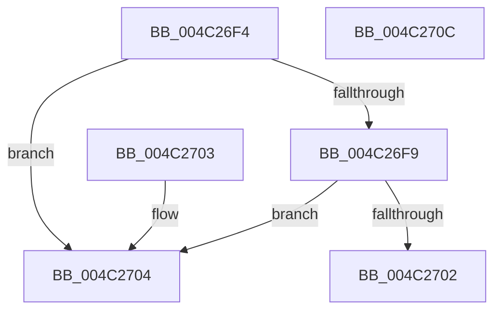

# PnpGetLogString

- RVA: `0x004C26F4`–`0x004C270D` (길이 `25` bytes)
- VA: `0x00000001404C26F4`
- 실행 섹션: `.text`
- PDB 이름 있음: `예`; PDB Function 태그: `아니요`
- unwind 정보 RVA: `0x000DB714`
- 디코드: `10`개 명령, `25/25` bytes 표시
- 미해석 바이트: `0` (있으면 어셈블리에 `.byte`로 보존)

> 이 문서는 커널 이미지의 기계어와 PDB 기호를 분석해 생성했습니다. 4번과 5번은 함수 원형과 자료형을 바이너리 사용 방식에서 추정한 C 해석이며 원본 소스 복구 결과는 아닙니다.

## 1. Dependencies

- 직접 호출 지점: **0**; 고유 호출 대상: **0**
- 직접 호출자로 확인된 함수: **2**
- RIP 상대 이미지 참조: **1**

### Outgoing calls
- 직접 디코드된 call 명령이 없습니다.

### Direct callers
- [PiDevCfgLogDeviceStarted](../../page/AB/PiDevCfgLogDeviceStarted_function_00ABEC8C.md) at `0x00ABEF2E`
- [PiDevCfgLogDeviceStarted](../../page/AB/PiDevCfgLogDeviceStarted_function_00ABEC8C.md) at `0x00ABEF3B`
- [PiDevCfgLogDeviceStarted](../../page/AB/PiDevCfgLogDeviceStarted_function_00ABEC8C.md) at `0x00ABEF47`
- [PiDevCfgLogDeviceStarted](../../page/AB/PiDevCfgLogDeviceStarted_function_00ABEC8C.md) at `0x00ABEFAA`
- [PiDevCfgLogDeviceStarted](../../page/AB/PiDevCfgLogDeviceStarted_function_00ABEC8C.md) at `0x00ABEFB7`
- [PiDevCfgLogDeviceStarted](../../page/AB/PiDevCfgLogDeviceStarted_function_00ABEC8C.md) at `0x00ABEFC3`
- [PiDevCfgLogDeviceStarted](../../page/AB/PiDevCfgLogDeviceStarted_function_00ABEC8C.md) at `0x00ABF008`
- [PiDevCfgLogDeviceStarted](../../page/AB/PiDevCfgLogDeviceStarted_function_00ABEC8C.md) at `0x00ABF015`
- [PiDevCfgLogDeviceStarted](../../page/AB/PiDevCfgLogDeviceStarted_function_00ABEC8C.md) at `0x00ABF021`
- [PiDevCfgLogDeviceConfigured](../../page/AD/PiDevCfgLogDeviceConfigured_function_00ADCDD4.md) at `0x00ADD4B5`
- [PiDevCfgLogDeviceConfigured](../../page/AD/PiDevCfgLogDeviceConfigured_function_00ADCDD4.md) at `0x00ADD4C1`
- [PiDevCfgLogDeviceConfigured](../../page/AD/PiDevCfgLogDeviceConfigured_function_00ADCDD4.md) at `0x00ADD4CC`
- [PiDevCfgLogDeviceConfigured](../../page/AD/PiDevCfgLogDeviceConfigured_function_00ADCDD4.md) at `0x00ADD4D7`
- [PiDevCfgLogDeviceConfigured](../../page/AD/PiDevCfgLogDeviceConfigured_function_00ADCDD4.md) at `0x00ADD4E2`
- [PiDevCfgLogDeviceConfigured](../../page/AD/PiDevCfgLogDeviceConfigured_function_00ADCDD4.md) at `0x00ADD596`
- [PiDevCfgLogDeviceConfigured](../../page/AD/PiDevCfgLogDeviceConfigured_function_00ADCDD4.md) at `0x00ADD5A2`
- [PiDevCfgLogDeviceConfigured](../../page/AD/PiDevCfgLogDeviceConfigured_function_00ADCDD4.md) at `0x00ADD5AD`
- [PiDevCfgLogDeviceConfigured](../../page/AD/PiDevCfgLogDeviceConfigured_function_00ADCDD4.md) at `0x00ADD5B8`
- [PiDevCfgLogDeviceConfigured](../../page/AD/PiDevCfgLogDeviceConfigured_function_00ADCDD4.md) at `0x00ADD5C3`
- [PiDevCfgLogDeviceConfigured](../../page/AD/PiDevCfgLogDeviceConfigured_function_00ADCDD4.md) at `0x00ADD6BD`
- [PiDevCfgLogDeviceConfigured](../../page/AD/PiDevCfgLogDeviceConfigured_function_00ADCDD4.md) at `0x00ADD6C9`
- [PiDevCfgLogDeviceConfigured](../../page/AD/PiDevCfgLogDeviceConfigured_function_00ADCDD4.md) at `0x00ADD6D4`
- [PiDevCfgLogDeviceConfigured](../../page/AD/PiDevCfgLogDeviceConfigured_function_00ADCDD4.md) at `0x00ADD6DF`
- [PiDevCfgLogDeviceConfigured](../../page/AD/PiDevCfgLogDeviceConfigured_function_00ADCDD4.md) at `0x00ADD6EA`
- [PiDevCfgLogDeviceConfigured](../../page/AD/PiDevCfgLogDeviceConfigured_function_00ADCDD4.md) at `0x00ADD7E2`
- [PiDevCfgLogDeviceConfigured](../../page/AD/PiDevCfgLogDeviceConfigured_function_00ADCDD4.md) at `0x00ADD7EE`
- [PiDevCfgLogDeviceConfigured](../../page/AD/PiDevCfgLogDeviceConfigured_function_00ADCDD4.md) at `0x00ADD7F9`
- [PiDevCfgLogDeviceConfigured](../../page/AD/PiDevCfgLogDeviceConfigured_function_00ADCDD4.md) at `0x00ADD804`
- [PiDevCfgLogDeviceConfigured](../../page/AD/PiDevCfgLogDeviceConfigured_function_00ADCDD4.md) at `0x00ADD80F`

### Static image references
- `0x004C2704` → RVA `0x00B53AB4` (` ?? ::LBKOJDO::`string'`; read)

## 2. Other-region calls and transfers

- 다른 실행 섹션으로 향하는 call: **0**
- 별도 외부 분기/꼬리 이동을 확인하지 못했습니다.

## 3. Assembly (complete function range)

```asm
004C26F4  48 85 C9                        test rcx, rcx
004C26F7  74 0B                           je 0x1404c2704
004C26F9  48 8B 41 08                     mov rax, qword ptr [rcx + 8]
004C26FD  48 85 C0                        test rax, rax
004C2700  74 02                           je 0x1404c2704
004C2702  C3                              ret
004C2703  CC                              int3
004C2704  48 8D 05 A9 13 69 00            lea rax, [rip + 0x6913a9]
004C270B  C3                              ret
004C270C  CC                              int3
```

## 4. C-style interpretation (structured pseudocode)

```c
__int64 __fastcall PnpGetLogString(__int64 a1)
{
    if (a1 == 0) goto loc_004C2704;
    if (*(unsigned __int64 *)(a1 + 8) == 0) goto loc_004C2704;
    return *(unsigned __int64 *)(a1 + 8);
loc_004C2704:
    return v_rip + 6886313;
}
```

## 5. (Beta) C Style

```c
int64_t PnpGetLogString(int64_t Arg1)
{
    if (Arg1 == 0) goto loc_004C2704;
    if (*(uint64_t *)(Arg1 + 0x8) == 0) goto loc_004C2704;
    return *(uint64_t *)(Arg1 + 0x8);
loc_004C2704:
    return v_rip + 6886313;
}
```

## 6. Execution-region graph

[열기: 2D/3D 그래프와 함수 탐색 컨트롤 패널](../../../control-panel.html?section=text&rva=0x004C26F4&view=graph)

- 2D 그래프는 위에서 아래로 흐르고, 3D 그래프는 빈 공간을 드래그해 회전합니다. Shift+드래그는 이동, 휠은 확대·축소, 함수 노드 선택은 대상 보고서 이동입니다.

### Static fallback


