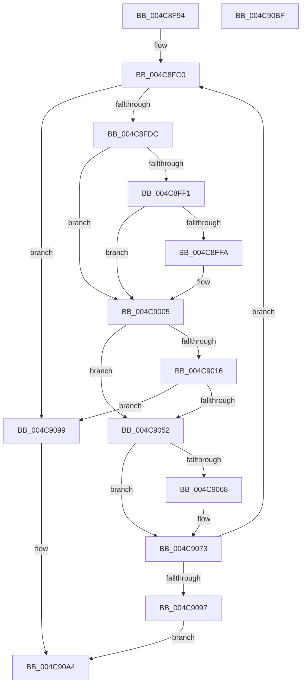

# PnpHandleEnumerateHandlesAgainstPdoStack

- RVA: `0x004C8F94`–`0x004C90C0` (길이 `300` bytes)
- VA: `0x00000001404C8F94`
- 실행 섹션: `.text`
- PDB 이름 있음: `예`; PDB Function 태그: `아니요`
- unwind 정보 RVA: `0x00060300`
- 디코드: `86`개 명령, `300/300` bytes 표시
- 미해석 바이트: `0` (있으면 어셈블리에 `.byte`로 보존)

> 이 문서는 커널 이미지의 기계어와 PDB 기호를 분석해 생성했습니다. 4번과 5번은 함수 원형과 자료형을 바이너리 사용 방식에서 추정한 C 해석이며 원본 소스 복구 결과는 아닙니다.

## 1. Dependencies

- 직접 호출 지점: **14**; 고유 호출 대상: **6**
- 직접 호출자로 확인된 함수: **1**
- RIP 상대 이미지 참조: **1**

### Outgoing calls
- `0x004C8FBB` → [ObfReferenceObjectWithTag](../21/ObfReferenceObjectWithTag_function_00210710.md) (function, `0x00210710`)
- `0x004C8FCD` → [PnpHandleEnumerateHandlesAgainstDeviceObject](../../page/A9/PnpHandleEnumerateHandlesAgainstDeviceObject_function_00A9D7A8.md) (function, `0x00A9D7A8`)
- `0x004C8FDF` → [KeAcquireQueuedSpinLock](../27/KeAcquireQueuedSpinLock_function_00273D80.md) (function, `0x00273D80`)
- `0x004C9000` → [ObfReferenceObjectWithTag](../21/ObfReferenceObjectWithTag_function_00210710.md) (function, `0x00210710`)
- `0x004C900C` → [KeReleaseQueuedSpinLock](../27/KeReleaseQueuedSpinLock_function_00272540.md) (function, `0x00272540`)
- `0x004C901C` → [IoGetDeviceAttachmentBaseRefWithTag](../27/IoGetDeviceAttachmentBaseRefWithTag_function_00272788.md) (function, `0x00272788`)
- `0x004C9031` → [PnpHandleEnumerateHandlesAgainstDeviceObject](../../page/A9/PnpHandleEnumerateHandlesAgainstDeviceObject_function_00A9D7A8.md) (function, `0x00A9D7A8`)
- `0x004C903E` → [ObfDereferenceObjectWithTag](../2F/ObfDereferenceObjectWithTag_function_002F78E0.md) (function, `0x002F78E0`)
- `0x004C9049` → [ObfDereferenceObjectWithTag](../2F/ObfDereferenceObjectWithTag_function_002F78E0.md) (function, `0x002F78E0`)
- `0x004C9057` → [KeAcquireQueuedSpinLock](../27/KeAcquireQueuedSpinLock_function_00273D80.md) (function, `0x00273D80`)
- `0x004C906E` → [ObfReferenceObjectWithTag](../21/ObfReferenceObjectWithTag_function_00210710.md) (function, `0x00210710`)
- `0x004C907B` → [KeReleaseQueuedSpinLock](../27/KeReleaseQueuedSpinLock_function_00272540.md) (function, `0x00272540`)
- `0x004C9086` → [ObfDereferenceObjectWithTag](../2F/ObfDereferenceObjectWithTag_function_002F78E0.md) (function, `0x002F78E0`)
- `0x004C909F` → [ObfDereferenceObjectWithTag](../2F/ObfDereferenceObjectWithTag_function_002F78E0.md) (function, `0x002F78E0`)

### Direct callers
- [PnpCollectOpenHandles](../../page/73/PnpCollectOpenHandles_function_00737E54.md) at `0x00737EAE`

### Static image references
- `0x004C8FC3` → RVA `0x00737EF0` (`PnpCollectOpenHandlesCallBack`; read)

## 2. Other-region calls and transfers

- 다른 실행 섹션으로 향하는 call: **2**
  - `0x004C8FCD` → [PnpHandleEnumerateHandlesAgainstDeviceObject](../../page/A9/PnpHandleEnumerateHandlesAgainstDeviceObject_function_00A9D7A8.md) (`.text` → `PAGE`)
  - `0x004C9031` → [PnpHandleEnumerateHandlesAgainstDeviceObject](../../page/A9/PnpHandleEnumerateHandlesAgainstDeviceObject_function_00A9D7A8.md) (`.text` → `PAGE`)
- 별도 외부 분기/꼬리 이동을 확인하지 못했습니다.

## 3. Assembly (complete function range)

```asm
004C8F94  48 89 5C 24 08                  mov qword ptr [rsp + 8], rbx
004C8F99  48 89 6C 24 10                  mov qword ptr [rsp + 0x10], rbp
004C8F9E  48 89 74 24 18                  mov qword ptr [rsp + 0x18], rsi
004C8FA3  57                              push rdi
004C8FA4  41 56                           push r14
004C8FA6  41 57                           push r15
004C8FA8  48 83 EC 20                     sub rsp, 0x20
004C8FAC  41 BF 44 66 6C 74               mov r15d, 0x746c6644
004C8FB2  4D 8B F0                        mov r14, r8
004C8FB5  41 8B D7                        mov edx, r15d
004C8FB8  48 8B F9                        mov rdi, rcx
004C8FBB  E8 50 77 D4 FF                  call 0x140210710
004C8FC0  4D 8B C6                        mov r8, r14
004C8FC3  48 8D 15 26 EF 26 00            lea rdx, [rip + 0x26ef26]
004C8FCA  48 8B CF                        mov rcx, rdi
004C8FCD  E8 D6 47 5D 00                  call 0x140a9d7a8
004C8FD2  8B E8                           mov ebp, eax
004C8FD4  85 C0                           test eax, eax
004C8FD6  0F 85 BD 00 00 00               jne 0x1404c9099
004C8FDC  8D 48 09                        lea ecx, [rax + 9]
004C8FDF  E8 9C AD DA FF                  call 0x140273d80
004C8FE4  48 8B 4F 38                     mov rcx, qword ptr [rdi + 0x38]
004C8FE8  33 F6                           xor esi, esi
004C8FEA  8A D8                           mov bl, al
004C8FEC  48 85 C9                        test rcx, rcx
004C8FEF  74 14                           je 0x1404c9005
004C8FF1  48 8B 71 08                     mov rsi, qword ptr [rcx + 8]
004C8FF5  48 85 F6                        test rsi, rsi
004C8FF8  74 0B                           je 0x1404c9005
004C8FFA  41 8B D7                        mov edx, r15d
004C8FFD  48 8B CE                        mov rcx, rsi
004C9000  E8 0B 77 D4 FF                  call 0x140210710
004C9005  8A D3                           mov dl, bl
004C9007  B9 09 00 00 00                  mov ecx, 9
004C900C  E8 2F 95 DA FF                  call 0x140272540
004C9011  48 85 F6                        test rsi, rsi
004C9014  74 3C                           je 0x1404c9052
004C9016  41 8B D7                        mov edx, r15d
004C9019  48 8B CE                        mov rcx, rsi
004C901C  E8 67 97 DA FF                  call 0x140272788
004C9021  4D 8B C6                        mov r8, r14
004C9024  48 8D 15 C5 EE 26 00            lea rdx, [rip + 0x26eec5]
004C902B  48 8B C8                        mov rcx, rax
004C902E  48 8B D8                        mov rbx, rax
004C9031  E8 72 47 5D 00                  call 0x140a9d7a8
004C9036  41 8B D7                        mov edx, r15d
004C9039  48 8B CB                        mov rcx, rbx
004C903C  8B E8                           mov ebp, eax
004C903E  E8 9D E8 E2 FF                  call 0x1402f78e0
004C9043  41 8B D7                        mov edx, r15d
004C9046  48 8B CE                        mov rcx, rsi
004C9049  E8 92 E8 E2 FF                  call 0x1402f78e0
004C904E  85 ED                           test ebp, ebp
004C9050  75 47                           jne 0x1404c9099
004C9052  B9 0A 00 00 00                  mov ecx, 0xa
004C9057  E8 24 AD DA FF                  call 0x140273d80
004C905C  48 8B 5F 18                     mov rbx, qword ptr [rdi + 0x18]
004C9060  40 8A F0                        mov sil, al
004C9063  48 85 DB                        test rbx, rbx
004C9066  74 0B                           je 0x1404c9073
004C9068  41 8B D7                        mov edx, r15d
004C906B  48 8B CB                        mov rcx, rbx
004C906E  E8 9D 76 D4 FF                  call 0x140210710
004C9073  40 8A D6                        mov dl, sil
004C9076  B9 0A 00 00 00                  mov ecx, 0xa
004C907B  E8 C0 94 DA FF                  call 0x140272540
004C9080  41 8B D7                        mov edx, r15d
004C9083  48 8B CF                        mov rcx, rdi
004C9086  E8 55 E8 E2 FF                  call 0x1402f78e0
004C908B  48 8B FB                        mov rdi, rbx
004C908E  48 85 DB                        test rbx, rbx
004C9091  0F 85 29 FF FF FF               jne 0x1404c8fc0
004C9097  EB 0B                           jmp 0x1404c90a4
004C9099  41 8B D7                        mov edx, r15d
004C909C  48 8B CF                        mov rcx, rdi
004C909F  E8 3C E8 E2 FF                  call 0x1402f78e0
004C90A4  48 8B 5C 24 40                  mov rbx, qword ptr [rsp + 0x40]
004C90A9  8B C5                           mov eax, ebp
004C90AB  48 8B 6C 24 48                  mov rbp, qword ptr [rsp + 0x48]
004C90B0  48 8B 74 24 50                  mov rsi, qword ptr [rsp + 0x50]
004C90B5  48 83 C4 20                     add rsp, 0x20
004C90B9  41 5F                           pop r15
004C90BB  41 5E                           pop r14
004C90BD  5F                              pop rdi
004C90BE  C3                              ret
004C90BF  CC                              int3
```

## 4. C-style interpretation (structured pseudocode)

```c
__int64 __fastcall PnpHandleEnumerateHandlesAgainstPdoStack(__int64 a1, __int64 a2, __int64 a3)
{
    __int64 result;
    __int64 v_rsi;
    __int64 v_rsp;
    unsigned __int64 v_stack_p10;
    unsigned __int64 v_stack_p18;
    unsigned __int64 v_stack_p8;

    v_stack_p8 = v_rbx;
    v_stack_p10 = v_rbp;
    v_stack_p18 = v_rsi;
    v_rsp = (v_rsp) - (32);
    result = ObfReferenceObjectWithTag(a1, (unsigned int)((unsigned int)((unsigned int)(0x746C6644ULL))), a3, a4);
loc_004C8FC0:
    result = PnpHandleEnumerateHandlesAgainstDeviceObject(a1, v_rip + 2551590, a3, a4);
    if ((unsigned int)(result) != 0) goto loc_004C9099;
    result = KeAcquireQueuedSpinLock(result + 9, v_rip + 2551590, a3, a4);
    v_rsi = 0;
    if (*(unsigned __int64 *)(a1 + 56) == 0) goto loc_004C9005;
    if (*(unsigned __int64 *)(*(unsigned __int64 *)(a1 + 56) + 8) != 0) {
        a2 = (unsigned int)((unsigned int)(0x746C6644ULL));
        a1 = *(unsigned __int64 *)(*(unsigned __int64 *)(a1 + 56) + 8);
        result = ObfReferenceObjectWithTag(a1, a2, a3, a4);
    }
    result = KeReleaseQueuedSpinLock(9, (unsigned __int8)((unsigned __int8)(result)), a3, a4);
    if (*(unsigned __int64 *)(*(unsigned __int64 *)(a1 + 56) + 8) == 0) goto loc_004C9052;
    result = IoGetDeviceAttachmentBaseRefWithTag(*(unsigned __int64 *)(*(unsigned __int64 *)(a1 + 56) + 8), (unsigned int)((unsigned int)((unsigned int)(0x746C6644ULL))), a3, a4);
    result = PnpHandleEnumerateHandlesAgainstDeviceObject(result, v_rip + 2551493, a3, a4);
    result = ObfDereferenceObjectWithTag(result, (unsigned int)((unsigned int)((unsigned int)(0x746C6644ULL))), a3, a4);
    result = ObfDereferenceObjectWithTag(*(unsigned __int64 *)(*(unsigned __int64 *)(a1 + 56) + 8), (unsigned int)((unsigned int)((unsigned int)(0x746C6644ULL))), a3, a4);
    if ((unsigned int)((unsigned int)((unsigned int)(result))) != 0) goto loc_004C9099;
loc_004C9052:
    result = KeAcquireQueuedSpinLock(10, (unsigned int)((unsigned int)((unsigned int)(0x746C6644ULL))), a3, a4);
    if (*(unsigned __int64 *)(a1 + 24) != 0) {
        a2 = (unsigned int)((unsigned int)(0x746C6644ULL));
        a1 = *(unsigned __int64 *)(a1 + 24);
        result = ObfReferenceObjectWithTag(a1, a2, a3, a4);
    }
    result = KeReleaseQueuedSpinLock(10, (unsigned __int8)((unsigned __int8)(result)), a3, a4);
    result = ObfDereferenceObjectWithTag(a1, (unsigned int)((unsigned int)((unsigned int)(0x746C6644ULL))), a3, a4);
    if (*(unsigned __int64 *)(a1 + 24) != 0) goto loc_004C8FC0;
    goto loc_004C90A4;
loc_004C9099:
    result = ObfDereferenceObjectWithTag(*(unsigned __int64 *)(a1 + 24), (unsigned int)((unsigned int)((unsigned int)(0x746C6644ULL))), a3, a4);
loc_004C90A4:
    v_rsp = (v_rsp) + (32);
    return (unsigned int)((unsigned int)((unsigned int)((unsigned int)(result))));
}
```

## 5. (Beta) C Style

```c
int64_t PnpHandleEnumerateHandlesAgainstPdoStack(int64_t Arg1, int64_t Arg2, int64_t Arg3)
{
    int64_t result;
    int64_t local_rsi;
    int64_t local_rsp;
    uint64_t v_stack_p10;
    uint64_t v_stack_p18;
    uint64_t v_stack_p8;

    v_stack_p8 = local_rbx;
    v_stack_p10 = local_rbp;
    v_stack_p18 = local_rsi;
    local_rsp = (local_rsp) - (32);
    result = ObfReferenceObjectWithTag(Arg1, (uint32_t)((uint32_t)((uint32_t)(0x746C6644ULL))), Arg3, a4);
loc_004C8FC0:
    result = PnpHandleEnumerateHandlesAgainstDeviceObject(Arg1, v_rip + 2551590, Arg3, a4);
    if ((uint32_t)(result) != 0) goto loc_004C9099;
    result = KeAcquireQueuedSpinLock(result + 9, v_rip + 2551590, Arg3, a4);
    local_rsi = 0;
    if (*(uint64_t *)(Arg1 + 0x38) == 0) goto loc_004C9005;
    if (*(uint64_t *)(*(uint64_t *)(Arg1 + 0x38) + 0x8) != 0) {
        Arg2 = (uint32_t)((uint32_t)(0x746C6644ULL));
        Arg1 = *(uint64_t *)(*(uint64_t *)(Arg1 + 0x38) + 0x8);
        result = ObfReferenceObjectWithTag(Arg1, Arg2, Arg3, a4);
    }
    result = KeReleaseQueuedSpinLock(9, (uint8_t)((uint8_t)(result)), Arg3, a4);
    if (*(uint64_t *)(*(uint64_t *)(Arg1 + 0x38) + 0x8) == 0) goto loc_004C9052;
    result = IoGetDeviceAttachmentBaseRefWithTag(*(uint64_t *)(*(uint64_t *)(Arg1 + 0x38) + 0x8), (uint32_t)((uint32_t)((uint32_t)(0x746C6644ULL))), Arg3, a4);
    result = PnpHandleEnumerateHandlesAgainstDeviceObject(result, v_rip + 2551493, Arg3, a4);
    result = ObfDereferenceObjectWithTag(result, (uint32_t)((uint32_t)((uint32_t)(0x746C6644ULL))), Arg3, a4);
    result = ObfDereferenceObjectWithTag(*(uint64_t *)(*(uint64_t *)(Arg1 + 0x38) + 0x8), (uint32_t)((uint32_t)((uint32_t)(0x746C6644ULL))), Arg3, a4);
    if ((uint32_t)((uint32_t)((uint32_t)(result))) != 0) goto loc_004C9099;
loc_004C9052:
    result = KeAcquireQueuedSpinLock(10, (uint32_t)((uint32_t)((uint32_t)(0x746C6644ULL))), Arg3, a4);
    if (*(uint64_t *)(Arg1 + 0x18) != 0) {
        Arg2 = (uint32_t)((uint32_t)(0x746C6644ULL));
        Arg1 = *(uint64_t *)(Arg1 + 0x18);
        result = ObfReferenceObjectWithTag(Arg1, Arg2, Arg3, a4);
    }
    result = KeReleaseQueuedSpinLock(10, (uint8_t)((uint8_t)(result)), Arg3, a4);
    result = ObfDereferenceObjectWithTag(Arg1, (uint32_t)((uint32_t)((uint32_t)(0x746C6644ULL))), Arg3, a4);
    if (*(uint64_t *)(Arg1 + 0x18) != 0) goto loc_004C8FC0;
    goto loc_004C90A4;
loc_004C9099:
    result = ObfDereferenceObjectWithTag(*(uint64_t *)(Arg1 + 0x18), (uint32_t)((uint32_t)((uint32_t)(0x746C6644ULL))), Arg3, a4);
loc_004C90A4:
    local_rsp = (local_rsp) + (32);
    return (uint32_t)((uint32_t)((uint32_t)((uint32_t)(result))));
}
```

## 6. Execution-region graph

[열기: 2D/3D 그래프와 함수 탐색 컨트롤 패널](../../../control-panel.html?section=text&rva=0x004C8F94&view=graph)

- 2D 그래프는 위에서 아래로 흐르고, 3D 그래프는 빈 공간을 드래그해 회전합니다. Shift+드래그는 이동, 휠은 확대·축소, 함수 노드 선택은 대상 보고서 이동입니다.

### Static fallback


