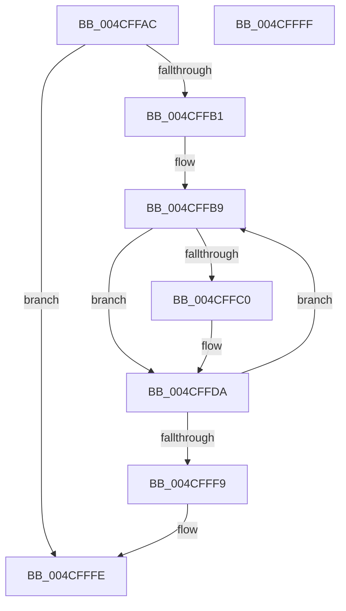

# PnpLockMountableDevice

- RVA: `0x004CFFAC`–`0x004D0000` (길이 `84` bytes)
- VA: `0x00000001404CFFAC`
- 실행 섹션: `.text`
- PDB 이름 있음: `예`; PDB Function 태그: `아니요`
- unwind 정보 RVA: `0x000BDB64`
- 디코드: `25`개 명령, `84/84` bytes 표시
- 미해석 바이트: `0` (있으면 어셈블리에 `.byte`로 보존)

> 이 문서는 커널 이미지의 기계어와 PDB 기호를 분석해 생성했습니다. 4번과 5번은 함수 원형과 자료형을 바이너리 사용 방식에서 추정한 C 해석이며 원본 소스 복구 결과는 아닙니다.

## 1. Dependencies

- 직접 호출 지점: **3**; 고유 호출 대상: **3**
- 직접 호출자로 확인된 함수: **3**
- RIP 상대 이미지 참조: **0**

### Outgoing calls
- `0x004CFFD5` → [KeWaitForSingleObject](../20/KeWaitForSingleObject_function_0020E6B0.md) (function, `0x0020E6B0`)
- `0x004CFFDF` → [KeAcquireQueuedSpinLock](../27/KeAcquireQueuedSpinLock_function_00273D80.md) (function, `0x00273D80`)
- `0x004CFFEF` → [KeReleaseQueuedSpinLock](../27/KeReleaseQueuedSpinLock_function_00272540.md) (function, `0x00272540`)

### Direct callers
- [PiIrpQueryRemoveDevice](../../page/73/PiIrpQueryRemoveDevice_function_0073E088.md) at `0x0073E0F3`
- [PiIrpQueryRemoveDevice](../../page/73/PiIrpQueryRemoveDevice_function_0073E088.md) at `0x0073E181`
- [PnpQueryStopDeviceNode](../../page/73/PnpQueryStopDeviceNode_function_0073F47C.md) at `0x0073F4BA`
- [IopRemoveDevice](../../page/8F/IopRemoveDevice_function_008FC7FC.md) at `0x008FC93A`
- [IopRemoveDevice](../../page/8F/IopRemoveDevice_function_008FC7FC.md) at `0x008FC962`

### Static image references
- 디코드된 RIP-relative 메모리 참조가 없습니다.

## 2. Other-region calls and transfers

- 다른 실행 섹션으로 향하는 call: **0**
- 별도 외부 분기/꼬리 이동을 확인하지 못했습니다.

## 3. Assembly (complete function range)

```asm
004CFFAC  48 85 C9                        test rcx, rcx
004CFFAF  74 4D                           je 0x1404cfffe
004CFFB1  53                              push rbx
004CFFB2  48 83 EC 30                     sub rsp, 0x30
004CFFB6  48 8B D9                        mov rbx, rcx
004CFFB9  48 83 7B 38 00                  cmp qword ptr [rbx + 0x38], 0
004CFFBE  74 1A                           je 0x1404cffda
004CFFC0  48 83 64 24 20 00               and qword ptr [rsp + 0x20], 0
004CFFC6  48 8D 8B 18 01 00 00            lea rcx, [rbx + 0x118]
004CFFCD  45 33 C9                        xor r9d, r9d
004CFFD0  45 33 C0                        xor r8d, r8d
004CFFD3  33 D2                           xor edx, edx
004CFFD5  E8 D6 E6 D3 FF                  call 0x14020e6b0
004CFFDA  B9 0A 00 00 00                  mov ecx, 0xa
004CFFDF  E8 9C 3D DA FF                  call 0x140273d80
004CFFE4  48 8B 5B 18                     mov rbx, qword ptr [rbx + 0x18]
004CFFE8  8A D0                           mov dl, al
004CFFEA  B9 0A 00 00 00                  mov ecx, 0xa
004CFFEF  E8 4C 25 DA FF                  call 0x140272540
004CFFF4  48 85 DB                        test rbx, rbx
004CFFF7  75 C0                           jne 0x1404cffb9
004CFFF9  48 83 C4 30                     add rsp, 0x30
004CFFFD  5B                              pop rbx
004CFFFE  C3                              ret
004CFFFF  CC                              int3
```

## 4. C-style interpretation (structured pseudocode)

```c
__int64 __fastcall PnpLockMountableDevice(__int64 a1, int a2, int a3, int a4)
{
    __int64 result;
    __int64 v_rsp;
    unsigned __int64 v_stack_m18;

    if (a1 == 0) goto loc_004CFFFE;
    v_rsp = (v_rsp) - (48);
loc_004CFFB9:
    if ((*(unsigned __int64 *)(a1 + 56)) != 0) {
        a1 = a1 + 280;
        a4 = 0;
        a3 = 0;
        a2 = 0;
        result = KeWaitForSingleObject(a1, a2, a3, a4);
    }
    result = KeAcquireQueuedSpinLock(10, a2, a3, a4);
    result = KeReleaseQueuedSpinLock(10, (unsigned __int8)(result), a3, a4);
    if (*(unsigned __int64 *)(a1 + 24) != 0) goto loc_004CFFB9;
    v_rsp = (v_rsp) + (48);
loc_004CFFFE:
    return result;
}
```

## 5. (Beta) C Style

```c
int64_t PnpLockMountableDevice(int64_t Arg1, int32_t Arg2, int32_t Arg3, int32_t Arg4)
{
    int64_t result;
    int64_t local_rsp;
    uint64_t v_stack_m18;

    if (Arg1 == 0) goto loc_004CFFFE;
    local_rsp = (local_rsp) - (48);
loc_004CFFB9:
    if ((*(uint64_t *)(Arg1 + 0x38)) != 0) {
        Arg1 = Arg1 + 280;
        Arg4 = 0;
        Arg3 = 0;
        Arg2 = 0;
        result = KeWaitForSingleObject(Arg1, Arg2, Arg3, Arg4);
    }
    result = KeAcquireQueuedSpinLock(10, Arg2, Arg3, Arg4);
    result = KeReleaseQueuedSpinLock(10, (uint8_t)(result), Arg3, Arg4);
    if (*(uint64_t *)(Arg1 + 0x18) != 0) goto loc_004CFFB9;
    local_rsp = (local_rsp) + (48);
loc_004CFFFE:
    return result;
}
```

## 6. Execution-region graph

[열기: 2D/3D 그래프와 함수 탐색 컨트롤 패널](../../../control-panel.html?section=text&rva=0x004CFFAC&view=graph)

- 2D 그래프는 위에서 아래로 흐르고, 3D 그래프는 빈 공간을 드래그해 회전합니다. Shift+드래그는 이동, 휠은 확대·축소, 함수 노드 선택은 대상 보고서 이동입니다.

### Static fallback


