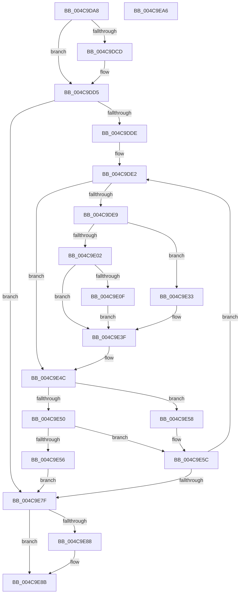

# PnpMarkDeviceForRemove

- RVA: `0x004C9DA8`–`0x004C9EA7` (길이 `255` bytes)
- VA: `0x00000001404C9DA8`
- 실행 섹션: `.text`
- PDB 이름 있음: `예`; PDB Function 태그: `아니요`
- unwind 정보 RVA: `0x0005E6B4`
- 디코드: `72`개 명령, `255/255` bytes 표시
- 미해석 바이트: `0` (있으면 어셈블리에 `.byte`로 보존)

> 이 문서는 커널 이미지의 기계어와 PDB 기호를 분석해 생성했습니다. 4번과 5번은 함수 원형과 자료형을 바이너리 사용 방식에서 추정한 C 해석이며 원본 소스 복구 결과는 아닙니다.

## 1. Dependencies

- 직접 호출 지점: **6**; 고유 호출 대상: **4**
- 직접 호출자로 확인된 함수: **3**
- RIP 상대 이미지 참조: **0**

### Outgoing calls
- `0x004C9DEE` → [KeAcquireQueuedSpinLock](../27/KeAcquireQueuedSpinLock_function_00273D80.md) (function, `0x00273D80`)
- `0x004C9E22` → [ObfReferenceObjectWithTag](../21/ObfReferenceObjectWithTag_function_00210710.md) (function, `0x00210710`)
- `0x004C9E2C` → [IopIncrementDeviceObjectRefCount](../41/IopIncrementDeviceObjectRefCount_function_0041B1D0.md) (function, `0x0041B1D0`)
- `0x004C9E47` → [KeReleaseQueuedSpinLock](../27/KeReleaseQueuedSpinLock_function_00272540.md) (function, `0x00272540`)
- `0x004C9E61` → [KeAcquireQueuedSpinLock](../27/KeAcquireQueuedSpinLock_function_00273D80.md) (function, `0x00273D80`)
- `0x004C9E71` → [KeReleaseQueuedSpinLock](../27/KeReleaseQueuedSpinLock_function_00272540.md) (function, `0x00272540`)

### Direct callers
- [PiIrpQueryRemoveDevice](../../page/73/PiIrpQueryRemoveDevice_function_0073E088.md) at `0x0073E102`
- [IopRemoveDevice](../../page/8F/IopRemoveDevice_function_008FC7FC.md) at `0x008FC94A`
- [IopRemoveDevice](../../page/8F/IopRemoveDevice_function_008FC7FC.md) at `0x008FCA35`
- [PnpSurpriseRemoveLockedDeviceNode](../../page/A0/PnpSurpriseRemoveLockedDeviceNode_function_00A08370.md) at `0x00A08582`

### Static image references
- 디코드된 RIP-relative 메모리 참조가 없습니다.

## 2. Other-region calls and transfers

- 다른 실행 섹션으로 향하는 call: **0**
- 별도 외부 분기/꼬리 이동을 확인하지 못했습니다.

## 3. Assembly (complete function range)

```asm
004C9DA8  48 8B C4                        mov rax, rsp
004C9DAB  48 89 58 08                     mov qword ptr [rax + 8], rbx
004C9DAF  48 89 68 10                     mov qword ptr [rax + 0x10], rbp
004C9DB3  48 89 70 18                     mov qword ptr [rax + 0x18], rsi
004C9DB7  48 89 78 20                     mov qword ptr [rax + 0x20], rdi
004C9DBB  41 56                           push r14
004C9DBD  48 83 EC 20                     sub rsp, 0x20
004C9DC1  49 8B D8                        mov rbx, r8
004C9DC4  8B EA                           mov ebp, edx
004C9DC6  48 8B F1                        mov rsi, rcx
004C9DC9  85 D2                           test edx, edx
004C9DCB  74 08                           je 0x1404c9dd5
004C9DCD  49 83 60 08 00                  and qword ptr [r8 + 8], 0
004C9DD2  49 89 08                        mov qword ptr [r8], rcx
004C9DD5  48 85 C9                        test rcx, rcx
004C9DD8  0F 84 A1 00 00 00               je 0x1404c9e7f
004C9DDE  49 8D 78 08                     lea rdi, [r8 + 8]
004C9DE2  48 83 7E 38 00                  cmp qword ptr [rsi + 0x38], 0
004C9DE7  74 63                           je 0x1404c9e4c
004C9DE9  B9 09 00 00 00                  mov ecx, 9
004C9DEE  E8 8D 9F DA FF                  call 0x140273d80
004C9DF3  48 8B 56 38                     mov rdx, qword ptr [rsi + 0x38]
004C9DF7  44 8A F0                        mov r14b, al
004C9DFA  0F B7 4A 04                     movzx ecx, word ptr [rdx + 4]
004C9DFE  85 ED                           test ebp, ebp
004C9E00  74 31                           je 0x1404c9e33
004C9E02  66 83 C9 08                     or cx, 8
004C9E06  66 89 4A 04                     mov word ptr [rdx + 4], cx
004C9E0A  F6 C1 01                        test cl, 1
004C9E0D  74 30                           je 0x1404c9e3f
004C9E0F  48 8B 4A 08                     mov rcx, qword ptr [rdx + 8]
004C9E13  48 8D 7B 08                     lea rdi, [rbx + 8]
004C9E17  BA 44 66 6C 74                  mov edx, 0x746c6644
004C9E1C  48 89 0F                        mov qword ptr [rdi], rcx
004C9E1F  48 89 33                        mov qword ptr [rbx], rsi
004C9E22  E8 E9 68 D4 FF                  call 0x140210710
004C9E27  48 8B 0F                        mov rcx, qword ptr [rdi]
004C9E2A  B2 01                           mov dl, 1
004C9E2C  E8 9F 13 F5 FF                  call 0x14041b1d0
004C9E31  EB 0C                           jmp 0x1404c9e3f
004C9E33  B8 F7 FF 00 00                  mov eax, 0xfff7
004C9E38  66 23 C8                        and cx, ax
004C9E3B  66 89 4A 04                     mov word ptr [rdx + 4], cx
004C9E3F  41 8A D6                        mov dl, r14b
004C9E42  B9 09 00 00 00                  mov ecx, 9
004C9E47  E8 F4 86 DA FF                  call 0x140272540
004C9E4C  85 ED                           test ebp, ebp
004C9E4E  74 08                           je 0x1404c9e58
004C9E50  48 83 3F 00                     cmp qword ptr [rdi], 0
004C9E54  74 06                           je 0x1404c9e5c
004C9E56  EB 27                           jmp 0x1404c9e7f
004C9E58  48 8D 7B 08                     lea rdi, [rbx + 8]
004C9E5C  B9 0A 00 00 00                  mov ecx, 0xa
004C9E61  E8 1A 9F DA FF                  call 0x140273d80
004C9E66  48 8B 76 18                     mov rsi, qword ptr [rsi + 0x18]
004C9E6A  8A D0                           mov dl, al
004C9E6C  B9 0A 00 00 00                  mov ecx, 0xa
004C9E71  E8 CA 86 DA FF                  call 0x140272540
004C9E76  48 85 F6                        test rsi, rsi
004C9E79  0F 85 63 FF FF FF               jne 0x1404c9de2
004C9E7F  48 8B 43 08                     mov rax, qword ptr [rbx + 8]
004C9E83  48 85 C0                        test rax, rax
004C9E86  75 03                           jne 0x1404c9e8b
004C9E88  48 8B 03                        mov rax, qword ptr [rbx]
004C9E8B  48 8B 5C 24 30                  mov rbx, qword ptr [rsp + 0x30]
004C9E90  48 8B 6C 24 38                  mov rbp, qword ptr [rsp + 0x38]
004C9E95  48 8B 74 24 40                  mov rsi, qword ptr [rsp + 0x40]
004C9E9A  48 8B 7C 24 48                  mov rdi, qword ptr [rsp + 0x48]
004C9E9F  48 83 C4 20                     add rsp, 0x20
004C9EA3  41 5E                           pop r14
004C9EA5  C3                              ret
004C9EA6  CC                              int3
```

## 4. C-style interpretation (structured pseudocode)

```c
__int64 __fastcall PnpMarkDeviceForRemove(__int64 a1, int a2, __int64 a3)
{
    __int64 result;
    __int64 v_rsp;
    unsigned __int64 v_stack_p10;
    unsigned __int64 v_stack_p18;
    unsigned __int64 v_stack_p20;
    unsigned __int64 v_stack_p8;

    *(unsigned __int64 *)(v_rsp + 8) = v_rbx;
    *(unsigned __int64 *)(v_rsp + 16) = v_rbp;
    *(unsigned __int64 *)(v_rsp + 24) = v_rsi;
    *(unsigned __int64 *)(v_rsp + 32) = v_rdi;
    v_rsp = (v_rsp) - (32);
    if (a2 != 0) {
        *(unsigned __int64 *)(a3) = a1;
    }
    if (a1 == 0) goto loc_004C9E7F;
loc_004C9DE2:
    if ((*(unsigned __int64 *)(a1 + 56)) == 0) goto loc_004C9E4C;
    result = KeAcquireQueuedSpinLock(9, a2, a3, a4);
    if ((unsigned int)((unsigned int)(a2)) == 0) goto loc_004C9E33;
    a1 = (unsigned __int16)((*(unsigned __int16 *)(*(unsigned __int64 *)(a1 + 56) + 4)) | (8));
    *(unsigned __int16 *)(*(unsigned __int64 *)(a1 + 56) + 4) = (unsigned __int16)(a1);
    if ((((unsigned __int8)(a1)) & (1)) == 0) goto loc_004C9E3F;
    *(unsigned __int64 *)(a3 + 8) = *(unsigned __int64 *)(*(unsigned __int64 *)(a1 + 56) + 8);
    *(unsigned __int64 *)(a3) = a1;
    result = ObfReferenceObjectWithTag(*(unsigned __int64 *)(*(unsigned __int64 *)(a1 + 56) + 8), (unsigned int)(0x746C6644ULL), a3, a4);
    result = IopIncrementDeviceObjectRefCount(*(unsigned __int64 *)(a3 + 8), 1, a3, a4);
    goto loc_004C9E3F;
loc_004C9E33:
    a1 = (unsigned __int16)((*(unsigned __int64 *)(a3 + 8)) & ((unsigned __int16)((unsigned int)(0xFFF7ULL))));
    *(unsigned __int16 *)(1 + 4) = (unsigned __int16)(a1);
loc_004C9E3F:
    result = KeReleaseQueuedSpinLock(9, (unsigned __int8)((unsigned __int8)(result)), a3, a4);
loc_004C9E4C:
    if ((unsigned int)((unsigned int)(a2)) == 0) goto loc_004C9E58;
    if ((*(unsigned __int64 *)(a3 + 8)) == 0) goto loc_004C9E5C;
    goto loc_004C9E7F;
loc_004C9E58:
loc_004C9E5C:
    result = KeAcquireQueuedSpinLock(10, (unsigned __int8)((unsigned __int8)(result)), a3, a4);
    result = KeReleaseQueuedSpinLock(10, (unsigned __int8)(result), a3, a4);
    if (*(unsigned __int64 *)(a1 + 24) != 0) goto loc_004C9DE2;
loc_004C9E7F:
    result = *(unsigned __int64 *)(a3 + 8);
    if (*(unsigned __int64 *)(a3 + 8) == 0) {
        result = *(unsigned __int64 *)(a3);
    }
    v_rsp = (v_rsp) + (32);
    return result;
}
```

## 5. (Beta) C Style

```c
int64_t PnpMarkDeviceForRemove(int64_t Arg1, int32_t Arg2, void *Arg3)
{
    uint8_t *arg3 = (uint8_t *)Arg3;

    int64_t result;
    int64_t local_rsp;
    uint64_t v_stack_p10;
    uint64_t v_stack_p18;
    uint64_t v_stack_p20;
    uint64_t v_stack_p8;

    *(uint64_t *)(local_rsp + 0x8) = local_rbx;
    *(uint64_t *)(local_rsp + 0x10) = local_rbp;
    *(uint64_t *)(local_rsp + 0x18) = local_rsi;
    *(uint64_t *)(local_rsp + 0x20) = local_rdi;
    local_rsp = (local_rsp) - (32);
    if (Arg2 != 0) {
        *(uint64_t *)(arg3) = Arg1;
    }
    if (Arg1 == 0) goto loc_004C9E7F;
loc_004C9DE2:
    if ((*(uint64_t *)(Arg1 + 0x38)) == 0) goto loc_004C9E4C;
    result = KeAcquireQueuedSpinLock(9, Arg2, Arg3, a4);
    if ((uint32_t)((uint32_t)(Arg2)) == 0) goto loc_004C9E33;
    Arg1 = (uint16_t)((*(uint16_t *)(*(uint64_t *)(Arg1 + 0x38) + 0x4)) | (8));
    *(uint16_t *)(*(uint64_t *)(Arg1 + 0x38) + 0x4) = (uint16_t)(Arg1);
    if ((((uint8_t)(Arg1)) & (1)) == 0) goto loc_004C9E3F;
    *(uint64_t *)(arg3 + 0x8) = *(uint64_t *)(*(uint64_t *)(Arg1 + 0x38) + 0x8);
    *(uint64_t *)(arg3) = Arg1;
    result = ObfReferenceObjectWithTag(*(uint64_t *)(*(uint64_t *)(Arg1 + 0x38) + 0x8), (uint32_t)(0x746C6644ULL), Arg3, a4);
    result = IopIncrementDeviceObjectRefCount(*(uint64_t *)(arg3 + 0x8), 1, Arg3, a4);
    goto loc_004C9E3F;
loc_004C9E33:
    Arg1 = (uint16_t)((*(uint64_t *)(arg3 + 0x8)) & ((uint16_t)((uint32_t)(0xFFF7ULL))));
    *(uint16_t *)(1 + 0x4) = (uint16_t)(Arg1);
loc_004C9E3F:
    result = KeReleaseQueuedSpinLock(9, (uint8_t)((uint8_t)(result)), Arg3, a4);
loc_004C9E4C:
    if ((uint32_t)((uint32_t)(Arg2)) == 0) goto loc_004C9E58;
    if ((*(uint64_t *)(arg3 + 0x8)) == 0) goto loc_004C9E5C;
    goto loc_004C9E7F;
loc_004C9E58:
loc_004C9E5C:
    result = KeAcquireQueuedSpinLock(10, (uint8_t)((uint8_t)(result)), Arg3, a4);
    result = KeReleaseQueuedSpinLock(10, (uint8_t)(result), Arg3, a4);
    if (*(uint64_t *)(Arg1 + 0x18) != 0) goto loc_004C9DE2;
loc_004C9E7F:
    result = *(uint64_t *)(arg3 + 0x8);
    if (*(uint64_t *)(arg3 + 0x8) == 0) {
        result = *(uint64_t *)(arg3);
    }
    local_rsp = (local_rsp) + (32);
    return result;
}
```

### 관측된 메모리 오프셋

구조체 형식이 확인되지 않은 접근은 인자 기준의 오프셋으로만 기록했습니다.

| 기준 인자 | 오프셋 표현 | 폭 (bit) | 접근 |
|---|---:|---:|---|
| `Arg3` | `+ 0x0` | `64` | `R` |
| `Arg3` | `+ 0x0` | `64` | `W` |
| `Arg3` | `+ 0x8` | `64` | `R` |
| `Arg3` | `+ 0x8` | `64` | `R/W` |

## 6. Execution-region graph

[열기: 2D/3D 그래프와 함수 탐색 컨트롤 패널](../../../control-panel.html?section=text&rva=0x004C9DA8&view=graph)

- 2D 그래프는 위에서 아래로 흐르고, 3D 그래프는 빈 공간을 드래그해 회전합니다. Shift+드래그는 이동, 휠은 확대·축소, 함수 노드 선택은 대상 보고서 이동입니다.

### Static fallback


