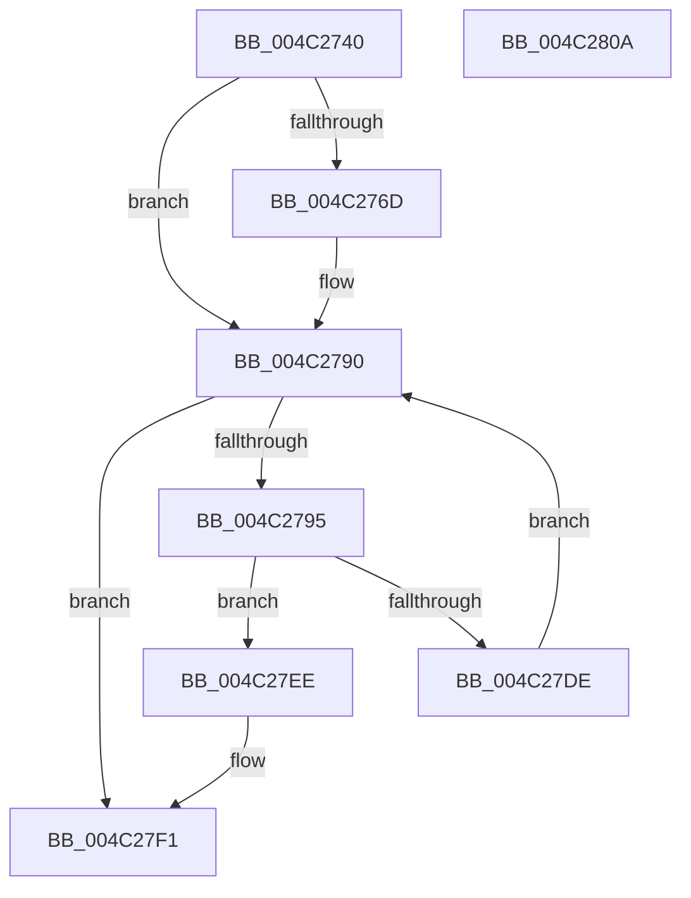

# PnpMultiSzContainsString

- RVA: `0x004C2740`–`0x004C280B` (길이 `203` bytes)
- VA: `0x00000001404C2740`
- 실행 섹션: `.text`
- PDB 이름 있음: `예`; PDB Function 태그: `아니요`
- unwind 정보 RVA: `0x000BCAF8`
- 디코드: `55`개 명령, `203/203` bytes 표시
- 미해석 바이트: `0` (있으면 어셈블리에 `.byte`로 보존)

> 이 문서는 커널 이미지의 기계어와 PDB 기호를 분석해 생성했습니다. 4번과 5번은 함수 원형과 자료형을 바이너리 사용 방식에서 추정한 C 해석이며 원본 소스 복구 결과는 아닙니다.

## 1. Dependencies

- 직접 호출 지점: **3**; 고유 호출 대상: **2**
- 직접 호출자로 확인된 함수: **5**
- RIP 상대 이미지 참조: **0**

### Outgoing calls
- `0x004C2770` → [wcslen](../50/wcslen_function_00501BA0.md) (function, `0x00501BA0`)
- `0x004C27A5` → [wcslen](../50/wcslen_function_00501BA0.md) (function, `0x00501BA0`)
- `0x004C27D5` → [RtlEqualUnicodeString](../../page/93/RtlEqualUnicodeString_function_00932A20.md) (function, `0x00932A20`)

### Direct callers
- [PiDevCfgAppendMultiSz](../../page/73/PiDevCfgAppendMultiSz_function_00731B28.md) at `0x00731CBB`
- [PiDevCfgAppendMultiSz](../../page/73/PiDevCfgAppendMultiSz_function_00731B28.md) at `0x00731D44`
- [PiDevCfgFindDeviceMigrationNode](../../page/73/PiDevCfgFindDeviceMigrationNode_function_00732920.md) at `0x00732CB2`
- [PiDevCfgFindDeviceDriver](../../page/97/PiDevCfgFindDeviceDriver_function_0097602C.md) at `0x0097644C`
- [PiDevCfgResolveVariableExpression](../../page/AA/PiDevCfgResolveVariableExpression_function_00AA8C00.md) at `0x00AA90C6`
- [PiDevCfgResolveVariableExpression](../../page/AA/PiDevCfgResolveVariableExpression_function_00AA8C00.md) at `0x00AA9453`
- [PiDevCfgResolveVariableExpression](../../page/AA/PiDevCfgResolveVariableExpression_function_00AA8C00.md) at `0x00AA9472`
- [PiDevCfgResolveVariableExpression](../../page/AA/PiDevCfgResolveVariableExpression_function_00AA8C00.md) at `0x00AA9490`
- [PiDevCfgResolveVariableExpression](../../page/AA/PiDevCfgResolveVariableExpression_function_00AA8C00.md) at `0x00AA9820`
- [PiDevCfgResolveVariableExpression](../../page/AA/PiDevCfgResolveVariableExpression_function_00AA8C00.md) at `0x00AA98B3`
- [PiDevCfgResolveMultiSzValue](../../page/AB/PiDevCfgResolveMultiSzValue_function_00AB6894.md) at `0x00AB6A1D`
- [PiDevCfgResolveMultiSzValue](../../page/AB/PiDevCfgResolveMultiSzValue_function_00AB6894.md) at `0x00AB6A66`
- [PiDevCfgResolveMultiSzValue](../../page/AB/PiDevCfgResolveMultiSzValue_function_00AB6894.md) at `0x00AB6AE7`

### Static image references
- 디코드된 RIP-relative 메모리 참조가 없습니다.

## 2. Other-region calls and transfers

- 다른 실행 섹션으로 향하는 call: **1**
  - `0x004C27D5` → [RtlEqualUnicodeString](../../page/93/RtlEqualUnicodeString_function_00932A20.md) (`.text` → `PAGE`)
- 별도 외부 분기/꼬리 이동을 확인하지 못했습니다.

## 3. Assembly (complete function range)

```asm
004C2740  48 8B C4                        mov rax, rsp
004C2743  48 89 58 08                     mov qword ptr [rax + 8], rbx
004C2747  48 89 70 10                     mov qword ptr [rax + 0x10], rsi
004C274B  48 89 78 18                     mov qword ptr [rax + 0x18], rdi
004C274F  41 56                           push r14
004C2751  48 83 EC 40                     sub rsp, 0x40
004C2755  33 DB                           xor ebx, ebx
004C2757  48 89 50 F0                     mov qword ptr [rax - 0x10], rdx
004C275B  48 89 58 E8                     mov qword ptr [rax - 0x18], rbx
004C275F  48 8B F9                        mov rdi, rcx
004C2762  41 BE FC FF 00 00               mov r14d, 0xfffc
004C2768  48 85 D2                        test rdx, rdx
004C276B  74 23                           je 0x1404c2790
004C276D  48 8B CA                        mov rcx, rdx
004C2770  E8 2B F4 03 00                  call 0x140501ba0
004C2775  48 03 C0                        add rax, rax
004C2778  48 3D FE FF 00 00               cmp rax, 0xfffe
004C277E  49 0F 43 C6                     cmovae rax, r14
004C2782  66 89 44 24 30                  mov word ptr [rsp + 0x30], ax
004C2787  66 83 C0 02                     add ax, 2
004C278B  66 89 44 24 32                  mov word ptr [rsp + 0x32], ax
004C2790  66 39 1F                        cmp word ptr [rdi], bx
004C2793  74 5C                           je 0x1404c27f1
004C2795  0F 57 C0                        xorps xmm0, xmm0
004C2798  48 8B CF                        mov rcx, rdi
004C279B  0F 11 44 24 20                  movups xmmword ptr [rsp + 0x20], xmm0
004C27A0  48 89 7C 24 28                  mov qword ptr [rsp + 0x28], rdi
004C27A5  E8 F6 F3 03 00                  call 0x140501ba0
004C27AA  48 8B F0                        mov rsi, rax
004C27AD  48 8D 54 24 20                  lea rdx, [rsp + 0x20]
004C27B2  48 03 F6                        add rsi, rsi
004C27B5  48 8D 4C 24 30                  lea rcx, [rsp + 0x30]
004C27BA  48 81 FE FE FF 00 00            cmp rsi, 0xfffe
004C27C1  41 B0 01                        mov r8b, 1
004C27C4  49 0F 43 F6                     cmovae rsi, r14
004C27C8  66 89 74 24 20                  mov word ptr [rsp + 0x20], si
004C27CD  8D 46 02                        lea eax, [rsi + 2]
004C27D0  66 89 44 24 22                  mov word ptr [rsp + 0x22], ax
004C27D5  E8 46 02 47 00                  call 0x140932a20
004C27DA  84 C0                           test al, al
004C27DC  75 10                           jne 0x1404c27ee
004C27DE  0F B7 C6                        movzx eax, si
004C27E1  48 D1 E8                        shr rax, 1
004C27E4  48 8D 3C 47                     lea rdi, [rdi + rax*2]
004C27E8  48 83 C7 02                     add rdi, 2
004C27EC  EB A2                           jmp 0x1404c2790
004C27EE  48 8B DF                        mov rbx, rdi
004C27F1  48 8B 74 24 58                  mov rsi, qword ptr [rsp + 0x58]
004C27F6  48 8B C3                        mov rax, rbx
004C27F9  48 8B 5C 24 50                  mov rbx, qword ptr [rsp + 0x50]
004C27FE  48 8B 7C 24 60                  mov rdi, qword ptr [rsp + 0x60]
004C2803  48 83 C4 40                     add rsp, 0x40
004C2807  41 5E                           pop r14
004C2809  C3                              ret
004C280A  CC                              int3
```

## 4. C-style interpretation (structured pseudocode)

```c
__int64 __fastcall PnpMultiSzContainsString(__int64 a1, __int64 a2)
{
    __int64 result;
    __int64 v_rbx;
    __int64 v_rdi;
    __int64 v_rsi;
    __int64 v_rsp;
    unsigned __int16 v_stack_m16;
    unsigned __int16 v_stack_m18;
    unsigned __int64 v_stack_m20;
    unsigned __int16 v_stack_m26;
    unsigned __int64 v_stack_m28;
    unsigned __int64 v_stack_p10;
    unsigned __int64 v_stack_p18;
    unsigned __int64 v_stack_p8;

    *(unsigned __int64 *)(v_rsp + 8) = v_rbx;
    *(unsigned __int64 *)(v_rsp + 16) = v_rsi;
    *(unsigned __int64 *)(v_rsp + 24) = v_rdi;
    v_rsp = (v_rsp) - (64);
    v_rbx = 0;
    *(unsigned __int64 *)(v_rsp - 16) = a2;
    *(unsigned __int64 *)(v_rsp - 24) = 0;
    result = v_rsp;
    if (a2 != 0) {
        a1 = a2;
        result = wcslen(a1, a2, a3, a4);
        result = (result) + (result);
        if (result >= 0xFFFEULL) { result = (unsigned int)(0xFFFCULL); }
        v_stack_m18 = (unsigned __int16)(result);
        result = (unsigned __int16)((result) + (2));
        v_stack_m16 = (unsigned __int16)(result);
    }
    if ((*(unsigned __int16 *)(a1)) == 0) goto loc_004C27F1;
    v_stack_m28 = v_xmm0;
    v_stack_m20 = a1;
    result = wcslen(a1, a2, a3, a4);
    v_rsi = (result) + (result);
    if (v_rsi >= 0xFFFEULL) { v_rsi = (unsigned int)(0xFFFCULL); }
    v_stack_m28 = (unsigned __int16)(v_rsi);
    v_stack_m26 = (unsigned __int16)(v_rsi + 2);
    result = RtlEqualUnicodeString(v_stack_m18, v_stack_m28, 1, a4);
    if ((unsigned __int8)(result) != 0) goto loc_004C27EE;
    result = ((unsigned __int16)(v_rsi)) >> (1);
    v_rdi = (a1 + result * 2) + (2);
    goto loc_004C2790;
loc_004C27EE:
loc_004C27F1:
    v_rsp = (v_rsp) + (64);
    return v_rdi;
}
```

## 5. (Beta) C Style

```c
int64_t PnpMultiSzContainsString(void *Arg1, int64_t Arg2)
{
    uint8_t *arg1 = (uint8_t *)Arg1;

    int64_t result;
    int64_t local_rbx;
    int64_t local_rdi;
    int64_t local_rsi;
    int64_t local_rsp;
    uint16_t v_stack_m16;
    uint16_t v_stack_m18;
    uint64_t v_stack_m20;
    uint16_t v_stack_m26;
    uint64_t v_stack_m28;
    uint64_t v_stack_p10;
    uint64_t v_stack_p18;
    uint64_t v_stack_p8;

    *(uint64_t *)(local_rsp + 0x8) = local_rbx;
    *(uint64_t *)(local_rsp + 0x10) = local_rsi;
    *(uint64_t *)(local_rsp + 0x18) = local_rdi;
    local_rsp = (local_rsp) - (64);
    local_rbx = 0;
    *(uint64_t *)(local_rsp - 0x10) = Arg2;
    *(uint64_t *)(local_rsp - 0x18) = 0;
    result = local_rsp;
    if (Arg2 != 0) {
        Arg1 = Arg2;
        result = wcslen(Arg1, Arg2, a3, a4);
        result = (result) + (result);
        if (result >= 0xFFFEULL) { result = (uint32_t)(0xFFFCULL); }
        v_stack_m18 = (uint16_t)(result);
        result = (uint16_t)((result) + (2));
        v_stack_m16 = (uint16_t)(result);
    }
    if ((*(uint16_t *)(arg1)) == 0) goto loc_004C27F1;
    v_stack_m28 = v_xmm0;
    v_stack_m20 = Arg1;
    result = wcslen(Arg1, Arg2, a3, a4);
    local_rsi = (result) + (result);
    if (local_rsi >= 0xFFFEULL) { local_rsi = (uint32_t)(0xFFFCULL); }
    v_stack_m28 = (uint16_t)(local_rsi);
    v_stack_m26 = (uint16_t)(local_rsi + 2);
    result = RtlEqualUnicodeString(v_stack_m18, v_stack_m28, 1, a4);
    if ((uint8_t)(result) != 0) goto loc_004C27EE;
    result = ((uint16_t)(local_rsi)) >> (1);
    local_rdi = (Arg1 + result * 2) + (2);
    goto loc_004C2790;
loc_004C27EE:
loc_004C27F1:
    local_rsp = (local_rsp) + (64);
    return local_rdi;
}
```

### 관측된 메모리 오프셋

구조체 형식이 확인되지 않은 접근은 인자 기준의 오프셋으로만 기록했습니다.

| 기준 인자 | 오프셋 표현 | 폭 (bit) | 접근 |
|---|---:|---:|---|
| `Arg1` | `+ 0x0` | `16` | `R` |
| `Arg1` | `+ 0x0 + rax*2` | `64` | `R` |

## 6. Execution-region graph

[열기: 2D/3D 그래프와 함수 탐색 컨트롤 패널](../../../control-panel.html?section=text&rva=0x004C2740&view=graph)

- 2D 그래프는 위에서 아래로 흐르고, 3D 그래프는 빈 공간을 드래그해 회전합니다. Shift+드래그는 이동, 휠은 확대·축소, 함수 노드 선택은 대상 보고서 이동입니다.

### Static fallback


