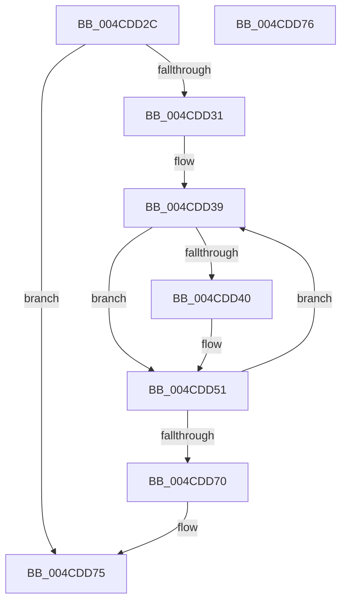

# PnpUnlockMountableDevice

- RVA: `0x004CDD2C`–`0x004CDD77` (길이 `75` bytes)
- VA: `0x00000001404CDD2C`
- 실행 섹션: `.text`
- PDB 이름 있음: `예`; PDB Function 태그: `아니요`
- unwind 정보 RVA: `0x000805BC`
- 디코드: `23`개 명령, `75/75` bytes 표시
- 미해석 바이트: `0` (있으면 어셈블리에 `.byte`로 보존)

> 이 문서는 커널 이미지의 기계어와 PDB 기호를 분석해 생성했습니다. 4번과 5번은 함수 원형과 자료형을 바이너리 사용 방식에서 추정한 C 해석이며 원본 소스 복구 결과는 아닙니다.

## 1. Dependencies

- 직접 호출 지점: **3**; 고유 호출 대상: **3**
- 직접 호출자로 확인된 함수: **5**
- RIP 상대 이미지 참조: **0**

### Outgoing calls
- `0x004CDD4C` → [KeSetEvent](../33/KeSetEvent_function_0033F310.md) (function, `0x0033F310`)
- `0x004CDD56` → [KeAcquireQueuedSpinLock](../27/KeAcquireQueuedSpinLock_function_00273D80.md) (function, `0x00273D80`)
- `0x004CDD66` → [KeReleaseQueuedSpinLock](../27/KeReleaseQueuedSpinLock_function_00272540.md) (function, `0x00272540`)

### Direct callers
- [PiIrpQueryRemoveDevice](../../page/73/PiIrpQueryRemoveDevice_function_0073E088.md) at `0x0073E10D`
- [PiIrpQueryRemoveDevice](../../page/73/PiIrpQueryRemoveDevice_function_0073E088.md) at `0x0073E1A2`
- [PnpCancelStopDeviceNode](../../page/73/PnpCancelStopDeviceNode_function_0073F048.md) at `0x0073F0B9`
- [PipProcessRestartPhase1](../../page/74/PipProcessRestartPhase1_function_007407EC.md) at `0x00740865`
- [IopRemoveDevice](../../page/8F/IopRemoveDevice_function_008FC7FC.md) at `0x008FC955`
- [IopRemoveDevice](../../page/8F/IopRemoveDevice_function_008FC7FC.md) at `0x008FC984`
- [PnpSurpriseRemoveLockedDeviceNode](../../page/A0/PnpSurpriseRemoveLockedDeviceNode_function_00A08370.md) at `0x00A0858A`

### Static image references
- 디코드된 RIP-relative 메모리 참조가 없습니다.

## 2. Other-region calls and transfers

- 다른 실행 섹션으로 향하는 call: **0**
- 별도 외부 분기/꼬리 이동을 확인하지 못했습니다.

## 3. Assembly (complete function range)

```asm
004CDD2C  48 85 C9                        test rcx, rcx
004CDD2F  74 44                           je 0x1404cdd75
004CDD31  53                              push rbx
004CDD32  48 83 EC 20                     sub rsp, 0x20
004CDD36  48 8B D9                        mov rbx, rcx
004CDD39  48 83 7B 38 00                  cmp qword ptr [rbx + 0x38], 0
004CDD3E  74 11                           je 0x1404cdd51
004CDD40  48 8D 8B 18 01 00 00            lea rcx, [rbx + 0x118]
004CDD47  45 33 C0                        xor r8d, r8d
004CDD4A  33 D2                           xor edx, edx
004CDD4C  E8 BF 15 E7 FF                  call 0x14033f310
004CDD51  B9 0A 00 00 00                  mov ecx, 0xa
004CDD56  E8 25 60 DA FF                  call 0x140273d80
004CDD5B  48 8B 5B 18                     mov rbx, qword ptr [rbx + 0x18]
004CDD5F  8A D0                           mov dl, al
004CDD61  B9 0A 00 00 00                  mov ecx, 0xa
004CDD66  E8 D5 47 DA FF                  call 0x140272540
004CDD6B  48 85 DB                        test rbx, rbx
004CDD6E  75 C9                           jne 0x1404cdd39
004CDD70  48 83 C4 20                     add rsp, 0x20
004CDD74  5B                              pop rbx
004CDD75  C3                              ret
004CDD76  CC                              int3
```

## 4. C-style interpretation (structured pseudocode)

```c
__int64 __fastcall PnpUnlockMountableDevice(__int64 a1, int a2, int a3)
{
    __int64 result;
    __int64 v_rsp;

    if (a1 == 0) goto loc_004CDD75;
    v_rsp = (v_rsp) - (32);
loc_004CDD39:
    if ((*(unsigned __int64 *)(a1 + 56)) != 0) {
        a1 = a1 + 280;
        a3 = 0;
        a2 = 0;
        result = KeSetEvent(a1, a2, a3, a4);
    }
    result = KeAcquireQueuedSpinLock(10, a2, a3, a4);
    result = KeReleaseQueuedSpinLock(10, (unsigned __int8)(result), a3, a4);
    if (*(unsigned __int64 *)(a1 + 24) != 0) goto loc_004CDD39;
    v_rsp = (v_rsp) + (32);
loc_004CDD75:
    return result;
}
```

## 5. (Beta) C Style

```c
int64_t PnpUnlockMountableDevice(int64_t Arg1, int32_t Arg2, int32_t Arg3)
{
    int64_t result;
    int64_t local_rsp;

    if (Arg1 == 0) goto loc_004CDD75;
    local_rsp = (local_rsp) - (32);
loc_004CDD39:
    if ((*(uint64_t *)(Arg1 + 0x38)) != 0) {
        Arg1 = Arg1 + 280;
        Arg3 = 0;
        Arg2 = 0;
        result = KeSetEvent(Arg1, Arg2, Arg3, a4);
    }
    result = KeAcquireQueuedSpinLock(10, Arg2, Arg3, a4);
    result = KeReleaseQueuedSpinLock(10, (uint8_t)(result), Arg3, a4);
    if (*(uint64_t *)(Arg1 + 0x18) != 0) goto loc_004CDD39;
    local_rsp = (local_rsp) + (32);
loc_004CDD75:
    return result;
}
```

## 6. Execution-region graph

[열기: 2D/3D 그래프와 함수 탐색 컨트롤 패널](../../../control-panel.html?section=text&rva=0x004CDD2C&view=graph)

- 2D 그래프는 위에서 아래로 흐르고, 3D 그래프는 빈 공간을 드래그해 회전합니다. Shift+드래그는 이동, 휠은 확대·축소, 함수 노드 선택은 대상 보고서 이동입니다.

### Static fallback


