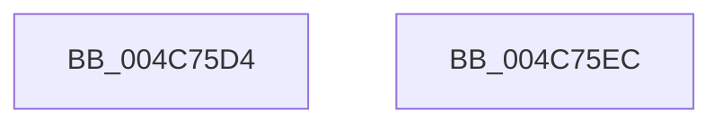

# PopAcquireWakeSourceSpinLock

- RVA: `0x004C75D4`–`0x004C75ED` (길이 `25` bytes)
- VA: `0x00000001404C75D4`
- 실행 섹션: `.text`
- PDB 이름 있음: `예`; PDB Function 태그: `아니요`
- unwind 정보 RVA: `0x0005C788`
- 디코드: `7`개 명령, `25/25` bytes 표시
- 미해석 바이트: `0` (있으면 어셈블리에 `.byte`로 보존)

> 이 문서는 커널 이미지의 기계어와 PDB 기호를 분석해 생성했습니다. 4번과 5번은 함수 원형과 자료형을 바이너리 사용 방식에서 추정한 C 해석이며 원본 소스 복구 결과는 아닙니다.

## 1. Dependencies

- 직접 호출 지점: **1**; 고유 호출 대상: **1**
- 직접 호출자로 확인된 함수: **3**
- RIP 상대 이미지 참조: **1**

### Outgoing calls
- `0x004C75E2` → [KeAcquireInStackQueuedSpinLock](../27/KeAcquireInStackQueuedSpinLock_function_002757A0.md) (function, `0x002757A0`)

### Direct callers
- [PopHandleWakeSources](../../pagelk/B6/PopHandleWakeSources_function_00B6C264.md) at `0x00B6C28D`
- [PopHandleWakeSources](../../pagelk/B6/PopHandleWakeSources_function_00B6C264.md) at `0x00B6C3EF`
- [PopProcessDeviceWakeSource](../../pagelk/B6/PopProcessDeviceWakeSource_function_00B6C534.md) at `0x00B6C56F`
- [PopProcessDeviceWakeSource](../../pagelk/B6/PopProcessDeviceWakeSource_function_00B6C534.md) at `0x00B6C5CD`
- [PopNewWakeInfo](../../pagelk/B7/PopNewWakeInfo_function_00B7D220.md) at `0x00B7D274`

### Static image references
- `0x004C75DB` → RVA `0x00F0DEA8` (`.data`; read)

## 2. Other-region calls and transfers

- 다른 실행 섹션으로 향하는 call: **0**
- 별도 외부 분기/꼬리 이동을 확인하지 못했습니다.

## 3. Assembly (complete function range)

```asm
004C75D4  48 83 EC 28                     sub rsp, 0x28
004C75D8  48 8B D1                        mov rdx, rcx
004C75DB  48 8D 0D C6 68 A4 00            lea rcx, [rip + 0xa468c6]
004C75E2  E8 B9 E1 DA FF                  call 0x1402757a0
004C75E7  48 83 C4 28                     add rsp, 0x28
004C75EB  C3                              ret
004C75EC  CC                              int3
```

## 4. C-style interpretation (structured pseudocode)

```c
__int64 __fastcall PopAcquireWakeSourceSpinLock(__int64 a1)
{
    __int64 result;
    __int64 v_rsp;

    v_rsp = (v_rsp) - (40);
    result = KeAcquireInStackQueuedSpinLock(v_rip + 10774726, a1, a3, a4);
    v_rsp = (v_rsp) + (40);
    return result;
}
```

## 5. (Beta) C Style

```c
int64_t PopAcquireWakeSourceSpinLock(int64_t Arg1)
{
    int64_t result;
    int64_t local_rsp;

    local_rsp = (local_rsp) - (40);
    result = KeAcquireInStackQueuedSpinLock(v_rip + 10774726, Arg1, a3, a4);
    local_rsp = (local_rsp) + (40);
    return result;
}
```

## 6. Execution-region graph

[열기: 2D/3D 그래프와 함수 탐색 컨트롤 패널](../../../control-panel.html?section=text&rva=0x004C75D4&view=graph)

- 2D 그래프는 위에서 아래로 흐르고, 3D 그래프는 빈 공간을 드래그해 회전합니다. Shift+드래그는 이동, 휠은 확대·축소, 함수 노드 선택은 대상 보고서 이동입니다.

### Static fallback


