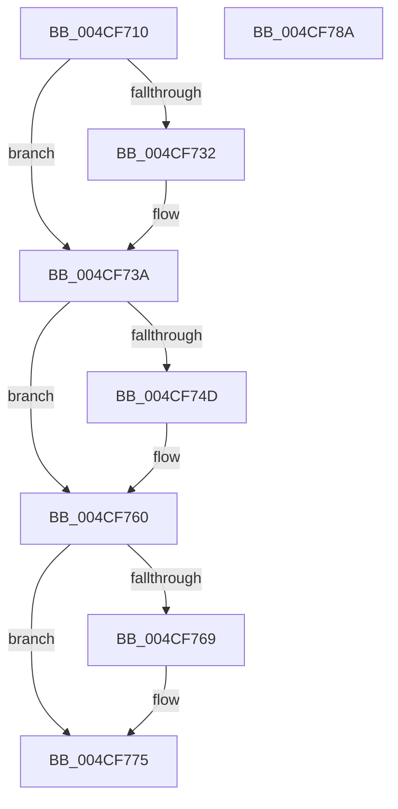

# PopDeviceConstraintsEnforced

- RVA: `0x004CF710`–`0x004CF78B` (길이 `123` bytes)
- VA: `0x00000001404CF710`
- 실행 섹션: `.text`
- PDB 이름 있음: `예`; PDB Function 태그: `아니요`
- unwind 정보 RVA: `0x0005CAAC`
- 디코드: `31`개 명령, `123/123` bytes 표시
- 미해석 바이트: `0` (있으면 어셈블리에 `.byte`로 보존)

> 이 문서는 커널 이미지의 기계어와 PDB 기호를 분석해 생성했습니다. 4번과 5번은 함수 원형과 자료형을 바이너리 사용 방식에서 추정한 C 해석이며 원본 소스 복구 결과는 아닙니다.

## 1. Dependencies

- 직접 호출 지점: **2**; 고유 호출 대상: **2**
- 직접 호출자로 확인된 함수: **2**
- RIP 상대 이미지 참조: **2**

### Outgoing calls
- `0x004CF735` → [KiRaiseIrqlProcessIrqlFlags](../4F/KiRaiseIrqlProcessIrqlFlags_function_004F56FC.md) (function, `0x004F56FC`)
- `0x004CF770` → [KiLowerIrqlProcessIrqlFlags](../4F/KiLowerIrqlProcessIrqlFlags_function_004F5698.md) (function, `0x004F5698`)

### Direct callers
- [PopDripsWatchdogCallbackHandler](../../page/76/PopDripsWatchdogCallbackHandler_function_0076C1C0.md) at `0x0076C256`
- [PopDripsWatchdogTakeAction](../../page/77/PopDripsWatchdogTakeAction_function_007732D0.md) at `0x007734EE`

### Static image references
- `0x004CF729` → RVA `0x00FC6D20` (`ALMOSTRO`; read)
- `0x004CF74D` → RVA `0x00FC6AD0` (`ALMOSTRO`; read)

## 2. Other-region calls and transfers

- 다른 실행 섹션으로 향하는 call: **0**
- 별도 외부 분기/꼬리 이동을 확인하지 못했습니다.

## 3. Assembly (complete function range)

```asm
004CF710  48 89 5C 24 08                  mov qword ptr [rsp + 8], rbx
004CF715  57                              push rdi
004CF716  48 83 EC 20                     sub rsp, 0x20
004CF71A  32 DB                           xor bl, bl
004CF71C  44 0F 20 C7                     mov rdi, cr8
004CF720  BA 02 00 00 00                  mov edx, 2
004CF725  44 0F 22 C2                     mov cr8, rdx
004CF729  83 3D F0 75 AF 00 00            cmp dword ptr [rip + 0xaf75f0], 0
004CF730  74 08                           je 0x1404cf73a
004CF732  40 8A CF                        mov cl, dil
004CF735  E8 C2 5F 02 00                  call 0x1404f56fc
004CF73A  65 48 8B 04 25 20 00 00 00      mov rax, qword ptr gs:[0x20]
004CF743  48 83 B8 40 88 00 00 00         cmp qword ptr [rax + 0x8840], 0
004CF74B  74 13                           je 0x1404cf760
004CF74D  48 83 3D 7B 73 AF 00 00         cmp qword ptr [rip + 0xaf737b], 0
004CF755  B8 01 00 00 00                  mov eax, 1
004CF75A  0F B6 DB                        movzx ebx, bl
004CF75D  0F 45 D8                        cmovne ebx, eax
004CF760  83 3D B9 75 AF 00 00            cmp dword ptr [rip + 0xaf75b9], 0
004CF767  74 0C                           je 0x1404cf775
004CF769  44 0F 20 C1                     mov rcx, cr8
004CF76D  40 8A D7                        mov dl, dil
004CF770  E8 23 5F 02 00                  call 0x1404f5698
004CF775  40 0F B6 CF                     movzx ecx, dil
004CF779  44 0F 22 C1                     mov cr8, rcx
004CF77D  8A C3                           mov al, bl
004CF77F  48 8B 5C 24 30                  mov rbx, qword ptr [rsp + 0x30]
004CF784  48 83 C4 20                     add rsp, 0x20
004CF788  5F                              pop rdi
004CF789  C3                              ret
004CF78A  CC                              int3
```

## 4. C-style interpretation (structured pseudocode)

```c
__int64 __fastcall PopDeviceConstraintsEnforced(void)
{
    __int64 result;
    __int64 v_rbx;
    __int64 v_rsp;
    unsigned __int64 v_stack_p8;

    v_stack_p8 = v_rbx;
    v_rsp = (v_rsp) - (32);
    v_rbx = 0;
    if ((*(unsigned int *)(v_rip + 11498992)) != 0) {
        a1 = (unsigned __int8)(v_cr8);
        result = KiRaiseIrqlProcessIrqlFlags(a1, 2, a3, a4);
    }
    result = *(unsigned __int64 *)(gs_base + (0 + 32));
    if ((*(unsigned __int64 *)(*(unsigned __int64 *)(gs_base + (0 + 32)) + 34880)) != 0) {
        result = 1;
        v_rbx = 0;
        if ((*(unsigned __int64 *)(v_rip + 11498363)) != 0) { v_rbx = (unsigned int)(result); }
    }
    if ((*(unsigned int *)(v_rip + 11498937)) != 0) {
        a1 = 2;
        a2 = (unsigned __int8)(v_cr8);
        result = KiLowerIrqlProcessIrqlFlags(a1, a2, a3, a4);
    }
    v_rsp = (v_rsp) + (32);
    return (unsigned __int8)(v_rbx);
}
```

## 5. (Beta) C Style

```c
void PopDeviceConstraintsEnforced(void)
{
    int64_t result;
    int64_t local_rbx;
    int64_t local_rsp;
    uint64_t v_stack_p8;

    v_stack_p8 = local_rbx;
    local_rsp = (local_rsp) - (32);
    local_rbx = 0;
    if ((*(uint32_t *)(v_rip + 0xAF75F0)) != 0) {
        a1 = (uint8_t)(v_cr8);
        result = KiRaiseIrqlProcessIrqlFlags(a1, 2, a3, a4);
    }
    result = *(uint64_t *)(gs_base + (0 + 0x20));
    if ((*(uint64_t *)(*(uint64_t *)(gs_base + (0 + 0x20)) + 0x8840)) != 0) {
        result = 1;
        local_rbx = 0;
        if ((*(uint64_t *)(v_rip + 0xAF737B)) != 0) { local_rbx = (uint32_t)(result); }
    }
    if ((*(uint32_t *)(v_rip + 0xAF75B9)) != 0) {
        a1 = 2;
        a2 = (uint8_t)(v_cr8);
        result = KiLowerIrqlProcessIrqlFlags(a1, a2, a3, a4);
    }
    local_rsp = (local_rsp) + (32);
    return (uint8_t)(local_rbx);
}
```

## 6. Execution-region graph

[열기: 2D/3D 그래프와 함수 탐색 컨트롤 패널](../../../control-panel.html?section=text&rva=0x004CF710&view=graph)

- 2D 그래프는 위에서 아래로 흐르고, 3D 그래프는 빈 공간을 드래그해 회전합니다. Shift+드래그는 이동, 휠은 확대·축소, 함수 노드 선택은 대상 보고서 이동입니다.

### Static fallback


