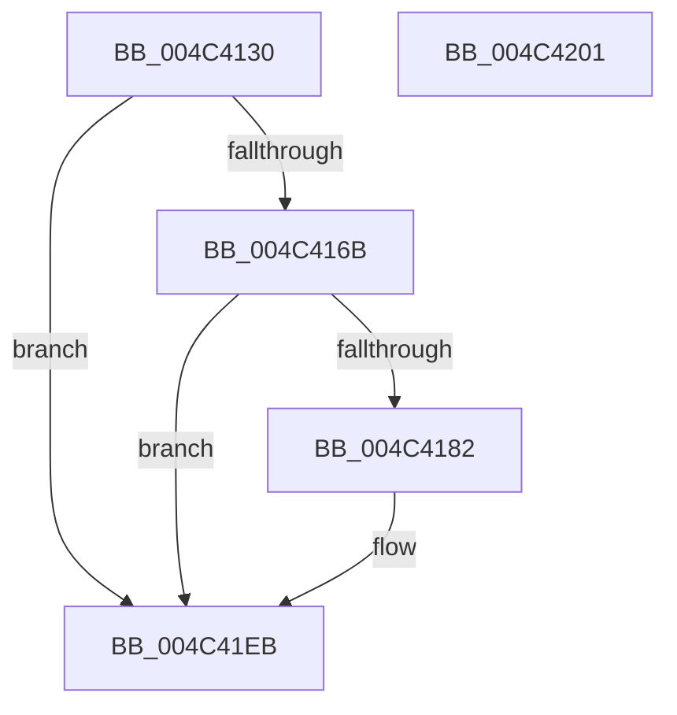

# PopDiagTraceFxDeviceDirectedTransition

- RVA: `0x004C4130`–`0x004C4202` (길이 `210` bytes)
- VA: `0x00000001404C4130`
- 실행 섹션: `.text`
- PDB 이름 있음: `예`; PDB Function 태그: `아니요`
- unwind 정보 RVA: `0x00080C0C`
- 디코드: `44`개 명령, `210/210` bytes 표시
- 미해석 바이트: `0` (있으면 어셈블리에 `.byte`로 보존)

> 이 문서는 커널 이미지의 기계어와 PDB 기호를 분석해 생성했습니다. 4번과 5번은 함수 원형과 자료형을 바이너리 사용 방식에서 추정한 C 해석이며 원본 소스 복구 결과는 아닙니다.

## 1. Dependencies

- 직접 호출 지점: **4**; 고유 호출 대상: **4**
- 직접 호출자로 확인된 함수: **1**
- RIP 상대 이미지 참조: **4**

### Outgoing calls
- `0x004C4159` → [PopFxAddLogEntry](../39/PopFxAddLogEntry_function_00390B94.md) (function, `0x00390B94`)
- `0x004C4179` → [EtwEventEnabled](../39/EtwEventEnabled_function_00392450.md) (function, `0x00392450`)
- `0x004C41E6` → [EtwWriteEx](../25/EtwWriteEx_function_0025F0D0.md) (function, `0x0025F0D0`)
- `0x004C41F3` → [_security_check_cookie](../6A/_security_check_cookie_function_006AC640.md) (function, `0x006AC640`)

### Direct callers
- [PopFxHandleDirectedPowerTransition](PopFxHandleDirectedPowerTransition_function_004C405C.md) at `0x004C4091`

### Static image references
- `0x004C4139` → RVA `0x00E0A740` (`.data`; read)
- `0x004C415E` → RVA `0x00E67858` (`.data`; read)
- `0x004C416B` → RVA `0x00F0B408` (`.data`; read)
- `0x004C4172` → RVA `0x00020F30` (`.rdata`; read)

## 2. Other-region calls and transfers

- 다른 실행 섹션으로 향하는 call: **0**
- 별도 외부 분기/꼬리 이동을 확인하지 못했습니다.

## 3. Assembly (complete function range)

```asm
004C4130  40 53                           push rbx
004C4132  48 81 EC 80 00 00 00            sub rsp, 0x80
004C4139  48 8B 05 00 66 94 00            mov rax, qword ptr [rip + 0x946600]
004C4140  48 33 C4                        xor rax, rsp
004C4143  48 89 44 24 70                  mov qword ptr [rsp + 0x70], rax
004C4148  0F B6 DA                        movzx ebx, dl
004C414B  33 D2                           xor edx, edx
004C414D  44 8B CB                        mov r9d, ebx
004C4150  48 89 4C 24 48                  mov qword ptr [rsp + 0x48], rcx
004C4155  44 8D 42 19                     lea r8d, [rdx + 0x19]
004C4159  E8 36 CA EC FF                  call 0x140390b94
004C415E  80 3D F3 36 9A 00 00            cmp byte ptr [rip + 0x9a36f3], 0
004C4165  0F 84 80 00 00 00               je 0x1404c41eb
004C416B  48 8B 0D 96 72 A4 00            mov rcx, qword ptr [rip + 0xa47296]
004C4172  48 8D 15 B7 CD B5 FF            lea rdx, [rip - 0x4a3249]
004C4179  E8 D2 E2 EC FF                  call 0x140392450
004C417E  84 C0                           test al, al
004C4180  74 69                           je 0x1404c41eb
004C4182  83 64 24 5C 00                  and dword ptr [rsp + 0x5c], 0
004C4187  48 8D 44 24 48                  lea rax, [rsp + 0x48]
004C418C  83 64 24 6C 00                  and dword ptr [rsp + 0x6c], 0
004C4191  48 8D 15 98 CD B5 FF            lea rdx, [rip - 0x4a3268]
004C4198  48 8B 0D 69 72 A4 00            mov rcx, qword ptr [rip + 0xa47269]
004C419F  45 33 C9                        xor r9d, r9d
004C41A2  48 89 44 24 50                  mov qword ptr [rsp + 0x50], rax
004C41A7  45 33 C0                        xor r8d, r8d
004C41AA  48 8D 44 24 40                  lea rax, [rsp + 0x40]
004C41AF  89 5C 24 40                     mov dword ptr [rsp + 0x40], ebx
004C41B3  48 89 44 24 60                  mov qword ptr [rsp + 0x60], rax
004C41B8  48 8D 44 24 50                  lea rax, [rsp + 0x50]
004C41BD  48 89 44 24 38                  mov qword ptr [rsp + 0x38], rax
004C41C2  C7 44 24 30 02 00 00 00         mov dword ptr [rsp + 0x30], 2
004C41CA  48 83 64 24 28 00               and qword ptr [rsp + 0x28], 0
004C41D0  48 83 64 24 20 00               and qword ptr [rsp + 0x20], 0
004C41D6  C7 44 24 58 08 00 00 00         mov dword ptr [rsp + 0x58], 8
004C41DE  C7 44 24 68 04 00 00 00         mov dword ptr [rsp + 0x68], 4
004C41E6  E8 E5 AE D9 FF                  call 0x14025f0d0
004C41EB  48 8B 4C 24 70                  mov rcx, qword ptr [rsp + 0x70]
004C41F0  48 33 CC                        xor rcx, rsp
004C41F3  E8 48 84 1E 00                  call 0x1406ac640
004C41F8  48 81 C4 80 00 00 00            add rsp, 0x80
004C41FF  5B                              pop rbx
004C4200  C3                              ret
004C4201  CC                              int3
```

## 4. C-style interpretation (structured pseudocode)

```c
__int64 __fastcall PopDiagTraceFxDeviceDirectedTransition(__int64 a1, int a2)
{
    __int64 result;
    __int64 v_rsp;
    unsigned __int64 v_stack_m18;
    unsigned int v_stack_m1C;
    unsigned int v_stack_m20;
    unsigned __int64 v_stack_m28;
    unsigned int v_stack_m2C;
    unsigned int v_stack_m30;
    unsigned __int64 v_stack_m38;
    unsigned __int64 v_stack_m40;
    unsigned __int64 v_stack_m48;
    unsigned __int64 v_stack_m50;
    unsigned int v_stack_m58;
    unsigned __int64 v_stack_m60;
    unsigned __int64 v_stack_m68;

    v_rsp = (v_rsp) - (128);
    result = (*(unsigned __int64 *)(v_rip + 9725440)) ^ (v_rsp);
    v_stack_m18 = result;
    a2 = 0;
    v_stack_m40 = a1;
    result = PopFxAddLogEntry(a1, a2, a2 + 25, (unsigned int)((unsigned int)((unsigned __int8)(a2))));
    if ((*(unsigned __int8 *)(v_rip + 10106611)) == 0) goto loc_004C41EB;
    result = EtwEventEnabled(*(unsigned __int64 *)(v_rip + 10777238), v_rip - 4862537, a2 + 25, (unsigned int)((unsigned int)((unsigned __int8)(a2))));
    if ((unsigned __int8)(result) != 0) {
        result = v_stack_m40;
        a2 = v_rip - 4862568;
        a1 = *(unsigned __int64 *)(v_rip + 10777193);
        a4 = 0;
        v_stack_m38 = result;
        a3 = 0;
        result = v_stack_m48;
        v_stack_m48 = (unsigned int)((unsigned __int8)(a2));
        v_stack_m28 = result;
        result = v_stack_m38;
        v_stack_m50 = result;
        v_stack_m58 = 2;
        v_stack_m30 = 8;
        v_stack_m20 = 4;
        result = EtwWriteEx(a1, a2, a3, a4);
    }
    a1 = (v_stack_m18) ^ (v_rsp);
    result = _security_check_cookie(a1, a2, a3, a4);
    v_rsp = (v_rsp) + (128);
    return result;
}
```

## 5. (Beta) C Style

```c
int64_t PopDiagTraceFxDeviceDirectedTransition(int64_t Arg1, int32_t Arg2)
{
    int64_t result;
    int64_t local_rsp;
    uint64_t v_stack_m18;
    uint32_t v_stack_m1C;
    uint32_t v_stack_m20;
    uint64_t v_stack_m28;
    uint32_t v_stack_m2C;
    uint32_t v_stack_m30;
    uint64_t v_stack_m38;
    uint64_t v_stack_m40;
    uint64_t v_stack_m48;
    uint64_t v_stack_m50;
    uint32_t v_stack_m58;
    uint64_t v_stack_m60;
    uint64_t v_stack_m68;

    local_rsp = (local_rsp) - (128);
    result = (*(uint64_t *)(v_rip + 0x946600)) ^ (local_rsp);
    v_stack_m18 = result;
    Arg2 = 0;
    v_stack_m40 = Arg1;
    result = PopFxAddLogEntry(Arg1, Arg2, Arg2 + 25, (uint32_t)((uint32_t)((uint8_t)(Arg2))));
    if ((*(uint8_t *)(v_rip + 0x9A36F3)) == 0) goto loc_004C41EB;
    result = EtwEventEnabled(*(uint64_t *)(v_rip + 0xA47296), v_rip - 4862537, Arg2 + 25, (uint32_t)((uint32_t)((uint8_t)(Arg2))));
    if ((uint8_t)(result) != 0) {
        result = v_stack_m40;
        Arg2 = v_rip - 4862568;
        Arg1 = *(uint64_t *)(v_rip + 0xA47269);
        a4 = 0;
        v_stack_m38 = result;
        a3 = 0;
        result = v_stack_m48;
        v_stack_m48 = (uint32_t)((uint8_t)(Arg2));
        v_stack_m28 = result;
        result = v_stack_m38;
        v_stack_m50 = result;
        v_stack_m58 = 2;
        v_stack_m30 = 8;
        v_stack_m20 = 4;
        result = EtwWriteEx(Arg1, Arg2, a3, a4);
    }
    Arg1 = (v_stack_m18) ^ (local_rsp);
    result = _security_check_cookie(Arg1, Arg2, a3, a4);
    local_rsp = (local_rsp) + (128);
    return result;
}
```

## 6. Execution-region graph

[열기: 2D/3D 그래프와 함수 탐색 컨트롤 패널](../../../control-panel.html?section=text&rva=0x004C4130&view=graph)

- 2D 그래프는 위에서 아래로 흐르고, 3D 그래프는 빈 공간을 드래그해 회전합니다. Shift+드래그는 이동, 휠은 확대·축소, 함수 노드 선택은 대상 보고서 이동입니다.

### Static fallback


