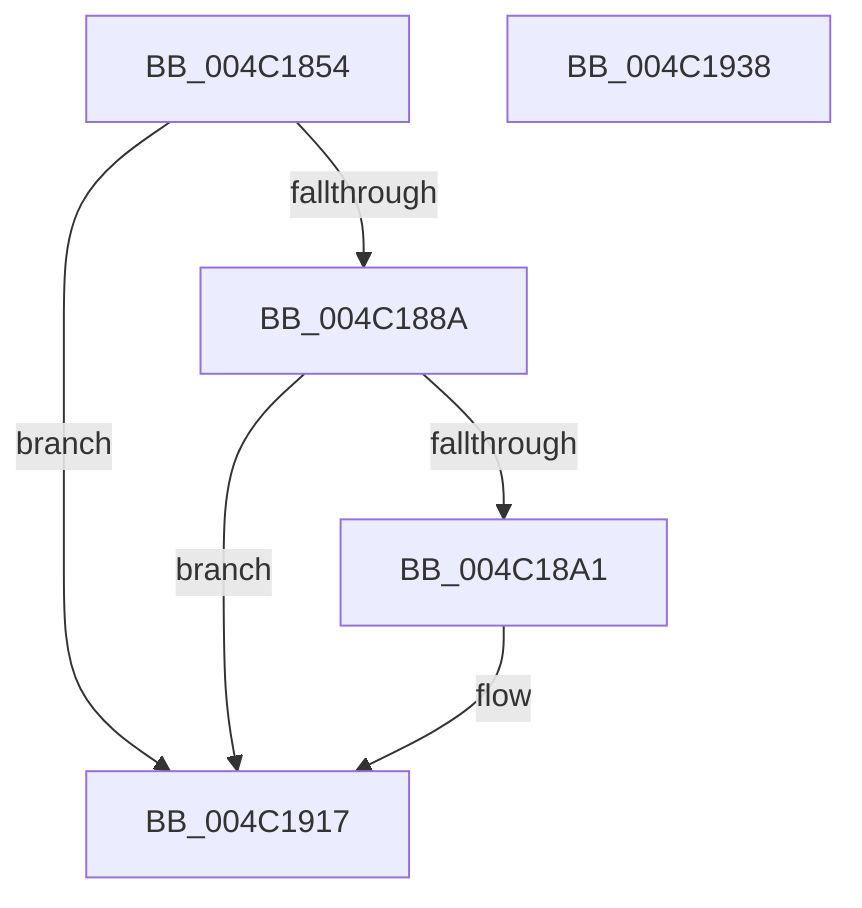

# PopDiagTraceFxPerfRequestComplete

- RVA: `0x004C1854`–`0x004C1939` (길이 `229` bytes)
- VA: `0x00000001404C1854`
- 실행 섹션: `.text`
- PDB 이름 있음: `예`; PDB Function 태그: `아니요`
- unwind 정보 RVA: `0x000BC800`
- 디코드: `53`개 명령, `229/229` bytes 표시
- 미해석 바이트: `0` (있으면 어셈블리에 `.byte`로 보존)

> 이 문서는 커널 이미지의 기계어와 PDB 기호를 분석해 생성했습니다. 4번과 5번은 함수 원형과 자료형을 바이너리 사용 방식에서 추정한 C 해석이며 원본 소스 복구 결과는 아닙니다.

## 1. Dependencies

- 직접 호출 지점: **3**; 고유 호출 대상: **3**
- 직접 호출자로 확인된 함수: **1**
- RIP 상대 이미지 참조: **4**

### Outgoing calls
- `0x004C1898` → [EtwEventEnabled](../39/EtwEventEnabled_function_00392450.md) (function, `0x00392450`)
- `0x004C1912` → [EtwWriteEx](../25/EtwWriteEx_function_0025F0D0.md) (function, `0x0025F0D0`)
- `0x004C191E` → [_security_check_cookie](../6A/_security_check_cookie_function_006AC640.md) (function, `0x006AC640`)

### Direct callers
- [PopFxCompleteComponentPerfState](PopFxCompleteComponentPerfState_function_004C1750.md) at `0x004C182F`

### Static image references
- `0x004C1869` → RVA `0x00E0A740` (`.data`; read)
- `0x004C1877` → RVA `0x00E67858` (`.data`; read)
- `0x004C188A` → RVA `0x00F0B408` (`.data`; read)
- `0x004C1891` → RVA `0x00023058` (`.rdata`; read)

## 2. Other-region calls and transfers

- 다른 실행 섹션으로 향하는 call: **0**
- 별도 외부 분기/꼬리 이동을 확인하지 못했습니다.

## 3. Assembly (complete function range)

```asm
004C1854  48 89 5C 24 08                  mov qword ptr [rsp + 8], rbx
004C1859  48 89 7C 24 10                  mov qword ptr [rsp + 0x10], rdi
004C185E  55                              push rbp
004C185F  48 8B EC                        mov rbp, rsp
004C1862  48 81 EC 80 00 00 00            sub rsp, 0x80
004C1869  48 8B 05 D0 8E 94 00            mov rax, qword ptr [rip + 0x948ed0]
004C1870  48 33 C4                        xor rax, rsp
004C1873  48 89 45 F8                     mov qword ptr [rbp - 8], rax
004C1877  80 3D DA 5F 9A 00 00            cmp byte ptr [rip + 0x9a5fda], 0
004C187E  48 8B F9                        mov rdi, rcx
004C1881  0F B6 DA                        movzx ebx, dl
004C1884  0F 84 8D 00 00 00               je 0x1404c1917
004C188A  48 8B 0D 77 9B A4 00            mov rcx, qword ptr [rip + 0xa49b77]
004C1891  48 8D 15 C0 17 B6 FF            lea rdx, [rip - 0x49e840]
004C1898  E8 B3 0B ED FF                  call 0x140392450
004C189D  84 C0                           test al, al
004C189F  74 76                           je 0x1404c1917
004C18A1  48 8B 0F                        mov rcx, qword ptr [rdi]
004C18A4  48 8D 15 AD 17 B6 FF            lea rdx, [rip - 0x49e853]
004C18AB  45 33 C9                        xor r9d, r9d
004C18AE  45 33 C0                        xor r8d, r8d
004C18B1  48 8B 41 50                     mov rax, qword ptr [rcx + 0x50]
004C18B5  83 65 D4 00                     and dword ptr [rbp - 0x2c], 0
004C18B9  48 83 C0 30                     add rax, 0x30
004C18BD  83 65 E4 00                     and dword ptr [rbp - 0x1c], 0
004C18C1  83 65 F4 00                     and dword ptr [rbp - 0xc], 0
004C18C5  48 89 45 C8                     mov qword ptr [rbp - 0x38], rax
004C18C9  48 8D 41 10                     lea rax, [rcx + 0x10]
004C18CD  48 89 45 D8                     mov qword ptr [rbp - 0x28], rax
004C18D1  B9 04 00 00 00                  mov ecx, 4
004C18D6  48 8D 45 C0                     lea rax, [rbp - 0x40]
004C18DA  89 4D E0                        mov dword ptr [rbp - 0x20], ecx
004C18DD  48 89 45 E8                     mov qword ptr [rbp - 0x18], rax
004C18E1  48 8D 45 C8                     lea rax, [rbp - 0x38]
004C18E5  48 89 44 24 38                  mov qword ptr [rsp + 0x38], rax
004C18EA  C7 44 24 30 03 00 00 00         mov dword ptr [rsp + 0x30], 3
004C18F2  48 83 64 24 28 00               and qword ptr [rsp + 0x28], 0
004C18F8  48 83 64 24 20 00               and qword ptr [rsp + 0x20], 0
004C18FE  89 4D F0                        mov dword ptr [rbp - 0x10], ecx
004C1901  48 8B 0D 00 9B A4 00            mov rcx, qword ptr [rip + 0xa49b00]
004C1908  C7 45 D0 08 00 00 00            mov dword ptr [rbp - 0x30], 8
004C190F  89 5D C0                        mov dword ptr [rbp - 0x40], ebx
004C1912  E8 B9 D7 D9 FF                  call 0x14025f0d0
004C1917  48 8B 4D F8                     mov rcx, qword ptr [rbp - 8]
004C191B  48 33 CC                        xor rcx, rsp
004C191E  E8 1D AD 1E 00                  call 0x1406ac640
004C1923  4C 8D 9C 24 80 00 00 00         lea r11, [rsp + 0x80]
004C192B  49 8B 5B 10                     mov rbx, qword ptr [r11 + 0x10]
004C192F  49 8B 7B 18                     mov rdi, qword ptr [r11 + 0x18]
004C1933  49 8B E3                        mov rsp, r11
004C1936  5D                              pop rbp
004C1937  C3                              ret
004C1938  CC                              int3
```

## 4. C-style interpretation (structured pseudocode)

```c
__int64 __fastcall PopDiagTraceFxPerfRequestComplete(__int64 a1, unsigned __int8 a2, int a3, int a4)
{
    __int64 result;
    __int64 v_rsp;
    unsigned __int64 v_stack_m10;
    unsigned int v_stack_m14;
    unsigned int v_stack_m18;
    unsigned __int64 v_stack_m20;
    unsigned int v_stack_m24;
    unsigned int v_stack_m28;
    unsigned __int64 v_stack_m30;
    unsigned int v_stack_m34;
    unsigned int v_stack_m38;
    unsigned __int64 v_stack_m40;
    unsigned __int64 v_stack_m48;
    unsigned __int64 v_stack_m50;
    unsigned int v_stack_m58;
    unsigned __int64 v_stack_m60;
    unsigned __int64 v_stack_m68;
    unsigned __int64 v_stack_m8;
    unsigned __int64 v_stack_p10;
    unsigned __int64 v_stack_p8;

    v_stack_p8 = v_rbx;
    v_stack_p10 = v_rdi;
    v_rsp = (v_rsp) - (128);
    result = (*(unsigned __int64 *)(v_rip + 9735888)) ^ (v_rsp);
    v_stack_m10 = result;
    if ((*(unsigned __int8 *)(v_rip + 10117082)) == 0) goto loc_004C1917;
    result = EtwEventEnabled(*(unsigned __int64 *)(v_rip + 10787703), v_rip - 4843584, a3, a4);
    if ((unsigned __int8)(result) != 0) {
        a1 = *(unsigned __int64 *)(a1);
        a2 = v_rip - 4843603;
        a4 = 0;
        a3 = 0;
        result = *(unsigned __int64 *)(a1 + 80);
        result = (result) + (48);
        v_stack_m40 = result;
        result = a1 + 16;
        v_stack_m30 = result;
        a1 = 4;
        result = v_stack_m48;
        v_stack_m28 = (unsigned int)(a1);
        v_stack_m20 = result;
        result = v_stack_m40;
        v_stack_m50 = result;
        v_stack_m58 = 3;
        v_stack_m18 = (unsigned int)(a1);
        a1 = *(unsigned __int64 *)(v_rip + 10787584);
        v_stack_m38 = 8;
        v_stack_m48 = a2;
        result = EtwWriteEx(a1, a2, a3, a4);
    }
    a1 = (v_stack_m10) ^ (v_rsp);
    result = _security_check_cookie(a1, a2, a3, a4);
    return result;
}
```

## 5. (Beta) C Style

```c
int64_t PopDiagTraceFxPerfRequestComplete(void *Arg1, uint8_t Arg2, int32_t Arg3, int32_t Arg4)
{
    uint8_t *arg1 = (uint8_t *)Arg1;

    int64_t result;
    int64_t local_rsp;
    uint64_t v_stack_m10;
    uint32_t v_stack_m14;
    uint32_t v_stack_m18;
    uint64_t v_stack_m20;
    uint32_t v_stack_m24;
    uint32_t v_stack_m28;
    uint64_t v_stack_m30;
    uint32_t v_stack_m34;
    uint32_t v_stack_m38;
    uint64_t v_stack_m40;
    uint64_t v_stack_m48;
    uint64_t v_stack_m50;
    uint32_t v_stack_m58;
    uint64_t v_stack_m60;
    uint64_t v_stack_m68;
    uint64_t v_stack_m8;
    uint64_t v_stack_p10;
    uint64_t v_stack_p8;

    v_stack_p8 = local_rbx;
    v_stack_p10 = local_rdi;
    local_rsp = (local_rsp) - (128);
    result = (*(uint64_t *)(v_rip + 0x948ED0)) ^ (local_rsp);
    v_stack_m10 = result;
    if ((*(uint8_t *)(v_rip + 0x9A5FDA)) == 0) goto loc_004C1917;
    result = EtwEventEnabled(*(uint64_t *)(v_rip + 0xA49B77), v_rip - 4843584, Arg3, Arg4);
    if ((uint8_t)(result) != 0) {
        Arg1 = *(uint64_t *)(arg1);
        Arg2 = v_rip - 4843603;
        Arg4 = 0;
        Arg3 = 0;
        result = *(uint64_t *)(arg1 + 0x50);
        result = (result) + (48);
        v_stack_m40 = result;
        result = Arg1 + 16;
        v_stack_m30 = result;
        Arg1 = 4;
        result = v_stack_m48;
        v_stack_m28 = (uint32_t)(Arg1);
        v_stack_m20 = result;
        result = v_stack_m40;
        v_stack_m50 = result;
        v_stack_m58 = 3;
        v_stack_m18 = (uint32_t)(Arg1);
        Arg1 = *(uint64_t *)(v_rip + 0xA49B00);
        v_stack_m38 = 8;
        v_stack_m48 = Arg2;
        result = EtwWriteEx(Arg1, Arg2, Arg3, Arg4);
    }
    Arg1 = (v_stack_m10) ^ (local_rsp);
    result = _security_check_cookie(Arg1, Arg2, Arg3, Arg4);
    return result;
}
```

### 관측된 메모리 오프셋

구조체 형식이 확인되지 않은 접근은 인자 기준의 오프셋으로만 기록했습니다.

| 기준 인자 | 오프셋 표현 | 폭 (bit) | 접근 |
|---|---:|---:|---|
| `Arg1` | `+ 0x0` | `64` | `R` |

## 6. Execution-region graph

[열기: 2D/3D 그래프와 함수 탐색 컨트롤 패널](../../../control-panel.html?section=text&rva=0x004C1854&view=graph)

- 2D 그래프는 위에서 아래로 흐르고, 3D 그래프는 빈 공간을 드래그해 회전합니다. Shift+드래그는 이동, 휠은 확대·축소, 함수 노드 선택은 대상 보고서 이동입니다.

### Static fallback


