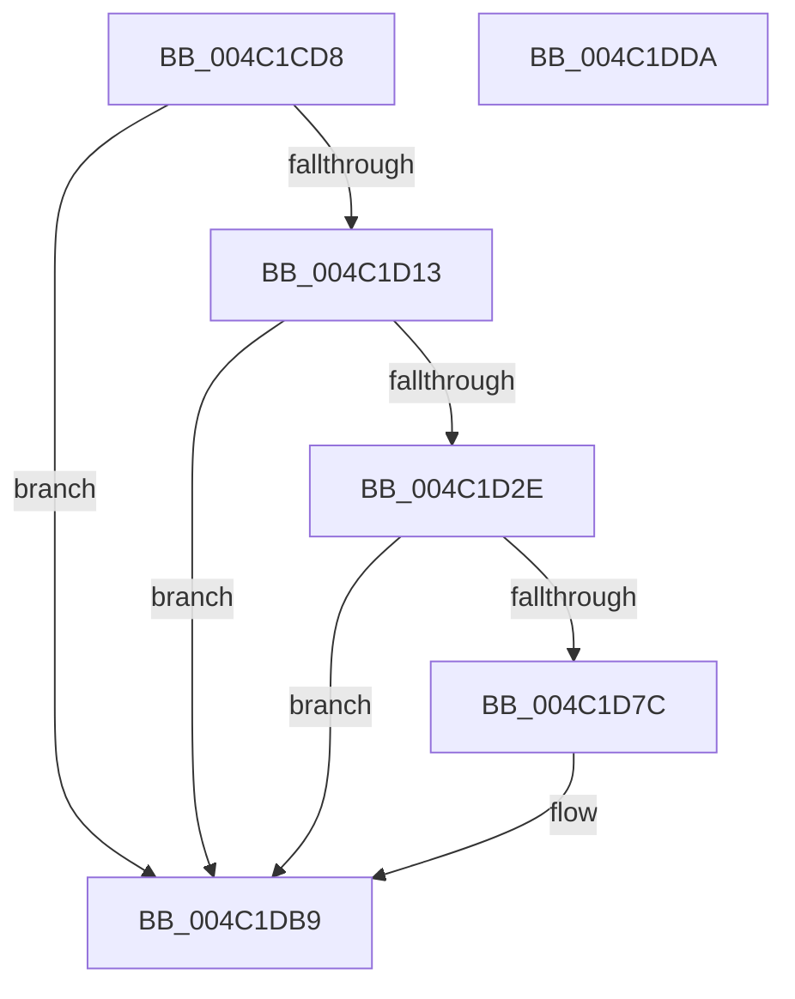

# PopDiagTraceFxPerfRequest

- RVA: `0x004C1CD8`–`0x004C1DDB` (길이 `259` bytes)
- VA: `0x00000001404C1CD8`
- 실행 섹션: `.text`
- PDB 이름 있음: `예`; PDB Function 태그: `아니요`
- unwind 정보 RVA: `0x000BC854`
- 디코드: `62`개 명령, `259/259` bytes 표시
- 미해석 바이트: `0` (있으면 어셈블리에 `.byte`로 보존)

> 이 문서는 커널 이미지의 기계어와 PDB 기호를 분석해 생성했습니다. 4번과 5번은 함수 원형과 자료형을 바이너리 사용 방식에서 추정한 C 해석이며 원본 소스 복구 결과는 아닙니다.

## 1. Dependencies

- 직접 호출 지점: **3**; 고유 호출 대상: **3**
- 직접 호출자로 확인된 함수: **1**
- RIP 상대 이미지 참조: **4**

### Outgoing calls
- `0x004C1D21` → [EtwEventEnabled](../39/EtwEventEnabled_function_00392450.md) (function, `0x00392450`)
- `0x004C1DB4` → [EtwWriteEx](../25/EtwWriteEx_function_0025F0D0.md) (function, `0x0025F0D0`)
- `0x004C1DC0` → [_security_check_cookie](../6A/_security_check_cookie_function_006AC640.md) (function, `0x006AC640`)

### Direct callers
- [PopFxIssueComponentPerfStateChanges](PopFxIssueComponentPerfStateChanges_function_004C1940.md) at `0x004C1A26`

### Static image references
- `0x004C1CF2` → RVA `0x00E0A740` (`.data`; read)
- `0x004C1D00` → RVA `0x00E67858` (`.data`; read)
- `0x004C1D13` → RVA `0x00F0B408` (`.data`; read)
- `0x004C1D1A` → RVA `0x00021E90` (`.rdata`; read)

## 2. Other-region calls and transfers

- 다른 실행 섹션으로 향하는 call: **0**
- 별도 외부 분기/꼬리 이동을 확인하지 못했습니다.

## 3. Assembly (complete function range)

```asm
004C1CD8  48 8B C4                        mov rax, rsp
004C1CDB  48 89 58 08                     mov qword ptr [rax + 8], rbx
004C1CDF  48 89 78 18                     mov qword ptr [rax + 0x18], rdi
004C1CE3  89 50 10                        mov dword ptr [rax + 0x10], edx
004C1CE6  55                              push rbp
004C1CE7  48 8D 68 A1                     lea rbp, [rax - 0x5f]
004C1CEB  48 81 EC 90 00 00 00            sub rsp, 0x90
004C1CF2  48 8B 05 47 8A 94 00            mov rax, qword ptr [rip + 0x948a47]
004C1CF9  48 33 C4                        xor rax, rsp
004C1CFC  48 89 45 47                     mov qword ptr [rbp + 0x47], rax
004C1D00  80 3D 51 5B 9A 00 00            cmp byte ptr [rip + 0x9a5b51], 0
004C1D07  49 8B F8                        mov rdi, r8
004C1D0A  48 8B D9                        mov rbx, rcx
004C1D0D  0F 84 A6 00 00 00               je 0x1404c1db9
004C1D13  48 8B 0D EE 96 A4 00            mov rcx, qword ptr [rip + 0xa496ee]
004C1D1A  48 8D 15 6F 01 B6 FF            lea rdx, [rip - 0x49fe91]
004C1D21  E8 2A 07 ED FF                  call 0x140392450
004C1D26  84 C0                           test al, al
004C1D28  0F 84 8B 00 00 00               je 0x1404c1db9
004C1D2E  48 8B 0B                        mov rcx, qword ptr [rbx]
004C1D31  BA 04 00 00 00                  mov edx, 4
004C1D36  48 8B 41 50                     mov rax, qword ptr [rcx + 0x50]
004C1D3A  83 65 13 00                     and dword ptr [rbp + 0x13], 0
004C1D3E  48 83 C0 30                     add rax, 0x30
004C1D42  83 65 23 00                     and dword ptr [rbp + 0x23], 0
004C1D46  83 65 33 00                     and dword ptr [rbp + 0x33], 0
004C1D4A  48 89 45 07                     mov qword ptr [rbp + 7], rax
004C1D4E  48 8D 41 10                     lea rax, [rcx + 0x10]
004C1D52  48 89 45 17                     mov qword ptr [rbp + 0x17], rax
004C1D56  B9 FF FF FF FF                  mov ecx, 0xffffffff
004C1D5B  48 8D 45 6F                     lea rax, [rbp + 0x6f]
004C1D5F  C7 45 0F 08 00 00 00            mov dword ptr [rbp + 0xf], 8
004C1D66  48 89 45 27                     mov qword ptr [rbp + 0x27], rax
004C1D6A  8B 45 6F                        mov eax, dword ptr [rbp + 0x6f]
004C1D6D  48 C1 E0 04                     shl rax, 4
004C1D71  89 55 1F                        mov dword ptr [rbp + 0x1f], edx
004C1D74  89 55 2F                        mov dword ptr [rbp + 0x2f], edx
004C1D77  48 3B C1                        cmp rax, rcx
004C1D7A  77 3D                           ja 0x1404c1db9
004C1D7C  83 65 43 00                     and dword ptr [rbp + 0x43], 0
004C1D80  45 33 C9                        xor r9d, r9d
004C1D83  48 8B 0D 7E 96 A4 00            mov rcx, qword ptr [rip + 0xa4967e]
004C1D8A  45 33 C0                        xor r8d, r8d
004C1D8D  89 45 3F                        mov dword ptr [rbp + 0x3f], eax
004C1D90  48 8D 45 07                     lea rax, [rbp + 7]
004C1D94  48 89 44 24 38                  mov qword ptr [rsp + 0x38], rax
004C1D99  89 54 24 30                     mov dword ptr [rsp + 0x30], edx
004C1D9D  48 8D 15 EC 00 B6 FF            lea rdx, [rip - 0x49ff14]
004C1DA4  48 83 64 24 28 00               and qword ptr [rsp + 0x28], 0
004C1DAA  48 83 64 24 20 00               and qword ptr [rsp + 0x20], 0
004C1DB0  48 89 7D 37                     mov qword ptr [rbp + 0x37], rdi
004C1DB4  E8 17 D3 D9 FF                  call 0x14025f0d0
004C1DB9  48 8B 4D 47                     mov rcx, qword ptr [rbp + 0x47]
004C1DBD  48 33 CC                        xor rcx, rsp
004C1DC0  E8 7B A8 1E 00                  call 0x1406ac640
004C1DC5  4C 8D 9C 24 90 00 00 00         lea r11, [rsp + 0x90]
004C1DCD  49 8B 5B 10                     mov rbx, qword ptr [r11 + 0x10]
004C1DD1  49 8B 7B 20                     mov rdi, qword ptr [r11 + 0x20]
004C1DD5  49 8B E3                        mov rsp, r11
004C1DD8  5D                              pop rbp
004C1DD9  C3                              ret
004C1DDA  CC                              int3
```

## 4. C-style interpretation (structured pseudocode)

```c
__int64 __fastcall PopDiagTraceFxPerfRequest(__int64 a1, int a2, __int64 a3, int a4)
{
    __int64 result;
    __int64 v_rsp;
    unsigned __int64 v_stack_m60;
    unsigned int v_stack_m68;
    unsigned __int64 v_stack_m70;
    unsigned __int64 v_stack_m78;
    unsigned __int64 v_stack_m8;

    *(unsigned __int64 *)(v_rsp + 8) = v_rbx;
    *(unsigned __int64 *)(v_rsp + 24) = v_rdi;
    *(unsigned int *)(v_rsp + 16) = a2;
    v_rsp = (v_rsp) - (144);
    result = (*(unsigned __int64 *)(v_rip + 9734727)) ^ (v_rsp);
    *(unsigned __int64 *)(v_rsp - 95 + 71) = result;
    if ((*(unsigned __int8 *)(v_rip + 10115921)) == 0) goto loc_004C1DB9;
    result = EtwEventEnabled(*(unsigned __int64 *)(v_rip + 10786542), v_rip - 4849297, a3, a4);
    if ((unsigned __int8)(result) == 0) goto loc_004C1DB9;
    result = (*(unsigned __int64 *)(*(unsigned __int64 *)(a1) + 80)) + (48);
    *(unsigned __int64 *)(v_rsp - 95 + 7) = result;
    *(unsigned __int64 *)(v_rsp - 95 + 23) = *(unsigned __int64 *)(a1) + 16;
    *(unsigned int *)(v_rsp - 95 + 15) = 8;
    *(unsigned __int64 *)(v_rsp - 95 + 39) = v_rsp - 95 + 111;
    result = ((unsigned int)(*(unsigned int *)(v_rsp - 95 + 111))) << (4);
    *(unsigned int *)(v_rsp - 95 + 31) = 4;
    *(unsigned int *)(v_rsp - 95 + 47) = 4;
    if (result <= ((unsigned int)(0xFFFFFFFFULL))) {
        a4 = 0;
        a1 = *(unsigned __int64 *)(v_rip + 10786430);
        a3 = 0;
        *(unsigned int *)(v_rsp - 95 + 63) = (unsigned int)(result);
        result = v_rsp - 95 + 7;
        v_stack_m60 = result;
        v_stack_m68 = 4;
        a2 = v_rip - 4849428;
        *(unsigned __int64 *)(v_rsp - 95 + 55) = 0;
        result = EtwWriteEx(a1, a2, a3, a4);
    }
    a1 = (*(unsigned __int64 *)(v_rsp - 95 + 71)) ^ (v_rsp);
    result = _security_check_cookie(a1, a2, a3, a4);
    return result;
}
```

## 5. (Beta) C Style

```c
int64_t PopDiagTraceFxPerfRequest(void *Arg1, int32_t Arg2, int64_t Arg3, int32_t Arg4)
{
    uint8_t *arg1 = (uint8_t *)Arg1;

    int64_t result;
    int64_t local_rsp;
    uint64_t v_stack_m60;
    uint32_t v_stack_m68;
    uint64_t v_stack_m70;
    uint64_t v_stack_m78;
    uint64_t v_stack_m8;

    *(uint64_t *)(local_rsp + 0x8) = local_rbx;
    *(uint64_t *)(local_rsp + 0x18) = local_rdi;
    *(uint32_t *)(local_rsp + 0x10) = Arg2;
    local_rsp = (local_rsp) - (144);
    result = (*(uint64_t *)(v_rip + 0x948A47)) ^ (local_rsp);
    *(uint64_t *)(local_rsp - 0x5F + 0x47) = result;
    if ((*(uint8_t *)(v_rip + 0x9A5B51)) == 0) goto loc_004C1DB9;
    result = EtwEventEnabled(*(uint64_t *)(v_rip + 0xA496EE), v_rip - 4849297, Arg3, Arg4);
    if ((uint8_t)(result) == 0) goto loc_004C1DB9;
    result = (*(uint64_t *)(*(uint64_t *)(arg1) + 0x50)) + (48);
    *(uint64_t *)(local_rsp - 0x5F + 0x7) = result;
    *(uint64_t *)(local_rsp - 0x5F + 0x17) = *(uint64_t *)(arg1) + 16;
    *(uint32_t *)(local_rsp - 0x5F + 0xF) = 8;
    *(uint64_t *)(local_rsp - 0x5F + 0x27) = local_rsp - 95 + 111;
    result = ((uint32_t)(*(uint32_t *)(local_rsp - 0x5F + 0x6F))) << (4);
    *(uint32_t *)(local_rsp - 0x5F + 0x1F) = 4;
    *(uint32_t *)(local_rsp - 0x5F + 0x2F) = 4;
    if (result <= ((uint32_t)(0xFFFFFFFFULL))) {
        Arg4 = 0;
        Arg1 = *(uint64_t *)(v_rip + 0xA4967E);
        Arg3 = 0;
        *(uint32_t *)(local_rsp - 0x5F + 0x3F) = (uint32_t)(result);
        result = local_rsp - 95 + 7;
        v_stack_m60 = result;
        v_stack_m68 = 4;
        Arg2 = v_rip - 4849428;
        *(uint64_t *)(local_rsp - 0x5F + 0x37) = 0;
        result = EtwWriteEx(Arg1, Arg2, Arg3, Arg4);
    }
    Arg1 = (*(uint64_t *)(local_rsp - 0x5F + 0x47)) ^ (local_rsp);
    result = _security_check_cookie(Arg1, Arg2, Arg3, Arg4);
    return result;
}
```

### 관측된 메모리 오프셋

구조체 형식이 확인되지 않은 접근은 인자 기준의 오프셋으로만 기록했습니다.

| 기준 인자 | 오프셋 표현 | 폭 (bit) | 접근 |
|---|---:|---:|---|
| `Arg1` | `+ 0x0` | `64` | `R` |

## 6. Execution-region graph

[열기: 2D/3D 그래프와 함수 탐색 컨트롤 패널](../../../control-panel.html?section=text&rva=0x004C1CD8&view=graph)

- 2D 그래프는 위에서 아래로 흐르고, 3D 그래프는 빈 공간을 드래그해 회전합니다. Shift+드래그는 이동, 휠은 확대·축소, 함수 노드 선택은 대상 보고서 이동입니다.

### Static fallback


