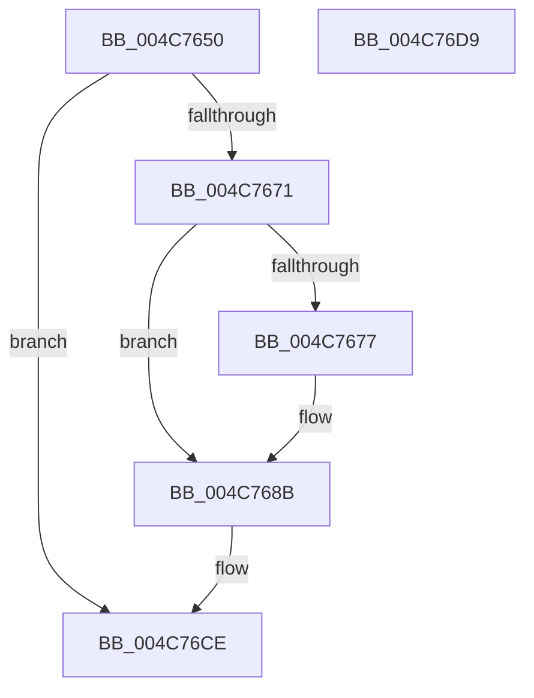

# PopFxAcpiForwardPepAcpiNotifyRequest

- RVA: `0x004C7650`–`0x004C76DA` (길이 `138` bytes)
- VA: `0x00000001404C7650`
- 실행 섹션: `.text`
- PDB 이름 있음: `예`; PDB Function 태그: `아니요`
- unwind 정보 RVA: `0x00065960`
- 디코드: `36`개 명령, `138/138` bytes 표시
- 미해석 바이트: `0` (있으면 어셈블리에 `.byte`로 보존)

> 이 문서는 커널 이미지의 기계어와 PDB 기호를 분석해 생성했습니다. 4번과 5번은 함수 원형과 자료형을 바이너리 사용 방식에서 추정한 C 해석이며 원본 소스 복구 결과는 아닙니다.

## 1. Dependencies

- 직접 호출 지점: **4**; 고유 호출 대상: **4**
- 직접 호출자로 확인된 함수: **1**
- RIP 상대 이미지 참조: **2**

### Outgoing calls
- `0x004C7666` → [PopFxFindAndReferenceAcpiDevice](PopFxFindAndReferenceAcpiDevice_function_004C76E0.md) (function, `0x004C76E0`)
- `0x004C7685` → [PopFxBugCheck](../2B/PopFxBugCheck_function_002BFC6C.md) (function, `0x002BFC6C`)
- `0x004C76B2` → [guard_dispatch_icall](../6B/guard_dispatch_icall_function_006BAAD0.md) (function, `0x006BAAD0`)
- `0x004C76C9` → [IoReleaseRemoveLockEx](../33/IoReleaseRemoveLockEx_function_0033D330.md) (function, `0x0033D330`)

### Direct callers
- [sub_002BD6E6](../2B/Unknown_function_002BD6E6.md) at `0x002BD92B`

### Static image references
- `0x004C768B` → RVA `0x00F070E8` (`.data`; read)
- `0x004C7697` → RVA `0x00F070E0` (`.data`; read)

## 2. Other-region calls and transfers

- 다른 실행 섹션으로 향하는 call: **0**
- 별도 외부 분기/꼬리 이동을 확인하지 못했습니다.

## 3. Assembly (complete function range)

```asm
004C7650  48 89 5C 24 08                  mov qword ptr [rsp + 8], rbx
004C7655  57                              push rdi
004C7656  48 83 EC 40                     sub rsp, 0x40
004C765A  33 C0                           xor eax, eax
004C765C  48 8B FA                        mov rdi, rdx
004C765F  89 44 24 24                     mov dword ptr [rsp + 0x24], eax
004C7663  48 8B D9                        mov rbx, rcx
004C7666  E8 75 00 00 00                  call 0x1404c76e0
004C766B  33 C9                           xor ecx, ecx
004C766D  85 C0                           test eax, eax
004C766F  78 5D                           js 0x1404c76ce
004C7671  48 39 4B 50                     cmp qword ptr [rbx + 0x50], rcx
004C7675  75 14                           jne 0x1404c768b
004C7677  4C 63 07                        movsxd r8, dword ptr [rdi]
004C767A  45 33 C9                        xor r9d, r9d
004C767D  48 8B D3                        mov rdx, rbx
004C7680  B9 68 06 00 00                  mov ecx, 0x668
004C7685  E8 E2 85 DF FF                  call 0x1402bfc6c
004C768A  CC                              int3
004C768B  48 8B 05 56 FA A3 00            mov rax, qword ptr [rip + 0xa3fa56]
004C7692  48 89 44 24 28                  mov qword ptr [rsp + 0x28], rax
004C7697  48 8B 05 42 FA A3 00            mov rax, qword ptr [rip + 0xa3fa42]
004C769E  48 89 4C 24 20                  mov qword ptr [rsp + 0x20], rcx
004C76A3  48 89 4C 24 30                  mov qword ptr [rsp + 0x30], rcx
004C76A8  48 8D 4C 24 20                  lea rcx, [rsp + 0x20]
004C76AD  48 89 7C 24 38                  mov qword ptr [rsp + 0x38], rdi
004C76B2  E8 19 34 1F 00                  call 0x1406baad0
004C76B7  48 8D 8B 38 01 00 00            lea rcx, [rbx + 0x138]
004C76BE  BA 50 6F 46 66                  mov edx, 0x66466f50
004C76C3  41 B8 20 00 00 00               mov r8d, 0x20
004C76C9  E8 62 5C E7 FF                  call 0x14033d330
004C76CE  48 8B 5C 24 50                  mov rbx, qword ptr [rsp + 0x50]
004C76D3  48 83 C4 40                     add rsp, 0x40
004C76D7  5F                              pop rdi
004C76D8  C3                              ret
004C76D9  CC                              int3
```

## 4. C-style interpretation (structured pseudocode)

```c
__int64 __fastcall PopFxAcpiForwardPepAcpiNotifyRequest(__int64 a1, __int64 a2, __int64 a3, int a4)
{
    __int64 result;
    __int64 v_rsp;
    unsigned __int64 v_stack_m10;
    unsigned __int64 v_stack_m18;
    unsigned __int64 v_stack_m20;
    unsigned int v_stack_m24;
    unsigned __int64 v_stack_m28;
    unsigned __int64 v_stack_p8;

    v_stack_p8 = v_rbx;
    v_rsp = (v_rsp) - (64);
    result = 0;
    v_stack_m24 = 0;
    result = PopFxFindAndReferenceAcpiDevice(a1, a2, a3, a4);
    a1 = 0;
    if (sign_flag) goto loc_004C76CE;
    if ((*(unsigned __int64 *)(a1 + 80)) == 0) {
        a3 = (int)(*(unsigned int *)(a2));
        a4 = 0;
        a2 = 0;
        a1 = 0x668ULL;
        result = PopFxBugCheck(a1, a2, a3, a4);
    }
    v_stack_m20 = *(unsigned __int64 *)(v_rip + 10746454);
    v_stack_m28 = a1;
    v_stack_m18 = a1;
    v_stack_m10 = a2;
    result = guard_dispatch_icall(v_stack_m28, a2, a3, a4);
    result = IoReleaseRemoveLockEx(a1 + 312, (unsigned int)(0x66466F50ULL), 32, a4);
loc_004C76CE:
    v_rsp = (v_rsp) + (64);
    return result;
}
```

## 5. (Beta) C Style

```c
int64_t PopFxAcpiForwardPepAcpiNotifyRequest(void *Arg1, void *Arg2, int64_t Arg3, int32_t Arg4)
{
    uint8_t *arg1 = (uint8_t *)Arg1;
    uint8_t *arg2 = (uint8_t *)Arg2;

    int64_t result;
    int64_t local_rsp;
    uint64_t v_stack_m10;
    uint64_t v_stack_m18;
    uint64_t v_stack_m20;
    uint32_t v_stack_m24;
    uint64_t v_stack_m28;
    uint64_t v_stack_p8;

    v_stack_p8 = local_rbx;
    local_rsp = (local_rsp) - (64);
    result = 0;
    v_stack_m24 = 0;
    result = PopFxFindAndReferenceAcpiDevice(Arg1, Arg2, Arg3, Arg4);
    Arg1 = 0;
    if (sign_flag) goto loc_004C76CE;
    if ((*(uint64_t *)(arg1 + 0x50)) == 0) {
        Arg3 = (int32_t)(*(uint32_t *)(arg2));
        Arg4 = 0;
        Arg2 = 0;
        Arg1 = 0x668ULL;
        result = PopFxBugCheck(Arg1, Arg2, Arg3, Arg4);
    }
    v_stack_m20 = *(uint64_t *)(v_rip + 0xA3FA56);
    v_stack_m28 = Arg1;
    v_stack_m18 = Arg1;
    v_stack_m10 = Arg2;
    result = guard_dispatch_icall(v_stack_m28, Arg2, Arg3, Arg4);
    result = IoReleaseRemoveLockEx(Arg1 + 312, (uint32_t)(0x66466F50ULL), 32, Arg4);
loc_004C76CE:
    local_rsp = (local_rsp) + (64);
    return result;
}
```

### 관측된 메모리 오프셋

구조체 형식이 확인되지 않은 접근은 인자 기준의 오프셋으로만 기록했습니다.

| 기준 인자 | 오프셋 표현 | 폭 (bit) | 접근 |
|---|---:|---:|---|
| `Arg1` | `+ 0x50` | `64` | `R` |
| `Arg1` | `+ 0x138` | `64` | `R` |
| `Arg2` | `+ 0x0` | `32` | `R` |

## 6. Execution-region graph

[열기: 2D/3D 그래프와 함수 탐색 컨트롤 패널](../../../control-panel.html?section=text&rva=0x004C7650&view=graph)

- 2D 그래프는 위에서 아래로 흐르고, 3D 그래프는 빈 공간을 드래그해 회전합니다. Shift+드래그는 이동, 휠은 확대·축소, 함수 노드 선택은 대상 보고서 이동입니다.

### Static fallback


