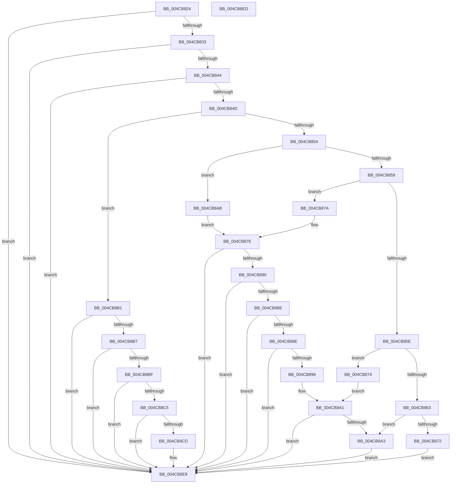

# PopFxAcpiValidateParameters

- RVA: `0x004CB824`–`0x004CB8EE` (길이 `202` bytes)
- VA: `0x00000001404CB824`
- 실행 섹션: `.text`
- PDB 이름 있음: `예`; PDB Function 태그: `아니요`
- unwind 정보 RVA: `0x000DB714`
- 디코드: `64`개 명령, `202/202` bytes 표시
- 미해석 바이트: `0` (있으면 어셈블리에 `.byte`로 보존)

> 이 문서는 커널 이미지의 기계어와 PDB 기호를 분석해 생성했습니다. 4번과 5번은 함수 원형과 자료형을 바이너리 사용 방식에서 추정한 C 해석이며 원본 소스 복구 결과는 아닙니다.

## 1. Dependencies

- 직접 호출 지점: **0**; 고유 호출 대상: **0**
- 직접 호출자로 확인된 함수: **1**
- RIP 상대 이미지 참조: **0**

### Outgoing calls
- 직접 디코드된 call 명령이 없습니다.

### Direct callers
- [PopFxAcpiDispatchNotification](../5D/PopFxAcpiDispatchNotification_function_005DD450.md) at `0x005DD472`

### Static image references
- 디코드된 RIP-relative 메모리 참조가 없습니다.

## 2. Other-region calls and transfers

- 다른 실행 섹션으로 향하는 call: **0**
- 별도 외부 분기/꼬리 이동을 확인하지 못했습니다.

## 3. Assembly (complete function range)

```asm
004CB824  45 33 C0                        xor r8d, r8d
004CB827  48 8B D1                        mov rdx, rcx
004CB82A  48 85 C9                        test rcx, rcx
004CB82D  0F 84 B6 00 00 00               je 0x1404cb8e9
004CB833  4C 8B 51 10                     mov r10, qword ptr [rcx + 0x10]
004CB837  4C 8B 49 18                     mov r9, qword ptr [rcx + 0x18]
004CB83B  4D 85 D2                        test r10, r10
004CB83E  0F 84 A5 00 00 00               je 0x1404cb8e9
004CB844  4D 85 C9                        test r9, r9
004CB847  0F 84 9C 00 00 00               je 0x1404cb8e9
004CB84D  8B 09                           mov ecx, dword ptr [rcx]
004CB84F  83 E9 01                        sub ecx, 1
004CB852  74 5D                           je 0x1404cb8b1
004CB854  83 E9 01                        sub ecx, 1
004CB857  74 52                           je 0x1404cb8ab
004CB859  83 E9 01                        sub ecx, 1
004CB85C  74 1C                           je 0x1404cb87a
004CB85E  83 F9 01                        cmp ecx, 1
004CB861  74 11                           je 0x1404cb874
004CB863  48 8B 42 08                     mov rax, qword ptr [rdx + 8]
004CB867  8B 88 60 03 00 00               mov ecx, dword ptr [rax + 0x360]
004CB86D  F6 C1 04                        test cl, 4
004CB870  75 31                           jne 0x1404cb8a3
004CB872  EB 75                           jmp 0x1404cb8e9
004CB874  49 83 F9 10                     cmp r9, 0x10
004CB878  EB 27                           jmp 0x1404cb8a1
004CB87A  49 83 F9 28                     cmp r9, 0x28
004CB87E  72 69                           jb 0x1404cb8e9
004CB880  49 8B 02                        mov rax, qword ptr [r10]
004CB883  48 85 C0                        test rax, rax
004CB886  74 61                           je 0x1404cb8e9
004CB888  4C 39 40 08                     cmp qword ptr [rax + 8], r8
004CB88C  74 5B                           je 0x1404cb8e9
004CB88E  0F B7 08                        movzx ecx, word ptr [rax]
004CB891  83 F9 04                        cmp ecx, 4
004CB894  72 53                           jb 0x1404cb8e9
004CB896  0F B7 40 02                     movzx eax, word ptr [rax + 2]
004CB89A  48 83 C1 02                     add rcx, 2
004CB89E  48 3B C1                        cmp rax, rcx
004CB8A1  72 46                           jb 0x1404cb8e9
004CB8A3  41 B8 01 00 00 00               mov r8d, 1
004CB8A9  EB 3E                           jmp 0x1404cb8e9
004CB8AB  49 83 F9 10                     cmp r9, 0x10
004CB8AF  EB CD                           jmp 0x1404cb87e
004CB8B1  49 83 F9 18                     cmp r9, 0x18
004CB8B5  72 32                           jb 0x1404cb8e9
004CB8B7  49 8B 02                        mov rax, qword ptr [r10]
004CB8BA  48 85 C0                        test rax, rax
004CB8BD  74 2A                           je 0x1404cb8e9
004CB8BF  4C 39 40 08                     cmp qword ptr [rax + 8], r8
004CB8C3  74 24                           je 0x1404cb8e9
004CB8C5  0F B7 08                        movzx ecx, word ptr [rax]
004CB8C8  83 F9 04                        cmp ecx, 4
004CB8CB  72 1C                           jb 0x1404cb8e9
004CB8CD  0F B7 40 02                     movzx eax, word ptr [rax + 2]
004CB8D1  48 8D 51 02                     lea rdx, [rcx + 2]
004CB8D5  41 0F B6 C8                     movzx ecx, r8b
004CB8D9  48 3B C2                        cmp rax, rdx
004CB8DC  41 B8 01 00 00 00               mov r8d, 1
004CB8E2  41 0F 43 C8                     cmovae ecx, r8d
004CB8E6  44 8A C1                        mov r8b, cl
004CB8E9  41 8A C0                        mov al, r8b
004CB8EC  C3                              ret
004CB8ED  CC                              int3
```

## 4. C-style interpretation (structured pseudocode)

```c
__int64 __fastcall PopFxAcpiValidateParameters(__int64 a1, __int64 a2, int a3)
{
    __int64 result;

    a3 = 0;
    if (a1 == 0) goto loc_004CB8E9;
    if (*(unsigned __int64 *)(a1 + 16) == 0) goto loc_004CB8E9;
    if (*(unsigned __int64 *)(a1 + 24) == 0) goto loc_004CB8E9;
    a1 = (unsigned int)(((unsigned int)(*(unsigned int *)(a1))) - (1));
    if (condition_is_equal) goto loc_004CB8B1;
    a1 = (unsigned int)((a1) - (1));
    if (condition_is_equal) goto loc_004CB8AB;
    a1 = (unsigned int)((a1) - (1));
    if (condition_is_equal) goto loc_004CB87A;
    if (((unsigned int)(a1)) == 1) goto loc_004CB874;
    if ((((unsigned __int8)((unsigned int)(*(unsigned int *)(*(unsigned __int64 *)(a1 + 8) + 864)))) & (4)) != 0) goto loc_004CB8A3;
    goto loc_004CB8E9;
loc_004CB874:
    goto loc_004CB8A1;
loc_004CB87A:
loc_004CB87E:
    if ((*(unsigned __int64 *)(a1 + 24)) < 40) goto loc_004CB8E9;
    if (*(unsigned __int64 *)(*(unsigned __int64 *)(a1 + 16)) == 0) goto loc_004CB8E9;
    if ((*(unsigned __int64 *)(*(unsigned __int64 *)(*(unsigned __int64 *)(a1 + 16)) + 8)) == 0) goto loc_004CB8E9;
    if (((unsigned int)(*(unsigned __int16 *)(*(unsigned __int64 *)(*(unsigned __int64 *)(a1 + 16))))) < 4) goto loc_004CB8E9;
    a1 = (*(unsigned __int16 *)(*(unsigned __int64 *)(*(unsigned __int64 *)(a1 + 16)))) + (2);
loc_004CB8A1:
    if ((*(unsigned __int16 *)(*(unsigned __int64 *)(*(unsigned __int64 *)(a1 + 16)) + 2)) < a1) goto loc_004CB8E9;
loc_004CB8A3:
    goto loc_004CB8E9;
loc_004CB8AB:
    goto loc_004CB87E;
loc_004CB8B1:
    if ((*(unsigned __int64 *)(a1 + 24)) < 24) goto loc_004CB8E9;
    if (*(unsigned __int64 *)(*(unsigned __int64 *)(a1 + 16)) == 0) goto loc_004CB8E9;
    if ((*(unsigned __int64 *)(*(unsigned __int64 *)(*(unsigned __int64 *)(a1 + 16)) + 8)) == 1) goto loc_004CB8E9;
    result = *(unsigned __int64 *)(*(unsigned __int64 *)(a1 + 16));
    if (((unsigned int)(*(unsigned __int16 *)(*(unsigned __int64 *)(*(unsigned __int64 *)(a1 + 16))))) >= 4) {
        result = *(unsigned __int16 *)(*(unsigned __int64 *)(*(unsigned __int64 *)(a1 + 16)) + 2);
        a2 = *(unsigned __int16 *)(*(unsigned __int64 *)(*(unsigned __int64 *)(a1 + 16))) + 2;
        a1 = 1;
        a3 = 1;
        if (result >= a2) { a1 = a3; }
        a3 = (unsigned __int8)(a1);
    }
    return (unsigned __int8)(a3);
}
```

## 5. (Beta) C Style

```c
int64_t PopFxAcpiValidateParameters(void *Arg1, int64_t Arg2, int32_t Arg3)
{
    uint8_t *arg1 = (uint8_t *)Arg1;

    int64_t result;

    Arg3 = 0;
    if (Arg1 == NULL) goto loc_004CB8E9;
    if (*(uint64_t *)(arg1 + 0x10) == 0) goto loc_004CB8E9;
    if (*(uint64_t *)(arg1 + 0x18) == 0) goto loc_004CB8E9;
    Arg1 = (uint32_t)(((uint32_t)(*(uint32_t *)(arg1))) - (1));
    if (condition_is_equal) goto loc_004CB8B1;
    Arg1 = (uint32_t)((Arg1) - (1));
    if (condition_is_equal) goto loc_004CB8AB;
    Arg1 = (uint32_t)((Arg1) - (1));
    if (condition_is_equal) goto loc_004CB87A;
    if (((uint32_t)(Arg1)) == 1) goto loc_004CB874;
    if ((((uint8_t)((uint32_t)(*(uint32_t *)(*(uint64_t *)(arg1 + 0x8) + 0x360)))) & (4)) != 0) goto loc_004CB8A3;
    goto loc_004CB8E9;
loc_004CB874:
    goto loc_004CB8A1;
loc_004CB87A:
loc_004CB87E:
    if ((*(uint64_t *)(arg1 + 0x18)) < 40) goto loc_004CB8E9;
    if (*(uint64_t *)(*(uint64_t *)(arg1 + 0x10)) == 0) goto loc_004CB8E9;
    if ((*(uint64_t *)(*(uint64_t *)(*(uint64_t *)(arg1 + 0x10)) + 0x8)) == 0) goto loc_004CB8E9;
    if (((uint32_t)(*(uint16_t *)(*(uint64_t *)(*(uint64_t *)(arg1 + 0x10))))) < 4) goto loc_004CB8E9;
    Arg1 = (*(uint16_t *)(*(uint64_t *)(*(uint64_t *)(arg1 + 0x10)))) + (2);
loc_004CB8A1:
    if ((*(uint16_t *)(*(uint64_t *)(*(uint64_t *)(arg1 + 0x10)) + 0x2)) < Arg1) goto loc_004CB8E9;
loc_004CB8A3:
    goto loc_004CB8E9;
loc_004CB8AB:
    goto loc_004CB87E;
loc_004CB8B1:
    if ((*(uint64_t *)(arg1 + 0x18)) < 24) goto loc_004CB8E9;
    if (*(uint64_t *)(*(uint64_t *)(arg1 + 0x10)) == 0) goto loc_004CB8E9;
    if ((*(uint64_t *)(*(uint64_t *)(*(uint64_t *)(arg1 + 0x10)) + 0x8)) == 1) goto loc_004CB8E9;
    result = *(uint64_t *)(*(uint64_t *)(arg1 + 0x10));
    if (((uint32_t)(*(uint16_t *)(*(uint64_t *)(*(uint64_t *)(arg1 + 0x10))))) >= 4) {
        result = *(uint16_t *)(*(uint64_t *)(*(uint64_t *)(arg1 + 0x10)) + 0x2);
        Arg2 = *(uint16_t *)(*(uint64_t *)(*(uint64_t *)(arg1 + 0x10))) + 2;
        Arg1 = 1;
        Arg3 = 1;
        if (result >= Arg2) { Arg1 = Arg3; }
        Arg3 = (uint8_t)(Arg1);
    }
    return (uint8_t)(Arg3);
}
```

### 관측된 메모리 오프셋

구조체 형식이 확인되지 않은 접근은 인자 기준의 오프셋으로만 기록했습니다.

| 기준 인자 | 오프셋 표현 | 폭 (bit) | 접근 |
|---|---:|---:|---|
| `Arg1` | `+ 0x8` | `64` | `R` |

## 6. Execution-region graph

[열기: 2D/3D 그래프와 함수 탐색 컨트롤 패널](../../../control-panel.html?section=text&rva=0x004CB824&view=graph)

- 2D 그래프는 위에서 아래로 흐르고, 3D 그래프는 빈 공간을 드래그해 회전합니다. Shift+드래그는 이동, 휠은 확대·축소, 함수 노드 선택은 대상 보고서 이동입니다.

### Static fallback


