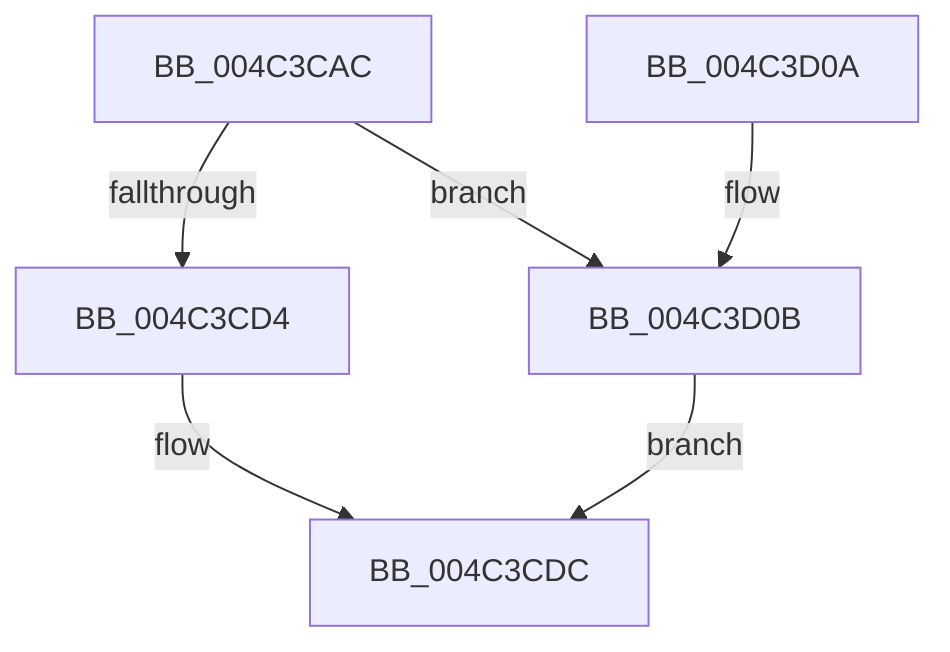

# PopFxAssignDeviceToDevNode

- RVA: `0x004C3CAC`–`0x004C3D2D` (길이 `129` bytes)
- VA: `0x00000001404C3CAC`
- 실행 섹션: `.text`
- PDB 이름 있음: `예`; PDB Function 태그: `아니요`
- unwind 정보 RVA: `0x00067AA4`
- 디코드: `36`개 명령, `129/129` bytes 표시
- 미해석 바이트: `0` (있으면 어셈블리에 `.byte`로 보존)

> 이 문서는 커널 이미지의 기계어와 PDB 기호를 분석해 생성했습니다. 4번과 5번은 함수 원형과 자료형을 바이너리 사용 방식에서 추정한 C 해석이며 원본 소스 복구 결과는 아닙니다.

## 1. Dependencies

- 직접 호출 지점: **2**; 고유 호출 대상: **2**
- 직접 호출자로 확인된 함수: **2**
- RIP 상대 이미지 참조: **0**

### Outgoing calls
- `0x004C3CC5` → [ExAcquireSpinLockExclusive](../24/ExAcquireSpinLockExclusive_function_00248690.md) (function, `0x00248690`)
- `0x004C3CF5` → [ExReleaseSpinLockExclusive](../2C/ExReleaseSpinLockExclusive_function_002C0EF0.md) (function, `0x002C0EF0`)

### Direct callers
- [PopFxRegisterDevice](../../page/75/PopFxRegisterDevice_function_00759B80.md) at `0x00759D28`
- [PopFxUnregisterDevice](../../page/A8/PopFxUnregisterDevice_function_00A8AE84.md) at `0x00A8AF23`

### Static image references
- 디코드된 RIP-relative 메모리 참조가 없습니다.

## 2. Other-region calls and transfers

- 다른 실행 섹션으로 향하는 call: **0**
- 별도 외부 분기/꼬리 이동을 확인하지 못했습니다.

## 3. Assembly (complete function range)

```asm
004C3CAC  48 89 5C 24 08                  mov qword ptr [rsp + 8], rbx
004C3CB1  48 89 74 24 10                  mov qword ptr [rsp + 0x10], rsi
004C3CB6  57                              push rdi
004C3CB7  48 83 EC 20                     sub rsp, 0x20
004C3CBB  48 8B D9                        mov rbx, rcx
004C3CBE  48 8B FA                        mov rdi, rdx
004C3CC1  48 83 C1 58                     add rcx, 0x58
004C3CC5  E8 C6 49 D8 FF                  call 0x140248690
004C3CCA  45 33 C0                        xor r8d, r8d
004C3CCD  8A C8                           mov cl, al
004C3CCF  48 85 FF                        test rdi, rdi
004C3CD2  75 37                           jne 0x1404c3d0b
004C3CD4  F0 83 A3 28 01 00 00 FB         lock and dword ptr [rbx + 0x128], 0xfffffffb
004C3CDC  8B 53 7C                        mov edx, dword ptr [rbx + 0x7c]
004C3CDF  8B 43 78                        mov eax, dword ptr [rbx + 0x78]
004C3CE2  2B C2                           sub eax, edx
004C3CE4  44 89 43 7C                     mov dword ptr [rbx + 0x7c], r8d
004C3CE8  8A D1                           mov dl, cl
004C3CEA  89 43 78                        mov dword ptr [rbx + 0x78], eax
004C3CED  48 8D 4B 58                     lea rcx, [rbx + 0x58]
004C3CF1  48 89 7B 50                     mov qword ptr [rbx + 0x50], rdi
004C3CF5  E8 F6 D1 DF FF                  call 0x1402c0ef0
004C3CFA  48 8B 5C 24 30                  mov rbx, qword ptr [rsp + 0x30]
004C3CFF  48 8B 74 24 38                  mov rsi, qword ptr [rsp + 0x38]
004C3D04  48 83 C4 20                     add rsp, 0x20
004C3D08  5F                              pop rdi
004C3D09  C3                              ret
004C3D0A  CC                              int3
004C3D0B  F0 83 A3 28 01 00 00 F7         lock and dword ptr [rbx + 0x128], 0xfffffff7
004C3D13  48 8D 43 68                     lea rax, [rbx + 0x68]
004C3D17  66 44 89 43 60                  mov word ptr [rbx + 0x60], r8w
004C3D1C  C6 43 62 06                     mov byte ptr [rbx + 0x62], 6
004C3D20  44 89 43 64                     mov dword ptr [rbx + 0x64], r8d
004C3D24  48 89 40 08                     mov qword ptr [rax + 8], rax
004C3D28  48 89 00                        mov qword ptr [rax], rax
004C3D2B  EB AF                           jmp 0x1404c3cdc
```

## 4. C-style interpretation (structured pseudocode)

```c
__int64 __fastcall PopFxAssignDeviceToDevNode(__int64 a1, __int64 a2, int a3)
{
    __int64 result;
    __int64 v_rsp;
    unsigned __int64 v_stack_p10;
    unsigned __int64 v_stack_p8;

    v_stack_p8 = v_rbx;
    v_stack_p10 = v_rsi;
    v_rsp = (v_rsp) - (32);
    a1 = (a1) + (88);
    result = ExAcquireSpinLockExclusive(a1, a2, a3, a4);
    a3 = 0;
    if (a2 != 0) goto loc_004C3D0B;
loc_004C3CDC:
    result = (unsigned int)(((unsigned int)(*(unsigned int *)(a1 + 120))) - ((unsigned int)((unsigned int)(*(unsigned int *)(a1 + 124)))));
    *(unsigned int *)(a1 + 124) = 0;
    *(unsigned int *)(a1 + 120) = (unsigned int)(result);
    *(unsigned __int64 *)(a1 + 80) = a2;
    result = ExReleaseSpinLockExclusive(a1 + 88, (unsigned __int8)((unsigned __int8)(result)), a3, a4);
    v_rsp = (v_rsp) + (32);
    return result;
loc_004C3D0B:
    *(unsigned __int16 *)(v_stack_p8 + 96) = 0;
    *(unsigned __int8 *)(v_stack_p8 + 98) = 6;
    *(unsigned int *)(v_stack_p8 + 100) = 0;
    *(unsigned __int64 *)(v_stack_p8 + 104 + 8) = v_stack_p8 + 104;
    *(unsigned __int64 *)(v_stack_p8 + 104) = v_stack_p8 + 104;
    goto loc_004C3CDC;
}
```

## 5. (Beta) C Style

```c
int64_t PopFxAssignDeviceToDevNode(void *Arg1, int64_t Arg2, int32_t Arg3)
{
    uint8_t *arg1 = (uint8_t *)Arg1;

    int64_t result;
    int64_t local_rsp;
    uint64_t v_stack_p10;
    uint64_t v_stack_p8;

    v_stack_p8 = local_rbx;
    v_stack_p10 = local_rsi;
    local_rsp = (local_rsp) - (32);
    Arg1 = (Arg1) + (88);
    result = ExAcquireSpinLockExclusive(Arg1, Arg2, Arg3, a4);
    Arg3 = 0;
    if (Arg2 != 0) goto loc_004C3D0B;
loc_004C3CDC:
    result = (uint32_t)(((uint32_t)(*(uint32_t *)(arg1 + 0x78))) - ((uint32_t)((uint32_t)(*(uint32_t *)(arg1 + 0x7C)))));
    *(uint32_t *)(arg1 + 0x7C) = 0;
    *(uint32_t *)(arg1 + 0x78) = (uint32_t)(result);
    *(uint64_t *)(arg1 + 0x50) = Arg2;
    result = ExReleaseSpinLockExclusive(Arg1 + 88, (uint8_t)((uint8_t)(result)), Arg3, a4);
    local_rsp = (local_rsp) + (32);
    return result;
loc_004C3D0B:
    *(uint16_t *)(v_stack_p8 + 0x60) = 0;
    *(uint8_t *)(v_stack_p8 + 0x62) = 6;
    *(uint32_t *)(v_stack_p8 + 0x64) = 0;
    *(uint64_t *)(v_stack_p8 + 0x68 + 0x8) = v_stack_p8 + 104;
    *(uint64_t *)(v_stack_p8 + 0x68) = v_stack_p8 + 104;
    goto loc_004C3CDC;
}
```

### 관측된 메모리 오프셋

구조체 형식이 확인되지 않은 접근은 인자 기준의 오프셋으로만 기록했습니다.

| 기준 인자 | 오프셋 표현 | 폭 (bit) | 접근 |
|---|---:|---:|---|
| `Arg1` | `+ 0x0` | `64` | `W` |
| `Arg1` | `+ 0x8` | `64` | `W` |
| `Arg1` | `+ 0x50` | `64` | `W` |
| `Arg1` | `+ 0x58` | `64` | `R` |
| `Arg1` | `+ 0x60` | `16` | `W` |
| `Arg1` | `+ 0x62` | `8` | `W` |
| `Arg1` | `+ 0x64` | `32` | `W` |
| `Arg1` | `+ 0x68` | `64` | `R` |
| `Arg1` | `+ 0x78` | `32` | `R` |
| `Arg1` | `+ 0x78` | `32` | `W` |
| `Arg1` | `+ 0x7C` | `32` | `R` |
| `Arg1` | `+ 0x7C` | `32` | `W` |
| `Arg1` | `+ 0x128` | `32` | `R/W` |

## 6. Execution-region graph

[열기: 2D/3D 그래프와 함수 탐색 컨트롤 패널](../../../control-panel.html?section=text&rva=0x004C3CAC&view=graph)

- 2D 그래프는 위에서 아래로 흐르고, 3D 그래프는 빈 공간을 드래그해 회전합니다. Shift+드래그는 이동, 휠은 확대·축소, 함수 노드 선택은 대상 보고서 이동입니다.

### Static fallback


