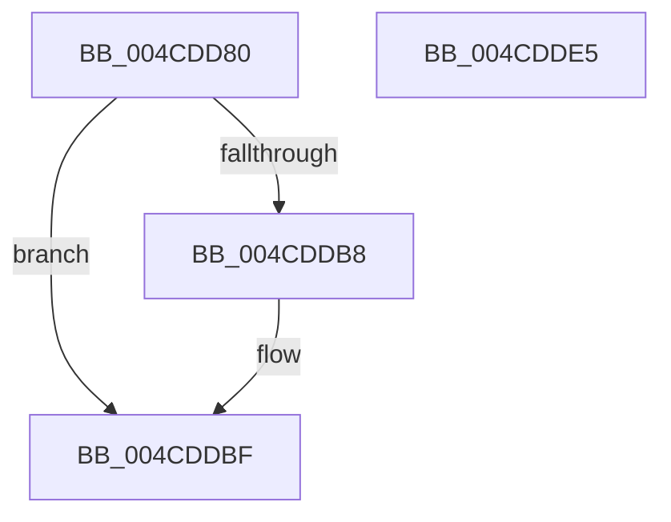

# PopFxBeginDeviceIRPhaseAccounting

- RVA: `0x004CDD80`–`0x004CDDE6` (길이 `102` bytes)
- VA: `0x00000001404CDD80`
- 실행 섹션: `.text`
- PDB 이름 있음: `예`; PDB Function 태그: `아니요`
- unwind 정보 RVA: `0x0005CAAC`
- 디코드: `23`개 명령, `102/102` bytes 표시
- 미해석 바이트: `0` (있으면 어셈블리에 `.byte`로 보존)

> 이 문서는 커널 이미지의 기계어와 PDB 기호를 분석해 생성했습니다. 4번과 5번은 함수 원형과 자료형을 바이너리 사용 방식에서 추정한 C 해석이며 원본 소스 복구 결과는 아닙니다.

## 1. Dependencies

- 직접 호출 지점: **4**; 고유 호출 대상: **4**
- 직접 호출자로 확인된 함수: **1**
- RIP 상대 이미지 참조: **5**

### Outgoing calls
- `0x004CDD94` → [KeAcquireSpinLockRaiseToDpc](../20/KeAcquireSpinLockRaiseToDpc_function_00208470.md) (function, `0x00208470`)
- `0x004CDDA3` → [KeAcquireSpinLockAtDpcLevel](../20/KeAcquireSpinLockAtDpcLevel_function_00208430.md) (function, `0x00208430`)
- `0x004CDDC6` → [KxReleaseSpinLock](../20/KxReleaseSpinLock_function_00206670.md) (function, `0x00206670`)
- `0x004CDDD5` → [KeReleaseSpinLock](../39/KeReleaseSpinLock_function_00392BA0.md) (function, `0x00392BA0`)

### Direct callers
- [PopPdcIdleResiliencyCallback](../../page/A3/PopPdcIdleResiliencyCallback_function_00A31518.md) at `0x00A31636`

### Static image references
- `0x004CDD8D` → RVA `0x00F0E570` (`.data`; read)
- `0x004CDD99` → RVA `0x00F0CA58` (`.data`; read)
- `0x004CDDA8` → RVA `0x00F0E6C0` (`.data`; read)
- `0x004CDDAF` → RVA `0x00F0C7B8` (`.data`; write)
- `0x004CDDB8` → RVA `0x00F0C7B0` (`.data`; write)

## 2. Other-region calls and transfers

- 다른 실행 섹션으로 향하는 call: **0**
- 별도 외부 분기/꼬리 이동을 확인하지 못했습니다.

## 3. Assembly (complete function range)

```asm
004CDD80  48 89 5C 24 08                  mov qword ptr [rsp + 8], rbx
004CDD85  57                              push rdi
004CDD86  48 83 EC 20                     sub rsp, 0x20
004CDD8A  48 8B D9                        mov rbx, rcx
004CDD8D  48 8D 0D DC 07 A4 00            lea rcx, [rip + 0xa407dc]
004CDD94  E8 D7 A6 D3 FF                  call 0x140208470
004CDD99  48 8D 0D B8 EC A3 00            lea rcx, [rip + 0xa3ecb8]
004CDDA0  40 8A F8                        mov dil, al
004CDDA3  E8 88 A6 D3 FF                  call 0x140208430
004CDDA8  80 3D 11 09 A4 00 00            cmp byte ptr [rip + 0xa40911], 0
004CDDAF  C6 05 02 EA A3 00 01            mov byte ptr [rip + 0xa3ea02], 1
004CDDB6  74 07                           je 0x1404cddbf
004CDDB8  48 89 1D F1 E9 A3 00            mov qword ptr [rip + 0xa3e9f1], rbx
004CDDBF  48 8D 0D 92 EC A3 00            lea rcx, [rip + 0xa3ec92]
004CDDC6  E8 A5 88 D3 FF                  call 0x140206670
004CDDCB  40 8A D7                        mov dl, dil
004CDDCE  48 8D 0D 9B 07 A4 00            lea rcx, [rip + 0xa4079b]
004CDDD5  E8 C6 4D EC FF                  call 0x140392ba0
004CDDDA  48 8B 5C 24 30                  mov rbx, qword ptr [rsp + 0x30]
004CDDDF  48 83 C4 20                     add rsp, 0x20
004CDDE3  5F                              pop rdi
004CDDE4  C3                              ret
004CDDE5  CC                              int3
```

## 4. C-style interpretation (structured pseudocode)

```c
__int64 __fastcall PopFxBeginDeviceIRPhaseAccounting(__int64 a1)
{
    __int64 result;
    __int64 v_rsp;
    unsigned __int64 v_stack_p8;

    v_stack_p8 = v_rbx;
    v_rsp = (v_rsp) - (32);
    result = KeAcquireSpinLockRaiseToDpc(v_rip + 10749916, a2, a3, a4);
    result = KeAcquireSpinLockAtDpcLevel(v_rip + 10742968, a2, a3, a4);
    *(unsigned __int8 *)(v_rip + 10742274) = 1;
    if ((*(unsigned __int8 *)(v_rip + 10750225)) != 0) {
        *(unsigned __int64 *)(v_rip + 10742257) = a1;
    }
    result = KxReleaseSpinLock(v_rip + 10742930, a2, a3, a4);
    result = KeReleaseSpinLock(v_rip + 10749851, (unsigned __int8)((unsigned __int8)(result)), a3, a4);
    v_rsp = (v_rsp) + (32);
    return result;
}
```

## 5. (Beta) C Style

```c
int64_t PopFxBeginDeviceIRPhaseAccounting(int64_t Arg1)
{
    int64_t result;
    int64_t local_rsp;
    uint64_t v_stack_p8;

    v_stack_p8 = local_rbx;
    local_rsp = (local_rsp) - (32);
    result = KeAcquireSpinLockRaiseToDpc(v_rip + 10749916, a2, a3, a4);
    result = KeAcquireSpinLockAtDpcLevel(v_rip + 10742968, a2, a3, a4);
    *(uint8_t *)(v_rip + 0xA3EA02) = 1;
    if ((*(uint8_t *)(v_rip + 0xA40911)) != 0) {
        *(uint64_t *)(v_rip + 0xA3E9F1) = Arg1;
    }
    result = KxReleaseSpinLock(v_rip + 10742930, a2, a3, a4);
    result = KeReleaseSpinLock(v_rip + 10749851, (uint8_t)((uint8_t)(result)), a3, a4);
    local_rsp = (local_rsp) + (32);
    return result;
}
```

## 6. Execution-region graph

[열기: 2D/3D 그래프와 함수 탐색 컨트롤 패널](../../../control-panel.html?section=text&rva=0x004CDD80&view=graph)

- 2D 그래프는 위에서 아래로 흐르고, 3D 그래프는 빈 공간을 드래그해 회전합니다. Shift+드래그는 이동, 휠은 확대·축소, 함수 노드 선택은 대상 보고서 이동입니다.

### Static fallback


