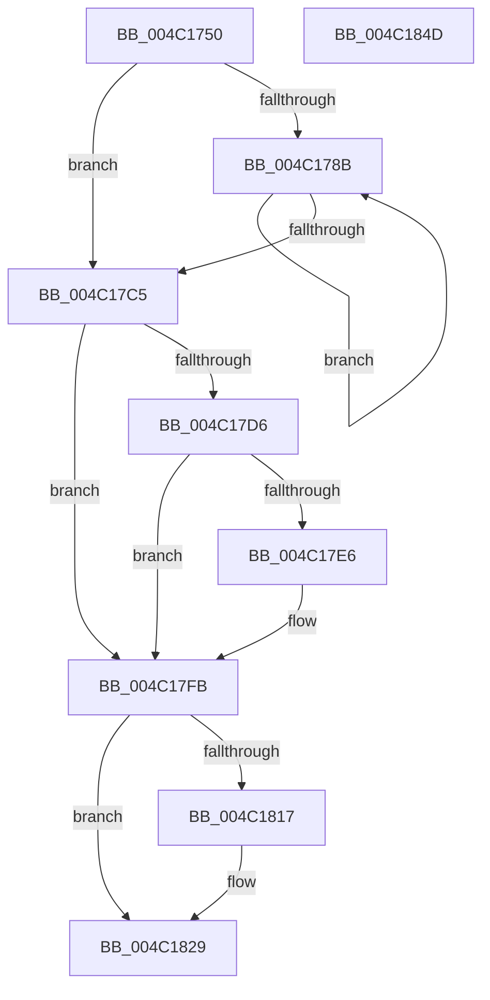

# PopFxCompleteComponentPerfState

- RVA: `0x004C1750`–`0x004C184E` (길이 `254` bytes)
- VA: `0x00000001404C1750`
- 실행 섹션: `.text`
- PDB 이름 있음: `예`; PDB Function 태그: `아니요`
- unwind 정보 RVA: `0x00084C9C`
- 디코드: `74`개 명령, `254/254` bytes 표시
- 미해석 바이트: `0` (있으면 어셈블리에 `.byte`로 보존)

> 이 문서는 커널 이미지의 기계어와 PDB 기호를 분석해 생성했습니다. 4번과 5번은 함수 원형과 자료형을 바이너리 사용 방식에서 추정한 C 해석이며 원본 소스 복구 결과는 아닙니다.

## 1. Dependencies

- 직접 호출 지점: **5**; 고유 호출 대상: **5**
- 직접 호출자로 확인된 함수: **3**
- RIP 상대 이미지 참조: **0**

### Outgoing calls
- `0x004C17CD` → [PopDiagTraceFxPerfRequestProgress](PopDiagTraceFxPerfRequestProgress_function_004C1B78.md) (function, `0x004C1B78`)
- `0x004C17F6` → [PopFxAddLogEntry](../39/PopFxAddLogEntry_function_00390B94.md) (function, `0x00390B94`)
- `0x004C180E` → [guard_dispatch_icall](../6B/guard_dispatch_icall_function_006BAAD0.md) (function, `0x006BAAD0`)
- `0x004C1824` → [KeSetEvent](../33/KeSetEvent_function_0033F310.md) (function, `0x0033F310`)
- `0x004C182F` → [PopDiagTraceFxPerfRequestComplete](PopDiagTraceFxPerfRequestComplete_function_004C1854.md) (function, `0x004C1854`)

### Direct callers
- [sub_002BD95A](../2B/Unknown_function_002BD95A.md) at `0x002BDD91`
- [PopFxIssueComponentPerfStateChanges](PopFxIssueComponentPerfStateChanges_function_004C1940.md) at `0x004C1B0A`
- [PopFxComponentPerfWork](../5D/PopFxComponentPerfWork_function_005D21A0.md) at `0x005D21E1`

### Static image references
- 디코드된 RIP-relative 메모리 참조가 없습니다.

## 2. Other-region calls and transfers

- 다른 실행 섹션으로 향하는 call: **0**
- 별도 외부 분기/꼬리 이동을 확인하지 못했습니다.

## 3. Assembly (complete function range)

```asm
004C1750  48 89 5C 24 08                  mov qword ptr [rsp + 8], rbx
004C1755  48 89 6C 24 10                  mov qword ptr [rsp + 0x10], rbp
004C175A  48 89 74 24 18                  mov qword ptr [rsp + 0x18], rsi
004C175F  57                              push rdi
004C1760  41 56                           push r14
004C1762  41 57                           push r15
004C1764  48 83 EC 30                     sub rsp, 0x30
004C1768  41 8A F1                        mov sil, r9b
004C176B  49 8B F8                        mov rdi, r8
004C176E  8B EA                           mov ebp, edx
004C1770  4C 8B F1                        mov r14, rcx
004C1773  83 CB FF                        or ebx, 0xffffffff
004C1776  F0 41 0F C1 58 28               lock xadd dword ptr [r8 + 0x28], ebx
004C177C  4D 8B 78 50                     mov r15, qword ptr [r8 + 0x50]
004C1780  FF CB                           dec ebx
004C1782  45 33 C0                        xor r8d, r8d
004C1785  44 39 47 38                     cmp dword ptr [rdi + 0x38], r8d
004C1789  76 3A                           jbe 0x1404c17c5
004C178B  48 8B 47 30                     mov rax, qword ptr [rdi + 0x30]
004C178F  41 8B C8                        mov ecx, r8d
004C1792  41 FF C0                        inc r8d
004C1795  48 03 C9                        add rcx, rcx
004C1798  8B 14 C8                        mov edx, dword ptr [rax + rcx*8]
004C179B  48 8B 47 40                     mov rax, qword ptr [rdi + 0x40]
004C179F  48 C1 E2 05                     shl rdx, 5
004C17A3  48 03 97 98 00 00 00            add rdx, qword ptr [rdi + 0x98]
004C17AA  48 89 42 10                     mov qword ptr [rdx + 0x10], rax
004C17AE  C6 42 18 00                     mov byte ptr [rdx + 0x18], 0
004C17B2  48 8B 47 30                     mov rax, qword ptr [rdi + 0x30]
004C17B6  48 8B 4C C8 08                  mov rcx, qword ptr [rax + rcx*8 + 8]
004C17BB  48 89 4A 08                     mov qword ptr [rdx + 8], rcx
004C17BF  44 3B 47 38                     cmp r8d, dword ptr [rdi + 0x38]
004C17C3  72 C6                           jb 0x1404c178b
004C17C5  8B D3                           mov edx, ebx
004C17C7  48 8B CF                        mov rcx, rdi
004C17CA  83 E2 07                        and edx, 7
004C17CD  E8 A6 03 00 00                  call 0x1404c1b78
004C17D2  85 DB                           test ebx, ebx
004C17D4  78 25                           js 0x1404c17fb
004C17D6  83 CB FF                        or ebx, 0xffffffff
004C17D9  F0 0F C1 5F 28                  lock xadd dword ptr [rdi + 0x28], ebx
004C17DE  FF CB                           dec ebx
004C17E0  0F BA E3 1B                     bt ebx, 0x1b
004C17E4  72 15                           jb 0x1404c17fb
004C17E6  49 8B 4E 30                     mov rcx, qword ptr [r14 + 0x30]
004C17EA  41 B9 01 00 00 00               mov r9d, 1
004C17F0  8B D5                           mov edx, ebp
004C17F2  45 8D 41 0E                     lea r8d, [r9 + 0xe]
004C17F6  E8 99 F3 EC FF                  call 0x140390b94
004C17FB  48 8B 47 20                     mov rax, qword ptr [rdi + 0x20]
004C17FF  4D 8B CF                        mov r9, r15
004C1802  49 8B 8E C0 00 00 00            mov rcx, qword ptr [r14 + 0xc0]
004C1809  44 8A C6                        mov r8b, sil
004C180C  8B D5                           mov edx, ebp
004C180E  E8 BD 92 1F 00                  call 0x1406baad0
004C1813  85 DB                           test ebx, ebx
004C1815  79 12                           jns 0x1404c1829
004C1817  F0 FF 4F 28                     lock dec dword ptr [rdi + 0x28]
004C181B  48 8D 4F 08                     lea rcx, [rdi + 8]
004C181F  45 33 C0                        xor r8d, r8d
004C1822  33 D2                           xor edx, edx
004C1824  E8 E7 DA E7 FF                  call 0x14033f310
004C1829  40 8A D6                        mov dl, sil
004C182C  48 8B CF                        mov rcx, rdi
004C182F  E8 20 00 00 00                  call 0x1404c1854
004C1834  48 8B 5C 24 50                  mov rbx, qword ptr [rsp + 0x50]
004C1839  48 8B 6C 24 58                  mov rbp, qword ptr [rsp + 0x58]
004C183E  48 8B 74 24 60                  mov rsi, qword ptr [rsp + 0x60]
004C1843  48 83 C4 30                     add rsp, 0x30
004C1847  41 5F                           pop r15
004C1849  41 5E                           pop r14
004C184B  5F                              pop rdi
004C184C  C3                              ret
004C184D  CC                              int3
```

## 4. C-style interpretation (structured pseudocode)

```c
__int64 __fastcall PopFxCompleteComponentPerfState(__int64 a1, int a2, __int64 a3, unsigned __int8 a4)
{
    __int64 result;
    __int64 v_rbx;
    __int64 v_rsp;
    unsigned __int64 v_stack_p10;
    unsigned __int64 v_stack_p18;
    unsigned __int64 v_stack_p8;

    v_stack_p8 = v_rbx;
    v_stack_p10 = v_rbp;
    v_stack_p18 = v_rsi;
    v_rsp = (v_rsp) - (48);
    v_rbx = (unsigned int)((v_rbx) | (0xFFFFFFFFULL));
    v_rbx = (unsigned int)((v_rbx) - 1);
    a3 = 0;
    if ((*(unsigned int *)(a3 + 56)) <= 0) goto loc_004C17C5;
loc_004C178B:
    a3 = (unsigned int)((a3) + 1);
    a1 = (0) + (0);
    a2 = ((unsigned int)(*(unsigned int *)(*(unsigned __int64 *)(a3 + 48) + a1 * 8))) << (5);
    a2 = (a2) + (*(unsigned __int64 *)(a3 + 152));
    *(unsigned __int64 *)(a2 + 16) = *(unsigned __int64 *)(a3 + 64);
    *(unsigned __int8 *)(a2 + 24) = 0;
    *(unsigned __int64 *)(a2 + 8) = *(unsigned __int64 *)(*(unsigned __int64 *)(a3 + 48) + a1 * 8 + 8);
    if (((unsigned int)(a3)) < (*(unsigned int *)(a3 + 56))) goto loc_004C178B;
loc_004C17C5:
    a2 = (unsigned int)(((unsigned int)((unsigned int)(v_rbx))) & (7));
    result = PopDiagTraceFxPerfRequestProgress(a3, a2, a3, a4);
    if (sign_flag) goto loc_004C17FB;
    v_rbx = (unsigned int)((v_rbx) | (0xFFFFFFFFULL));
    v_rbx = (unsigned int)((v_rbx) - 1);
    if (!(condition_is_below)) {
        a1 = *(unsigned __int64 *)(a1 + 48);
        a4 = 1;
        a2 = (unsigned int)((unsigned int)(a2));
        a3 = a4 + 14;
        result = PopFxAddLogEntry(a1, a2, a3, a4);
    }
    result = guard_dispatch_icall(*(unsigned __int64 *)(a1 + 192), (unsigned int)((unsigned int)((unsigned int)(a2))), a4, *(unsigned __int64 *)(a3 + 80));
    if (sign_flag) {
        a1 = a3 + 8;
        a3 = 0;
        a2 = 0;
        result = KeSetEvent(a1, a2, a3, *(unsigned __int64 *)(a3 + 80));
    }
    result = PopDiagTraceFxPerfRequestComplete(0, a4, a3, *(unsigned __int64 *)(a3 + 80));
    v_rsp = (v_rsp) + (48);
    return result;
}
```

## 5. (Beta) C Style

```c
int64_t PopFxCompleteComponentPerfState(void *Arg1, int32_t Arg2, void *Arg3, uint8_t Arg4)
{
    uint8_t *arg1 = (uint8_t *)Arg1;
    uint8_t *arg3 = (uint8_t *)Arg3;

    int64_t result;
    int64_t local_rbx;
    int64_t local_rsp;
    uint64_t v_stack_p10;
    uint64_t v_stack_p18;
    uint64_t v_stack_p8;

    v_stack_p8 = local_rbx;
    v_stack_p10 = local_rbp;
    v_stack_p18 = local_rsi;
    local_rsp = (local_rsp) - (48);
    local_rbx = (uint32_t)((local_rbx) | (0xFFFFFFFFULL));
    local_rbx = (uint32_t)((local_rbx) - 1);
    Arg3 = 0;
    if ((*(uint32_t *)(arg3 + 0x38)) <= 0) goto loc_004C17C5;
loc_004C178B:
    Arg3 = (uint32_t)((Arg3) + 1);
    Arg1 = (0) + (0);
    Arg2 = ((uint32_t)(*(uint32_t *)(*(uint64_t *)(arg3 + 0x30) + arg1 * 8))) << (5);
    Arg2 = (Arg2) + (*(uint64_t *)(arg3 + 0x98));
    *(uint64_t *)(Arg2 + 0x10) = *(uint64_t *)(arg3 + 0x40);
    *(uint8_t *)(Arg2 + 0x18) = 0;
    *(uint64_t *)(Arg2 + 0x8) = *(uint64_t *)(*(uint64_t *)(arg3 + 0x30) + arg1 * 8 + 0x8);
    if (((uint32_t)(Arg3)) < (*(uint32_t *)(arg3 + 0x38))) goto loc_004C178B;
loc_004C17C5:
    Arg2 = (uint32_t)(((uint32_t)((uint32_t)(local_rbx))) & (7));
    result = PopDiagTraceFxPerfRequestProgress(Arg3, Arg2, Arg3, Arg4);
    if (sign_flag) goto loc_004C17FB;
    local_rbx = (uint32_t)((local_rbx) | (0xFFFFFFFFULL));
    local_rbx = (uint32_t)((local_rbx) - 1);
    if (!(condition_is_below)) {
        Arg1 = *(uint64_t *)(arg1 + 0x30);
        Arg4 = 1;
        Arg2 = (uint32_t)((uint32_t)(Arg2));
        Arg3 = Arg4 + 14;
        result = PopFxAddLogEntry(Arg1, Arg2, Arg3, Arg4);
    }
    result = guard_dispatch_icall(*(uint64_t *)(arg1 + 0xC0), (uint32_t)((uint32_t)((uint32_t)(Arg2))), Arg4, *(uint64_t *)(arg3 + 0x50));
    if (sign_flag) {
        Arg1 = Arg3 + 8;
        Arg3 = 0;
        Arg2 = 0;
        result = KeSetEvent(Arg1, Arg2, Arg3, *(uint64_t *)(arg3 + 0x50));
    }
    result = PopDiagTraceFxPerfRequestComplete(0, Arg4, Arg3, *(uint64_t *)(arg3 + 0x50));
    local_rsp = (local_rsp) + (48);
    return result;
}
```

### 관측된 메모리 오프셋

구조체 형식이 확인되지 않은 접근은 인자 기준의 오프셋으로만 기록했습니다.

| 기준 인자 | 오프셋 표현 | 폭 (bit) | 접근 |
|---|---:|---:|---|
| `Arg1` | `+ 0x30` | `64` | `R` |
| `Arg1` | `+ 0xC0` | `64` | `R` |
| `Arg3` | `+ 0x8` | `64` | `R` |
| `Arg3` | `+ 0x20` | `64` | `R` |
| `Arg3` | `+ 0x28` | `32` | `R/W` |
| `Arg3` | `+ 0x30` | `64` | `R` |
| `Arg3` | `+ 0x38` | `32` | `R` |
| `Arg3` | `+ 0x40` | `64` | `R` |
| `Arg3` | `+ 0x50` | `64` | `R` |
| `Arg3` | `+ 0x98` | `64` | `R` |

## 6. Execution-region graph

[열기: 2D/3D 그래프와 함수 탐색 컨트롤 패널](../../../control-panel.html?section=text&rva=0x004C1750&view=graph)

- 2D 그래프는 위에서 아래로 흐르고, 3D 그래프는 빈 공간을 드래그해 회전합니다. Shift+드래그는 이동, 휠은 확대·축소, 함수 노드 선택은 대상 보고서 이동입니다.

### Static fallback


