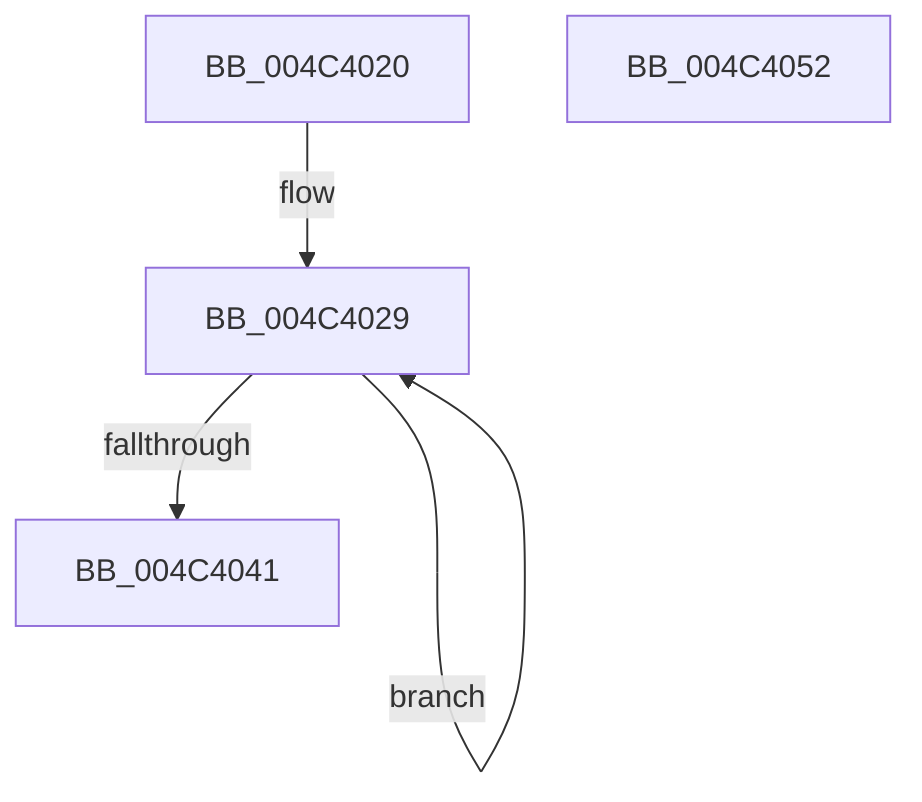

# PopFxDirectedPowerTransitionWorker

- RVA: `0x004C4020`–`0x004C4053` (길이 `51` bytes)
- VA: `0x00000001404C4020`
- 실행 섹션: `.text`
- PDB 이름 있음: `예`; PDB Function 태그: `아니요`
- unwind 정보 RVA: `0x0005CF00`
- 디코드: `16`개 명령, `51/51` bytes 표시
- 미해석 바이트: `0` (있으면 어셈블리에 `.byte`로 보존)

> 이 문서는 커널 이미지의 기계어와 PDB 기호를 분석해 생성했습니다. 4번과 5번은 함수 원형과 자료형을 바이너리 사용 방식에서 추정한 C 해석이며 원본 소스 복구 결과는 아닙니다.

## 1. Dependencies

- 직접 호출 지점: **2**; 고유 호출 대상: **2**
- 직접 호출자로 확인된 함수: **0**
- RIP 상대 이미지 참조: **0**

### Outgoing calls
- `0x004C402C` → [PopFxHandleDirectedPowerTransition](PopFxHandleDirectedPowerTransition_function_004C405C.md) (function, `0x004C405C`)
- `0x004C4047` → [PopFxDereferenceDevice](../27/PopFxDereferenceDevice_function_0027038C.md) (function, `0x0027038C`)

### Direct callers
- 이 함수 시작 RVA로 연결되는 직접 call은 확인되지 않았습니다. 간접 호출은 완전히 역산할 수 없습니다.

### Static image references
- 디코드된 RIP-relative 메모리 참조가 없습니다.

## 2. Other-region calls and transfers

- 다른 실행 섹션으로 향하는 call: **0**
- 별도 외부 분기/꼬리 이동을 확인하지 못했습니다.

## 3. Assembly (complete function range)

```asm
004C4020  40 53                           push rbx
004C4022  48 83 EC 20                     sub rsp, 0x20
004C4026  48 8B D9                        mov rbx, rcx
004C4029  48 8B CB                        mov rcx, rbx
004C402C  E8 2B 00 00 00                  call 0x1404c405c
004C4031  83 C8 FF                        or eax, 0xffffffff
004C4034  F0 0F C1 83 E0 03 00 00         lock xadd dword ptr [rbx + 0x3e0], eax
004C403C  83 F8 01                        cmp eax, 1
004C403F  75 E8                           jne 0x1404c4029
004C4041  8D 50 03                        lea edx, [rax + 3]
004C4044  48 8B CB                        mov rcx, rbx
004C4047  E8 40 C3 DA FF                  call 0x14027038c
004C404C  48 83 C4 20                     add rsp, 0x20
004C4050  5B                              pop rbx
004C4051  C3                              ret
004C4052  CC                              int3
```

## 4. C-style interpretation (structured pseudocode)

```c
__int64 __fastcall PopFxDirectedPowerTransitionWorker(__int64 a1)
{
    __int64 result;
    __int64 v_rsp;

    v_rsp = (v_rsp) - (32);
loc_004C4029:
    result = PopFxHandleDirectedPowerTransition(a1, a2, a3, a4);
    result = (unsigned int)((result) | (0xFFFFFFFFULL));
    if (((unsigned int)(result)) != 1) goto loc_004C4029;
    result = PopFxDereferenceDevice(a1, result + 3, a3, a4);
    v_rsp = (v_rsp) + (32);
    return result;
}
```

## 5. (Beta) C Style

```c
int64_t PopFxDirectedPowerTransitionWorker(void *Arg1)
{
    uint8_t *arg1 = (uint8_t *)Arg1;

    int64_t result;
    int64_t local_rsp;

    local_rsp = (local_rsp) - (32);
loc_004C4029:
    result = PopFxHandleDirectedPowerTransition(Arg1, a2, a3, a4);
    result = (uint32_t)((result) | (0xFFFFFFFFULL));
    if (((uint32_t)(result)) != 1) goto loc_004C4029;
    result = PopFxDereferenceDevice(Arg1, result + 3, a3, a4);
    local_rsp = (local_rsp) + (32);
    return result;
}
```

### 관측된 메모리 오프셋

구조체 형식이 확인되지 않은 접근은 인자 기준의 오프셋으로만 기록했습니다.

| 기준 인자 | 오프셋 표현 | 폭 (bit) | 접근 |
|---|---:|---:|---|
| `Arg1` | `+ 0x3E0` | `32` | `R/W` |

## 6. Execution-region graph

[열기: 2D/3D 그래프와 함수 탐색 컨트롤 패널](../../../control-panel.html?section=text&rva=0x004C4020&view=graph)

- 2D 그래프는 위에서 아래로 흐르고, 3D 그래프는 빈 공간을 드래그해 회전합니다. Shift+드래그는 이동, 휠은 확대·축소, 함수 노드 선택은 대상 보고서 이동입니다.

### Static fallback


