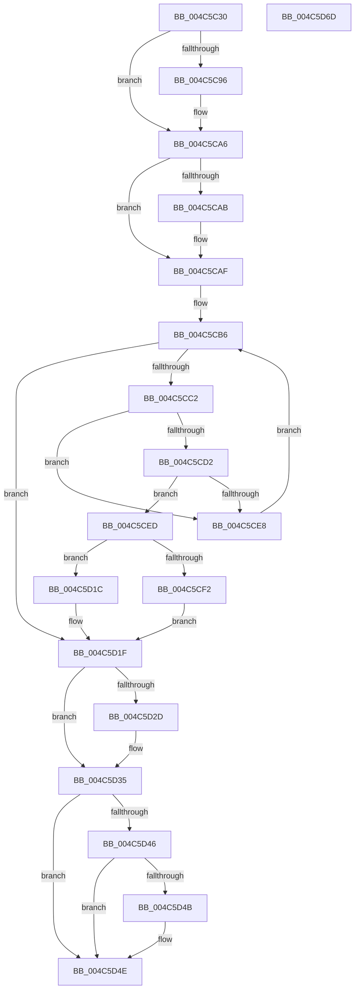

# PopFxFindAcpiDeviceByUniqueId

- RVA: `0x004C5C30`–`0x004C5D6E` (길이 `318` bytes)
- VA: `0x00000001404C5C30`
- 실행 섹션: `.text`
- PDB 이름 있음: `예`; PDB Function 태그: `아니요`
- unwind 정보 RVA: `0x000AA18C`
- 디코드: `86`개 명령, `318/318` bytes 표시
- 미해석 바이트: `0` (있으면 어셈블리에 `.byte`로 보존)

> 이 문서는 커널 이미지의 기계어와 PDB 기호를 분석해 생성했습니다. 4번과 5번은 함수 원형과 자료형을 바이너리 사용 방식에서 추정한 C 해석이며 원본 소스 복구 결과는 아닙니다.

## 1. Dependencies

- 직접 호출 지점: **7**; 고유 호출 대상: **7**
- 직접 호출자로 확인된 함수: **3**
- RIP 상대 이미지 참조: **3**

### Outgoing calls
- `0x004C5C7D` → [KeAbPreAcquire](../21/KeAbPreAcquire_function_00210230.md) (function, `0x00210230`)
- `0x004C5CA1` → [ExfAcquirePushLockSharedEx](../21/ExfAcquirePushLockSharedEx_function_0021044C.md) (function, `0x0021044C`)
- `0x004C5CDF` → [RtlCompareUnicodeString](../../page/93/RtlCompareUnicodeString_function_00937F90.md) (function, `0x00937F90`)
- `0x004C5D13` → [IoAcquireRemoveLockEx](../43/IoAcquireRemoveLockEx_function_00433420.md) (function, `0x00433420`)
- `0x004C5D30` → [ExfReleasePushLockShared](../26/ExfReleasePushLockShared_function_00263440.md) (function, `0x00263440`)
- `0x004C5D38` → [KeAbPostRelease](../2E/KeAbPostRelease_function_002E1600.md) (function, `0x002E1600`)
- `0x004C5D3D` → [KeLeaveCriticalRegion](../25/KeLeaveCriticalRegion_function_0025D8B0.md) (function, `0x0025D8B0`)

### Direct callers
- [PopFxAcpiPrepareDevice](../5D/PopFxAcpiPrepareDevice_function_005DD5F4.md) at `0x005DD61B`
- [PopFxRegisterDeviceWorker](../../page/75/PopFxRegisterDeviceWorker_function_00759E20.md) at `0x0075A037`
- [PopFxFindDeviceAndAllocateUniqueId](../../page/A9/PopFxFindDeviceAndAllocateUniqueId_function_00A90D8C.md) at `0x00A90DEE`

### Static image references
- `0x004C5C55` → RVA `0x00F0E408` (`.data`; read)
- `0x004C5CAF` → RVA `0x00F0E3E0` (`.data`; read)
- `0x004C5D07` → RVA `0x006C7800` (` ?? ::FNODOBFM::`string'`; read)

## 2. Other-region calls and transfers

- 다른 실행 섹션으로 향하는 call: **1**
  - `0x004C5CDF` → [RtlCompareUnicodeString](../../page/93/RtlCompareUnicodeString_function_00937F90.md) (`.text` → `PAGE`)
- 별도 외부 분기/꼬리 이동을 확인하지 못했습니다.

## 3. Assembly (complete function range)

```asm
004C5C30  48 89 5C 24 08                  mov qword ptr [rsp + 8], rbx
004C5C35  48 89 6C 24 18                  mov qword ptr [rsp + 0x18], rbp
004C5C3A  48 89 74 24 20                  mov qword ptr [rsp + 0x20], rsi
004C5C3F  57                              push rdi
004C5C40  41 54                           push r12
004C5C42  41 55                           push r13
004C5C44  41 56                           push r14
004C5C46  41 57                           push r15
004C5C48  48 83 EC 30                     sub rsp, 0x30
004C5C4C  65 48 8B 04 25 88 01 00 00      mov rax, qword ptr gs:[0x188]
004C5C55  4C 8D 25 AC 87 A4 00            lea r12, [rip + 0xa487ac]
004C5C5C  4C 8B F2                        mov r14, rdx
004C5C5F  48 8B E9                        mov rbp, rcx
004C5C62  45 33 FF                        xor r15d, r15d
004C5C65  45 33 C0                        xor r8d, r8d
004C5C68  33 D2                           xor edx, edx
004C5C6A  49 8B CC                        mov rcx, r12
004C5C6D  66 FF 88 E4 01 00 00            dec word ptr [rax + 0x1e4]
004C5C74  41 8B FF                        mov edi, r15d
004C5C77  90                              nop
004C5C78  BE 25 02 00 C0                  mov esi, 0xc0000225
004C5C7D  E8 AE A5 D4 FF                  call 0x140210230
004C5C82  48 8B D8                        mov rbx, rax
004C5C85  45 8D 6F 11                     lea r13d, [r15 + 0x11]
004C5C89  33 C0                           xor eax, eax
004C5C8B  F0 4C 0F B1 2D 74 87 A4 00      lock cmpxchg qword ptr [rip + 0xa48774], r13
004C5C94  74 10                           je 0x1404c5ca6
004C5C96  4D 8B CC                        mov r9, r12
004C5C99  4C 8B C3                        mov r8, rbx
004C5C9C  33 D2                           xor edx, edx
004C5C9E  49 8B CC                        mov rcx, r12
004C5CA1  E8 A6 A7 D4 FF                  call 0x14021044c
004C5CA6  48 85 DB                        test rbx, rbx
004C5CA9  74 04                           je 0x1404c5caf
004C5CAB  C6 43 0A 01                     mov byte ptr [rbx + 0xa], 1
004C5CAF  48 8B 1D 2A 87 A4 00            mov rbx, qword ptr [rip + 0xa4872a]
004C5CB6  48 8D 05 23 87 A4 00            lea rax, [rip + 0xa48723]
004C5CBD  48 3B D8                        cmp rbx, rax
004C5CC0  74 5D                           je 0x1404c5d1f
004C5CC2  48 8D BB 38 FF FF FF            lea rdi, [rbx - 0xc8]
004C5CC9  4C 39 BF E0 00 00 00            cmp qword ptr [rdi + 0xe0], r15
004C5CD0  74 16                           je 0x1404c5ce8
004C5CD2  48 8D 8F D8 00 00 00            lea rcx, [rdi + 0xd8]
004C5CD9  45 33 C0                        xor r8d, r8d
004C5CDC  48 8B D5                        mov rdx, rbp
004C5CDF  E8 AC 22 47 00                  call 0x140937f90
004C5CE4  85 C0                           test eax, eax
004C5CE6  74 05                           je 0x1404c5ced
004C5CE8  48 8B 1B                        mov rbx, qword ptr [rbx]
004C5CEB  EB C9                           jmp 0x1404c5cb6
004C5CED  4D 85 F6                        test r14, r14
004C5CF0  74 2A                           je 0x1404c5d1c
004C5CF2  48 8D 8F 38 01 00 00            lea rcx, [rdi + 0x138]
004C5CF9  C7 44 24 20 20 00 00 00         mov dword ptr [rsp + 0x20], 0x20
004C5D01  41 B9 01 00 00 00               mov r9d, 1
004C5D07  4C 8D 05 F2 1A 20 00            lea r8, [rip + 0x201af2]
004C5D0E  BA 50 6F 46 66                  mov edx, 0x66466f50
004C5D13  E8 08 D7 F6 FF                  call 0x140433420
004C5D18  8B F0                           mov esi, eax
004C5D1A  EB 03                           jmp 0x1404c5d1f
004C5D1C  41 8B F7                        mov esi, r15d
004C5D1F  49 8B C5                        mov rax, r13
004C5D22  F0 4C 0F B1 3D DD 86 A4 00      lock cmpxchg qword ptr [rip + 0xa486dd], r15
004C5D2B  74 08                           je 0x1404c5d35
004C5D2D  49 8B CC                        mov rcx, r12
004C5D30  E8 0B D7 D9 FF                  call 0x140263440
004C5D35  49 8B CC                        mov rcx, r12
004C5D38  E8 C3 B8 E1 FF                  call 0x1402e1600
004C5D3D  E8 6E 7B D9 FF                  call 0x14025d8b0
004C5D42  85 F6                           test esi, esi
004C5D44  78 08                           js 0x1404c5d4e
004C5D46  4D 85 F6                        test r14, r14
004C5D49  74 03                           je 0x1404c5d4e
004C5D4B  49 89 3E                        mov qword ptr [r14], rdi
004C5D4E  48 8B 5C 24 60                  mov rbx, qword ptr [rsp + 0x60]
004C5D53  8B C6                           mov eax, esi
004C5D55  48 8B 74 24 78                  mov rsi, qword ptr [rsp + 0x78]
004C5D5A  48 8B 6C 24 70                  mov rbp, qword ptr [rsp + 0x70]
004C5D5F  48 83 C4 30                     add rsp, 0x30
004C5D63  41 5F                           pop r15
004C5D65  41 5E                           pop r14
004C5D67  41 5D                           pop r13
004C5D69  41 5C                           pop r12
004C5D6B  5F                              pop rdi
004C5D6C  C3                              ret
004C5D6D  CC                              int3
```

## 4. C-style interpretation (structured pseudocode)

```c
__int64 __fastcall PopFxFindAcpiDeviceByUniqueId(__int64 a1, __int64 a2, int a3)
{
    __int64 result;
    __int64 v_r15;
    __int64 v_rsp;
    unsigned int v_stack_m38;
    unsigned __int64 v_stack_p18;
    unsigned __int64 v_stack_p20;
    unsigned __int64 v_stack_p8;

    v_stack_p8 = v_rbx;
    v_stack_p18 = v_rbp;
    v_stack_p20 = v_rsi;
    v_rsp = (v_rsp) - (48);
    v_r15 = 0;
    a3 = 0;
    a2 = 0;
    result = KeAbPreAcquire(v_rip + 10782636, a2, a3, a4);
    result = 0;
    if (!(condition_is_equal)) {
        a4 = v_rip + 10782636;
        a3 = 0;
        a2 = 0;
        a1 = v_rip + 10782636;
        result = ExfAcquirePushLockSharedEx(a1, a2, a3, a4);
    }
    if (result != 0) {
        *(unsigned __int8 *)(result + 10) = 1;
    }
loc_004C5CB6:
    if ((*(unsigned __int64 *)(v_rip + 10782506)) == (v_rip + 10782499)) goto loc_004C5D1F;
    if ((*(unsigned __int64 *)(*(unsigned __int64 *)(v_rip + 10782506) - 200 + 224)) == 0) goto loc_004C5CE8;
    a3 = 0;
    result = RtlCompareUnicodeString(*(unsigned __int64 *)(v_rip + 10782506) - 200 + 216, a1, a3, a4);
    if ((unsigned int)(result) == 0) goto loc_004C5CED;
loc_004C5CE8:
    goto loc_004C5CB6;
loc_004C5CED:
    if (0 == 0) goto loc_004C5D1C;
    v_stack_m38 = 32;
    result = IoAcquireRemoveLockEx(*(unsigned __int64 *)(v_rip + 10782506) - 200 + 312, (unsigned int)(0x66466F50ULL), v_rip + 2104050, 1);
    goto loc_004C5D1F;
loc_004C5D1C:
loc_004C5D1F:
    result = v_r15 + 17;
    if (0 != 0) {
        a1 = v_rip + 10782636;
        result = ExfReleasePushLockShared(a1, (unsigned int)(0x66466F50ULL), v_rip + 2104050, 1);
    }
    result = KeAbPostRelease(v_rip + 10782636, (unsigned int)(0x66466F50ULL), v_rip + 2104050, 1);
    result = KeLeaveCriticalRegion(v_rip + 10782636, (unsigned int)(0x66466F50ULL), v_rip + 2104050, 1);
    if (sign_flag) goto loc_004C5D4E;
    if (0 != 0) {
        *(unsigned __int64 *)(a2) = *(unsigned __int64 *)(v_rip + 10782506) - 200;
    }
    v_rsp = (v_rsp) + (48);
    return 0;
}
```

## 5. (Beta) C Style

```c
int64_t PopFxFindAcpiDeviceByUniqueId(int64_t Arg1, int64_t Arg2, int32_t Arg3)
{
    int64_t result;
    int64_t local_r15;
    int64_t local_rsp;
    uint32_t v_stack_m38;
    uint64_t v_stack_p18;
    uint64_t v_stack_p20;
    uint64_t v_stack_p8;

    v_stack_p8 = local_rbx;
    v_stack_p18 = local_rbp;
    v_stack_p20 = local_rsi;
    local_rsp = (local_rsp) - (48);
    local_r15 = 0;
    Arg3 = 0;
    Arg2 = 0;
    result = KeAbPreAcquire(v_rip + 10782636, Arg2, Arg3, a4);
    result = 0;
    if (!(condition_is_equal)) {
        a4 = v_rip + 10782636;
        Arg3 = 0;
        Arg2 = 0;
        Arg1 = v_rip + 10782636;
        result = ExfAcquirePushLockSharedEx(Arg1, Arg2, Arg3, a4);
    }
    if (result != 0) {
        *(uint8_t *)(result + 0xA) = 1;
    }
loc_004C5CB6:
    if ((*(uint64_t *)(v_rip + 0xA4872A)) == (v_rip + 10782499)) goto loc_004C5D1F;
    if ((*(uint64_t *)(*(uint64_t *)(v_rip + 0xA4872A) - 0xC8 + 0xE0)) == 0) goto loc_004C5CE8;
    Arg3 = 0;
    result = RtlCompareUnicodeString(*(uint64_t *)(v_rip + 0xA4872A) - 200 + 216, Arg1, Arg3, a4);
    if ((uint32_t)(result) == 0) goto loc_004C5CED;
loc_004C5CE8:
    goto loc_004C5CB6;
loc_004C5CED:
    if (0 == 0) goto loc_004C5D1C;
    v_stack_m38 = 32;
    result = IoAcquireRemoveLockEx(*(uint64_t *)(v_rip + 0xA4872A) - 200 + 312, (uint32_t)(0x66466F50ULL), v_rip + 2104050, 1);
    goto loc_004C5D1F;
loc_004C5D1C:
loc_004C5D1F:
    result = local_r15 + 17;
    if (0 != 0) {
        Arg1 = v_rip + 10782636;
        result = ExfReleasePushLockShared(Arg1, (uint32_t)(0x66466F50ULL), v_rip + 2104050, 1);
    }
    result = KeAbPostRelease(v_rip + 10782636, (uint32_t)(0x66466F50ULL), v_rip + 2104050, 1);
    result = KeLeaveCriticalRegion(v_rip + 10782636, (uint32_t)(0x66466F50ULL), v_rip + 2104050, 1);
    if (sign_flag) goto loc_004C5D4E;
    if (0 != 0) {
        *(uint64_t *)(Arg2) = *(uint64_t *)(v_rip + 0xA4872A) - 200;
    }
    local_rsp = (local_rsp) + (48);
    return 0;
}
```

## 6. Execution-region graph

[열기: 2D/3D 그래프와 함수 탐색 컨트롤 패널](../../../control-panel.html?section=text&rva=0x004C5C30&view=graph)

- 2D 그래프는 위에서 아래로 흐르고, 3D 그래프는 빈 공간을 드래그해 회전합니다. Shift+드래그는 이동, 휠은 확대·축소, 함수 노드 선택은 대상 보고서 이동입니다.

### Static fallback


