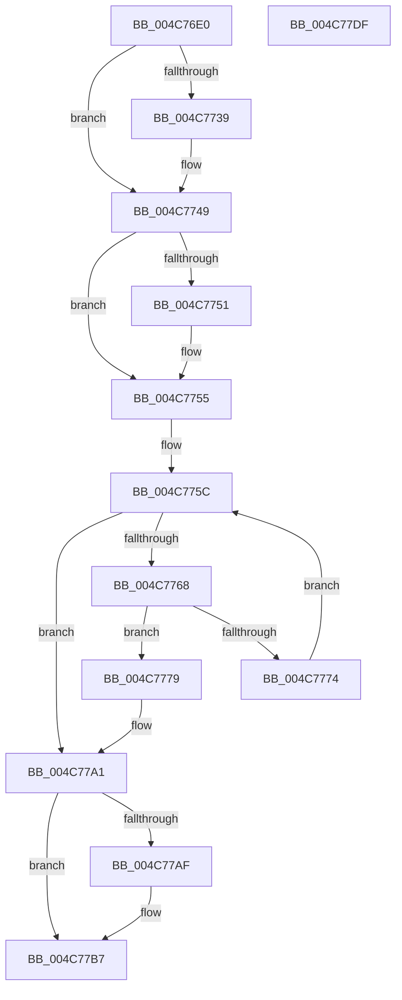

# PopFxFindAndReferenceAcpiDevice

- RVA: `0x004C76E0`–`0x004C77E0` (길이 `256` bytes)
- VA: `0x00000001404C76E0`
- 실행 섹션: `.text`
- PDB 이름 있음: `예`; PDB Function 태그: `아니요`
- unwind 정보 RVA: `0x000BD20C`
- 디코드: `65`개 명령, `256/256` bytes 표시
- 미해석 바이트: `0` (있으면 어셈블리에 `.byte`로 보존)

> 이 문서는 커널 이미지의 기계어와 PDB 기호를 분석해 생성했습니다. 4번과 5번은 함수 원형과 자료형을 바이너리 사용 방식에서 추정한 C 해석이며 원본 소스 복구 결과는 아닙니다.

## 1. Dependencies

- 직접 호출 지점: **6**; 고유 호출 대상: **6**
- 직접 호출자로 확인된 함수: **1**
- RIP 상대 이미지 참조: **3**

### Outgoing calls
- `0x004C7720` → [KeAbPreAcquire](../21/KeAbPreAcquire_function_00210230.md) (function, `0x00210230`)
- `0x004C7744` → [ExfAcquirePushLockSharedEx](../21/ExfAcquirePushLockSharedEx_function_0021044C.md) (function, `0x0021044C`)
- `0x004C779A` → [IoAcquireRemoveLockEx](../43/IoAcquireRemoveLockEx_function_00433420.md) (function, `0x00433420`)
- `0x004C77B2` → [ExfReleasePushLockShared](../26/ExfReleasePushLockShared_function_00263440.md) (function, `0x00263440`)
- `0x004C77BA` → [KeAbPostRelease](../2E/KeAbPostRelease_function_002E1600.md) (function, `0x002E1600`)
- `0x004C77BF` → [KeLeaveCriticalRegion](../25/KeLeaveCriticalRegion_function_0025D8B0.md) (function, `0x0025D8B0`)

### Direct callers
- [PopFxAcpiForwardPepAcpiNotifyRequest](PopFxAcpiForwardPepAcpiNotifyRequest_function_004C7650.md) at `0x004C7666`

### Static image references
- `0x004C7701` → RVA `0x00F0E408` (`.data`; read)
- `0x004C7755` → RVA `0x00F0E3E0` (`.data`; read)
- `0x004C778E` → RVA `0x006C7800` (` ?? ::FNODOBFM::`string'`; read)

## 2. Other-region calls and transfers

- 다른 실행 섹션으로 향하는 call: **0**
- 별도 외부 분기/꼬리 이동을 확인하지 못했습니다.

## 3. Assembly (complete function range)

```asm
004C76E0  48 89 5C 24 08                  mov qword ptr [rsp + 8], rbx
004C76E5  48 89 6C 24 18                  mov qword ptr [rsp + 0x18], rbp
004C76EA  48 89 74 24 20                  mov qword ptr [rsp + 0x20], rsi
004C76EF  57                              push rdi
004C76F0  41 56                           push r14
004C76F2  41 57                           push r15
004C76F4  48 83 EC 30                     sub rsp, 0x30
004C76F8  65 48 8B 04 25 88 01 00 00      mov rax, qword ptr gs:[0x188]
004C7701  48 8D 2D 00 6D A4 00            lea rbp, [rip + 0xa46d00]
004C7708  48 8B F1                        mov rsi, rcx
004C770B  45 33 C0                        xor r8d, r8d
004C770E  33 D2                           xor edx, edx
004C7710  48 8B CD                        mov rcx, rbp
004C7713  BF 0E 00 00 C0                  mov edi, 0xc000000e
004C7718  66 FF 88 E4 01 00 00            dec word ptr [rax + 0x1e4]
004C771F  90                              nop
004C7720  E8 0B 8B D4 FF                  call 0x140210230
004C7725  48 8B D8                        mov rbx, rax
004C7728  33 C0                           xor eax, eax
004C772A  44 8D 78 11                     lea r15d, [rax + 0x11]
004C772E  F0 4C 0F B1 3D D1 6C A4 00      lock cmpxchg qword ptr [rip + 0xa46cd1], r15
004C7737  74 10                           je 0x1404c7749
004C7739  4C 8B CD                        mov r9, rbp
004C773C  4C 8B C3                        mov r8, rbx
004C773F  33 D2                           xor edx, edx
004C7741  48 8B CD                        mov rcx, rbp
004C7744  E8 03 8D D4 FF                  call 0x14021044c
004C7749  45 33 F6                        xor r14d, r14d
004C774C  48 85 DB                        test rbx, rbx
004C774F  74 04                           je 0x1404c7755
004C7751  C6 43 0A 01                     mov byte ptr [rbx + 0xa], 1
004C7755  48 8B 05 84 6C A4 00            mov rax, qword ptr [rip + 0xa46c84]
004C775C  48 8D 0D 7D 6C A4 00            lea rcx, [rip + 0xa46c7d]
004C7763  48 3B C1                        cmp rax, rcx
004C7766  74 39                           je 0x1404c77a1
004C7768  48 8D 88 38 FF FF FF            lea rcx, [rax - 0xc8]
004C776F  48 3B CE                        cmp rcx, rsi
004C7772  74 05                           je 0x1404c7779
004C7774  48 8B 00                        mov rax, qword ptr [rax]
004C7777  EB E3                           jmp 0x1404c775c
004C7779  48 81 C1 38 01 00 00            add rcx, 0x138
004C7780  C7 44 24 20 20 00 00 00         mov dword ptr [rsp + 0x20], 0x20
004C7788  41 B9 01 00 00 00               mov r9d, 1
004C778E  4C 8D 05 6B 00 20 00            lea r8, [rip + 0x20006b]
004C7795  BA 50 6F 46 66                  mov edx, 0x66466f50
004C779A  E8 81 BC F6 FF                  call 0x140433420
004C779F  8B F8                           mov edi, eax
004C77A1  49 8B C7                        mov rax, r15
004C77A4  F0 4C 0F B1 35 5B 6C A4 00      lock cmpxchg qword ptr [rip + 0xa46c5b], r14
004C77AD  74 08                           je 0x1404c77b7
004C77AF  48 8B CD                        mov rcx, rbp
004C77B2  E8 89 BC D9 FF                  call 0x140263440
004C77B7  48 8B CD                        mov rcx, rbp
004C77BA  E8 41 9E E1 FF                  call 0x1402e1600
004C77BF  E8 EC 60 D9 FF                  call 0x14025d8b0
004C77C4  48 8B 5C 24 50                  mov rbx, qword ptr [rsp + 0x50]
004C77C9  8B C7                           mov eax, edi
004C77CB  48 8B 6C 24 60                  mov rbp, qword ptr [rsp + 0x60]
004C77D0  48 8B 74 24 68                  mov rsi, qword ptr [rsp + 0x68]
004C77D5  48 83 C4 30                     add rsp, 0x30
004C77D9  41 5F                           pop r15
004C77DB  41 5E                           pop r14
004C77DD  5F                              pop rdi
004C77DE  C3                              ret
004C77DF  CC                              int3
```

## 4. C-style interpretation (structured pseudocode)

```c
__int64 __fastcall PopFxFindAndReferenceAcpiDevice(__int64 a1, int a2, int a3)
{
    __int64 result;
    __int64 v_r14;
    __int64 v_rsp;
    unsigned int v_stack_m28;
    unsigned __int64 v_stack_p18;
    unsigned __int64 v_stack_p20;
    unsigned __int64 v_stack_p8;

    v_stack_p8 = v_rbx;
    v_stack_p18 = v_rbp;
    v_stack_p20 = v_rsi;
    v_rsp = (v_rsp) - (48);
    a3 = 0;
    a2 = 0;
    result = KeAbPreAcquire(v_rip + 10775808, a2, a3, a4);
    result = 0;
    if (!(condition_is_equal)) {
        a4 = v_rip + 10775808;
        a3 = 0;
        a2 = 0;
        a1 = v_rip + 10775808;
        result = ExfAcquirePushLockSharedEx(a1, a2, a3, a4);
    }
    v_r14 = 0;
    if (result != 0) {
        *(unsigned __int8 *)(result + 10) = 1;
    }
loc_004C775C:
    if ((*(unsigned __int64 *)(v_rip + 10775684)) == (v_rip + 10775677)) goto loc_004C77A1;
    if ((*(unsigned __int64 *)(v_rip + 10775684) - 200) == a1) goto loc_004C7779;
    goto loc_004C775C;
loc_004C7779:
    a1 = (*(unsigned __int64 *)(v_rip + 10775684) - 200) + (312);
    v_stack_m28 = 32;
    result = IoAcquireRemoveLockEx(a1, (unsigned int)(0x66466F50ULL), v_rip + 2097259, 1);
loc_004C77A1:
    result = result + 17;
    if (!(condition_is_equal)) {
        a1 = v_rip + 10775808;
        result = ExfReleasePushLockShared(a1, (unsigned int)(0x66466F50ULL), v_rip + 2097259, 1);
    }
    result = KeAbPostRelease(v_rip + 10775808, (unsigned int)(0x66466F50ULL), v_rip + 2097259, 1);
    result = KeLeaveCriticalRegion(v_rip + 10775808, (unsigned int)(0x66466F50ULL), v_rip + 2097259, 1);
    v_rsp = (v_rsp) + (48);
    return (unsigned int)((unsigned int)((unsigned int)((unsigned int)(result))));
}
```

## 5. (Beta) C Style

```c
int64_t PopFxFindAndReferenceAcpiDevice(int64_t Arg1, int32_t Arg2, int32_t Arg3)
{
    int64_t result;
    int64_t local_r14;
    int64_t local_rsp;
    uint32_t v_stack_m28;
    uint64_t v_stack_p18;
    uint64_t v_stack_p20;
    uint64_t v_stack_p8;

    v_stack_p8 = local_rbx;
    v_stack_p18 = local_rbp;
    v_stack_p20 = local_rsi;
    local_rsp = (local_rsp) - (48);
    Arg3 = 0;
    Arg2 = 0;
    result = KeAbPreAcquire(v_rip + 10775808, Arg2, Arg3, a4);
    result = 0;
    if (!(condition_is_equal)) {
        a4 = v_rip + 10775808;
        Arg3 = 0;
        Arg2 = 0;
        Arg1 = v_rip + 10775808;
        result = ExfAcquirePushLockSharedEx(Arg1, Arg2, Arg3, a4);
    }
    local_r14 = 0;
    if (result != 0) {
        *(uint8_t *)(result + 0xA) = 1;
    }
loc_004C775C:
    if ((*(uint64_t *)(v_rip + 0xA46C84)) == (v_rip + 10775677)) goto loc_004C77A1;
    if ((*(uint64_t *)(v_rip + 0xA46C84) - 200) == Arg1) goto loc_004C7779;
    goto loc_004C775C;
loc_004C7779:
    Arg1 = (*(uint64_t *)(v_rip + 0xA46C84) - 200) + (312);
    v_stack_m28 = 32;
    result = IoAcquireRemoveLockEx(Arg1, (uint32_t)(0x66466F50ULL), v_rip + 2097259, 1);
loc_004C77A1:
    result = result + 17;
    if (!(condition_is_equal)) {
        Arg1 = v_rip + 10775808;
        result = ExfReleasePushLockShared(Arg1, (uint32_t)(0x66466F50ULL), v_rip + 2097259, 1);
    }
    result = KeAbPostRelease(v_rip + 10775808, (uint32_t)(0x66466F50ULL), v_rip + 2097259, 1);
    result = KeLeaveCriticalRegion(v_rip + 10775808, (uint32_t)(0x66466F50ULL), v_rip + 2097259, 1);
    local_rsp = (local_rsp) + (48);
    return (uint32_t)((uint32_t)((uint32_t)((uint32_t)(result))));
}
```

## 6. Execution-region graph

[열기: 2D/3D 그래프와 함수 탐색 컨트롤 패널](../../../control-panel.html?section=text&rva=0x004C76E0&view=graph)

- 2D 그래프는 위에서 아래로 흐르고, 3D 그래프는 빈 공간을 드래그해 회전합니다. Shift+드래그는 이동, 휠은 확대·축소, 함수 노드 선택은 대상 보고서 이동입니다.

### Static fallback


