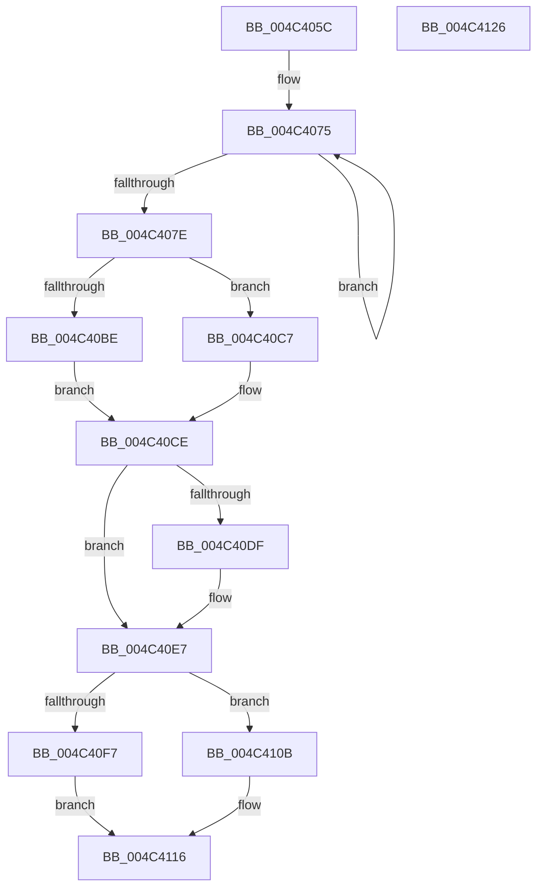

# PopFxHandleDirectedPowerTransition

- RVA: `0x004C405C`–`0x004C4127` (길이 `203` bytes)
- VA: `0x00000001404C405C`
- 실행 섹션: `.text`
- PDB 이름 있음: `예`; PDB Function 태그: `아니요`
- unwind 정보 RVA: `0x00060BC4`
- 디코드: `52`개 명령, `203/203` bytes 표시
- 미해석 바이트: `0` (있으면 어셈블리에 `.byte`로 보존)

> 이 문서는 커널 이미지의 기계어와 PDB 기호를 분석해 생성했습니다. 4번과 5번은 함수 원형과 자료형을 바이너리 사용 방식에서 추정한 C 해석이며 원본 소스 복구 결과는 아닙니다.

## 1. Dependencies

- 직접 호출 지점: **5**; 고유 호출 대상: **5**
- 직접 호출자로 확인된 함수: **1**
- RIP 상대 이미지 참조: **2**

### Outgoing calls
- `0x004C4091` → [PopDiagTraceFxDeviceDirectedTransition](PopDiagTraceFxDeviceDirectedTransition_function_004C4130.md) (function, `0x004C4130`)
- `0x004C40AC` → [PopFxEnableWorkOrderWatchdog](../2B/PopFxEnableWorkOrderWatchdog_function_002BD268.md) (function, `0x002BD268`)
- `0x004C40CE` → [guard_dispatch_icall](../6B/guard_dispatch_icall_function_006BAAD0.md) (function, `0x006BAAD0`)
- `0x004C4104` → [PopFxAddLogEntry](../39/PopFxAddLogEntry_function_00390B94.md) (function, `0x00390B94`)
- `0x004C4111` → [PopFxCompleteDirectedPowerTransition](../4F/PopFxCompleteDirectedPowerTransition_function_004FB330.md) (function, `0x004FB330`)

### Direct callers
- [PopFxDirectedPowerTransitionWorker](PopFxDirectedPowerTransitionWorker_function_004C4020.md) at `0x004C402C`

### Static image references
- `0x004C4096` → RVA `0x00F0E3D0` (`.data`; read)
- `0x004C40A5` → RVA `0x00F0E3D4` (`.data`; read)

## 2. Other-region calls and transfers

- 다른 실행 섹션으로 향하는 call: **0**
- 별도 외부 분기/꼬리 이동을 확인하지 못했습니다.

## 3. Assembly (complete function range)

```asm
004C405C  48 89 5C 24 08                  mov qword ptr [rsp + 8], rbx
004C4061  48 89 74 24 10                  mov qword ptr [rsp + 0x10], rsi
004C4066  57                              push rdi
004C4067  48 83 EC 20                     sub rsp, 0x20
004C406B  48 8B F9                        mov rdi, rcx
004C406E  0F 0D 49 20                     prefetchw byte ptr [rcx + 0x20]
004C4072  8B 41 20                        mov eax, dword ptr [rcx + 0x20]
004C4075  8B D0                           mov edx, eax
004C4077  F0 0F B1 51 20                  lock cmpxchg dword ptr [rcx + 0x20], edx
004C407C  75 F7                           jne 0x1404c4075
004C407E  48 8B 49 30                     mov rcx, qword ptr [rcx + 0x30]
004C4082  8B D8                           mov ebx, eax
004C4084  81 E3 00 10 00 00               and ebx, 0x1000
004C408A  40 0F 95 C6                     setne sil
004C408E  40 8A D6                        mov dl, sil
004C4091  E8 9A 00 00 00                  call 0x1404c4130
004C4096  8B 15 34 A3 A4 00               mov edx, dword ptr [rip + 0xa4a334]
004C409C  48 8D 8F C0 03 00 00            lea rcx, [rdi + 0x3c0]
004C40A3  85 DB                           test ebx, ebx
004C40A5  0F 44 15 28 A3 A4 00            cmove edx, dword ptr [rip + 0xa4a328]
004C40AC  E8 B7 91 DF FF                  call 0x1402bd268
004C40B1  48 8B 8F C0 00 00 00            mov rcx, qword ptr [rdi + 0xc0]
004C40B8  33 D2                           xor edx, edx
004C40BA  85 DB                           test ebx, ebx
004C40BC  75 09                           jne 0x1404c40c7
004C40BE  48 8B 87 B0 00 00 00            mov rax, qword ptr [rdi + 0xb0]
004C40C5  EB 07                           jmp 0x1404c40ce
004C40C7  48 8B 87 B8 00 00 00            mov rax, qword ptr [rdi + 0xb8]
004C40CE  E8 FD 69 1F 00                  call 0x1406baad0
004C40D3  48 8B 87 F0 03 00 00            mov rax, qword ptr [rdi + 0x3f0]
004C40DA  48 85 C0                        test rax, rax
004C40DD  74 08                           je 0x1404c40e7
004C40DF  48 83 A0 A8 00 00 00 00         and qword ptr [rax + 0xa8], 0
004C40E7  83 C8 FF                        or eax, 0xffffffff
004C40EA  F0 0F C1 87 B0 04 00 00         lock xadd dword ptr [rdi + 0x4b0], eax
004C40F2  83 F8 01                        cmp eax, 1
004C40F5  74 14                           je 0x1404c410b
004C40F7  48 8B 4F 30                     mov rcx, qword ptr [rdi + 0x30]
004C40FB  45 33 C9                        xor r9d, r9d
004C40FE  33 D2                           xor edx, edx
004C4100  45 8D 41 18                     lea r8d, [r9 + 0x18]
004C4104  E8 8B CA EC FF                  call 0x140390b94
004C4109  EB 0B                           jmp 0x1404c4116
004C410B  40 8A D6                        mov dl, sil
004C410E  48 8B CF                        mov rcx, rdi
004C4111  E8 1A 72 03 00                  call 0x1404fb330
004C4116  48 8B 5C 24 30                  mov rbx, qword ptr [rsp + 0x30]
004C411B  48 8B 74 24 38                  mov rsi, qword ptr [rsp + 0x38]
004C4120  48 83 C4 20                     add rsp, 0x20
004C4124  5F                              pop rdi
004C4125  C3                              ret
004C4126  CC                              int3
```

## 4. C-style interpretation (structured pseudocode)

```c
__int64 __fastcall PopFxHandleDirectedPowerTransition(__int64 a1, __int64 a2, __int64 a3, int a4)
{
    __int64 result;
    __int64 v_rbx;
    __int64 v_rsi;
    __int64 v_rsp;
    unsigned __int64 v_stack_p10;
    unsigned __int64 v_stack_p8;

    v_stack_p8 = v_rbx;
    v_stack_p10 = v_rsi;
    v_rsp = (v_rsp) - (32);
loc_004C4075:
    if (condition_is_not_equal) goto loc_004C4075;
    v_rbx = (unsigned int)(((unsigned int)((unsigned int)((unsigned int)(*(unsigned int *)(a1 + 32))))) & (0x1000ULL));
    v_rsi = (condition_is_not_equal) ? 1 : 0;
    result = PopDiagTraceFxDeviceDirectedTransition(*(unsigned __int64 *)(a1 + 48), (unsigned __int8)(v_rsi), a3, a4);
    a2 = (unsigned int)(*(unsigned int *)(v_rip + 10789684));
    if ((unsigned int)(v_rbx) == 0) { a2 = *(unsigned int *)(v_rip + 10789672); }
    result = PopFxEnableWorkOrderWatchdog(a1 + 960, a2, a3, a4);
    a2 = 0;
    if ((unsigned int)(v_rbx) != 0) goto loc_004C40C7;
    goto loc_004C40CE;
loc_004C40C7:
loc_004C40CE:
    result = guard_dispatch_icall(*(unsigned __int64 *)(a1 + 192), a2, a3, a4);
    if (*(unsigned __int64 *)(a1 + 1008) != 0) {
    }
    result = (unsigned int)((*(unsigned __int64 *)(a1 + 1008)) | (0xFFFFFFFFULL));
    if (((unsigned int)(result)) == 1) goto loc_004C410B;
    a4 = 0;
    a2 = 0;
    result = PopFxAddLogEntry(*(unsigned __int64 *)(a1 + 48), a2, a4 + 24, a4);
    goto loc_004C4116;
loc_004C410B:
    result = PopFxCompleteDirectedPowerTransition(a1, (unsigned __int8)(v_rsi), a4 + 24, a4);
loc_004C4116:
    v_rsp = (v_rsp) + (32);
    return result;
}
```

## 5. (Beta) C Style

```c
int64_t PopFxHandleDirectedPowerTransition(void *Arg1, int64_t Arg2, int64_t Arg3, int32_t Arg4)
{
    uint8_t *arg1 = (uint8_t *)Arg1;

    int64_t result;
    int64_t local_rbx;
    int64_t local_rsi;
    int64_t local_rsp;
    uint64_t v_stack_p10;
    uint64_t v_stack_p8;

    v_stack_p8 = local_rbx;
    v_stack_p10 = local_rsi;
    local_rsp = (local_rsp) - (32);
loc_004C4075:
    if (condition_is_not_equal) goto loc_004C4075;
    local_rbx = (uint32_t)(((uint32_t)((uint32_t)((uint32_t)(*(uint32_t *)(arg1 + 0x20))))) & (0x1000ULL));
    local_rsi = (condition_is_not_equal) ? 1 : 0;
    result = PopDiagTraceFxDeviceDirectedTransition(*(uint64_t *)(arg1 + 0x30), (uint8_t)(local_rsi), Arg3, Arg4);
    Arg2 = (uint32_t)(*(uint32_t *)(v_rip + 0xA4A334));
    if ((uint32_t)(local_rbx) == 0) { Arg2 = *(uint32_t *)(v_rip + 0xA4A328); }
    result = PopFxEnableWorkOrderWatchdog(Arg1 + 960, Arg2, Arg3, Arg4);
    Arg2 = 0;
    if ((uint32_t)(local_rbx) != 0) goto loc_004C40C7;
    goto loc_004C40CE;
loc_004C40C7:
loc_004C40CE:
    result = guard_dispatch_icall(*(uint64_t *)(arg1 + 0xC0), Arg2, Arg3, Arg4);
    if (*(uint64_t *)(arg1 + 0x3F0) != 0) {
    }
    result = (uint32_t)((*(uint64_t *)(arg1 + 0x3F0)) | (0xFFFFFFFFULL));
    if (((uint32_t)(result)) == 1) goto loc_004C410B;
    Arg4 = 0;
    Arg2 = 0;
    result = PopFxAddLogEntry(*(uint64_t *)(arg1 + 0x30), Arg2, Arg4 + 24, Arg4);
    goto loc_004C4116;
loc_004C410B:
    result = PopFxCompleteDirectedPowerTransition(Arg1, (uint8_t)(local_rsi), Arg4 + 24, Arg4);
loc_004C4116:
    local_rsp = (local_rsp) + (32);
    return result;
}
```

### 관측된 메모리 오프셋

구조체 형식이 확인되지 않은 접근은 인자 기준의 오프셋으로만 기록했습니다.

| 기준 인자 | 오프셋 표현 | 폭 (bit) | 접근 |
|---|---:|---:|---|
| `Arg1` | `+ 0x20` | `8` | `R` |
| `Arg1` | `+ 0x20` | `32` | `R` |
| `Arg1` | `+ 0x30` | `64` | `R` |
| `Arg1` | `+ 0xB0` | `64` | `R` |
| `Arg1` | `+ 0xB8` | `64` | `R` |
| `Arg1` | `+ 0xC0` | `64` | `R` |
| `Arg1` | `+ 0x3C0` | `64` | `R` |
| `Arg1` | `+ 0x3F0` | `64` | `R` |
| `Arg1` | `+ 0x4B0` | `32` | `R/W` |

## 6. Execution-region graph

[열기: 2D/3D 그래프와 함수 탐색 컨트롤 패널](../../../control-panel.html?section=text&rva=0x004C405C&view=graph)

- 2D 그래프는 위에서 아래로 흐르고, 3D 그래프는 빈 공간을 드래그해 회전합니다. Shift+드래그는 이동, 휠은 확대·축소, 함수 노드 선택은 대상 보고서 이동입니다.

### Static fallback


