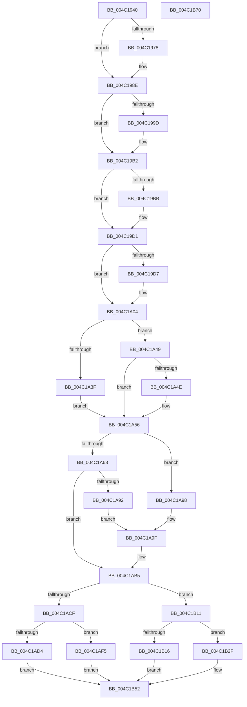

# PopFxIssueComponentPerfStateChanges

- RVA: `0x004C1940`–`0x004C1B71` (길이 `561` bytes)
- VA: `0x00000001404C1940`
- 실행 섹션: `.text`
- PDB 이름 있음: `예`; PDB Function 태그: `아니요`
- unwind 정보 RVA: `0x000BC81C`
- 디코드: `155`개 명령, `561/561` bytes 표시
- 미해석 바이트: `0` (있으면 어셈블리에 `.byte`로 보존)

> 이 문서는 커널 이미지의 기계어와 PDB 기호를 분석해 생성했습니다. 4번과 5번은 함수 원형과 자료형을 바이너리 사용 방식에서 추정한 C 해석이며 원본 소스 복구 결과는 아닙니다.

## 1. Dependencies

- 직접 호출 지점: **14**; 고유 호출 대상: **10**
- 직접 호출자로 확인된 함수: **1**
- RIP 상대 이미지 참조: **0**

### Outgoing calls
- `0x004C1988` → [PopFxBugCheck](../2B/PopFxBugCheck_function_002BFC6C.md) (function, `0x002BFC6C`)
- `0x004C19AC` → [PopFxBugCheck](../2B/PopFxBugCheck_function_002BFC6C.md) (function, `0x002BFC6C`)
- `0x004C19CB` → [PopFxBugCheck](../2B/PopFxBugCheck_function_002BFC6C.md) (function, `0x002BFC6C`)
- `0x004C19EA` → [memcpy](../6C/memcpy_function_006C6840.md) (function, `0x006C6840`)
- `0x004C1A14` → [KeResetEvent](../24/KeResetEvent_function_00248350.md) (function, `0x00248350`)
- `0x004C1A26` → [PopDiagTraceFxPerfRequest](PopDiagTraceFxPerfRequest_function_004C1CD8.md) (function, `0x004C1CD8`)
- `0x004C1A86` → [PopPluginRequestComponentPerfState](PopPluginRequestComponentPerfState_function_004C1C58.md) (function, `0x004C1C58`)
- `0x004C1AC5` → [PopDiagTraceFxPerfRequestProgress](PopDiagTraceFxPerfRequestProgress_function_004C1B78.md) (function, `0x004C1B78`)
- `0x004C1AE2` → [PopFxAddLogEntry](../39/PopFxAddLogEntry_function_00390B94.md) (function, `0x00390B94`)
- `0x004C1AEE` → [PopFxQueueWorkOrder](../2B/PopFxQueueWorkOrder_function_002BFD34.md) (function, `0x002BFD34`)
- `0x004C1B0A` → [PopFxCompleteComponentPerfState](PopFxCompleteComponentPerfState_function_004C1750.md) (function, `0x004C1750`)
- `0x004C1B28` → [KeWaitForSingleObject](../20/KeWaitForSingleObject_function_0020E6B0.md) (function, `0x0020E6B0`)
- `0x004C1B3D` → [PopFxAddLogEntry](../39/PopFxAddLogEntry_function_00390B94.md) (function, `0x00390B94`)
- `0x004C1B4D` → [PopFxAddLogEntry](../39/PopFxAddLogEntry_function_00390B94.md) (function, `0x00390B94`)

### Direct callers
- [PoFxIssueComponentPerfStateChangeMultiple](../5D/PoFxIssueComponentPerfStateChangeMultiple_function_005D1A60.md) at `0x005D1AF0`

### Static image references
- 디코드된 RIP-relative 메모리 참조가 없습니다.

## 2. Other-region calls and transfers

- 다른 실행 섹션으로 향하는 call: **0**
- 별도 외부 분기/꼬리 이동을 확인하지 못했습니다.

## 3. Assembly (complete function range)

```asm
004C1940  48 89 5C 24 08                  mov qword ptr [rsp + 8], rbx
004C1945  48 89 6C 24 18                  mov qword ptr [rsp + 0x18], rbp
004C194A  48 89 74 24 20                  mov qword ptr [rsp + 0x20], rsi
004C194F  57                              push rdi
004C1950  41 54                           push r12
004C1952  41 55                           push r13
004C1954  41 56                           push r14
004C1956  41 57                           push r15
004C1958  48 83 EC 40                     sub rsp, 0x40
004C195C  41 8B E9                        mov ebp, r9d
004C195F  45 8B F0                        mov r14d, r8d
004C1962  48 8B F2                        mov rsi, rdx
004C1965  48 8B F9                        mov rdi, rcx
004C1968  44 0F 20 C0                     mov rax, cr8
004C196C  48 8B 9A A8 01 00 00            mov rbx, qword ptr [rdx + 0x1a8]
004C1973  48 85 DB                        test rbx, rbx
004C1976  75 16                           jne 0x1404c198e
004C1978  44 8B 4A 10                     mov r9d, dword ptr [rdx + 0x10]
004C197C  4C 8B C1                        mov r8, rcx
004C197F  48 8B 51 40                     mov rdx, qword ptr [rcx + 0x40]
004C1983  B9 1B 06 00 00                  mov ecx, 0x61b
004C1988  E8 DF E2 DF FF                  call 0x1402bfc6c
004C198D  CC                              int3
004C198E  48 8B 03                        mov rax, qword ptr [rbx]
004C1991  44 8B 78 10                     mov r15d, dword ptr [rax + 0x10]
004C1995  3B AB 90 00 00 00               cmp ebp, dword ptr [rbx + 0x90]
004C199B  76 15                           jbe 0x1404c19b2
004C199D  44 8B 42 10                     mov r8d, dword ptr [rdx + 0x10]
004C19A1  45 33 C9                        xor r9d, r9d
004C19A4  48 8B D7                        mov rdx, rdi
004C19A7  B9 1C 06 00 00                  mov ecx, 0x61c
004C19AC  E8 BB E2 DF FF                  call 0x1402bfc6c
004C19B1  CC                              int3
004C19B2  33 C0                           xor eax, eax
004C19B4  87 43 28                        xchg dword ptr [rbx + 0x28], eax
004C19B7  A8 07                           test al, 7
004C19B9  74 16                           je 0x1404c19d1
004C19BB  44 8B 42 10                     mov r8d, dword ptr [rdx + 0x10]
004C19BF  B9 1D 06 00 00                  mov ecx, 0x61d
004C19C4  4C 8B 4B 50                     mov r9, qword ptr [rbx + 0x50]
004C19C8  48 8B D7                        mov rdx, rdi
004C19CB  E8 9C E2 DF FF                  call 0x1402bfc6c
004C19D0  CC                              int3
004C19D1  80 7B 4A 00                     cmp byte ptr [rbx + 0x4a], 0
004C19D5  74 2D                           je 0x1404c1a04
004C19D7  48 8B 94 24 90 00 00 00         mov rdx, qword ptr [rsp + 0x90]
004C19DF  4C 8B C5                        mov r8, rbp
004C19E2  48 8B 4B 30                     mov rcx, qword ptr [rbx + 0x30]
004C19E6  49 C1 E0 04                     shl r8, 4
004C19EA  E8 51 4E 20 00                  call 0x1406c6840
004C19EF  89 6B 38                        mov dword ptr [rbx + 0x38], ebp
004C19F2  C6 43 48 00                     mov byte ptr [rbx + 0x48], 0
004C19F6  48 A1 08 00 00 00 80 F7 FF FF   movabs rax, qword ptr [0xfffff78000000008]
004C1A00  48 89 43 40                     mov qword ptr [rbx + 0x40], rax
004C1A04  48 8B 84 24 98 00 00 00         mov rax, qword ptr [rsp + 0x98]
004C1A0C  48 8D 4B 08                     lea rcx, [rbx + 8]
004C1A10  48 89 43 50                     mov qword ptr [rbx + 0x50], rax
004C1A14  E8 37 69 D8 FF                  call 0x140248350
004C1A19  4C 8B 84 24 90 00 00 00         mov r8, qword ptr [rsp + 0x90]
004C1A21  8B D5                           mov edx, ebp
004C1A23  48 8B CB                        mov rcx, rbx
004C1A26  E8 AD 02 00 00                  call 0x1404c1cd8
004C1A2B  45 8B EE                        mov r13d, r14d
004C1A2E  33 C0                           xor eax, eax
004C1A30  41 83 E6 02                     and r14d, 2
004C1A34  41 BC 01 00 00 00               mov r12d, 1
004C1A3A  45 23 EC                        and r13d, r12d
004C1A3D  74 0A                           je 0x1404c1a49
004C1A3F  F0 81 4B 28 00 00 00 88         lock or dword ptr [rbx + 0x28], 0x88000000
004C1A47  EB 0D                           jmp 0x1404c1a56
004C1A49  45 85 F6                        test r14d, r14d
004C1A4C  74 08                           je 0x1404c1a56
004C1A4E  F0 81 4B 28 00 00 00 10         lock or dword ptr [rbx + 0x28], 0x10000000
004C1A56  F0 83 43 28 04                  lock add dword ptr [rbx + 0x28], 4
004C1A5B  F0 09 04 24                     lock or dword ptr [rsp], eax
004C1A5F  48 83 C6 10                     add rsi, 0x10
004C1A63  38 43 49                        cmp byte ptr [rbx + 0x49], al
004C1A66  74 30                           je 0x1404c1a98
004C1A68  4C 8B 8C 24 90 00 00 00         mov r9, qword ptr [rsp + 0x90]
004C1A70  44 8B C5                        mov r8d, ebp
004C1A73  8B 16                           mov edx, dword ptr [rsi]
004C1A75  48 8B CF                        mov rcx, rdi
004C1A78  88 44 24 78                     mov byte ptr [rsp + 0x78], al
004C1A7C  48 8D 44 24 78                  lea rax, [rsp + 0x78]
004C1A81  48 89 44 24 20                  mov qword ptr [rsp + 0x20], rax
004C1A86  E8 CD 01 00 00                  call 0x1404c1c58
004C1A8B  44 8A E0                        mov r12b, al
004C1A8E  84 C0                           test al, al
004C1A90  74 23                           je 0x1404c1ab5
004C1A92  8A 4C 24 78                     mov cl, byte ptr [rsp + 0x78]
004C1A96  EB 07                           jmp 0x1404c1a9f
004C1A98  41 8A CC                        mov cl, r12b
004C1A9B  88 4C 24 78                     mov byte ptr [rsp + 0x78], cl
004C1A9F  F6 D9                           neg cl
004C1AA1  1B C0                           sbb eax, eax
004C1AA3  25 00 00 00 40                  and eax, 0x40000000
004C1AA8  05 00 00 00 20                  add eax, 0x20000000
004C1AAD  F0 09 43 28                     lock or dword ptr [rbx + 0x28], eax
004C1AB1  F0 FF 4B 28                     lock dec dword ptr [rbx + 0x28]
004C1AB5  83 CA FF                        or edx, 0xffffffff
004C1AB8  F0 0F C1 53 28                  lock xadd dword ptr [rbx + 0x28], edx
004C1ABD  FF CA                           dec edx
004C1ABF  48 8B CB                        mov rcx, rbx
004C1AC2  83 E2 07                        and edx, 7
004C1AC5  E8 AE 00 00 00                  call 0x1404c1b78
004C1ACA  45 84 E4                        test r12b, r12b
004C1ACD  74 42                           je 0x1404c1b11
004C1ACF  45 85 F6                        test r14d, r14d
004C1AD2  74 21                           je 0x1404c1af5
004C1AD4  48 8B 4F 30                     mov rcx, qword ptr [rdi + 0x30]
004C1AD8  45 33 C9                        xor r9d, r9d
004C1ADB  41 8B D7                        mov edx, r15d
004C1ADE  45 8D 41 0F                     lea r8d, [r9 + 0xf]
004C1AE2  E8 AD F0 EC FF                  call 0x140390b94
004C1AE7  48 8D 4B 58                     lea rcx, [rbx + 0x58]
004C1AEB  48 8B D7                        mov rdx, rdi
004C1AEE  E8 41 E2 DF FF                  call 0x1402bfd34
004C1AF3  EB 5D                           jmp 0x1404c1b52
004C1AF5  F0 81 4B 28 00 00 00 80         lock or dword ptr [rbx + 0x28], 0x80000000
004C1AFD  44 8A 4C 24 78                  mov r9b, byte ptr [rsp + 0x78]
004C1B02  4C 8B C3                        mov r8, rbx
004C1B05  8B 16                           mov edx, dword ptr [rsi]
004C1B07  48 8B CF                        mov rcx, rdi
004C1B0A  E8 41 FC FF FF                  call 0x1404c1750
004C1B0F  EB 41                           jmp 0x1404c1b52
004C1B11  45 85 ED                        test r13d, r13d
004C1B14  74 19                           je 0x1404c1b2f
004C1B16  48 83 64 24 20 00               and qword ptr [rsp + 0x20], 0
004C1B1C  48 8D 4B 08                     lea rcx, [rbx + 8]
004C1B20  45 33 C9                        xor r9d, r9d
004C1B23  45 33 C0                        xor r8d, r8d
004C1B26  33 D2                           xor edx, edx
004C1B28  E8 83 CB D4 FF                  call 0x14020e6b0
004C1B2D  EB 23                           jmp 0x1404c1b52
004C1B2F  48 8B 4F 30                     mov rcx, qword ptr [rdi + 0x30]
004C1B33  45 33 C9                        xor r9d, r9d
004C1B36  41 8B D7                        mov edx, r15d
004C1B39  45 8D 41 0F                     lea r8d, [r9 + 0xf]
004C1B3D  E8 52 F0 EC FF                  call 0x140390b94
004C1B42  48 8B 4F 30                     mov rcx, qword ptr [rdi + 0x30]
004C1B46  45 8D 41 14                     lea r8d, [r9 + 0x14]
004C1B4A  41 8B D7                        mov edx, r15d
004C1B4D  E8 42 F0 EC FF                  call 0x140390b94
004C1B52  4C 8D 5C 24 40                  lea r11, [rsp + 0x40]
004C1B57  49 8B 5B 30                     mov rbx, qword ptr [r11 + 0x30]
004C1B5B  49 8B 6B 40                     mov rbp, qword ptr [r11 + 0x40]
004C1B5F  49 8B 73 48                     mov rsi, qword ptr [r11 + 0x48]
004C1B63  49 8B E3                        mov rsp, r11
004C1B66  41 5F                           pop r15
004C1B68  41 5E                           pop r14
004C1B6A  41 5D                           pop r13
004C1B6C  41 5C                           pop r12
004C1B6E  5F                              pop rdi
004C1B6F  C3                              ret
004C1B70  CC                              int3
```

## 4. C-style interpretation (structured pseudocode)

```c
__int64 __fastcall PopFxIssueComponentPerfStateChanges(__int64 a1, __int64 a2, int a3, int a4, __int64 a5, __int64 a6)
{
    __int64 result;
    __int64 v_r13;
    __int64 v_r14;
    __int64 v_rsi;
    __int64 v_rsp;
    unsigned __int64 v_stack_m28;
    unsigned __int64 v_stack_m48;
    unsigned int v_stack_m68;
    unsigned __int8 v_stack_p10;
    unsigned __int64 v_stack_p18;
    unsigned __int64 v_stack_p20;
    unsigned __int64 v_stack_p8;

    v_stack_p8 = v_rbx;
    v_stack_p18 = v_rbp;
    v_stack_p20 = v_rsi;
    v_rsp = (v_rsp) - (64);
    result = v_cr8;
    if (*(unsigned __int64 *)(a2 + 424) == 0) {
        a4 = *(unsigned int *)(a2 + 16);
        a3 = a1;
        a2 = *(unsigned __int64 *)(a1 + 64);
        a1 = 0x61BULL;
        result = PopFxBugCheck(a1, a2, a3, a4);
    }
    result = *(unsigned __int64 *)(*(unsigned __int64 *)(a2 + 424));
    if (((unsigned int)((unsigned int)(a4))) >= = (*(unsigned int *)(*(unsigned __int64 *)(a2 + 424) + 144))) {
        a3 = *(unsigned int *)(a2 + 16);
        a4 = 0;
        a2 = a1;
        a1 = 0x61CULL;
        result = PopFxBugCheck(a1, a2, a3, a4);
    }
    result = 0;
    if (((0) & (7)) != 0) {
        a3 = *(unsigned int *)(a2 + 16);
        a1 = 0x61DULL;
        a4 = *(unsigned __int64 *)(*(unsigned __int64 *)(a2 + 424) + 80);
        a2 = a1;
        result = PopFxBugCheck(a1, a2, a3, a4);
    }
    if ((*(unsigned __int8 *)(*(unsigned __int64 *)(a2 + 424) + 74)) != 0) {
        a2 = a5;
        a3 = (unsigned int)(a4);
        a1 = *(unsigned __int64 *)(*(unsigned __int64 *)(a2 + 424) + 48);
        a3 = (a3) << (4);
        result = memcpy(a1, a2, a3, a4);
        *(unsigned int *)(*(unsigned __int64 *)(a2 + 424) + 56) = (unsigned int)((unsigned int)(a4));
        *(unsigned __int8 *)(*(unsigned __int64 *)(a2 + 424) + 72) = 0;
        *(unsigned __int64 *)(*(unsigned __int64 *)(a2 + 424) + 64) = result;
    }
    *(unsigned __int64 *)(*(unsigned __int64 *)(a2 + 424) + 80) = a6;
    result = KeResetEvent(*(unsigned __int64 *)(a2 + 424) + 8, a2, a3, a4);
    result = PopDiagTraceFxPerfRequest(*(unsigned __int64 *)(a2 + 424), (unsigned int)((unsigned int)((unsigned int)(a4))), a5, a4);
    result = 0;
    v_r14 = (unsigned int)(((unsigned int)(a3)) & (2));
    v_r13 = (unsigned int)(((unsigned int)((unsigned int)((unsigned int)(a3)))) & (1));
    if (condition_is_equal) goto loc_004C1A49;
    goto loc_004C1A56;
loc_004C1A49:
    if ((unsigned int)(v_r14) != 0) {
    }
    v_rsi = (a2) + (16);
    if ((*(unsigned __int8 *)(*(unsigned __int64 *)(a2 + 424) + 73)) == 0) goto loc_004C1A98;
    v_stack_p10 = 0;
    v_stack_m48 = v_stack_p10;
    result = PopPluginRequestComponentPerfState(a1, (unsigned int)(*(unsigned int *)(v_rsi)), (unsigned int)((unsigned int)((unsigned int)(a4))), a5);
    if ((unsigned __int8)(result) == 0) goto loc_004C1AB5;
    goto loc_004C1A9F;
loc_004C1A98:
    v_stack_p10 = (unsigned __int8)((unsigned __int8)((unsigned __int8)(result)));
loc_004C1A9F:
    a1 = (unsigned __int8)(-((unsigned __int8)((unsigned __int8)(result))));
    result = (unsigned int)((result) & (0x40000000ULL));
    result = (unsigned int)((result) + (0x20000000ULL));
loc_004C1AB5:
    a2 = (unsigned int)(((unsigned int)(*(unsigned int *)(v_rsi))) | (0xFFFFFFFFULL));
    a2 = (unsigned int)((a2) - 1);
    a2 = (unsigned int)((a2) & (7));
    result = PopDiagTraceFxPerfRequestProgress(*(unsigned __int64 *)(a2 + 424), a2, (unsigned int)((unsigned int)((unsigned int)(a4))), a5);
    if ((unsigned __int8)((unsigned __int8)(result)) == 0) goto loc_004C1B11;
    if ((unsigned int)(v_r14) == 0) goto loc_004C1AF5;
    a4 = 0;
    result = PopFxAddLogEntry(*(unsigned __int64 *)(a1 + 48), (unsigned int)((unsigned int)((unsigned int)(*(unsigned int *)(*(unsigned __int64 *)(*(unsigned __int64 *)(a2 + 424)) + 16)))), a4 + 15, a4);
    result = PopFxQueueWorkOrder(*(unsigned __int64 *)(a2 + 424) + 88, a1, a4 + 15, a4);
    goto loc_004C1B52;
loc_004C1AF5:
    result = PopFxCompleteComponentPerfState(a1, (unsigned int)(*(unsigned int *)(v_rsi)), *(unsigned __int64 *)(a2 + 424), v_stack_p10);
    goto loc_004C1B52;
loc_004C1B11:
    if ((unsigned int)(v_r13) == 0) goto loc_004C1B2F;
    a4 = 0;
    a3 = 0;
    a2 = 0;
    result = KeWaitForSingleObject(*(unsigned __int64 *)(a2 + 424) + 8, a2, a3, a4);
    goto loc_004C1B52;
loc_004C1B2F:
    a4 = 0;
    result = PopFxAddLogEntry(*(unsigned __int64 *)(a1 + 48), (unsigned int)((unsigned int)((unsigned int)(*(unsigned int *)(*(unsigned __int64 *)(*(unsigned __int64 *)(a2 + 424)) + 16)))), a4 + 15, a4);
    result = PopFxAddLogEntry(*(unsigned __int64 *)(a1 + 48), (unsigned int)((unsigned int)((unsigned int)(*(unsigned int *)(*(unsigned __int64 *)(*(unsigned __int64 *)(a2 + 424)) + 16)))), a4 + 20, a4);
loc_004C1B52:
    return result;
}
```

## 5. (Beta) C Style

```c
int64_t PopFxIssueComponentPerfStateChanges(void *Arg1, void *Arg2, int32_t Arg3, int32_t Arg4, int64_t Arg5, int64_t Arg6)
{
    uint8_t *arg1 = (uint8_t *)Arg1;
    uint8_t *arg2 = (uint8_t *)Arg2;

    int64_t result;
    int64_t local_r13;
    int64_t local_r14;
    int64_t local_rsi;
    int64_t local_rsp;
    uint64_t v_stack_m28;
    uint64_t v_stack_m48;
    uint32_t v_stack_m68;
    uint8_t v_stack_p10;
    uint64_t v_stack_p18;
    uint64_t v_stack_p20;
    uint64_t v_stack_p8;

    v_stack_p8 = local_rbx;
    v_stack_p18 = local_rbp;
    v_stack_p20 = local_rsi;
    local_rsp = (local_rsp) - (64);
    result = v_cr8;
    if (*(uint64_t *)(arg2 + 0x1A8) == 0) {
        Arg4 = *(uint32_t *)(arg2 + 0x10);
        Arg3 = Arg1;
        Arg2 = *(uint64_t *)(arg1 + 0x40);
        Arg1 = 0x61BULL;
        result = PopFxBugCheck(Arg1, Arg2, Arg3, Arg4);
    }
    result = *(uint64_t *)(*(uint64_t *)(arg2 + 0x1A8));
    if (((uint32_t)((uint32_t)(Arg4))) >= = (*(uint32_t *)(*(uint64_t *)(arg2 + 0x1A8) + 0x90))) {
        Arg3 = *(uint32_t *)(arg2 + 0x10);
        Arg4 = 0;
        Arg2 = Arg1;
        Arg1 = 0x61CULL;
        result = PopFxBugCheck(Arg1, Arg2, Arg3, Arg4);
    }
    result = 0;
    if (((0) & (7)) != 0) {
        Arg3 = *(uint32_t *)(arg2 + 0x10);
        Arg1 = 0x61DULL;
        Arg4 = *(uint64_t *)(*(uint64_t *)(arg2 + 0x1A8) + 0x50);
        Arg2 = Arg1;
        result = PopFxBugCheck(Arg1, Arg2, Arg3, Arg4);
    }
    if ((*(uint8_t *)(*(uint64_t *)(arg2 + 0x1A8) + 0x4A)) != 0) {
        Arg2 = Arg5;
        Arg3 = (uint32_t)(Arg4);
        Arg1 = *(uint64_t *)(*(uint64_t *)(arg2 + 0x1A8) + 0x30);
        Arg3 = (Arg3) << (4);
        result = memcpy(Arg1, Arg2, Arg3, Arg4);
        *(uint32_t *)(*(uint64_t *)(arg2 + 0x1A8) + 0x38) = (uint32_t)((uint32_t)(Arg4));
        *(uint8_t *)(*(uint64_t *)(arg2 + 0x1A8) + 0x48) = 0;
        *(uint64_t *)(*(uint64_t *)(arg2 + 0x1A8) + 0x40) = result;
    }
    *(uint64_t *)(*(uint64_t *)(arg2 + 0x1A8) + 0x50) = Arg6;
    result = KeResetEvent(*(uint64_t *)(arg2 + 0x1A8) + 8, Arg2, Arg3, Arg4);
    result = PopDiagTraceFxPerfRequest(*(uint64_t *)(arg2 + 0x1A8), (uint32_t)((uint32_t)((uint32_t)(Arg4))), Arg5, Arg4);
    result = 0;
    local_r14 = (uint32_t)(((uint32_t)(Arg3)) & (2));
    local_r13 = (uint32_t)(((uint32_t)((uint32_t)((uint32_t)(Arg3)))) & (1));
    if (condition_is_equal) goto loc_004C1A49;
    goto loc_004C1A56;
loc_004C1A49:
    if ((uint32_t)(local_r14) != 0) {
    }
    local_rsi = (Arg2) + (16);
    if ((*(uint8_t *)(*(uint64_t *)(arg2 + 0x1A8) + 0x49)) == 0) goto loc_004C1A98;
    v_stack_p10 = 0;
    v_stack_m48 = v_stack_p10;
    result = PopPluginRequestComponentPerfState(Arg1, (uint32_t)(*(uint32_t *)(local_rsi)), (uint32_t)((uint32_t)((uint32_t)(Arg4))), Arg5);
    if ((uint8_t)(result) == 0) goto loc_004C1AB5;
    goto loc_004C1A9F;
loc_004C1A98:
    v_stack_p10 = (uint8_t)((uint8_t)((uint8_t)(result)));
loc_004C1A9F:
    Arg1 = (uint8_t)(-((uint8_t)((uint8_t)(result))));
    result = (uint32_t)((result) & (0x40000000ULL));
    result = (uint32_t)((result) + (0x20000000ULL));
loc_004C1AB5:
    Arg2 = (uint32_t)(((uint32_t)(*(uint32_t *)(local_rsi))) | (0xFFFFFFFFULL));
    Arg2 = (uint32_t)((Arg2) - 1);
    Arg2 = (uint32_t)((Arg2) & (7));
    result = PopDiagTraceFxPerfRequestProgress(*(uint64_t *)(arg2 + 0x1A8), Arg2, (uint32_t)((uint32_t)((uint32_t)(Arg4))), Arg5);
    if ((uint8_t)((uint8_t)(result)) == 0) goto loc_004C1B11;
    if ((uint32_t)(local_r14) == 0) goto loc_004C1AF5;
    Arg4 = 0;
    result = PopFxAddLogEntry(*(uint64_t *)(arg1 + 0x30), (uint32_t)((uint32_t)((uint32_t)(*(uint32_t *)(*(uint64_t *)(*(uint64_t *)(arg2 + 0x1A8)) + 0x10)))), Arg4 + 15, Arg4);
    result = PopFxQueueWorkOrder(*(uint64_t *)(arg2 + 0x1A8) + 88, Arg1, Arg4 + 15, Arg4);
    goto loc_004C1B52;
loc_004C1AF5:
    result = PopFxCompleteComponentPerfState(Arg1, (uint32_t)(*(uint32_t *)(local_rsi)), *(uint64_t *)(arg2 + 0x1A8), v_stack_p10);
    goto loc_004C1B52;
loc_004C1B11:
    if ((uint32_t)(local_r13) == 0) goto loc_004C1B2F;
    Arg4 = 0;
    Arg3 = 0;
    Arg2 = 0;
    result = KeWaitForSingleObject(*(uint64_t *)(arg2 + 0x1A8) + 8, Arg2, Arg3, Arg4);
    goto loc_004C1B52;
loc_004C1B2F:
    Arg4 = 0;
    result = PopFxAddLogEntry(*(uint64_t *)(arg1 + 0x30), (uint32_t)((uint32_t)((uint32_t)(*(uint32_t *)(*(uint64_t *)(*(uint64_t *)(arg2 + 0x1A8)) + 0x10)))), Arg4 + 15, Arg4);
    result = PopFxAddLogEntry(*(uint64_t *)(arg1 + 0x30), (uint32_t)((uint32_t)((uint32_t)(*(uint32_t *)(*(uint64_t *)(*(uint64_t *)(arg2 + 0x1A8)) + 0x10)))), Arg4 + 20, Arg4);
loc_004C1B52:
    return result;
}
```

### 관측된 메모리 오프셋

구조체 형식이 확인되지 않은 접근은 인자 기준의 오프셋으로만 기록했습니다.

| 기준 인자 | 오프셋 표현 | 폭 (bit) | 접근 |
|---|---:|---:|---|
| `Arg1` | `+ 0x30` | `64` | `R` |
| `Arg1` | `+ 0x40` | `64` | `R` |
| `Arg2` | `+ 0x0` | `32` | `R` |
| `Arg2` | `+ 0x10` | `32` | `R` |
| `Arg2` | `+ 0x1A8` | `64` | `R` |

## 6. Execution-region graph

[열기: 2D/3D 그래프와 함수 탐색 컨트롤 패널](../../../control-panel.html?section=text&rva=0x004C1940&view=graph)

- 2D 그래프는 위에서 아래로 흐르고, 3D 그래프는 빈 공간을 드래그해 회전합니다. Shift+드래그는 이동, 휠은 확대·축소, 함수 노드 선택은 대상 보고서 이동입니다.

### Static fallback


