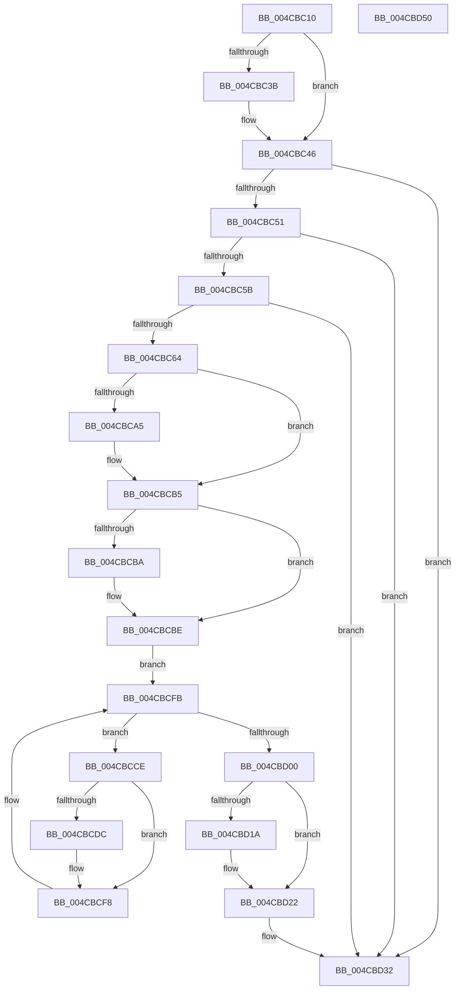

# PopFxLowPowerEpochCallback

- RVA: `0x004CBC10`–`0x004CBD51` (길이 `321` bytes)
- VA: `0x00000001404CBC10`
- 실행 섹션: `.text`
- PDB 이름 있음: `예`; PDB Function 태그: `아니요`
- unwind 정보 RVA: `0x0005D7BC`
- 디코드: `79`개 명령, `321/321` bytes 표시
- 미해석 바이트: `0` (있으면 어셈블리에 `.byte`로 보존)

> 이 문서는 커널 이미지의 기계어와 PDB 기호를 분석해 생성했습니다. 4번과 5번은 함수 원형과 자료형을 바이너리 사용 방식에서 추정한 C 해석이며 원본 소스 복구 결과는 아닙니다.

## 1. Dependencies

- 직접 호출 지점: **6**; 고유 호출 대상: **6**
- 직접 호출자로 확인된 함수: **0**
- RIP 상대 이미지 참조: **7**

### Outgoing calls
- `0x004CBC8C` → [KeAbPreAcquire](../21/KeAbPreAcquire_function_00210230.md) (function, `0x00210230`)
- `0x004CBCB0` → [ExfAcquirePushLockSharedEx](../21/ExfAcquirePushLockSharedEx_function_0021044C.md) (function, `0x0021044C`)
- `0x004CBCF3` → [guard_dispatch_icall](../6B/guard_dispatch_icall_function_006BAAD0.md) (function, `0x006BAAD0`)
- `0x004CBD1D` → [ExfReleasePushLockShared](../26/ExfReleasePushLockShared_function_00263440.md) (function, `0x00263440`)
- `0x004CBD25` → [KeAbPostRelease](../2E/KeAbPostRelease_function_002E1600.md) (function, `0x002E1600`)
- `0x004CBD2A` → [KeLeaveCriticalRegion](../25/KeLeaveCriticalRegion_function_0025D8B0.md) (function, `0x0025D8B0`)

### Direct callers
- 이 함수 시작 RVA로 연결되는 직접 call은 확인되지 않았습니다. 간접 호출은 완전히 역산할 수 없습니다.

### Static image references
- `0x004CBC29` → RVA `0x0001C740` (`.rdata`; read)
- `0x004CBC3B` → RVA `0x0001C748` (`.rdata`; read)
- `0x004CBC66` → RVA `0x00F0E428` (`.data`; read)
- `0x004CBC6D` → RVA `0x00E676C1` (`.data`; write)
- `0x004CBCBE` → RVA `0x00F0E410` (`.data`; read)
- `0x004CBCDC` → RVA `0x00E676C1` (`.data`; read)
- `0x004CBD06` → RVA `0x00F0774C` (`.data`; write)

## 2. Other-region calls and transfers

- 다른 실행 섹션으로 향하는 call: **0**
- 별도 외부 분기/꼬리 이동을 확인하지 못했습니다.

## 3. Assembly (complete function range)

```asm
004CBC10  48 8B C4                        mov rax, rsp
004CBC13  48 89 58 08                     mov qword ptr [rax + 8], rbx
004CBC17  48 89 68 10                     mov qword ptr [rax + 0x10], rbp
004CBC1B  48 89 70 18                     mov qword ptr [rax + 0x18], rsi
004CBC1F  48 89 78 20                     mov qword ptr [rax + 0x20], rdi
004CBC23  41 56                           push r14
004CBC25  48 83 EC 30                     sub rsp, 0x30
004CBC29  4C 8B 0D 10 0B B5 FF            mov r9, qword ptr [rip - 0x4af4f0]
004CBC30  41 BA 0D 00 00 C0               mov r10d, 0xc000000d
004CBC36  4C 2B 09                        sub r9, qword ptr [rcx]
004CBC39  75 0B                           jne 0x1404cbc46
004CBC3B  4C 8B 0D 06 0B B5 FF            mov r9, qword ptr [rip - 0x4af4fa]
004CBC42  4C 2B 49 08                     sub r9, qword ptr [rcx + 8]
004CBC46  33 FF                           xor edi, edi
004CBC48  4D 85 C9                        test r9, r9
004CBC4B  0F 85 E1 00 00 00               jne 0x1404cbd32
004CBC51  41 83 F8 04                     cmp r8d, 4
004CBC55  0F 85 D7 00 00 00               jne 0x1404cbd32
004CBC5B  48 85 D2                        test rdx, rdx
004CBC5E  0F 84 CE 00 00 00               je 0x1404cbd32
004CBC64  8A 02                           mov al, byte ptr [rdx]
004CBC66  48 8D 35 BB 27 A4 00            lea rsi, [rip + 0xa427bb]
004CBC6D  88 05 4E BA 99 00               mov byte ptr [rip + 0x99ba4e], al
004CBC73  45 33 C0                        xor r8d, r8d
004CBC76  65 48 8B 04 25 88 01 00 00      mov rax, qword ptr gs:[0x188]
004CBC7F  33 D2                           xor edx, edx
004CBC81  48 8B CE                        mov rcx, rsi
004CBC84  66 FF 88 E4 01 00 00            dec word ptr [rax + 0x1e4]
004CBC8B  90                              nop
004CBC8C  E8 9F 45 D4 FF                  call 0x140210230
004CBC91  48 8B D8                        mov rbx, rax
004CBC94  44 8D 77 11                     lea r14d, [rdi + 0x11]
004CBC98  33 C0                           xor eax, eax
004CBC9A  F0 4C 0F B1 35 85 27 A4 00      lock cmpxchg qword ptr [rip + 0xa42785], r14
004CBCA3  74 10                           je 0x1404cbcb5
004CBCA5  4C 8B CE                        mov r9, rsi
004CBCA8  4C 8B C3                        mov r8, rbx
004CBCAB  33 D2                           xor edx, edx
004CBCAD  48 8B CE                        mov rcx, rsi
004CBCB0  E8 97 47 D4 FF                  call 0x14021044c
004CBCB5  48 85 DB                        test rbx, rbx
004CBCB8  74 04                           je 0x1404cbcbe
004CBCBA  C6 43 0A 01                     mov byte ptr [rbx + 0xa], 1
004CBCBE  48 8B 1D 4B 27 A4 00            mov rbx, qword ptr [rip + 0xa4274b]
004CBCC5  48 8D 2D 44 27 A4 00            lea rbp, [rip + 0xa42744]
004CBCCC  EB 2D                           jmp 0x1404cbcfb
004CBCCE  4C 8B 43 60                     mov r8, qword ptr [rbx + 0x60]
004CBCD2  40 88 7C 24 20                  mov byte ptr [rsp + 0x20], dil
004CBCD7  4D 85 C0                        test r8, r8
004CBCDA  74 1C                           je 0x1404cbcf8
004CBCDC  8A 05 DF B9 99 00               mov al, byte ptr [rip + 0x99b9df]
004CBCE2  48 8D 54 24 20                  lea rdx, [rsp + 0x20]
004CBCE7  88 44 24 20                     mov byte ptr [rsp + 0x20], al
004CBCEB  B9 18 00 00 00                  mov ecx, 0x18
004CBCF0  49 8B C0                        mov rax, r8
004CBCF3  E8 D8 ED 1E 00                  call 0x1406baad0
004CBCF8  48 8B 1B                        mov rbx, qword ptr [rbx]
004CBCFB  48 3B DD                        cmp rbx, rbp
004CBCFE  75 CE                           jne 0x1404cbcce
004CBD00  8A 05 BB B9 99 00               mov al, byte ptr [rip + 0x99b9bb]
004CBD06  88 05 40 BA A3 00               mov byte ptr [rip + 0xa3ba40], al
004CBD0C  49 8B C6                        mov rax, r14
004CBD0F  F0 48 0F B1 3D 10 27 A4 00      lock cmpxchg qword ptr [rip + 0xa42710], rdi
004CBD18  74 08                           je 0x1404cbd22
004CBD1A  48 8B CE                        mov rcx, rsi
004CBD1D  E8 1E 77 D9 FF                  call 0x140263440
004CBD22  48 8B CE                        mov rcx, rsi
004CBD25  E8 D6 58 E1 FF                  call 0x1402e1600
004CBD2A  E8 81 1B D9 FF                  call 0x14025d8b0
004CBD2F  44 8B D7                        mov r10d, edi
004CBD32  48 8B 5C 24 40                  mov rbx, qword ptr [rsp + 0x40]
004CBD37  41 8B C2                        mov eax, r10d
004CBD3A  48 8B 6C 24 48                  mov rbp, qword ptr [rsp + 0x48]
004CBD3F  48 8B 74 24 50                  mov rsi, qword ptr [rsp + 0x50]
004CBD44  48 8B 7C 24 58                  mov rdi, qword ptr [rsp + 0x58]
004CBD49  48 83 C4 30                     add rsp, 0x30
004CBD4D  41 5E                           pop r14
004CBD4F  C3                              ret
004CBD50  CC                              int3
```

## 4. C-style interpretation (structured pseudocode)

```c
__int64 __fastcall PopFxLowPowerEpochCallback(__int64 a1, __int64 a2, int a3)
{
    __int64 result;
    __int64 v_rdi;
    __int64 v_rsp;
    unsigned __int8 v_stack_m18;
    unsigned __int64 v_stack_p10;
    unsigned __int64 v_stack_p18;
    unsigned __int64 v_stack_p20;
    unsigned __int64 v_stack_p8;

    *(unsigned __int64 *)(v_rsp + 8) = v_rbx;
    *(unsigned __int64 *)(v_rsp + 16) = v_rbp;
    *(unsigned __int64 *)(v_rsp + 24) = v_rsi;
    *(unsigned __int64 *)(v_rsp + 32) = v_rdi;
    v_rsp = (v_rsp) - (48);
    a4 = (*(unsigned __int64 *)(v_rip - 4912368)) - (*(unsigned __int64 *)(a1));
    if (!(condition_is_not_equal)) {
        a4 = *(unsigned __int64 *)(v_rip - 4912378);
        a4 = (a4) - (*(unsigned __int64 *)(a1 + 8));
    }
    v_rdi = 0;
    if (a4 != 0) goto loc_004CBD32;
    if (a3 != 4) goto loc_004CBD32;
    if (a2 == 0) goto loc_004CBD32;
    *(unsigned __int8 *)(v_rip + 10074702) = (unsigned __int8)(*(unsigned __int8 *)(a2));
    a3 = 0;
    a2 = 0;
    result = KeAbPreAcquire(v_rip + 10758075, a2, a3, a4);
    result = 0;
    if (!(condition_is_equal)) {
        a4 = v_rip + 10758075;
        a3 = 0;
        a2 = 0;
        a1 = v_rip + 10758075;
        result = ExfAcquirePushLockSharedEx(a1, a2, a3, a4);
    }
    if (result != 0) {
        *(unsigned __int8 *)(result + 10) = 1;
    }
    goto loc_004CBCFB;
loc_004CBCCE:
    v_stack_m18 = 0;
    if (*(unsigned __int64 *)(*(unsigned __int64 *)(v_rip + 10757963) + 96) != 0) {
        result = *(unsigned __int8 *)(v_rip + 10074591);
        a2 = v_stack_m18;
        v_stack_m18 = (unsigned __int8)(result);
        a1 = 24;
        result = *(unsigned __int64 *)(*(unsigned __int64 *)(v_rip + 10757963) + 96);
        result = guard_dispatch_icall(a1, a2, *(unsigned __int64 *)(*(unsigned __int64 *)(v_rip + 10757963) + 96), a4);
    }
loc_004CBCFB:
    if ((*(unsigned __int64 *)(*(unsigned __int64 *)(v_rip + 10757963))) != (v_rip + 10757956)) goto loc_004CBCCE;
    *(unsigned __int8 *)(v_rip + 10730048) = (unsigned __int8)(*(unsigned __int8 *)(v_rip + 10074555));
    result = v_rdi + 17;
    if ((*(unsigned __int64 *)(*(unsigned __int64 *)(v_rip + 10757963))) != (v_rip + 10757956)) {
        a1 = v_rip + 10758075;
        result = ExfReleasePushLockShared(a1, a2, *(unsigned __int64 *)(*(unsigned __int64 *)(v_rip + 10757963) + 96), a4);
    }
    result = KeAbPostRelease(v_rip + 10758075, a2, *(unsigned __int64 *)(*(unsigned __int64 *)(v_rip + 10757963) + 96), a4);
    result = KeLeaveCriticalRegion(v_rip + 10758075, a2, *(unsigned __int64 *)(*(unsigned __int64 *)(v_rip + 10757963) + 96), a4);
loc_004CBD32:
    v_rsp = (v_rsp) + (48);
    return 0;
}
```

## 5. (Beta) C Style

```c
int64_t PopFxLowPowerEpochCallback(void *Arg1, int64_t Arg2, int32_t Arg3)
{
    uint8_t *arg1 = (uint8_t *)Arg1;

    int64_t result;
    int64_t local_rdi;
    int64_t local_rsp;
    uint8_t v_stack_m18;
    uint64_t v_stack_p10;
    uint64_t v_stack_p18;
    uint64_t v_stack_p20;
    uint64_t v_stack_p8;

    *(uint64_t *)(local_rsp + 0x8) = local_rbx;
    *(uint64_t *)(local_rsp + 0x10) = local_rbp;
    *(uint64_t *)(local_rsp + 0x18) = local_rsi;
    *(uint64_t *)(local_rsp + 0x20) = local_rdi;
    local_rsp = (local_rsp) - (48);
    a4 = (*(uint64_t *)(v_rip - 0x4AF4F0)) - (*(uint64_t *)(arg1));
    if (!(condition_is_not_equal)) {
        a4 = *(uint64_t *)(v_rip - 0x4AF4FA);
        a4 = (a4) - (*(uint64_t *)(arg1 + 0x8));
    }
    local_rdi = 0;
    if (a4 != 0) goto loc_004CBD32;
    if (Arg3 != 4) goto loc_004CBD32;
    if (Arg2 == 0) goto loc_004CBD32;
    *(uint8_t *)(v_rip + 0x99BA4E) = (uint8_t)(*(uint8_t *)(Arg2));
    Arg3 = 0;
    Arg2 = 0;
    result = KeAbPreAcquire(v_rip + 10758075, Arg2, Arg3, a4);
    result = 0;
    if (!(condition_is_equal)) {
        a4 = v_rip + 10758075;
        Arg3 = 0;
        Arg2 = 0;
        Arg1 = v_rip + 10758075;
        result = ExfAcquirePushLockSharedEx(Arg1, Arg2, Arg3, a4);
    }
    if (result != 0) {
        *(uint8_t *)(result + 0xA) = 1;
    }
    goto loc_004CBCFB;
loc_004CBCCE:
    v_stack_m18 = 0;
    if (*(uint64_t *)(*(uint64_t *)(v_rip + 0xA4274B) + 0x60) != 0) {
        result = *(uint8_t *)(v_rip + 0x99B9DF);
        Arg2 = v_stack_m18;
        v_stack_m18 = (uint8_t)(result);
        Arg1 = 24;
        result = *(uint64_t *)(*(uint64_t *)(v_rip + 0xA4274B) + 0x60);
        result = guard_dispatch_icall(Arg1, Arg2, *(uint64_t *)(*(uint64_t *)(v_rip + 0xA4274B) + 0x60), a4);
    }
loc_004CBCFB:
    if ((*(uint64_t *)(*(uint64_t *)(v_rip + 0xA4274B))) != (v_rip + 10757956)) goto loc_004CBCCE;
    *(uint8_t *)(v_rip + 0xA3BA40) = (uint8_t)(*(uint8_t *)(v_rip + 0x99B9BB));
    result = local_rdi + 17;
    if ((*(uint64_t *)(*(uint64_t *)(v_rip + 0xA4274B))) != (v_rip + 10757956)) {
        Arg1 = v_rip + 10758075;
        result = ExfReleasePushLockShared(Arg1, Arg2, *(uint64_t *)(*(uint64_t *)(v_rip + 0xA4274B) + 0x60), a4);
    }
    result = KeAbPostRelease(v_rip + 10758075, Arg2, *(uint64_t *)(*(uint64_t *)(v_rip + 0xA4274B) + 0x60), a4);
    result = KeLeaveCriticalRegion(v_rip + 10758075, Arg2, *(uint64_t *)(*(uint64_t *)(v_rip + 0xA4274B) + 0x60), a4);
loc_004CBD32:
    local_rsp = (local_rsp) + (48);
    return 0;
}
```

### 관측된 메모리 오프셋

구조체 형식이 확인되지 않은 접근은 인자 기준의 오프셋으로만 기록했습니다.

| 기준 인자 | 오프셋 표현 | 폭 (bit) | 접근 |
|---|---:|---:|---|
| `Arg1` | `+ 0x0` | `64` | `R` |
| `Arg1` | `+ 0x8` | `64` | `R` |

## 6. Execution-region graph

[열기: 2D/3D 그래프와 함수 탐색 컨트롤 패널](../../../control-panel.html?section=text&rva=0x004CBC10&view=graph)

- 2D 그래프는 위에서 아래로 흐르고, 3D 그래프는 빈 공간을 드래그해 회전합니다. Shift+드래그는 이동, 휠은 확대·축소, 함수 노드 선택은 대상 보고서 이동입니다.

### Static fallback


