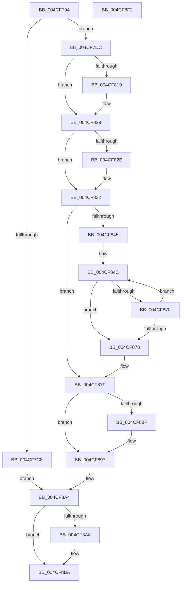

# PopFxRegisterDeviceWithPep

- RVA: `0x004CF794`–`0x004CF8F3` (길이 `351` bytes)
- VA: `0x00000001404CF794`
- 실행 섹션: `.text`
- PDB 이름 있음: `예`; PDB Function 태그: `아니요`
- unwind 정보 RVA: `0x0007BBB4`
- 디코드: `98`개 명령, `351/351` bytes 표시
- 미해석 바이트: `0` (있으면 어셈블리에 `.byte`로 보존)

> 이 문서는 커널 이미지의 기계어와 PDB 기호를 분석해 생성했습니다. 4번과 5번은 함수 원형과 자료형을 바이너리 사용 방식에서 추정한 C 해석이며 원본 소스 복구 결과는 아닙니다.

## 1. Dependencies

- 직접 호출 지점: **8**; 고유 호출 대상: **7**
- 직접 호출자로 확인된 함수: **1**
- RIP 상대 이미지 참조: **2**

### Outgoing calls
- `0x004CF7D0` → [PopPluginRegisterDevice](PopPluginRegisterDevice_function_004CF8FC.md) (function, `0x004CF8FC`)
- `0x004CF7FF` → [KeAbPreAcquire](../21/KeAbPreAcquire_function_00210230.md) (function, `0x00210230`)
- `0x004CF824` → [ExfAcquirePushLockSharedEx](../21/ExfAcquirePushLockSharedEx_function_0021044C.md) (function, `0x0021044C`)
- `0x004CF865` → [PopPluginRegisterDevice](PopPluginRegisterDevice_function_004CF8FC.md) (function, `0x004CF8FC`)
- `0x004CF892` → [ExfReleasePushLockShared](../26/ExfReleasePushLockShared_function_00263440.md) (function, `0x00263440`)
- `0x004CF89A` → [KeAbPostRelease](../2E/KeAbPostRelease_function_002E1600.md) (function, `0x002E1600`)
- `0x004CF89F` → [KeLeaveCriticalRegion](../25/KeLeaveCriticalRegion_function_0025D8B0.md) (function, `0x0025D8B0`)
- `0x004CF8CF` → [PopPepRegisterDevice](../../page/AA/PopPepRegisterDevice_function_00AAEBD0.md) (function, `0x00AAEBD0`)

### Direct callers
- [PopFxRegisterDeviceWorker](../../page/75/PopFxRegisterDeviceWorker_function_00759E20.md) at `0x0075A548`

### Static image references
- `0x004CF7E5` → RVA `0x00F0E428` (`.data`; read)
- `0x004CF832` → RVA `0x00F0E410` (`.data`; read)

## 2. Other-region calls and transfers

- 다른 실행 섹션으로 향하는 call: **1**
  - `0x004CF8CF` → [PopPepRegisterDevice](../../page/AA/PopPepRegisterDevice_function_00AAEBD0.md) (`.text` → `PAGE`)
- 별도 외부 분기/꼬리 이동을 확인하지 못했습니다.

## 3. Assembly (complete function range)

```asm
004CF794  4C 8B DC                        mov r11, rsp
004CF797  49 89 5B 10                     mov qword ptr [r11 + 0x10], rbx
004CF79B  49 89 6B 18                     mov qword ptr [r11 + 0x18], rbp
004CF79F  49 89 73 20                     mov qword ptr [r11 + 0x20], rsi
004CF7A3  57                              push rdi
004CF7A4  41 54                           push r12
004CF7A6  41 55                           push r13
004CF7A8  41 56                           push r14
004CF7AA  41 57                           push r15
004CF7AC  48 83 EC 40                     sub rsp, 0x40
004CF7B0  45 33 E4                        xor r12d, r12d
004CF7B3  4D 8B F1                        mov r14, r9
004CF7B6  4D 89 63 08                     mov qword ptr [r11 + 8], r12
004CF7BA  49 8B D8                        mov rbx, r8
004CF7BD  4C 8B FA                        mov r15, rdx
004CF7C0  48 8B E9                        mov rbp, rcx
004CF7C3  48 85 C9                        test rcx, rcx
004CF7C6  74 14                           je 0x1404cf7dc
004CF7C8  49 8D 43 08                     lea rax, [r11 + 8]
004CF7CC  49 89 43 C0                     mov qword ptr [r11 - 0x40], rax
004CF7D0  E8 27 01 00 00                  call 0x1404cf8fc
004CF7D5  8B F0                           mov esi, eax
004CF7D7  E9 C8 00 00 00                  jmp 0x1404cf8a4
004CF7DC  65 48 8B 04 25 88 01 00 00      mov rax, qword ptr gs:[0x188]
004CF7E5  4C 8D 2D 3C EC A3 00            lea r13, [rip + 0xa3ec3c]
004CF7EC  45 33 C0                        xor r8d, r8d
004CF7EF  33 D2                           xor edx, edx
004CF7F1  49 8B CD                        mov rcx, r13
004CF7F4  41 8B F4                        mov esi, r12d
004CF7F7  66 FF 88 E4 01 00 00            dec word ptr [rax + 0x1e4]
004CF7FE  90                              nop
004CF7FF  E8 2C 0A D4 FF                  call 0x140210230
004CF804  48 8B F8                        mov rdi, rax
004CF807  B9 11 00 00 00                  mov ecx, 0x11
004CF80C  33 C0                           xor eax, eax
004CF80E  F0 48 0F B1 0D 11 EC A3 00      lock cmpxchg qword ptr [rip + 0xa3ec11], rcx
004CF817  74 10                           je 0x1404cf829
004CF819  4D 8B CD                        mov r9, r13
004CF81C  4C 8B C7                        mov r8, rdi
004CF81F  33 D2                           xor edx, edx
004CF821  49 8B CD                        mov rcx, r13
004CF824  E8 23 0C D4 FF                  call 0x14021044c
004CF829  48 85 FF                        test rdi, rdi
004CF82C  74 04                           je 0x1404cf832
004CF82E  C6 47 0A 01                     mov byte ptr [rdi + 0xa], 1
004CF832  48 8B 3D D7 EB A3 00            mov rdi, qword ptr [rip + 0xa3ebd7]
004CF839  48 8D 05 D0 EB A3 00            lea rax, [rip + 0xa3ebd0]
004CF840  48 3B F8                        cmp rdi, rax
004CF843  74 3A                           je 0x1404cf87f
004CF845  4C 8D 2D C4 EB A3 00            lea r13, [rip + 0xa3ebc4]
004CF84C  48 8D 44 24 70                  lea rax, [rsp + 0x70]
004CF851  4D 8B CE                        mov r9, r14
004CF854  4C 8B C3                        mov r8, rbx
004CF857  48 89 44 24 28                  mov qword ptr [rsp + 0x28], rax
004CF85C  49 8B D7                        mov rdx, r15
004CF85F  48 8B CF                        mov rcx, rdi
004CF862  48 8B EF                        mov rbp, rdi
004CF865  E8 92 00 00 00                  call 0x1404cf8fc
004CF86A  8B F0                           mov esi, eax
004CF86C  85 C0                           test eax, eax
004CF86E  75 08                           jne 0x1404cf878
004CF870  48 8B 3F                        mov rdi, qword ptr [rdi]
004CF873  49 3B FD                        cmp rdi, r13
004CF876  75 D4                           jne 0x1404cf84c
004CF878  4C 8D 2D A9 EB A3 00            lea r13, [rip + 0xa3eba9]
004CF87F  B8 11 00 00 00                  mov eax, 0x11
004CF884  F0 4C 0F B1 25 9B EB A3 00      lock cmpxchg qword ptr [rip + 0xa3eb9b], r12
004CF88D  74 08                           je 0x1404cf897
004CF88F  49 8B CD                        mov rcx, r13
004CF892  E8 A9 3B D9 FF                  call 0x140263440
004CF897  49 8B CD                        mov rcx, r13
004CF89A  E8 61 1D E1 FF                  call 0x1402e1600
004CF89F  E8 0C E0 D8 FF                  call 0x14025d8b0
004CF8A4  85 F6                           test esi, esi
004CF8A6  74 12                           je 0x1404cf8ba
004CF8A8  48 8B 44 24 70                  mov rax, qword ptr [rsp + 0x70]
004CF8AD  BE 02 00 00 00                  mov esi, 2
004CF8B2  48 89 43 48                     mov qword ptr [rbx + 0x48], rax
004CF8B6  48 89 6B 40                     mov qword ptr [rbx + 0x40], rbp
004CF8BA  48 8D 43 38                     lea rax, [rbx + 0x38]
004CF8BE  44 8B CE                        mov r9d, esi
004CF8C1  4D 8B C6                        mov r8, r14
004CF8C4  48 89 44 24 20                  mov qword ptr [rsp + 0x20], rax
004CF8C9  48 8B D3                        mov rdx, rbx
004CF8CC  49 8B CF                        mov rcx, r15
004CF8CF  E8 FC F2 5D 00                  call 0x140aaebd0
004CF8D4  4C 8D 5C 24 40                  lea r11, [rsp + 0x40]
004CF8D9  49 8B 5B 38                     mov rbx, qword ptr [r11 + 0x38]
004CF8DD  49 8B 6B 40                     mov rbp, qword ptr [r11 + 0x40]
004CF8E1  49 8B 73 48                     mov rsi, qword ptr [r11 + 0x48]
004CF8E5  49 8B E3                        mov rsp, r11
004CF8E8  41 5F                           pop r15
004CF8EA  41 5E                           pop r14
004CF8EC  41 5D                           pop r13
004CF8EE  41 5C                           pop r12
004CF8F0  5F                              pop rdi
004CF8F1  C3                              ret
004CF8F2  CC                              int3
```

## 4. C-style interpretation (structured pseudocode)

```c
__int64 __fastcall PopFxRegisterDeviceWithPep(__int64 a1, __int64 a2, __int64 a3, __int64 a4)
{
    __int64 result;
    __int64 v_r12;
    __int64 v_rsi;
    __int64 v_rsp;
    unsigned __int64 v_stack_m28;
    unsigned __int64 v_stack_m40;
    unsigned __int64 v_stack_m48;
    unsigned __int64 v_stack_p8;

    *(unsigned __int64 *)(v_rsp + 16) = v_rbx;
    *(unsigned __int64 *)(v_rsp + 24) = v_rbp;
    *(unsigned __int64 *)(v_rsp + 32) = v_rsi;
    v_rsp = (v_rsp) - (64);
    v_r12 = 0;
    *(unsigned __int64 *)(v_rsp + 8) = 0;
    if (a1 == 0) goto loc_004CF7DC;
    *(unsigned __int64 *)(v_rsp - 64) = v_rsp + 8;
    result = PopPluginRegisterDevice(a1, a2, a3, a4);
    goto loc_004CF8A4;
loc_004CF7DC:
    a3 = 0;
    a2 = 0;
    result = KeAbPreAcquire(v_rip + 10742844, a2, a3, a4);
    result = 0;
    if (!(condition_is_equal)) {
        a4 = v_rip + 10742844;
        a3 = 0;
        a2 = 0;
        a1 = v_rip + 10742844;
        result = ExfAcquirePushLockSharedEx(a1, a2, a3, a4);
    }
    if (result != 0) {
        *(unsigned __int8 *)(result + 10) = 1;
    }
    if ((*(unsigned __int64 *)(v_rip + 10742743)) == (v_rip + 10742736)) goto loc_004CF87F;
loc_004CF84C:
    v_stack_m40 = v_stack_p8;
    result = PopPluginRegisterDevice(*(unsigned __int64 *)(v_rip + 10742743), 0, a3, a4);
    if ((unsigned int)(result) != 0) goto loc_004CF878;
    if ((*(unsigned __int64 *)(*(unsigned __int64 *)(v_rip + 10742743))) != (v_rip + 10742724)) goto loc_004CF84C;
loc_004CF878:
loc_004CF87F:
    result = 17;
    if ((*(unsigned __int64 *)(*(unsigned __int64 *)(v_rip + 10742743))) != (v_rip + 10742724)) {
        a1 = v_rip + 10742697;
        result = ExfReleasePushLockShared(a1, 0, a3, a4);
    }
    result = KeAbPostRelease(v_rip + 10742697, 0, a3, a4);
    result = KeLeaveCriticalRegion(v_rip + 10742697, 0, a3, a4);
loc_004CF8A4:
    v_rsi = (unsigned int)((unsigned int)(result));
    if ((unsigned int)((unsigned int)((unsigned int)(result))) != 0) {
        result = v_stack_p8;
        v_rsi = 2;
        *(unsigned __int64 *)(a3 + 72) = result;
        *(unsigned __int64 *)(a3 + 64) = *(unsigned __int64 *)(v_rip + 10742743);
    }
    v_stack_m48 = a3 + 56;
    result = PopPepRegisterDevice(0, a3, a4, (unsigned int)((unsigned int)(v_rsi)));
    return result;
}
```

## 5. (Beta) C Style

```c
int64_t PopFxRegisterDeviceWithPep(int64_t Arg1, int64_t Arg2, void *Arg3, int64_t Arg4)
{
    uint8_t *arg3 = (uint8_t *)Arg3;

    int64_t result;
    int64_t local_r12;
    int64_t local_rsi;
    int64_t local_rsp;
    uint64_t v_stack_m28;
    uint64_t v_stack_m40;
    uint64_t v_stack_m48;
    uint64_t v_stack_p8;

    *(uint64_t *)(local_rsp + 0x10) = local_rbx;
    *(uint64_t *)(local_rsp + 0x18) = local_rbp;
    *(uint64_t *)(local_rsp + 0x20) = local_rsi;
    local_rsp = (local_rsp) - (64);
    local_r12 = 0;
    *(uint64_t *)(local_rsp + 0x8) = 0;
    if (Arg1 == 0) goto loc_004CF7DC;
    *(uint64_t *)(local_rsp - 0x40) = local_rsp + 8;
    result = PopPluginRegisterDevice(Arg1, Arg2, Arg3, Arg4);
    goto loc_004CF8A4;
loc_004CF7DC:
    Arg3 = 0;
    Arg2 = 0;
    result = KeAbPreAcquire(v_rip + 10742844, Arg2, Arg3, Arg4);
    result = 0;
    if (!(condition_is_equal)) {
        Arg4 = v_rip + 10742844;
        Arg3 = 0;
        Arg2 = 0;
        Arg1 = v_rip + 10742844;
        result = ExfAcquirePushLockSharedEx(Arg1, Arg2, Arg3, Arg4);
    }
    if (result != 0) {
        *(uint8_t *)(result + 0xA) = 1;
    }
    if ((*(uint64_t *)(v_rip + 0xA3EBD7)) == (v_rip + 10742736)) goto loc_004CF87F;
loc_004CF84C:
    v_stack_m40 = v_stack_p8;
    result = PopPluginRegisterDevice(*(uint64_t *)(v_rip + 0xA3EBD7), 0, Arg3, Arg4);
    if ((uint32_t)(result) != 0) goto loc_004CF878;
    if ((*(uint64_t *)(*(uint64_t *)(v_rip + 0xA3EBD7))) != (v_rip + 10742724)) goto loc_004CF84C;
loc_004CF878:
loc_004CF87F:
    result = 17;
    if ((*(uint64_t *)(*(uint64_t *)(v_rip + 0xA3EBD7))) != (v_rip + 10742724)) {
        Arg1 = v_rip + 10742697;
        result = ExfReleasePushLockShared(Arg1, 0, Arg3, Arg4);
    }
    result = KeAbPostRelease(v_rip + 10742697, 0, Arg3, Arg4);
    result = KeLeaveCriticalRegion(v_rip + 10742697, 0, Arg3, Arg4);
loc_004CF8A4:
    local_rsi = (uint32_t)((uint32_t)(result));
    if ((uint32_t)((uint32_t)((uint32_t)(result))) != 0) {
        result = v_stack_p8;
        local_rsi = 2;
        *(uint64_t *)(arg3 + 0x48) = result;
        *(uint64_t *)(arg3 + 0x40) = *(uint64_t *)(v_rip + 0xA3EBD7);
    }
    v_stack_m48 = Arg3 + 56;
    result = PopPepRegisterDevice(0, Arg3, Arg4, (uint32_t)((uint32_t)(local_rsi)));
    return result;
}
```

### 관측된 메모리 오프셋

구조체 형식이 확인되지 않은 접근은 인자 기준의 오프셋으로만 기록했습니다.

| 기준 인자 | 오프셋 표현 | 폭 (bit) | 접근 |
|---|---:|---:|---|
| `Arg3` | `+ 0x38` | `64` | `R` |
| `Arg3` | `+ 0x40` | `64` | `W` |
| `Arg3` | `+ 0x48` | `64` | `W` |

## 6. Execution-region graph

[열기: 2D/3D 그래프와 함수 탐색 컨트롤 패널](../../../control-panel.html?section=text&rva=0x004CF794&view=graph)

- 2D 그래프는 위에서 아래로 흐르고, 3D 그래프는 빈 공간을 드래그해 회전합니다. Shift+드래그는 이동, 휠은 확대·축소, 함수 노드 선택은 대상 보고서 이동입니다.

### Static fallback


