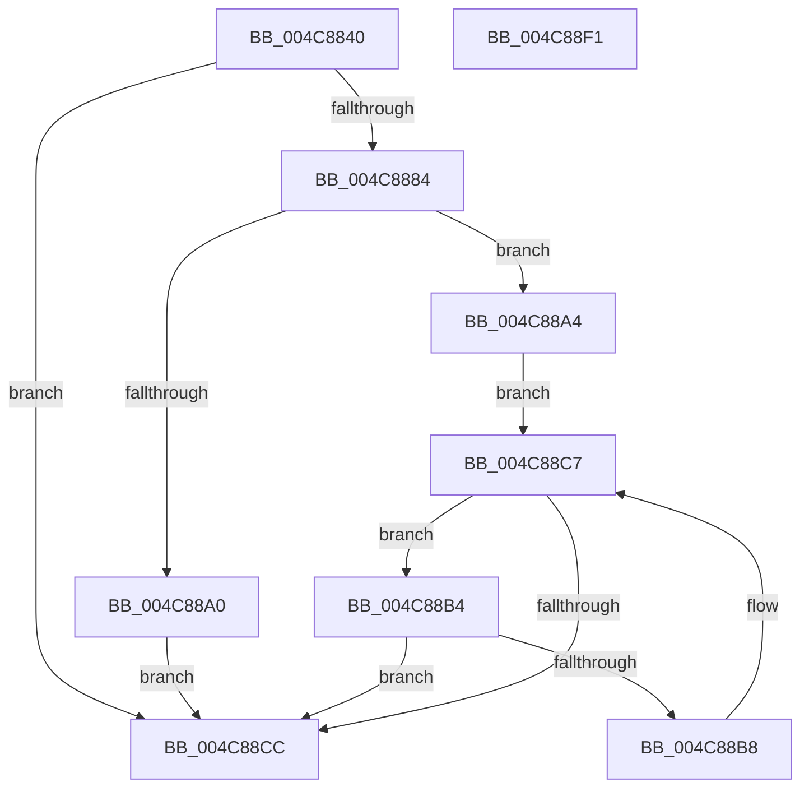

# PopGetCurrentWakeInfos

- RVA: `0x004C8840`–`0x004C88F2` (길이 `178` bytes)
- VA: `0x00000001404C8840`
- 실행 섹션: `.text`
- PDB 이름 있음: `예`; PDB Function 태그: `아니요`
- unwind 정보 RVA: `0x000BCAF8`
- 디코드: `52`개 명령, `178/178` bytes 표시
- 미해석 바이트: `0` (있으면 어셈블리에 `.byte`로 보존)

> 이 문서는 커널 이미지의 기계어와 PDB 기호를 분석해 생성했습니다. 4번과 5번은 함수 원형과 자료형을 바이너리 사용 방식에서 추정한 C 해석이며 원본 소스 복구 결과는 아닙니다.

## 1. Dependencies

- 직접 호출 지점: **3**; 고유 호출 대상: **3**
- 직접 호출자로 확인된 함수: **1**
- RIP 상대 이미지 참조: **3**

### Outgoing calls
- `0x004C8875` → [KeAcquireInStackQueuedSpinLock](../27/KeAcquireInStackQueuedSpinLock_function_002757A0.md) (function, `0x002757A0`)
- `0x004C8893` → [ExAllocatePool2](../../poolcode/B8/ExAllocatePool2_function_00B820F0.md) (function, `0x00B820F0`)
- `0x004C88D1` → [KeReleaseInStackQueuedSpinLock](../34/KeReleaseInStackQueuedSpinLock_function_00342CE0.md) (function, `0x00342CE0`)

### Direct callers
- [PopGetWakeSource](../../page/AB/PopGetWakeSource_function_00ABDB68.md) at `0x00ABDBC5`

### Static image references
- `0x004C886C` → RVA `0x00F0DEA8` (`.data`; read)
- `0x004C887A` → RVA `0x00F0DEA0` (`.data`; read)
- `0x004C88A4` → RVA `0x00F0DE90` (`.data`; read)

## 2. Other-region calls and transfers

- 다른 실행 섹션으로 향하는 call: **1**
  - `0x004C8893` → [ExAllocatePool2](../../poolcode/B8/ExAllocatePool2_function_00B820F0.md) (`.text` → `POOLCODE`)
- 별도 외부 분기/꼬리 이동을 확인하지 못했습니다.

## 3. Assembly (complete function range)

```asm
004C8840  4C 8B DC                        mov r11, rsp
004C8843  49 89 5B 08                     mov qword ptr [r11 + 8], rbx
004C8847  49 89 73 10                     mov qword ptr [r11 + 0x10], rsi
004C884B  49 89 7B 18                     mov qword ptr [r11 + 0x18], rdi
004C884F  41 56                           push r14
004C8851  48 83 EC 40                     sub rsp, 0x40
004C8855  0F 57 C0                        xorps xmm0, xmm0
004C8858  49 8D 53 D8                     lea rdx, [r11 - 0x28]
004C885C  4C 8B F1                        mov r14, rcx
004C885F  33 C0                           xor eax, eax
004C8861  0F 11 44 24 20                  movups xmmword ptr [rsp + 0x20], xmm0
004C8866  33 DB                           xor ebx, ebx
004C8868  49 89 43 E8                     mov qword ptr [r11 - 0x18], rax
004C886C  48 8D 0D 35 56 A4 00            lea rcx, [rip + 0xa45635]
004C8873  8B F3                           mov esi, ebx
004C8875  E8 26 CF DA FF                  call 0x1402757a0
004C887A  8B 3D 20 56 A4 00               mov edi, dword ptr [rip + 0xa45620]
004C8880  85 FF                           test edi, edi
004C8882  74 48                           je 0x1404c88cc
004C8884  8B D7                           mov edx, edi
004C8886  8D 4B 40                        lea ecx, [rbx + 0x40]
004C8889  48 C1 E2 03                     shl rdx, 3
004C888D  41 B8 4D 65 6D 20               mov r8d, 0x206d654d
004C8893  E8 58 98 6B 00                  call 0x140b820f0
004C8898  48 8B F0                        mov rsi, rax
004C889B  48 85 C0                        test rax, rax
004C889E  75 04                           jne 0x1404c88a4
004C88A0  8B FB                           mov edi, ebx
004C88A2  EB 28                           jmp 0x1404c88cc
004C88A4  48 8B 0D E5 55 A4 00            mov rcx, qword ptr [rip + 0xa455e5]
004C88AB  48 8D 15 DE 55 A4 00            lea rdx, [rip + 0xa455de]
004C88B2  EB 13                           jmp 0x1404c88c7
004C88B4  3B DF                           cmp ebx, edi
004C88B6  73 14                           jae 0x1404c88cc
004C88B8  8B C3                           mov eax, ebx
004C88BA  48 89 0C C6                     mov qword ptr [rsi + rax*8], rcx
004C88BE  F0 FF 41 10                     lock inc dword ptr [rcx + 0x10]
004C88C2  48 8B 09                        mov rcx, qword ptr [rcx]
004C88C5  FF C3                           inc ebx
004C88C7  48 3B CA                        cmp rcx, rdx
004C88CA  75 E8                           jne 0x1404c88b4
004C88CC  48 8D 4C 24 20                  lea rcx, [rsp + 0x20]
004C88D1  E8 0A A4 E7 FF                  call 0x140342ce0
004C88D6  48 8B 5C 24 50                  mov rbx, qword ptr [rsp + 0x50]
004C88DB  8B C7                           mov eax, edi
004C88DD  48 8B 7C 24 60                  mov rdi, qword ptr [rsp + 0x60]
004C88E2  49 89 36                        mov qword ptr [r14], rsi
004C88E5  48 8B 74 24 58                  mov rsi, qword ptr [rsp + 0x58]
004C88EA  48 83 C4 40                     add rsp, 0x40
004C88EE  41 5E                           pop r14
004C88F0  C3                              ret
004C88F1  CC                              int3
```

## 4. C-style interpretation (structured pseudocode)

```c
__int64 __fastcall PopGetCurrentWakeInfos(__int64 a1)
{
    __int64 result;
    __int64 v_rbx;
    __int64 v_rsp;
    unsigned __int64 v_stack_m28;
    unsigned __int64 v_stack_p10;
    unsigned __int64 v_stack_p18;
    unsigned __int64 v_stack_p8;

    *(unsigned __int64 *)(v_rsp + 8) = v_rbx;
    *(unsigned __int64 *)(v_rsp + 16) = v_rsi;
    *(unsigned __int64 *)(v_rsp + 24) = v_rdi;
    v_rsp = (v_rsp) - (64);
    result = 0;
    v_stack_m28 = v_xmm0;
    v_rbx = 0;
    *(unsigned __int64 *)(v_rsp - 24) = 0;
    result = KeAcquireInStackQueuedSpinLock(v_rip + 10769973, v_rsp - 40, a3, a4);
    if ((unsigned int)((unsigned int)(*(unsigned int *)(v_rip + 10769952))) == 0) goto loc_004C88CC;
    a2 = ((unsigned int)((unsigned int)((unsigned int)(*(unsigned int *)(v_rip + 10769952))))) << (3);
    result = ExAllocatePool2(v_rbx + 64, a2, (unsigned int)(0x206D654DULL), a4);
    if (result != 0) goto loc_004C88A4;
    goto loc_004C88CC;
loc_004C88A4:
    goto loc_004C88C7;
loc_004C88B4:
    if (0 >= 0) goto loc_004C88CC;
    *(unsigned __int64 *)(result + 0 * 8) = *(unsigned __int64 *)(v_rip + 10769893);
    v_rbx = (unsigned int)((v_rbx) + 1);
loc_004C88C7:
    if ((*(unsigned __int64 *)(*(unsigned __int64 *)(v_rip + 10769893))) != (v_rip + 10769886)) goto loc_004C88B4;
loc_004C88CC:
    result = KeReleaseInStackQueuedSpinLock(v_stack_m28, v_rip + 10769886, (unsigned int)(0x206D654DULL), a4);
    *(unsigned __int64 *)(a1) = result;
    v_rsp = (v_rsp) + (64);
    return 0;
}
```

## 5. (Beta) C Style

```c
int64_t PopGetCurrentWakeInfos(void *Arg1)
{
    uint8_t *arg1 = (uint8_t *)Arg1;

    int64_t result;
    int64_t local_rbx;
    int64_t local_rsp;
    uint64_t v_stack_m28;
    uint64_t v_stack_p10;
    uint64_t v_stack_p18;
    uint64_t v_stack_p8;

    *(uint64_t *)(local_rsp + 0x8) = local_rbx;
    *(uint64_t *)(local_rsp + 0x10) = local_rsi;
    *(uint64_t *)(local_rsp + 0x18) = local_rdi;
    local_rsp = (local_rsp) - (64);
    result = 0;
    v_stack_m28 = v_xmm0;
    local_rbx = 0;
    *(uint64_t *)(local_rsp - 0x18) = 0;
    result = KeAcquireInStackQueuedSpinLock(v_rip + 10769973, local_rsp - 40, a3, a4);
    if ((uint32_t)((uint32_t)(*(uint32_t *)(v_rip + 0xA45620))) == 0) goto loc_004C88CC;
    a2 = ((uint32_t)((uint32_t)((uint32_t)(*(uint32_t *)(v_rip + 0xA45620))))) << (3);
    result = ExAllocatePool2(local_rbx + 64, a2, (uint32_t)(0x206D654DULL), a4);
    if (result != 0) goto loc_004C88A4;
    goto loc_004C88CC;
loc_004C88A4:
    goto loc_004C88C7;
loc_004C88B4:
    if (0 >= 0) goto loc_004C88CC;
    *(uint64_t *)(result + 0x0 * 8) = *(uint64_t *)(v_rip + 0xA455E5);
    local_rbx = (uint32_t)((local_rbx) + 1);
loc_004C88C7:
    if ((*(uint64_t *)(*(uint64_t *)(v_rip + 0xA455E5))) != (v_rip + 10769886)) goto loc_004C88B4;
loc_004C88CC:
    result = KeReleaseInStackQueuedSpinLock(v_stack_m28, v_rip + 10769886, (uint32_t)(0x206D654DULL), a4);
    *(uint64_t *)(arg1) = result;
    local_rsp = (local_rsp) + (64);
    return 0;
}
```

### 관측된 메모리 오프셋

구조체 형식이 확인되지 않은 접근은 인자 기준의 오프셋으로만 기록했습니다.

| 기준 인자 | 오프셋 표현 | 폭 (bit) | 접근 |
|---|---:|---:|---|
| `Arg1` | `+ 0x0` | `64` | `W` |

## 6. Execution-region graph

[열기: 2D/3D 그래프와 함수 탐색 컨트롤 패널](../../../control-panel.html?section=text&rva=0x004C8840&view=graph)

- 2D 그래프는 위에서 아래로 흐르고, 3D 그래프는 빈 공간을 드래그해 회전합니다. Shift+드래그는 이동, 휠은 확대·축소, 함수 노드 선택은 대상 보고서 이동입니다.

### Static fallback


