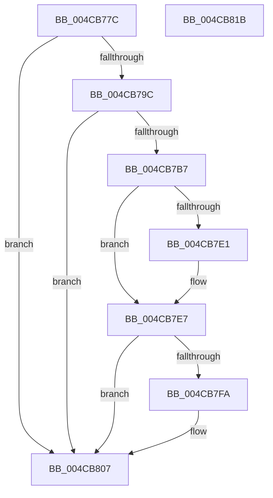

# PopGetDope

- RVA: `0x004CB77C`–`0x004CB81C` (길이 `160` bytes)
- VA: `0x00000001404CB77C`
- 실행 섹션: `.text`
- PDB 이름 있음: `예`; PDB Function 태그: `아니요`
- unwind 정보 RVA: `0x00060BC4`
- 디코드: `42`개 명령, `160/160` bytes 표시
- 미해석 바이트: `0` (있으면 어셈블리에 `.byte`로 보존)

> 이 문서는 커널 이미지의 기계어와 PDB 기호를 분석해 생성했습니다. 4번과 5번은 함수 원형과 자료형을 바이너리 사용 방식에서 추정한 C 해석이며 원본 소스 복구 결과는 아닙니다.

## 1. Dependencies

- 직접 호출 지점: **4**; 고유 호출 대상: **4**
- 직접 호출자로 확인된 함수: **8**
- RIP 상대 이미지 참조: **1**

### Outgoing calls
- `0x004CB7AA` → [ExAllocatePool2](../../poolcode/B8/ExAllocatePool2_function_00B820F0.md) (function, `0x00B820F0`)
- `0x004CB7D5` → [KeAcquireSpinLockRaiseToDpc](../20/KeAcquireSpinLockRaiseToDpc_function_00208470.md) (function, `0x00208470`)
- `0x004CB7F0` → [KeReleaseSpinLock](../39/KeReleaseSpinLock_function_00392BA0.md) (function, `0x00392BA0`)
- `0x004CB802` → [ExFreePoolWithTag](../../poolcode/B8/ExFreePoolWithTag_function_00B82870.md) (function, `0x00B82870`)

### Direct callers
- [PoRegisterDeviceForIdleDetection](../27/PoRegisterDeviceForIdleDetection_function_002700E0.md) at `0x0027017E`
- [PopAssociatePowerLimitRequest](../../page/75/PopAssociatePowerLimitRequest_function_00755EC8.md) at `0x00755EEB`
- [PopFreePowerLimitRequest](../../page/75/PopFreePowerLimitRequest_function_00756494.md) at `0x0075659C`
- [PopOrphanPowerLimitExtension](../../page/75/PopOrphanPowerLimitExtension_function_007566D8.md) at `0x00756753`
- [PopAssociateThermalRequest](../../page/75/PopAssociateThermalRequest_function_00756E78.md) at `0x00756EA6`
- [PopOrphanCoolingExtension](../../page/75/PopOrphanCoolingExtension_function_00757474.md) at `0x0075754C`
- [PoVolumeDevice](../../page/AC/PoVolumeDevice_function_00AC9290.md) at `0x00AC9296`
- [PopDeactiveThermalRequest](../../page/AD/PopDeactiveThermalRequest_function_00ADF634.md) at `0x00ADF72A`

### Static image references
- `0x004CB7CE` → RVA `0x00F0CBA0` (`.data`; read)

## 2. Other-region calls and transfers

- 다른 실행 섹션으로 향하는 call: **2**
  - `0x004CB7AA` → [ExAllocatePool2](../../poolcode/B8/ExAllocatePool2_function_00B820F0.md) (`.text` → `POOLCODE`)
  - `0x004CB802` → [ExFreePoolWithTag](../../poolcode/B8/ExFreePoolWithTag_function_00B82870.md) (`.text` → `POOLCODE`)
- 별도 외부 분기/꼬리 이동을 확인하지 못했습니다.

## 3. Assembly (complete function range)

```asm
004CB77C  48 89 5C 24 08                  mov qword ptr [rsp + 8], rbx
004CB781  48 89 74 24 10                  mov qword ptr [rsp + 0x10], rsi
004CB786  57                              push rdi
004CB787  48 83 EC 20                     sub rsp, 0x20
004CB78B  48 8B B9 38 01 00 00            mov rdi, qword ptr [rcx + 0x138]
004CB792  48 8B F1                        mov rsi, rcx
004CB795  48 83 7F 18 00                  cmp qword ptr [rdi + 0x18], 0
004CB79A  75 6B                           jne 0x1404cb807
004CB79C  BA 68 00 00 00                  mov edx, 0x68
004CB7A1  41 B8 44 4F 50 45               mov r8d, 0x45504f44
004CB7A7  8D 4A D8                        lea ecx, [rdx - 0x28]
004CB7AA  E8 41 69 6B 00                  call 0x140b820f0
004CB7AF  48 8B D8                        mov rbx, rax
004CB7B2  48 85 C0                        test rax, rax
004CB7B5  74 50                           je 0x1404cb807
004CB7B7  83 60 34 00                     and dword ptr [rax + 0x34], 0
004CB7BB  48 8D 48 20                     lea rcx, [rax + 0x20]
004CB7BF  83 60 38 00                     and dword ptr [rax + 0x38], 0
004CB7C3  48 89 70 18                     mov qword ptr [rax + 0x18], rsi
004CB7C7  48 89 49 08                     mov qword ptr [rcx + 8], rcx
004CB7CB  48 89 09                        mov qword ptr [rcx], rcx
004CB7CE  48 8D 0D CB 13 A4 00            lea rcx, [rip + 0xa413cb]
004CB7D5  E8 96 CC D3 FF                  call 0x140208470
004CB7DA  48 83 7F 18 00                  cmp qword ptr [rdi + 0x18], 0
004CB7DF  75 06                           jne 0x1404cb7e7
004CB7E1  48 89 5F 18                     mov qword ptr [rdi + 0x18], rbx
004CB7E5  33 DB                           xor ebx, ebx
004CB7E7  8A D0                           mov dl, al
004CB7E9  48 8D 0D B0 13 A4 00            lea rcx, [rip + 0xa413b0]
004CB7F0  E8 AB 73 EC FF                  call 0x140392ba0
004CB7F5  48 85 DB                        test rbx, rbx
004CB7F8  74 0D                           je 0x1404cb807
004CB7FA  BA 44 4F 50 45                  mov edx, 0x45504f44
004CB7FF  48 8B CB                        mov rcx, rbx
004CB802  E8 69 70 6B 00                  call 0x140b82870
004CB807  48 8B 47 18                     mov rax, qword ptr [rdi + 0x18]
004CB80B  48 8B 5C 24 30                  mov rbx, qword ptr [rsp + 0x30]
004CB810  48 8B 74 24 38                  mov rsi, qword ptr [rsp + 0x38]
004CB815  48 83 C4 20                     add rsp, 0x20
004CB819  5F                              pop rdi
004CB81A  C3                              ret
004CB81B  CC                              int3
```

## 4. C-style interpretation (structured pseudocode)

```c
__int64 __fastcall PopGetDope(__int64 a1)
{
    __int64 result;
    __int64 v_rbx;
    __int64 v_rsp;
    unsigned __int64 v_stack_p10;
    unsigned __int64 v_stack_p8;

    v_stack_p8 = v_rbx;
    v_stack_p10 = v_rsi;
    v_rsp = (v_rsp) - (32);
    if ((*(unsigned __int64 *)(*(unsigned __int64 *)(a1 + 312) + 24)) != 0) goto loc_004CB807;
    result = ExAllocatePool2(104 - 40, 104, (unsigned int)(0x45504F44ULL), a4);
    if (result == 0) goto loc_004CB807;
    *(unsigned __int64 *)(result + 24) = a1;
    *(unsigned __int64 *)(result + 32 + 8) = result + 32;
    *(unsigned __int64 *)(result + 32) = result + 32;
    result = KeAcquireSpinLockRaiseToDpc(v_rip + 10752971, 104, (unsigned int)(0x45504F44ULL), a4);
    v_rbx = result;
    if ((*(unsigned __int64 *)(*(unsigned __int64 *)(a1 + 312) + 24)) == 0) {
        *(unsigned __int64 *)(*(unsigned __int64 *)(a1 + 312) + 24) = result;
        v_rbx = 0;
    }
    result = KeReleaseSpinLock(v_rip + 10752944, (unsigned __int8)(result), (unsigned int)(0x45504F44ULL), a4);
    if (0 != 0) {
        a2 = 0x45504F44ULL;
        a1 = 0;
        result = ExFreePoolWithTag(a1, a2, (unsigned int)(0x45504F44ULL), a4);
    }
    v_rsp = (v_rsp) + (32);
    return *(unsigned __int64 *)(*(unsigned __int64 *)(a1 + 312) + 24);
}
```

## 5. (Beta) C Style

```c
int64_t PopGetDope(void *Arg1)
{
    uint8_t *arg1 = (uint8_t *)Arg1;

    int64_t result;
    int64_t local_rbx;
    int64_t local_rsp;
    uint64_t v_stack_p10;
    uint64_t v_stack_p8;

    v_stack_p8 = local_rbx;
    v_stack_p10 = local_rsi;
    local_rsp = (local_rsp) - (32);
    if ((*(uint64_t *)(*(uint64_t *)(arg1 + 0x138) + 0x18)) != 0) goto loc_004CB807;
    result = ExAllocatePool2(104 - 40, 104, (uint32_t)(0x45504F44ULL), a4);
    if (result == 0) goto loc_004CB807;
    *(void **)(result + 0x18) = Arg1;
    *(uint64_t *)(result + 0x20 + 0x8) = result + 32;
    *(uint64_t *)(result + 0x20) = result + 32;
    result = KeAcquireSpinLockRaiseToDpc(v_rip + 10752971, 104, (uint32_t)(0x45504F44ULL), a4);
    local_rbx = result;
    if ((*(uint64_t *)(*(uint64_t *)(arg1 + 0x138) + 0x18)) == 0) {
        *(uint64_t *)(*(uint64_t *)(arg1 + 0x138) + 0x18) = result;
        local_rbx = 0;
    }
    result = KeReleaseSpinLock(v_rip + 10752944, (uint8_t)(result), (uint32_t)(0x45504F44ULL), a4);
    if (0 != 0) {
        a2 = 0x45504F44ULL;
        Arg1 = 0;
        result = ExFreePoolWithTag(Arg1, a2, (uint32_t)(0x45504F44ULL), a4);
    }
    local_rsp = (local_rsp) + (32);
    return *(uint64_t *)(*(uint64_t *)(arg1 + 0x138) + 0x18);
}
```

### 관측된 메모리 오프셋

구조체 형식이 확인되지 않은 접근은 인자 기준의 오프셋으로만 기록했습니다.

| 기준 인자 | 오프셋 표현 | 폭 (bit) | 접근 |
|---|---:|---:|---|
| `Arg1` | `+ 0x138` | `64` | `R` |

## 6. Execution-region graph

[열기: 2D/3D 그래프와 함수 탐색 컨트롤 패널](../../../control-panel.html?section=text&rva=0x004CB77C&view=graph)

- 2D 그래프는 위에서 아래로 흐르고, 3D 그래프는 빈 공간을 드래그해 회전합니다. Shift+드래그는 이동, 휠은 확대·축소, 함수 노드 선택은 대상 보고서 이동입니다.

### Static fallback


