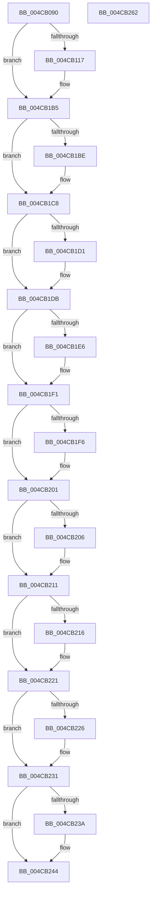

# PopIdlePhaseWatchdogCallback

- RVA: `0x004CB090`–`0x004CB263` (길이 `467` bytes)
- VA: `0x00000001404CB090`
- 실행 섹션: `.text`
- PDB 이름 있음: `예`; PDB Function 태그: `아니요`
- unwind 정보 RVA: `0x000BD5F0`
- 디코드: `124`개 명령, `467/467` bytes 표시
- 미해석 바이트: `0` (있으면 어셈블리에 `.byte`로 보존)

> 이 문서는 커널 이미지의 기계어와 PDB 기호를 분석해 생성했습니다. 4번과 5번은 함수 원형과 자료형을 바이너리 사용 방식에서 추정한 C 해석이며 원본 소스 복구 결과는 아닙니다.

## 1. Dependencies

- 직접 호출 지점: **15**; 고유 호출 대상: **8**
- 직접 호출자로 확인된 함수: **0**
- RIP 상대 이미지 참조: **6**

### Outgoing calls
- `0x004CB0D4` → [memset](../6C/memset_function_006C6C40.md) (function, `0x006C6C40`)
- `0x004CB0DD` → [PopPdcSnapDiagnosticContext](../../page/70/PopPdcSnapDiagnosticContext_function_00705194.md) (function, `0x00705194`)
- `0x004CB11E` → [PopAcquireRwLockExclusive](../43/PopAcquireRwLockExclusive_function_00430B44.md) (function, `0x00430B44`)
- `0x004CB14D` → [PopReleaseRwLock](../2D/PopReleaseRwLock_function_002DFBBC.md) (function, `0x002DFBBC`)
- `0x004CB15A` → [PopSnapSystemIdleContext](../../page/98/PopSnapSystemIdleContext_function_0098A260.md) (function, `0x0098A260`)
- `0x004CB163` → [PopPowerAggregatorSnapDiagnosticContext](../../page/76/PopPowerAggregatorSnapDiagnosticContext_function_00765064.md) (function, `0x00765064`)
- `0x004CB199` → [DbgkWerCaptureLiveKernelDump](../../page/AC/DbgkWerCaptureLiveKernelDump_function_00AC1E90.md) (function, `0x00AC1E90`)
- `0x004CB1C3` → [ExFreePoolWithTag](../../poolcode/B8/ExFreePoolWithTag_function_00B82870.md) (function, `0x00B82870`)
- `0x004CB1D6` → [ExFreePoolWithTag](../../poolcode/B8/ExFreePoolWithTag_function_00B82870.md) (function, `0x00B82870`)
- `0x004CB1EC` → [ExFreePoolWithTag](../../poolcode/B8/ExFreePoolWithTag_function_00B82870.md) (function, `0x00B82870`)
- `0x004CB1FC` → [ExFreePoolWithTag](../../poolcode/B8/ExFreePoolWithTag_function_00B82870.md) (function, `0x00B82870`)
- `0x004CB20C` → [ExFreePoolWithTag](../../poolcode/B8/ExFreePoolWithTag_function_00B82870.md) (function, `0x00B82870`)
- `0x004CB21C` → [ExFreePoolWithTag](../../poolcode/B8/ExFreePoolWithTag_function_00B82870.md) (function, `0x00B82870`)
- `0x004CB22C` → [ExFreePoolWithTag](../../poolcode/B8/ExFreePoolWithTag_function_00B82870.md) (function, `0x00B82870`)
- `0x004CB23F` → [ExFreePoolWithTag](../../poolcode/B8/ExFreePoolWithTag_function_00B82870.md) (function, `0x00B82870`)

### Direct callers
- 이 함수 시작 RVA로 연결되는 직접 call은 확인되지 않았습니다. 간접 호출은 완전히 역산할 수 없습니다.

### Static image references
- `0x004CB117` → RVA `0x00F08488` (`.data`; read)
- `0x004CB123` → RVA `0x00F08498` (`.data`; read)
- `0x004CB137` → RVA `0x00F084A0` (`.data`; read)
- `0x004CB140` → RVA `0x00F084A0` (`.data`; write)
- `0x004CB146` → RVA `0x00F08498` (`.data`; write)
- `0x004CB16C` → RVA `0x006CC400` (` ?? ::FNODOBFM::`string'`; read)

## 2. Other-region calls and transfers

- 다른 실행 섹션으로 향하는 call: **12**
  - `0x004CB0DD` → [PopPdcSnapDiagnosticContext](../../page/70/PopPdcSnapDiagnosticContext_function_00705194.md) (`.text` → `PAGE`)
  - `0x004CB15A` → [PopSnapSystemIdleContext](../../page/98/PopSnapSystemIdleContext_function_0098A260.md) (`.text` → `PAGE`)
  - `0x004CB163` → [PopPowerAggregatorSnapDiagnosticContext](../../page/76/PopPowerAggregatorSnapDiagnosticContext_function_00765064.md) (`.text` → `PAGE`)
  - `0x004CB199` → [DbgkWerCaptureLiveKernelDump](../../page/AC/DbgkWerCaptureLiveKernelDump_function_00AC1E90.md) (`.text` → `PAGE`)
  - `0x004CB1C3` → [ExFreePoolWithTag](../../poolcode/B8/ExFreePoolWithTag_function_00B82870.md) (`.text` → `POOLCODE`)
  - `0x004CB1D6` → [ExFreePoolWithTag](../../poolcode/B8/ExFreePoolWithTag_function_00B82870.md) (`.text` → `POOLCODE`)
  - `0x004CB1EC` → [ExFreePoolWithTag](../../poolcode/B8/ExFreePoolWithTag_function_00B82870.md) (`.text` → `POOLCODE`)
  - `0x004CB1FC` → [ExFreePoolWithTag](../../poolcode/B8/ExFreePoolWithTag_function_00B82870.md) (`.text` → `POOLCODE`)
  - `0x004CB20C` → [ExFreePoolWithTag](../../poolcode/B8/ExFreePoolWithTag_function_00B82870.md) (`.text` → `POOLCODE`)
  - `0x004CB21C` → [ExFreePoolWithTag](../../poolcode/B8/ExFreePoolWithTag_function_00B82870.md) (`.text` → `POOLCODE`)
  - `0x004CB22C` → [ExFreePoolWithTag](../../poolcode/B8/ExFreePoolWithTag_function_00B82870.md) (`.text` → `POOLCODE`)
  - `0x004CB23F` → [ExFreePoolWithTag](../../poolcode/B8/ExFreePoolWithTag_function_00B82870.md) (`.text` → `POOLCODE`)
- 별도 외부 분기/꼬리 이동을 확인하지 못했습니다.

## 3. Assembly (complete function range)

```asm
004CB090  48 8B C4                        mov rax, rsp
004CB093  48 89 58 08                     mov qword ptr [rax + 8], rbx
004CB097  4C 89 40 18                     mov qword ptr [rax + 0x18], r8
004CB09B  89 50 10                        mov dword ptr [rax + 0x10], edx
004CB09E  55                              push rbp
004CB09F  56                              push rsi
004CB0A0  57                              push rdi
004CB0A1  41 54                           push r12
004CB0A3  41 55                           push r13
004CB0A5  41 56                           push r14
004CB0A7  41 57                           push r15
004CB0A9  48 8D 68 B1                     lea rbp, [rax - 0x4f]
004CB0AD  48 81 EC D0 00 00 00            sub rsp, 0xd0
004CB0B4  0F 57 C0                        xorps xmm0, xmm0
004CB0B7  48 8D 4D C7                     lea rcx, [rbp - 0x39]
004CB0BB  45 33 E4                        xor r12d, r12d
004CB0BE  33 D2                           xor edx, edx
004CB0C0  4D 8B E9                        mov r13, r9
004CB0C3  0F 11 45 97                     movups xmmword ptr [rbp - 0x69], xmm0
004CB0C7  45 8D 44 24 50                  lea r8d, [r12 + 0x50]
004CB0CC  0F 11 45 A7                     movups xmmword ptr [rbp - 0x59], xmm0
004CB0D0  0F 11 45 B7                     movups xmmword ptr [rbp - 0x49], xmm0
004CB0D4  E8 67 BB 1F 00                  call 0x1406c6c40
004CB0D9  48 8D 4D 97                     lea rcx, [rbp - 0x69]
004CB0DD  E8 B2 A0 23 00                  call 0x140705194
004CB0E2  F7 45 A7 DF FF FF FF            test dword ptr [rbp - 0x59], 0xffffffdf
004CB0E9  48 8B 5D 97                     mov rbx, qword ptr [rbp - 0x69]
004CB0ED  48 8B 7D 9F                     mov rdi, qword ptr [rbp - 0x61]
004CB0F1  4C 8B 75 AF                     mov r14, qword ptr [rbp - 0x51]
004CB0F5  4C 8B 7D B7                     mov r15, qword ptr [rbp - 0x49]
004CB0F9  48 8B 75 BF                     mov rsi, qword ptr [rbp - 0x41]
004CB0FD  48 89 5D E7                     mov qword ptr [rbp - 0x19], rbx
004CB101  48 89 7D EF                     mov qword ptr [rbp - 0x11], rdi
004CB105  4C 89 75 F7                     mov qword ptr [rbp - 9], r14
004CB109  4C 89 7D FF                     mov qword ptr [rbp - 1], r15
004CB10D  48 89 75 07                     mov qword ptr [rbp + 7], rsi
004CB111  0F 84 9E 00 00 00               je 0x1404cb1b5
004CB117  48 8D 0D 6A D3 A3 00            lea rcx, [rip + 0xa3d36a]
004CB11E  E8 21 5A F6 FF                  call 0x140430b44
004CB123  48 8B 05 6E D3 A3 00            mov rax, qword ptr [rip + 0xa3d36e]
004CB12A  48 8D 0D 57 D3 A3 00            lea rcx, [rip + 0xa3d357]
004CB131  48 89 45 C7                     mov qword ptr [rbp - 0x39], rax
004CB135  33 DB                           xor ebx, ebx
004CB137  8B 05 63 D3 A3 00               mov eax, dword ptr [rip + 0xa3d363]
004CB13D  89 45 CF                        mov dword ptr [rbp - 0x31], eax
004CB140  89 1D 5A D3 A3 00               mov dword ptr [rip + 0xa3d35a], ebx
004CB146  48 89 1D 4B D3 A3 00            mov qword ptr [rip + 0xa3d34b], rbx
004CB14D  E8 6A 4A E1 FF                  call 0x1402dfbbc
004CB152  48 8D 55 DF                     lea rdx, [rbp - 0x21]
004CB156  48 8D 4D D7                     lea rcx, [rbp - 0x29]
004CB15A  E8 01 F1 4B 00                  call 0x14098a260
004CB15F  48 8D 4D 0F                     lea rcx, [rbp + 0xf]
004CB163  E8 FC 9E 29 00                  call 0x140765064
004CB168  48 8B 45 7F                     mov rax, qword ptr [rbp + 0x7f]
004CB16C  48 8D 0D 8D 12 20 00            lea rcx, [rip + 0x20128d]
004CB173  4C 8B 45 67                     mov r8, qword ptr [rbp + 0x67]
004CB177  4D 8B CD                        mov r9, r13
004CB17A  8B 55 5F                        mov edx, dword ptr [rbp + 0x5f]
004CB17D  89 5C 24 40                     mov dword ptr [rsp + 0x40], ebx
004CB181  48 89 5C 24 38                  mov qword ptr [rsp + 0x38], rbx
004CB186  48 89 5C 24 30                  mov qword ptr [rsp + 0x30], rbx
004CB18B  48 89 44 24 28                  mov qword ptr [rsp + 0x28], rax
004CB190  48 8B 45 77                     mov rax, qword ptr [rbp + 0x77]
004CB194  48 89 44 24 20                  mov qword ptr [rsp + 0x20], rax
004CB199  E8 F2 6C 5F 00                  call 0x140ac1e90
004CB19E  48 8B 75 07                     mov rsi, qword ptr [rbp + 7]
004CB1A2  44 8B E0                        mov r12d, eax
004CB1A5  4C 8B 7D FF                     mov r15, qword ptr [rbp - 1]
004CB1A9  4C 8B 75 F7                     mov r14, qword ptr [rbp - 9]
004CB1AD  48 8B 7D EF                     mov rdi, qword ptr [rbp - 0x11]
004CB1B1  48 8B 5D E7                     mov rbx, qword ptr [rbp - 0x19]
004CB1B5  48 8B 4D C7                     mov rcx, qword ptr [rbp - 0x39]
004CB1B9  48 85 C9                        test rcx, rcx
004CB1BC  74 0A                           je 0x1404cb1c8
004CB1BE  BA 50 64 69 67                  mov edx, 0x67696450
004CB1C3  E8 A8 76 6B 00                  call 0x140b82870
004CB1C8  48 8B 4D D7                     mov rcx, qword ptr [rbp - 0x29]
004CB1CC  48 85 C9                        test rcx, rcx
004CB1CF  74 0A                           je 0x1404cb1db
004CB1D1  BA 50 64 69 67                  mov edx, 0x67696450
004CB1D6  E8 95 76 6B 00                  call 0x140b82870
004CB1DB  41 BD 50 50 44 54               mov r13d, 0x54445050
004CB1E1  48 85 DB                        test rbx, rbx
004CB1E4  74 0B                           je 0x1404cb1f1
004CB1E6  41 8B D5                        mov edx, r13d
004CB1E9  48 8B CB                        mov rcx, rbx
004CB1EC  E8 7F 76 6B 00                  call 0x140b82870
004CB1F1  48 85 FF                        test rdi, rdi
004CB1F4  74 0B                           je 0x1404cb201
004CB1F6  41 8B D5                        mov edx, r13d
004CB1F9  48 8B CF                        mov rcx, rdi
004CB1FC  E8 6F 76 6B 00                  call 0x140b82870
004CB201  4D 85 F6                        test r14, r14
004CB204  74 0B                           je 0x1404cb211
004CB206  41 8B D5                        mov edx, r13d
004CB209  49 8B CE                        mov rcx, r14
004CB20C  E8 5F 76 6B 00                  call 0x140b82870
004CB211  4D 85 FF                        test r15, r15
004CB214  74 0B                           je 0x1404cb221
004CB216  41 8B D5                        mov edx, r13d
004CB219  49 8B CF                        mov rcx, r15
004CB21C  E8 4F 76 6B 00                  call 0x140b82870
004CB221  48 85 F6                        test rsi, rsi
004CB224  74 0B                           je 0x1404cb231
004CB226  41 8B D5                        mov edx, r13d
004CB229  48 8B CE                        mov rcx, rsi
004CB22C  E8 3F 76 6B 00                  call 0x140b82870
004CB231  48 8B 4D 0F                     mov rcx, qword ptr [rbp + 0xf]
004CB235  48 85 C9                        test rcx, rcx
004CB238  74 0A                           je 0x1404cb244
004CB23A  BA 50 64 69 67                  mov edx, 0x67696450
004CB23F  E8 2C 76 6B 00                  call 0x140b82870
004CB244  48 8B 9C 24 10 01 00 00         mov rbx, qword ptr [rsp + 0x110]
004CB24C  41 8B C4                        mov eax, r12d
004CB24F  48 81 C4 D0 00 00 00            add rsp, 0xd0
004CB256  41 5F                           pop r15
004CB258  41 5E                           pop r14
004CB25A  41 5D                           pop r13
004CB25C  41 5C                           pop r12
004CB25E  5F                              pop rdi
004CB25F  5E                              pop rsi
004CB260  5D                              pop rbp
004CB261  C3                              ret
004CB262  CC                              int3
```

## 4. C-style interpretation (structured pseudocode)

```c
__int64 __fastcall PopIdlePhaseWatchdogCallback(__int64 a1, int a2, __int64 a3, __int64 a4)
{
    __int64 result;
    __int64 v_r12;
    __int64 v_r14;
    __int64 v_r15;
    __int64 v_rbx;
    __int64 v_rdi;
    __int64 v_rsi;
    __int64 v_rsp;
    unsigned int v_stack_mC8;
    unsigned __int64 v_stack_mD0;
    unsigned __int64 v_stack_mD8;
    unsigned __int64 v_stack_mE0;
    unsigned __int64 v_stack_mE8;
    unsigned __int64 v_stack_p8;

    *(unsigned __int64 *)(v_rsp + 8) = v_rbx;
    *(unsigned __int64 *)(v_rsp + 24) = a3;
    *(unsigned int *)(v_rsp + 16) = a2;
    v_rsp = (v_rsp) - (208);
    v_r12 = 0;
    a2 = 0;
    *(unsigned __int64 *)(v_rsp - 79 - 105) = v_xmm0;
    *(unsigned __int64 *)(v_rsp - 79 - 89) = v_xmm0;
    *(unsigned __int64 *)(v_rsp - 79 - 73) = v_xmm0;
    result = memset(v_rsp - 79 - 57, a2, v_r12 + 80, a4);
    result = PopPdcSnapDiagnosticContext(v_rsp - 79 - 105, a2, v_r12 + 80, a4);
    *(unsigned __int64 *)(v_rsp - 79 - 25) = *(unsigned __int64 *)(v_rsp - 79 - 105);
    *(unsigned __int64 *)(v_rsp - 79 - 17) = *(unsigned __int64 *)(v_rsp - 79 - 97);
    *(unsigned __int64 *)(v_rsp - 79 - 9) = *(unsigned __int64 *)(v_rsp - 79 - 81);
    *(unsigned __int64 *)(v_rsp - 79 - 1) = *(unsigned __int64 *)(v_rsp - 79 - 73);
    *(unsigned __int64 *)(v_rsp - 79 + 7) = *(unsigned __int64 *)(v_rsp - 79 - 65);
    v_rbx = *(unsigned __int64 *)(v_rsp - 79 - 105);
    v_rsi = *(unsigned __int64 *)(v_rsp - 79 - 65);
    v_rdi = *(unsigned __int64 *)(v_rsp - 79 - 97);
    v_r14 = *(unsigned __int64 *)(v_rsp - 79 - 81);
    v_r15 = *(unsigned __int64 *)(v_rsp - 79 - 73);
    if (((*(unsigned int *)(v_rsp - 79 - 89)) & (0xFFFFFFDFULL)) != 0) {
        a1 = v_rip + 10736490;
        result = PopAcquireRwLockExclusive(a1, a2, v_r12 + 80, a4);
        result = *(unsigned __int64 *)(v_rip + 10736494);
        a1 = v_rip + 10736471;
        *(unsigned __int64 *)(v_rsp - 79 - 57) = result;
        v_rbx = 0;
        result = *(unsigned int *)(v_rip + 10736483);
        *(unsigned int *)(v_rsp - 79 - 49) = (unsigned int)(result);
        *(unsigned int *)(v_rip + 10736474) = 0;
        *(unsigned __int64 *)(v_rip + 10736459) = 0;
        result = PopReleaseRwLock(a1, a2, v_r12 + 80, a4);
        a2 = v_rsp - 79 - 33;
        a1 = v_rsp - 79 - 41;
        result = PopSnapSystemIdleContext(a1, a2, v_r12 + 80, a4);
        a1 = v_rsp - 79 + 15;
        result = PopPowerAggregatorSnapDiagnosticContext(a1, a2, v_r12 + 80, a4);
        result = *(unsigned __int64 *)(v_rsp - 79 + 127);
        a1 = v_rip + 2101901;
        a3 = *(unsigned __int64 *)(v_rsp - 79 + 103);
        a4 = a4;
        a2 = *(unsigned int *)(v_rsp - 79 + 95);
        v_stack_mC8 = 0;
        v_stack_mD0 = 0;
        v_stack_mD8 = 0;
        v_stack_mE0 = result;
        result = *(unsigned __int64 *)(v_rsp - 79 + 119);
        v_stack_mE8 = result;
        result = DbgkWerCaptureLiveKernelDump(a1, a2, a3, a4);
        v_rsi = *(unsigned __int64 *)(v_rsp - 79 + 7);
        v_r12 = (unsigned int)(result);
        v_r15 = *(unsigned __int64 *)(v_rsp - 79 - 1);
        v_r14 = *(unsigned __int64 *)(v_rsp - 79 - 9);
        v_rdi = *(unsigned __int64 *)(v_rsp - 79 - 17);
        v_rbx = *(unsigned __int64 *)(v_rsp - 79 - 25);
    }
    if (*(unsigned __int64 *)(v_rsp - 79 - 57) != 0) {
        a2 = 0x67696450ULL;
        result = ExFreePoolWithTag(*(unsigned __int64 *)(v_rsp - 79 - 57), a2, a3, a4);
    }
    if (*(unsigned __int64 *)(v_rsp - 79 - 41) != 0) {
        a2 = 0x67696450ULL;
        result = ExFreePoolWithTag(*(unsigned __int64 *)(v_rsp - 79 - 41), a2, a3, a4);
    }
    if (v_rbx != 0) {
        a2 = (unsigned int)((unsigned int)(0x54445050ULL));
        a1 = v_rbx;
        result = ExFreePoolWithTag(a1, a2, a3, a4);
    }
    if (v_rdi != 0) {
        a2 = (unsigned int)((unsigned int)(0x54445050ULL));
        a1 = v_rdi;
        result = ExFreePoolWithTag(a1, a2, a3, a4);
    }
    if (v_r14 != 0) {
        a2 = (unsigned int)((unsigned int)(0x54445050ULL));
        a1 = v_r14;
        result = ExFreePoolWithTag(a1, a2, a3, a4);
    }
    if (v_r15 != 0) {
        a2 = (unsigned int)((unsigned int)(0x54445050ULL));
        a1 = v_r15;
        result = ExFreePoolWithTag(a1, a2, a3, a4);
    }
    if (v_rsi != 0) {
        a2 = (unsigned int)((unsigned int)(0x54445050ULL));
        a1 = v_rsi;
        result = ExFreePoolWithTag(a1, a2, a3, a4);
    }
    if (*(unsigned __int64 *)(v_rsp - 79 + 15) != 0) {
        a2 = 0x67696450ULL;
        result = ExFreePoolWithTag(*(unsigned __int64 *)(v_rsp - 79 + 15), a2, a3, a4);
    }
    v_rsp = (v_rsp) + (208);
    return (unsigned int)((unsigned int)(v_r12));
}
```

## 5. (Beta) C Style

```c
int64_t PopIdlePhaseWatchdogCallback(int64_t Arg1, int32_t Arg2, int64_t Arg3, int64_t Arg4)
{
    int64_t result;
    int64_t local_r12;
    int64_t local_r14;
    int64_t local_r15;
    int64_t local_rbx;
    int64_t local_rdi;
    int64_t local_rsi;
    int64_t local_rsp;
    uint32_t v_stack_mC8;
    uint64_t v_stack_mD0;
    uint64_t v_stack_mD8;
    uint64_t v_stack_mE0;
    uint64_t v_stack_mE8;
    uint64_t v_stack_p8;

    *(uint64_t *)(local_rsp + 0x8) = local_rbx;
    *(uint64_t *)(local_rsp + 0x18) = Arg3;
    *(uint32_t *)(local_rsp + 0x10) = Arg2;
    local_rsp = (local_rsp) - (208);
    local_r12 = 0;
    Arg2 = 0;
    *(uint64_t *)(local_rsp - 0x4F - 0x69) = v_xmm0;
    *(uint64_t *)(local_rsp - 0x4F - 0x59) = v_xmm0;
    *(uint64_t *)(local_rsp - 0x4F - 0x49) = v_xmm0;
    result = memset(local_rsp - 79 - 57, Arg2, local_r12 + 80, Arg4);
    result = PopPdcSnapDiagnosticContext(local_rsp - 79 - 105, Arg2, local_r12 + 80, Arg4);
    *(uint64_t *)(local_rsp - 0x4F - 0x19) = *(uint64_t *)(local_rsp - 0x4F - 0x69);
    *(uint64_t *)(local_rsp - 0x4F - 0x11) = *(uint64_t *)(local_rsp - 0x4F - 0x61);
    *(uint64_t *)(local_rsp - 0x4F - 0x9) = *(uint64_t *)(local_rsp - 0x4F - 0x51);
    *(uint64_t *)(local_rsp - 0x4F - 0x1) = *(uint64_t *)(local_rsp - 0x4F - 0x49);
    *(uint64_t *)(local_rsp - 0x4F + 0x7) = *(uint64_t *)(local_rsp - 0x4F - 0x41);
    local_rbx = *(uint64_t *)(local_rsp - 0x4F - 0x69);
    local_rsi = *(uint64_t *)(local_rsp - 0x4F - 0x41);
    local_rdi = *(uint64_t *)(local_rsp - 0x4F - 0x61);
    local_r14 = *(uint64_t *)(local_rsp - 0x4F - 0x51);
    local_r15 = *(uint64_t *)(local_rsp - 0x4F - 0x49);
    if (((*(uint32_t *)(local_rsp - 0x4F - 0x59)) & (0xFFFFFFDFULL)) != 0) {
        Arg1 = v_rip + 10736490;
        result = PopAcquireRwLockExclusive(Arg1, Arg2, local_r12 + 80, Arg4);
        result = *(uint64_t *)(v_rip + 0xA3D36E);
        Arg1 = v_rip + 10736471;
        *(uint64_t *)(local_rsp - 0x4F - 0x39) = result;
        local_rbx = 0;
        result = *(uint32_t *)(v_rip + 0xA3D363);
        *(uint32_t *)(local_rsp - 0x4F - 0x31) = (uint32_t)(result);
        *(uint32_t *)(v_rip + 0xA3D35A) = 0;
        *(uint64_t *)(v_rip + 0xA3D34B) = 0;
        result = PopReleaseRwLock(Arg1, Arg2, local_r12 + 80, Arg4);
        Arg2 = local_rsp - 79 - 33;
        Arg1 = local_rsp - 79 - 41;
        result = PopSnapSystemIdleContext(Arg1, Arg2, local_r12 + 80, Arg4);
        Arg1 = local_rsp - 79 + 15;
        result = PopPowerAggregatorSnapDiagnosticContext(Arg1, Arg2, local_r12 + 80, Arg4);
        result = *(uint64_t *)(local_rsp - 0x4F + 0x7F);
        Arg1 = v_rip + 2101901;
        Arg3 = *(uint64_t *)(local_rsp - 0x4F + 0x67);
        Arg4 = Arg4;
        Arg2 = *(uint32_t *)(local_rsp - 0x4F + 0x5F);
        v_stack_mC8 = 0;
        v_stack_mD0 = 0;
        v_stack_mD8 = 0;
        v_stack_mE0 = result;
        result = *(uint64_t *)(local_rsp - 0x4F + 0x77);
        v_stack_mE8 = result;
        result = DbgkWerCaptureLiveKernelDump(Arg1, Arg2, Arg3, Arg4);
        local_rsi = *(uint64_t *)(local_rsp - 0x4F + 0x7);
        local_r12 = (uint32_t)(result);
        local_r15 = *(uint64_t *)(local_rsp - 0x4F - 0x1);
        local_r14 = *(uint64_t *)(local_rsp - 0x4F - 0x9);
        local_rdi = *(uint64_t *)(local_rsp - 0x4F - 0x11);
        local_rbx = *(uint64_t *)(local_rsp - 0x4F - 0x19);
    }
    if (*(uint64_t *)(local_rsp - 0x4F - 0x39) != 0) {
        Arg2 = 0x67696450ULL;
        result = ExFreePoolWithTag(*(uint64_t *)(local_rsp - 0x4F - 0x39), Arg2, Arg3, Arg4);
    }
    if (*(uint64_t *)(local_rsp - 0x4F - 0x29) != 0) {
        Arg2 = 0x67696450ULL;
        result = ExFreePoolWithTag(*(uint64_t *)(local_rsp - 0x4F - 0x29), Arg2, Arg3, Arg4);
    }
    if (local_rbx != 0) {
        Arg2 = (uint32_t)((uint32_t)(0x54445050ULL));
        Arg1 = local_rbx;
        result = ExFreePoolWithTag(Arg1, Arg2, Arg3, Arg4);
    }
    if (local_rdi != 0) {
        Arg2 = (uint32_t)((uint32_t)(0x54445050ULL));
        Arg1 = local_rdi;
        result = ExFreePoolWithTag(Arg1, Arg2, Arg3, Arg4);
    }
    if (local_r14 != 0) {
        Arg2 = (uint32_t)((uint32_t)(0x54445050ULL));
        Arg1 = local_r14;
        result = ExFreePoolWithTag(Arg1, Arg2, Arg3, Arg4);
    }
    if (local_r15 != 0) {
        Arg2 = (uint32_t)((uint32_t)(0x54445050ULL));
        Arg1 = local_r15;
        result = ExFreePoolWithTag(Arg1, Arg2, Arg3, Arg4);
    }
    if (local_rsi != 0) {
        Arg2 = (uint32_t)((uint32_t)(0x54445050ULL));
        Arg1 = local_rsi;
        result = ExFreePoolWithTag(Arg1, Arg2, Arg3, Arg4);
    }
    if (*(uint64_t *)(local_rsp - 0x4F + 0xF) != 0) {
        Arg2 = 0x67696450ULL;
        result = ExFreePoolWithTag(*(uint64_t *)(local_rsp - 0x4F + 0xF), Arg2, Arg3, Arg4);
    }
    local_rsp = (local_rsp) + (208);
    return (uint32_t)((uint32_t)(local_r12));
}
```

## 6. Execution-region graph

[열기: 2D/3D 그래프와 함수 탐색 컨트롤 패널](../../../control-panel.html?section=text&rva=0x004CB090&view=graph)

- 2D 그래프는 위에서 아래로 흐르고, 3D 그래프는 빈 공간을 드래그해 회전합니다. Shift+드래그는 이동, 휠은 확대·축소, 함수 노드 선택은 대상 보고서 이동입니다.

### Static fallback


