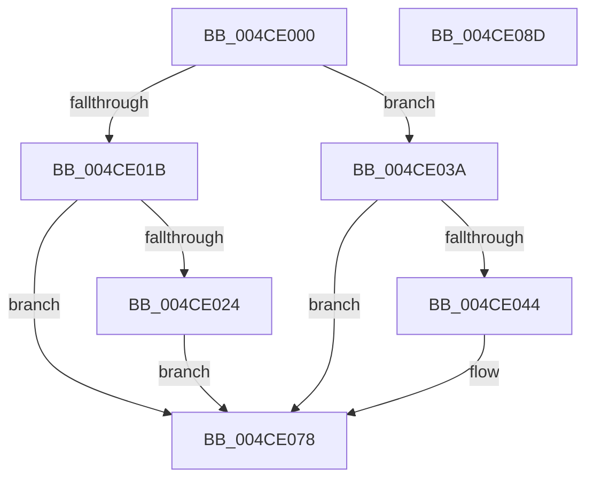

# PopNetUpdateDsAccounting

- RVA: `0x004CE000`–`0x004CE08E` (길이 `142` bytes)
- VA: `0x00000001404CE000`
- 실행 섹션: `.text`
- PDB 이름 있음: `예`; PDB Function 태그: `아니요`
- unwind 정보 RVA: `0x0005CF00`
- 디코드: `31`개 명령, `142/142` bytes 표시
- 미해석 바이트: `0` (있으면 어셈블리에 `.byte`로 보존)

> 이 문서는 커널 이미지의 기계어와 PDB 기호를 분석해 생성했습니다. 4번과 5번은 함수 원형과 자료형을 바이너리 사용 방식에서 추정한 C 해석이며 원본 소스 복구 결과는 아닙니다.

## 1. Dependencies

- 직접 호출 지점: **2**; 고유 호출 대상: **2**
- 직접 호출자로 확인된 함수: **1**
- RIP 상대 이미지 참조: **6**

### Outgoing calls
- `0x004CE00F` → [KeAcquireSpinLockRaiseToDpc](../20/KeAcquireSpinLockRaiseToDpc_function_00208470.md) (function, `0x00208470`)
- `0x004CE082` → [KeReleaseSpinLock](../39/KeReleaseSpinLock_function_00392BA0.md) (function, `0x00392BA0`)

### Direct callers
- [PdcPoNetworkResiliency](../../page/76/PdcPoNetworkResiliency_function_007693A0.md) at `0x007693AF`

### Static image references
- `0x004CE008` → RVA `0x00F0CA58` (`.data`; read)
- `0x004CE01B` → RVA `0x00E678DC` (`.data`; read)
- `0x004CE031` → RVA `0x00F0C778` (`.data`; write)
- `0x004CE03A` → RVA `0x00F0C778` (`.data`; read)
- `0x004CE069` → RVA `0x00F0C780` (`.data`; read/write)
- `0x004CE070` → RVA `0x00F0C778` (`.data`; read/write)

## 2. Other-region calls and transfers

- 다른 실행 섹션으로 향하는 call: **0**
- 별도 외부 분기/꼬리 이동을 확인하지 못했습니다.

## 3. Assembly (complete function range)

```asm
004CE000  40 53                           push rbx
004CE002  48 83 EC 20                     sub rsp, 0x20
004CE006  8A D9                           mov bl, cl
004CE008  48 8D 0D 49 EA A3 00            lea rcx, [rip + 0xa3ea49]
004CE00F  E8 5C A4 D3 FF                  call 0x140208470
004CE014  44 8A C0                        mov r8b, al
004CE017  84 DB                           test bl, bl
004CE019  74 1F                           je 0x1404ce03a
004CE01B  83 3D BA 98 99 00 02            cmp dword ptr [rip + 0x9998ba], 2
004CE022  75 54                           jne 0x1404ce078
004CE024  48 BA 08 00 00 00 80 F7 FF FF   movabs rdx, 0xfffff78000000008
004CE02E  48 8B 0A                        mov rcx, qword ptr [rdx]
004CE031  48 89 0D 40 E7 A3 00            mov qword ptr [rip + 0xa3e740], rcx
004CE038  EB 3E                           jmp 0x1404ce078
004CE03A  48 83 3D 36 E7 A3 00 00         cmp qword ptr [rip + 0xa3e736], 0
004CE042  74 34                           je 0x1404ce078
004CE044  48 BA 08 00 00 00 80 F7 FF FF   movabs rdx, 0xfffff78000000008
004CE04E  48 B8 CD CC CC CC CC CC CC CC   movabs rax, 0xcccccccccccccccd
004CE058  48 8B 12                        mov rdx, qword ptr [rdx]
004CE05B  48 2B 15 16 E7 A3 00            sub rdx, qword ptr [rip + 0xa3e716]
004CE062  48 F7 E2                        mul rdx
004CE065  48 C1 EA 03                     shr rdx, 3
004CE069  48 01 15 10 E7 A3 00            add qword ptr [rip + 0xa3e710], rdx
004CE070  48 83 25 00 E7 A3 00 00         and qword ptr [rip + 0xa3e700], 0
004CE078  41 8A D0                        mov dl, r8b
004CE07B  48 8D 0D D6 E9 A3 00            lea rcx, [rip + 0xa3e9d6]
004CE082  E8 19 4B EC FF                  call 0x140392ba0
004CE087  48 83 C4 20                     add rsp, 0x20
004CE08B  5B                              pop rbx
004CE08C  C3                              ret
004CE08D  CC                              int3
```

## 4. C-style interpretation (structured pseudocode)

```c
__int64 __fastcall PopNetUpdateDsAccounting(unsigned __int8 a1)
{
    __int64 result;
    __int64 v_rsp;

    v_rsp = (v_rsp) - (32);
    result = KeAcquireSpinLockRaiseToDpc(v_rip + 10742345, a2, a3, a4);
    if (a1 == 0) goto loc_004CE03A;
    if ((*(unsigned int *)(v_rip + 10066106)) != 2) goto loc_004CE078;
    *(unsigned __int64 *)(v_rip + 10741568) = *(unsigned __int64 *)(a2);
    goto loc_004CE078;
loc_004CE03A:
    if ((*(unsigned __int64 *)(v_rip + 10741558)) != 0) {
        a2 = *(unsigned __int64 *)(a2);
        a2 = (a2) - (*(unsigned __int64 *)(v_rip + 10741526));
        a2 = (a2) >> (3);
    }
    result = KeReleaseSpinLock(v_rip + 10742230, (unsigned __int8)((unsigned __int8)(result)), (unsigned __int8)(result), a4);
    v_rsp = (v_rsp) + (32);
    return result;
}
```

## 5. (Beta) C Style

```c
int64_t PopNetUpdateDsAccounting(uint8_t Arg1)
{
    int64_t result;
    int64_t local_rsp;

    local_rsp = (local_rsp) - (32);
    result = KeAcquireSpinLockRaiseToDpc(v_rip + 10742345, a2, a3, a4);
    if (Arg1 == 0) goto loc_004CE03A;
    if ((*(uint32_t *)(v_rip + 0x9998BA)) != 2) goto loc_004CE078;
    *(uint64_t *)(v_rip + 0xA3E740) = *(uint64_t *)(a2);
    goto loc_004CE078;
loc_004CE03A:
    if ((*(uint64_t *)(v_rip + 0xA3E736)) != 0) {
        a2 = *(uint64_t *)(a2);
        a2 = (a2) - (*(uint64_t *)(v_rip + 0xA3E716));
        a2 = (a2) >> (3);
    }
    result = KeReleaseSpinLock(v_rip + 10742230, (uint8_t)((uint8_t)(result)), (uint8_t)(result), a4);
    local_rsp = (local_rsp) + (32);
    return result;
}
```

## 6. Execution-region graph

[열기: 2D/3D 그래프와 함수 탐색 컨트롤 패널](../../../control-panel.html?section=text&rva=0x004CE000&view=graph)

- 2D 그래프는 위에서 아래로 흐르고, 3D 그래프는 빈 공간을 드래그해 회전합니다. Shift+드래그는 이동, 휠은 확대·축소, 함수 노드 선택은 대상 보고서 이동입니다.

### Static fallback


