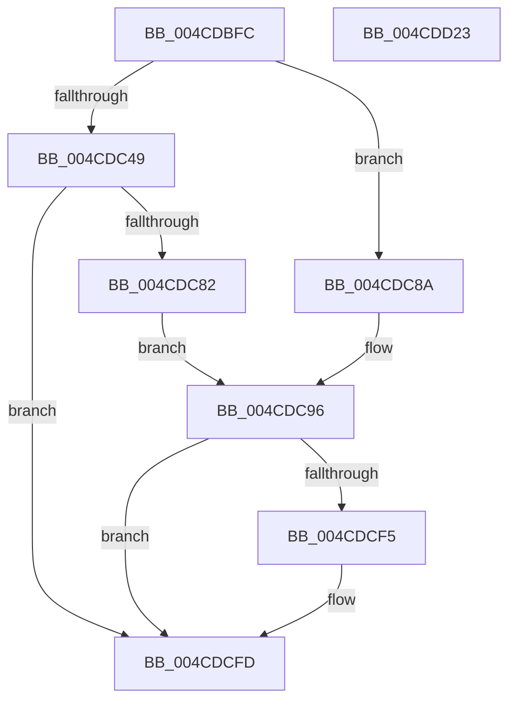

# PopOpenThermalLoggingKey

- RVA: `0x004CDBFC`–`0x004CDD24` (길이 `296` bytes)
- VA: `0x00000001404CDBFC`
- 실행 섹션: `.text`
- PDB 이름 있음: `예`; PDB Function 태그: `아니요`
- unwind 정보 RVA: `0x000BD9B8`
- 디코드: `69`개 명령, `296/296` bytes 표시
- 미해석 바이트: `0` (있으면 어셈블리에 `.byte`로 보존)

> 이 문서는 커널 이미지의 기계어와 PDB 기호를 분석해 생성했습니다. 4번과 5번은 함수 원형과 자료형을 바이너리 사용 방식에서 추정한 C 해석이며 원본 소스 복구 결과는 아닙니다.

## 1. Dependencies

- 직접 호출 지점: **4**; 고유 호출 대상: **4**
- 직접 호출자로 확인된 함수: **2**
- RIP 상대 이미지 참조: **4**

### Outgoing calls
- `0x004CDC77` → [RtlGetPersistedStateLocation](../../page/8C/RtlGetPersistedStateLocation_function_008C8DE0.md) (function, `0x008C8DE0`)
- `0x004CDC9B` → [RtlInitUnicodeString](../42/RtlInitUnicodeString_function_0042A780.md) (function, `0x0042A780`)
- `0x004CDCEA` → [ZwCreateKey](../6A/ZwCreateKey_function_006AD470.md) (function, `0x006AD470`)
- `0x004CDD09` → [_security_check_cookie](../6A/_security_check_cookie_function_006AC640.md) (function, `0x006AC640`)

### Direct callers
- [PopThermalWriteShutdownToRegistry](PopThermalWriteShutdownToRegistry_function_004CDA6C.md) at `0x004CDAA8`
- [PopThermalHandlePreviousShutdown](../../page/75/PopThermalHandlePreviousShutdown_function_0075F400.md) at `0x0075F46C`
- [PopThermalHandlePreviousShutdown](../../page/75/PopThermalHandlePreviousShutdown_function_0075F400.md) at `0x0075F641`

### Static image references
- `0x004CDC16` → RVA `0x00E0A740` (`.data`; read)
- `0x004CDC56` → RVA `0x0001E880` (`.rdata`; read)
- `0x004CDC70` → RVA `0x006CC0F0` (` ?? ::FNODOBFM::`string'`; read)
- `0x004CDC8F` → RVA `0x00029400` (`.rdata`; read)

## 2. Other-region calls and transfers

- 다른 실행 섹션으로 향하는 call: **1**
  - `0x004CDC77` → [RtlGetPersistedStateLocation](../../page/8C/RtlGetPersistedStateLocation_function_008C8DE0.md) (`.text` → `PAGE`)
- 별도 외부 분기/꼬리 이동을 확인하지 못했습니다.

## 3. Assembly (complete function range)

```asm
004CDBFC  48 89 5C 24 08                  mov qword ptr [rsp + 8], rbx
004CDC01  48 89 7C 24 18                  mov qword ptr [rsp + 0x18], rdi
004CDC06  55                              push rbp
004CDC07  48 8D AC 24 50 FE FF FF         lea rbp, [rsp - 0x1b0]
004CDC0F  48 81 EC B0 02 00 00            sub rsp, 0x2b0
004CDC16  48 8B 05 23 CB 93 00            mov rax, qword ptr [rip + 0x93cb23]
004CDC1D  48 33 C4                        xor rax, rsp
004CDC20  48 89 85 A0 01 00 00            mov qword ptr [rbp + 0x1a0], rax
004CDC27  33 C0                           xor eax, eax
004CDC29  0F 57 C0                        xorps xmm0, xmm0
004CDC2C  21 44 24 7C                     and dword ptr [rsp + 0x7c], eax
004CDC30  48 8B FA                        mov rdi, rdx
004CDC33  48 21 44 24 40                  and qword ptr [rsp + 0x40], rax
004CDC38  89 44 24 64                     mov dword ptr [rsp + 0x64], eax
004CDC3C  21 44 24 64                     and dword ptr [rsp + 0x64], eax
004CDC40  0F 11 44 24 50                  movups xmmword ptr [rsp + 0x50], xmm0
004CDC45  84 C9                           test cl, cl
004CDC47  75 41                           jne 0x1404cdc8a
004CDC49  48 8D 44 24 48                  lea rax, [rsp + 0x48]
004CDC4E  45 33 C9                        xor r9d, r9d
004CDC51  48 89 44 24 30                  mov qword ptr [rsp + 0x30], rax
004CDC56  4C 8D 05 23 0C B5 FF            lea r8, [rip - 0x4af3dd]
004CDC5D  48 8D 45 90                     lea rax, [rbp - 0x70]
004CDC61  C7 44 24 28 08 02 00 00         mov dword ptr [rsp + 0x28], 0x208
004CDC69  33 D2                           xor edx, edx
004CDC6B  48 89 44 24 20                  mov qword ptr [rsp + 0x20], rax
004CDC70  48 8D 0D 79 E4 1F 00            lea rcx, [rip + 0x1fe479]
004CDC77  E8 64 B1 3F 00                  call 0x1408c8de0
004CDC7C  8B C8                           mov ecx, eax
004CDC7E  85 C0                           test eax, eax
004CDC80  78 7B                           js 0x1404cdcfd
004CDC82  33 DB                           xor ebx, ebx
004CDC84  48 8D 55 90                     lea rdx, [rbp - 0x70]
004CDC88  EB 0C                           jmp 0x1404cdc96
004CDC8A  BB 01 00 00 00                  mov ebx, 1
004CDC8F  48 8D 15 6A B7 B5 FF            lea rdx, [rip - 0x4a4896]
004CDC96  48 8D 4C 24 50                  lea rcx, [rsp + 0x50]
004CDC9B  E8 E0 CA F5 FF                  call 0x14042a780
004CDCA0  48 83 64 24 30 00               and qword ptr [rsp + 0x30], 0
004CDCA6  48 8D 44 24 50                  lea rax, [rsp + 0x50]
004CDCAB  48 83 64 24 68 00               and qword ptr [rsp + 0x68], 0
004CDCB1  4C 8D 44 24 60                  lea r8, [rsp + 0x60]
004CDCB6  0F 57 C0                        xorps xmm0, xmm0
004CDCB9  89 5C 24 28                     mov dword ptr [rsp + 0x28], ebx
004CDCBD  48 83 64 24 20 00               and qword ptr [rsp + 0x20], 0
004CDCC3  48 8D 4C 24 40                  lea rcx, [rsp + 0x40]
004CDCC8  45 33 C9                        xor r9d, r9d
004CDCCB  48 89 44 24 70                  mov qword ptr [rsp + 0x70], rax
004CDCD0  BA 1F 00 02 00                  mov edx, 0x2001f
004CDCD5  C7 44 24 60 30 00 00 00         mov dword ptr [rsp + 0x60], 0x30
004CDCDD  F3 0F 7F 45 80                  movdqu xmmword ptr [rbp - 0x80], xmm0
004CDCE2  C7 44 24 78 40 02 00 00         mov dword ptr [rsp + 0x78], 0x240
004CDCEA  E8 81 F7 1D 00                  call 0x1406ad470
004CDCEF  8B C8                           mov ecx, eax
004CDCF1  85 C0                           test eax, eax
004CDCF3  78 08                           js 0x1404cdcfd
004CDCF5  48 8B 44 24 40                  mov rax, qword ptr [rsp + 0x40]
004CDCFA  48 89 07                        mov qword ptr [rdi], rax
004CDCFD  8B C1                           mov eax, ecx
004CDCFF  48 8B 8D A0 01 00 00            mov rcx, qword ptr [rbp + 0x1a0]
004CDD06  48 33 CC                        xor rcx, rsp
004CDD09  E8 32 E9 1D 00                  call 0x1406ac640
004CDD0E  4C 8D 9C 24 B0 02 00 00         lea r11, [rsp + 0x2b0]
004CDD16  49 8B 5B 10                     mov rbx, qword ptr [r11 + 0x10]
004CDD1A  49 8B 7B 20                     mov rdi, qword ptr [r11 + 0x20]
004CDD1E  49 8B E3                        mov rsp, r11
004CDD21  5D                              pop rbp
004CDD22  C3                              ret
004CDD23  CC                              int3
```

## 4. C-style interpretation (structured pseudocode)

```c
__int64 __fastcall PopOpenThermalLoggingKey(unsigned __int8 a1, __int64 a2, __int64 a3, int a4)
{
    __int64 result;
    __int64 v_rbx;
    __int64 v_rsp;
    unsigned __int64 v_stack_m18;
    unsigned __int64 v_stack_m1B8;
    unsigned __int64 v_stack_m228;
    unsigned __int64 v_stack_m238;
    unsigned int v_stack_m23C;
    unsigned int v_stack_m240;
    unsigned __int64 v_stack_m248;
    unsigned __int64 v_stack_m250;
    unsigned int v_stack_m254;
    unsigned __int64 v_stack_m258;
    unsigned __int64 v_stack_m268;
    unsigned __int64 v_stack_m270;
    unsigned __int64 v_stack_m278;
    unsigned __int64 v_stack_m288;
    unsigned int v_stack_m290;
    unsigned __int64 v_stack_m298;
    unsigned __int64 v_stack_m8;
    unsigned __int64 v_stack_p18;
    unsigned __int64 v_stack_p8;

    v_stack_p8 = v_rbx;
    v_stack_p18 = v_rdi;
    v_rsp = (v_rsp) - (688);
    result = (*(unsigned __int64 *)(v_rip + 9685795)) ^ (v_rsp);
    v_stack_m18 = result;
    result = 0;
    v_stack_m254 = 0;
    v_stack_m268 = v_xmm0;
    if (a1 != 0) goto loc_004CDC8A;
    a4 = 0;
    v_stack_m288 = v_stack_m270;
    v_stack_m290 = 520;
    a2 = 0;
    v_stack_m298 = v_stack_m228;
    result = RtlGetPersistedStateLocation(v_rip + 2090105, a2, v_rip - 4912093, a4);
    if (sign_flag) goto loc_004CDCFD;
    v_rbx = 0;
    goto loc_004CDC96;
loc_004CDC8A:
loc_004CDC96:
    result = RtlInitUnicodeString(v_stack_m268, v_rip - 4868246, v_rip - 4912093, a4);
    v_stack_m290 = 1;
    a4 = 0;
    v_stack_m248 = v_stack_m268;
    v_stack_m258 = 48;
    v_stack_m238 = v_xmm0;
    v_stack_m240 = 576;
    result = ZwCreateKey(v_stack_m278, (unsigned int)(0x2001FULL), v_stack_m258, a4);
    if (!(sign_flag)) {
        result = v_stack_m278;
        *(unsigned __int64 *)(a2) = result;
    }
    a1 = (v_stack_m18) ^ (v_rsp);
    result = _security_check_cookie(a1, (unsigned int)(0x2001FULL), v_stack_m258, a4);
    return result;
}
```

## 5. (Beta) C Style

```c
int64_t PopOpenThermalLoggingKey(uint8_t Arg1, void *Arg2, int64_t Arg3, int32_t Arg4)
{
    uint8_t *arg2 = (uint8_t *)Arg2;

    int64_t result;
    int64_t local_rbx;
    int64_t local_rsp;
    uint64_t v_stack_m18;
    uint64_t v_stack_m1B8;
    uint64_t v_stack_m228;
    uint64_t v_stack_m238;
    uint32_t v_stack_m23C;
    uint32_t v_stack_m240;
    uint64_t v_stack_m248;
    uint64_t v_stack_m250;
    uint32_t v_stack_m254;
    uint64_t v_stack_m258;
    uint64_t v_stack_m268;
    uint64_t v_stack_m270;
    uint64_t v_stack_m278;
    uint64_t v_stack_m288;
    uint32_t v_stack_m290;
    uint64_t v_stack_m298;
    uint64_t v_stack_m8;
    uint64_t v_stack_p18;
    uint64_t v_stack_p8;

    v_stack_p8 = local_rbx;
    v_stack_p18 = local_rdi;
    local_rsp = (local_rsp) - (688);
    result = (*(uint64_t *)(v_rip + 0x93CB23)) ^ (local_rsp);
    v_stack_m18 = result;
    result = 0;
    v_stack_m254 = 0;
    v_stack_m268 = v_xmm0;
    if (Arg1 != 0) goto loc_004CDC8A;
    Arg4 = 0;
    v_stack_m288 = v_stack_m270;
    v_stack_m290 = 520;
    Arg2 = 0;
    v_stack_m298 = v_stack_m228;
    result = RtlGetPersistedStateLocation(v_rip + 2090105, Arg2, v_rip - 4912093, Arg4);
    if (sign_flag) goto loc_004CDCFD;
    local_rbx = 0;
    goto loc_004CDC96;
loc_004CDC8A:
loc_004CDC96:
    result = RtlInitUnicodeString(v_stack_m268, v_rip - 4868246, v_rip - 4912093, Arg4);
    v_stack_m290 = 1;
    Arg4 = 0;
    v_stack_m248 = v_stack_m268;
    v_stack_m258 = 48;
    v_stack_m238 = v_xmm0;
    v_stack_m240 = 576;
    result = ZwCreateKey(v_stack_m278, (uint32_t)(0x2001FULL), v_stack_m258, Arg4);
    if (!(sign_flag)) {
        result = v_stack_m278;
        *(uint64_t *)(arg2) = result;
    }
    Arg1 = (v_stack_m18) ^ (local_rsp);
    result = _security_check_cookie(Arg1, (uint32_t)(0x2001FULL), v_stack_m258, Arg4);
    return result;
}
```

### 관측된 메모리 오프셋

구조체 형식이 확인되지 않은 접근은 인자 기준의 오프셋으로만 기록했습니다.

| 기준 인자 | 오프셋 표현 | 폭 (bit) | 접근 |
|---|---:|---:|---|
| `Arg2` | `+ 0x0` | `64` | `W` |

## 6. Execution-region graph

[열기: 2D/3D 그래프와 함수 탐색 컨트롤 패널](../../../control-panel.html?section=text&rva=0x004CDBFC&view=graph)

- 2D 그래프는 위에서 아래로 흐르고, 3D 그래프는 빈 공간을 드래그해 회전합니다. Shift+드래그는 이동, 휠은 확대·축소, 함수 노드 선택은 대상 보고서 이동입니다.

### Static fallback


