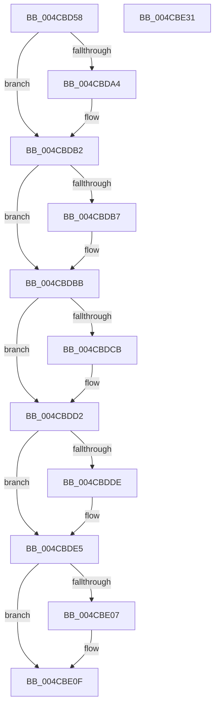

# PopPepInsertDevice

- RVA: `0x004CBD58`–`0x004CBE32` (길이 `218` bytes)
- VA: `0x00000001404CBD58`
- 실행 섹션: `.text`
- PDB 이름 있음: `예`; PDB Function 태그: `아니요`
- unwind 정보 RVA: `0x0005C954`
- 디코드: `54`개 명령, `218/218` bytes 표시
- 미해석 바이트: `0` (있으면 어셈블리에 `.byte`로 보존)

> 이 문서는 커널 이미지의 기계어와 PDB 기호를 분석해 생성했습니다. 4번과 5번은 함수 원형과 자료형을 바이너리 사용 방식에서 추정한 C 해석이며 원본 소스 복구 결과는 아닙니다.

## 1. Dependencies

- 직접 호출 지점: **5**; 고유 호출 대상: **5**
- 직접 호출자로 확인된 함수: **1**
- RIP 상대 이미지 참조: **7**

### Outgoing calls
- `0x004CBD93` → [KeAbPreAcquire](../21/KeAbPreAcquire_function_00210230.md) (function, `0x00210230`)
- `0x004CBDAD` → [ExfAcquirePushLockExclusiveEx](../20/ExfAcquirePushLockExclusiveEx_function_0020FC90.md) (function, `0x0020FC90`)
- `0x004CBE0A` → [ExfTryToWakePushLock](../26/ExfTryToWakePushLock_function_00265DD0.md) (function, `0x00265DD0`)
- `0x004CBE12` → [KeAbPostRelease](../2E/KeAbPostRelease_function_002E1600.md) (function, `0x002E1600`)
- `0x004CBE17` → [KeLeaveCriticalRegion](../25/KeLeaveCriticalRegion_function_0025D8B0.md) (function, `0x0025D8B0`)

### Direct callers
- [PopPepRegisterDevice](../../page/AA/PopPepRegisterDevice_function_00AAEBD0.md) at `0x00AAEEF8`

### Static image references
- `0x004CBD75` → RVA `0x00F07678` (`.data`; read)
- `0x004CBDBB` → RVA `0x00F07680` (`.data`; read)
- `0x004CBDC2` → RVA `0x00E08388` (`.data`; read)
- `0x004CBDCB` → RVA `0x00E08388` (`.data`; write)
- `0x004CBDD2` → RVA `0x00F07688` (`.data`; read)
- `0x004CBDEF` → RVA `0x00F07688` (`.data`; write)
- `0x004CBDF6` → RVA `0x00F07678` (`.data`; read/write)

## 2. Other-region calls and transfers

- 다른 실행 섹션으로 향하는 call: **0**
- 별도 외부 분기/꼬리 이동을 확인하지 못했습니다.

## 3. Assembly (complete function range)

```asm
004CBD58  48 89 5C 24 08                  mov qword ptr [rsp + 8], rbx
004CBD5D  48 89 6C 24 10                  mov qword ptr [rsp + 0x10], rbp
004CBD62  48 89 74 24 18                  mov qword ptr [rsp + 0x18], rsi
004CBD67  57                              push rdi
004CBD68  48 83 EC 20                     sub rsp, 0x20
004CBD6C  65 48 8B 04 25 88 01 00 00      mov rax, qword ptr gs:[0x188]
004CBD75  48 8D 2D FC B8 A3 00            lea rbp, [rip + 0xa3b8fc]
004CBD7C  48 8B FA                        mov rdi, rdx
004CBD7F  48 83 CB FF                     or rbx, 0xffffffffffffffff
004CBD83  45 33 C0                        xor r8d, r8d
004CBD86  33 D2                           xor edx, edx
004CBD88  48 8B CD                        mov rcx, rbp
004CBD8B  66 01 98 E4 01 00 00            add word ptr [rax + 0x1e4], bx
004CBD92  90                              nop
004CBD93  E8 98 44 D4 FF                  call 0x140210230
004CBD98  F0 48 0F BA 6D 00 00            lock bts qword ptr [rbp], 0
004CBD9F  48 8B F0                        mov rsi, rax
004CBDA2  73 0E                           jae 0x1404cbdb2
004CBDA4  4C 8B C5                        mov r8, rbp
004CBDA7  48 8B D0                        mov rdx, rax
004CBDAA  48 8B CD                        mov rcx, rbp
004CBDAD  E8 DE 3E D4 FF                  call 0x14020fc90
004CBDB2  48 85 F6                        test rsi, rsi
004CBDB5  74 04                           je 0x1404cbdbb
004CBDB7  C6 46 0A 01                     mov byte ptr [rsi + 0xa], 1
004CBDBB  48 8D 0D BE B8 A3 00            lea rcx, [rip + 0xa3b8be]
004CBDC2  48 39 0D BF C5 93 00            cmp qword ptr [rip + 0x93c5bf], rcx
004CBDC9  75 07                           jne 0x1404cbdd2
004CBDCB  48 89 3D B6 C5 93 00            mov qword ptr [rip + 0x93c5b6], rdi
004CBDD2  48 8B 05 AF B8 A3 00            mov rax, qword ptr [rip + 0xa3b8af]
004CBDD9  48 39 08                        cmp qword ptr [rax], rcx
004CBDDC  74 07                           je 0x1404cbde5
004CBDDE  B9 03 00 00 00                  mov ecx, 3
004CBDE3  CD 29                           int 0x29
004CBDE5  48 89 0F                        mov qword ptr [rdi], rcx
004CBDE8  48 89 47 08                     mov qword ptr [rdi + 8], rax
004CBDEC  48 89 38                        mov qword ptr [rax], rdi
004CBDEF  48 89 3D 92 B8 A3 00            mov qword ptr [rip + 0xa3b892], rdi
004CBDF6  F0 48 0F C1 1D 79 B8 A3 00      lock xadd qword ptr [rip + 0xa3b879], rbx
004CBDFF  80 E3 06                        and bl, 6
004CBE02  80 FB 02                        cmp bl, 2
004CBE05  75 08                           jne 0x1404cbe0f
004CBE07  48 8B CD                        mov rcx, rbp
004CBE0A  E8 C1 9F D9 FF                  call 0x140265dd0
004CBE0F  48 8B CD                        mov rcx, rbp
004CBE12  E8 E9 57 E1 FF                  call 0x1402e1600
004CBE17  E8 94 1A D9 FF                  call 0x14025d8b0
004CBE1C  48 8B 5C 24 30                  mov rbx, qword ptr [rsp + 0x30]
004CBE21  48 8B 6C 24 38                  mov rbp, qword ptr [rsp + 0x38]
004CBE26  48 8B 74 24 40                  mov rsi, qword ptr [rsp + 0x40]
004CBE2B  48 83 C4 20                     add rsp, 0x20
004CBE2F  5F                              pop rdi
004CBE30  C3                              ret
004CBE31  CC                              int3
```

## 4. C-style interpretation (structured pseudocode)

```c
__int64 __fastcall PopPepInsertDevice(__int64 a1, __int64 a2, int a3)
{
    __int64 result;
    __int64 v_rbx;
    __int64 v_rsp;
    unsigned __int64 v_stack_p10;
    unsigned __int64 v_stack_p18;
    unsigned __int64 v_stack_p8;

    v_stack_p8 = v_rbx;
    v_stack_p10 = v_rbp;
    v_stack_p18 = v_rsi;
    v_rsp = (v_rsp) - (32);
    v_rbx = (v_rbx) | (-1);
    a3 = 0;
    a2 = 0;
    result = KeAbPreAcquire(v_rip + 10729724, a2, a3, a4);
    if (!(condition_is_above_or_equal)) {
        a3 = v_rip + 10729724;
        a2 = result;
        a1 = v_rip + 10729724;
        result = ExfAcquirePushLockExclusiveEx(a1, a2, a3, a4);
    }
    if (result != 0) {
        *(unsigned __int8 *)(result + 10) = 1;
    }
    if ((*(unsigned __int64 *)(v_rip + 9684415)) == (v_rip + 10729662)) {
        *(unsigned __int64 *)(v_rip + 9684406) = a2;
    }
    if ((*(unsigned __int64 *)(*(unsigned __int64 *)(v_rip + 10729647))) != (v_rip + 10729662)) {
        a1 = 3;
    }
    *(unsigned __int64 *)(a2) = a1;
    *(unsigned __int64 *)(a2 + 8) = *(unsigned __int64 *)(v_rip + 10729647);
    *(unsigned __int64 *)(*(unsigned __int64 *)(v_rip + 10729647)) = a2;
    *(unsigned __int64 *)(v_rip + 10729618) = a2;
    v_rbx = (unsigned __int8)((v_rbx) & (6));
    result = *(unsigned __int64 *)(v_rip + 10729647);
    if (((unsigned __int8)(v_rbx)) == 2) {
        a1 = v_rip + 10729724;
        result = ExfTryToWakePushLock(a1, a2, a3, a4);
    }
    result = KeAbPostRelease(v_rip + 10729724, a2, a3, a4);
    result = KeLeaveCriticalRegion(v_rip + 10729724, a2, a3, a4);
    v_rsp = (v_rsp) + (32);
    return result;
}
```

## 5. (Beta) C Style

```c
int64_t PopPepInsertDevice(int64_t Arg1, void *Arg2, int32_t Arg3)
{
    uint8_t *arg2 = (uint8_t *)Arg2;

    int64_t result;
    int64_t local_rbx;
    int64_t local_rsp;
    uint64_t v_stack_p10;
    uint64_t v_stack_p18;
    uint64_t v_stack_p8;

    v_stack_p8 = local_rbx;
    v_stack_p10 = local_rbp;
    v_stack_p18 = local_rsi;
    local_rsp = (local_rsp) - (32);
    local_rbx = (local_rbx) | (-1);
    Arg3 = 0;
    Arg2 = 0;
    result = KeAbPreAcquire(v_rip + 10729724, Arg2, Arg3, a4);
    if (!(condition_is_above_or_equal)) {
        Arg3 = v_rip + 10729724;
        Arg2 = result;
        Arg1 = v_rip + 10729724;
        result = ExfAcquirePushLockExclusiveEx(Arg1, Arg2, Arg3, a4);
    }
    if (result != 0) {
        *(uint8_t *)(result + 0xA) = 1;
    }
    if ((*(uint64_t *)(v_rip + 0x93C5BF)) == (v_rip + 10729662)) {
        *(void **)(v_rip + 0x93C5B6) = Arg2;
    }
    if ((*(uint64_t *)(*(uint64_t *)(v_rip + 0xA3B8AF))) != (v_rip + 10729662)) {
        Arg1 = 3;
    }
    *(uint64_t *)(arg2) = Arg1;
    *(uint64_t *)(arg2 + 0x8) = *(uint64_t *)(v_rip + 0xA3B8AF);
    *(void **)(*(uint64_t *)(v_rip + 0xA3B8AF)) = Arg2;
    *(void **)(v_rip + 0xA3B892) = Arg2;
    local_rbx = (uint8_t)((local_rbx) & (6));
    result = *(uint64_t *)(v_rip + 0xA3B8AF);
    if (((uint8_t)(local_rbx)) == 2) {
        Arg1 = v_rip + 10729724;
        result = ExfTryToWakePushLock(Arg1, Arg2, Arg3, a4);
    }
    result = KeAbPostRelease(v_rip + 10729724, Arg2, Arg3, a4);
    result = KeLeaveCriticalRegion(v_rip + 10729724, Arg2, Arg3, a4);
    local_rsp = (local_rsp) + (32);
    return result;
}
```

### 관측된 메모리 오프셋

구조체 형식이 확인되지 않은 접근은 인자 기준의 오프셋으로만 기록했습니다.

| 기준 인자 | 오프셋 표현 | 폭 (bit) | 접근 |
|---|---:|---:|---|
| `Arg2` | `+ 0x0` | `64` | `W` |
| `Arg2` | `+ 0x8` | `64` | `W` |

## 6. Execution-region graph

[열기: 2D/3D 그래프와 함수 탐색 컨트롤 패널](../../../control-panel.html?section=text&rva=0x004CBD58&view=graph)

- 2D 그래프는 위에서 아래로 흐르고, 3D 그래프는 빈 공간을 드래그해 회전합니다. Shift+드래그는 이동, 휠은 확대·축소, 함수 노드 선택은 대상 보고서 이동입니다.

### Static fallback


