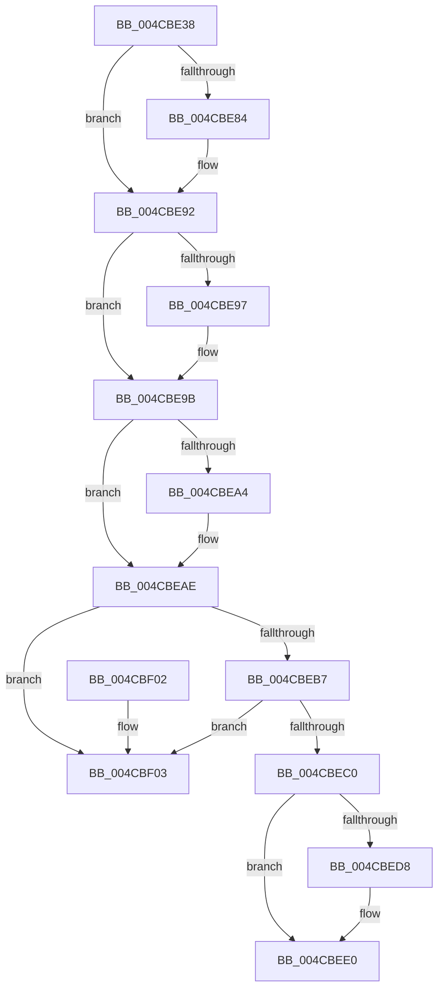

# PopPepRemoveDevice

- RVA: `0x004CBE38`–`0x004CBF0A` (길이 `210` bytes)
- VA: `0x00000001404CBE38`
- 실행 섹션: `.text`
- PDB 이름 있음: `예`; PDB Function 태그: `아니요`
- unwind 정보 RVA: `0x00069AD0`
- 디코드: `55`개 명령, `210/210` bytes 표시
- 미해석 바이트: `0` (있으면 어셈블리에 `.byte`로 보존)

> 이 문서는 커널 이미지의 기계어와 PDB 기호를 분석해 생성했습니다. 4번과 5번은 함수 원형과 자료형을 바이너리 사용 방식에서 추정한 C 해석이며 원본 소스 복구 결과는 아닙니다.

## 1. Dependencies

- 직접 호출 지점: **5**; 고유 호출 대상: **5**
- 직접 호출자로 확인된 함수: **1**
- RIP 상대 이미지 참조: **4**

### Outgoing calls
- `0x004CBE73` → [KeAbPreAcquire](../21/KeAbPreAcquire_function_00210230.md) (function, `0x00210230`)
- `0x004CBE8D` → [ExfAcquirePushLockExclusiveEx](../20/ExfAcquirePushLockExclusiveEx_function_0020FC90.md) (function, `0x0020FC90`)
- `0x004CBEDB` → [ExfTryToWakePushLock](../26/ExfTryToWakePushLock_function_00265DD0.md) (function, `0x00265DD0`)
- `0x004CBEE3` → [KeAbPostRelease](../2E/KeAbPostRelease_function_002E1600.md) (function, `0x002E1600`)
- `0x004CBEE8` → [KeLeaveCriticalRegion](../25/KeLeaveCriticalRegion_function_0025D8B0.md) (function, `0x0025D8B0`)

### Direct callers
- [PopPepUnregisterDevice](../../page/A8/PopPepUnregisterDevice_function_00A8B048.md) at `0x00A8B0A8`

### Static image references
- `0x004CBE55` → RVA `0x00F07678` (`.data`; read)
- `0x004CBE9B` → RVA `0x00E08388` (`.data`; read)
- `0x004CBEA7` → RVA `0x00E08388` (`.data`; write)
- `0x004CBEC7` → RVA `0x00F07678` (`.data`; read/write)

## 2. Other-region calls and transfers

- 다른 실행 섹션으로 향하는 call: **0**
- 별도 외부 분기/꼬리 이동을 확인하지 못했습니다.

## 3. Assembly (complete function range)

```asm
004CBE38  48 89 5C 24 08                  mov qword ptr [rsp + 8], rbx
004CBE3D  48 89 6C 24 10                  mov qword ptr [rsp + 0x10], rbp
004CBE42  48 89 74 24 18                  mov qword ptr [rsp + 0x18], rsi
004CBE47  57                              push rdi
004CBE48  48 83 EC 20                     sub rsp, 0x20
004CBE4C  65 48 8B 04 25 88 01 00 00      mov rax, qword ptr gs:[0x188]
004CBE55  48 8D 2D 1C B8 A3 00            lea rbp, [rip + 0xa3b81c]
004CBE5C  48 8B F9                        mov rdi, rcx
004CBE5F  48 83 CB FF                     or rbx, 0xffffffffffffffff
004CBE63  45 33 C0                        xor r8d, r8d
004CBE66  33 D2                           xor edx, edx
004CBE68  48 8B CD                        mov rcx, rbp
004CBE6B  66 01 98 E4 01 00 00            add word ptr [rax + 0x1e4], bx
004CBE72  90                              nop
004CBE73  E8 B8 43 D4 FF                  call 0x140210230
004CBE78  F0 48 0F BA 6D 00 00            lock bts qword ptr [rbp], 0
004CBE7F  48 8B F0                        mov rsi, rax
004CBE82  73 0E                           jae 0x1404cbe92
004CBE84  4C 8B C5                        mov r8, rbp
004CBE87  48 8B D0                        mov rdx, rax
004CBE8A  48 8B CD                        mov rcx, rbp
004CBE8D  E8 FE 3D D4 FF                  call 0x14020fc90
004CBE92  48 85 F6                        test rsi, rsi
004CBE95  74 04                           je 0x1404cbe9b
004CBE97  C6 46 0A 01                     mov byte ptr [rsi + 0xa], 1
004CBE9B  48 39 3D E6 C4 93 00            cmp qword ptr [rip + 0x93c4e6], rdi
004CBEA2  75 0A                           jne 0x1404cbeae
004CBEA4  48 8B 07                        mov rax, qword ptr [rdi]
004CBEA7  48 89 05 DA C4 93 00            mov qword ptr [rip + 0x93c4da], rax
004CBEAE  48 8B 17                        mov rdx, qword ptr [rdi]
004CBEB1  48 39 7A 08                     cmp qword ptr [rdx + 8], rdi
004CBEB5  75 4C                           jne 0x1404cbf03
004CBEB7  48 8B 47 08                     mov rax, qword ptr [rdi + 8]
004CBEBB  48 39 38                        cmp qword ptr [rax], rdi
004CBEBE  75 43                           jne 0x1404cbf03
004CBEC0  48 89 10                        mov qword ptr [rax], rdx
004CBEC3  48 89 42 08                     mov qword ptr [rdx + 8], rax
004CBEC7  F0 48 0F C1 1D A8 B7 A3 00      lock xadd qword ptr [rip + 0xa3b7a8], rbx
004CBED0  80 E3 06                        and bl, 6
004CBED3  80 FB 02                        cmp bl, 2
004CBED6  75 08                           jne 0x1404cbee0
004CBED8  48 8B CD                        mov rcx, rbp
004CBEDB  E8 F0 9E D9 FF                  call 0x140265dd0
004CBEE0  48 8B CD                        mov rcx, rbp
004CBEE3  E8 18 57 E1 FF                  call 0x1402e1600
004CBEE8  E8 C3 19 D9 FF                  call 0x14025d8b0
004CBEED  48 8B 5C 24 30                  mov rbx, qword ptr [rsp + 0x30]
004CBEF2  48 8B 6C 24 38                  mov rbp, qword ptr [rsp + 0x38]
004CBEF7  48 8B 74 24 40                  mov rsi, qword ptr [rsp + 0x40]
004CBEFC  48 83 C4 20                     add rsp, 0x20
004CBF00  5F                              pop rdi
004CBF01  C3                              ret
004CBF02  CC                              int3
004CBF03  B9 03 00 00 00                  mov ecx, 3
004CBF08  CD 29                           int 0x29
```

## 4. C-style interpretation (structured pseudocode)

```c
__int64 __fastcall PopPepRemoveDevice(__int64 a1, int a2, int a3)
{
    __int64 result;
    __int64 v_rbx;
    __int64 v_rsp;
    unsigned __int64 v_stack_p10;
    unsigned __int64 v_stack_p18;
    unsigned __int64 v_stack_p8;

    v_stack_p8 = v_rbx;
    v_stack_p10 = v_rbp;
    v_stack_p18 = v_rsi;
    v_rsp = (v_rsp) - (32);
    v_rbx = (v_rbx) | (-1);
    a3 = 0;
    a2 = 0;
    result = KeAbPreAcquire(v_rip + 10729500, a2, a3, a4);
    if (!(condition_is_above_or_equal)) {
        a3 = v_rip + 10729500;
        a2 = result;
        a1 = v_rip + 10729500;
        result = ExfAcquirePushLockExclusiveEx(a1, a2, a3, a4);
    }
    if (result != 0) {
        *(unsigned __int8 *)(result + 10) = 1;
    }
    if ((*(unsigned __int64 *)(v_rip + 9684198)) == a1) {
        result = *(unsigned __int64 *)(a1);
        *(unsigned __int64 *)(v_rip + 9684186) = result;
    }
    if ((*(unsigned __int64 *)(*(unsigned __int64 *)(a1) + 8)) != a1) goto loc_004CBF03;
    if ((*(unsigned __int64 *)(*(unsigned __int64 *)(a1 + 8))) != a1) goto loc_004CBF03;
    *(unsigned __int64 *)(*(unsigned __int64 *)(a1 + 8)) = *(unsigned __int64 *)(a1);
    *(unsigned __int64 *)(*(unsigned __int64 *)(a1) + 8) = *(unsigned __int64 *)(a1 + 8);
    v_rbx = (unsigned __int8)((v_rbx) & (6));
    result = *(unsigned __int64 *)(a1 + 8);
    if (((unsigned __int8)(v_rbx)) == 2) {
        a1 = v_rip + 10729500;
        result = ExfTryToWakePushLock(a1, *(unsigned __int64 *)(a1), a3, a4);
    }
    result = KeAbPostRelease(v_rip + 10729500, *(unsigned __int64 *)(a1), a3, a4);
    result = KeLeaveCriticalRegion(v_rip + 10729500, *(unsigned __int64 *)(a1), a3, a4);
    v_rsp = (v_rsp) + (32);
    return result;
loc_004CBF03:
    return result;
}
```

## 5. (Beta) C Style

```c
int64_t PopPepRemoveDevice(void *Arg1, int32_t Arg2, int32_t Arg3)
{
    uint8_t *arg1 = (uint8_t *)Arg1;

    int64_t result;
    int64_t local_rbx;
    int64_t local_rsp;
    uint64_t v_stack_p10;
    uint64_t v_stack_p18;
    uint64_t v_stack_p8;

    v_stack_p8 = local_rbx;
    v_stack_p10 = local_rbp;
    v_stack_p18 = local_rsi;
    local_rsp = (local_rsp) - (32);
    local_rbx = (local_rbx) | (-1);
    Arg3 = 0;
    Arg2 = 0;
    result = KeAbPreAcquire(v_rip + 10729500, Arg2, Arg3, a4);
    if (!(condition_is_above_or_equal)) {
        Arg3 = v_rip + 10729500;
        Arg2 = result;
        Arg1 = v_rip + 10729500;
        result = ExfAcquirePushLockExclusiveEx(Arg1, Arg2, Arg3, a4);
    }
    if (result != 0) {
        *(uint8_t *)(result + 0xA) = 1;
    }
    if ((*(uint64_t *)(v_rip + 0x93C4E6)) == Arg1) {
        result = *(uint64_t *)(arg1);
        *(uint64_t *)(v_rip + 0x93C4DA) = result;
    }
    if ((*(uint64_t *)(*(uint64_t *)(arg1) + 0x8)) != Arg1) goto loc_004CBF03;
    if ((*(uint64_t *)(*(uint64_t *)(arg1 + 0x8))) != Arg1) goto loc_004CBF03;
    *(uint64_t *)(*(uint64_t *)(arg1 + 0x8)) = *(uint64_t *)(arg1);
    *(uint64_t *)(*(uint64_t *)(arg1) + 0x8) = *(uint64_t *)(arg1 + 0x8);
    local_rbx = (uint8_t)((local_rbx) & (6));
    result = *(uint64_t *)(arg1 + 0x8);
    if (((uint8_t)(local_rbx)) == 2) {
        Arg1 = v_rip + 10729500;
        result = ExfTryToWakePushLock(Arg1, *(uint64_t *)(arg1), Arg3, a4);
    }
    result = KeAbPostRelease(v_rip + 10729500, *(uint64_t *)(arg1), Arg3, a4);
    result = KeLeaveCriticalRegion(v_rip + 10729500, *(uint64_t *)(arg1), Arg3, a4);
    local_rsp = (local_rsp) + (32);
    return result;
loc_004CBF03:
    return result;
}
```

### 관측된 메모리 오프셋

구조체 형식이 확인되지 않은 접근은 인자 기준의 오프셋으로만 기록했습니다.

| 기준 인자 | 오프셋 표현 | 폭 (bit) | 접근 |
|---|---:|---:|---|
| `Arg1` | `+ 0x0` | `64` | `R` |
| `Arg1` | `+ 0x8` | `64` | `R` |

## 6. Execution-region graph

[열기: 2D/3D 그래프와 함수 탐색 컨트롤 패널](../../../control-panel.html?section=text&rva=0x004CBE38&view=graph)

- 2D 그래프는 위에서 아래로 흐르고, 3D 그래프는 빈 공간을 드래그해 회전합니다. Shift+드래그는 이동, 휠은 확대·축소, 함수 노드 선택은 대상 보고서 이동입니다.

### Static fallback


