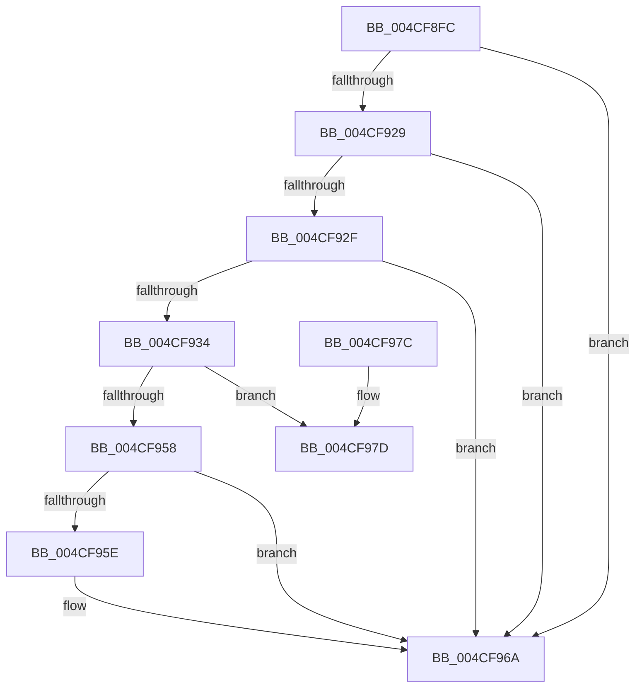

# PopPluginRegisterDevice

- RVA: `0x004CF8FC`–`0x004CF992` (길이 `150` bytes)
- VA: `0x00000001404CF8FC`
- 실행 섹션: `.text`
- PDB 이름 있음: `예`; PDB Function 태그: `아니요`
- unwind 정보 RVA: `0x000BDAC4`
- 디코드: `45`개 명령, `150/150` bytes 표시
- 미해석 바이트: `0` (있으면 어셈블리에 `.byte`로 보존)

> 이 문서는 커널 이미지의 기계어와 PDB 기호를 분석해 생성했습니다. 4번과 5번은 함수 원형과 자료형을 바이너리 사용 방식에서 추정한 C 해석이며 원본 소스 복구 결과는 아닙니다.

## 1. Dependencies

- 직접 호출 지점: **2**; 고유 호출 대상: **2**
- 직접 호출자로 확인된 함수: **1**
- RIP 상대 이미지 참조: **0**

### Outgoing calls
- `0x004CF94F` → [guard_dispatch_icall](../6B/guard_dispatch_icall_function_006BAAD0.md) (function, `0x006BAAD0`)
- `0x004CF98C` → [PopFxBugCheck](../2B/PopFxBugCheck_function_002BFC6C.md) (function, `0x002BFC6C`)

### Direct callers
- [PopFxRegisterDeviceWithPep](PopFxRegisterDeviceWithPep_function_004CF794.md) at `0x004CF7D0`
- [PopFxRegisterDeviceWithPep](PopFxRegisterDeviceWithPep_function_004CF794.md) at `0x004CF865`

### Static image references
- 디코드된 RIP-relative 메모리 참조가 없습니다.

## 2. Other-region calls and transfers

- 다른 실행 섹션으로 향하는 call: **0**
- 별도 외부 분기/꼬리 이동을 확인하지 못했습니다.

## 3. Assembly (complete function range)

```asm
004CF8FC  4C 8B DC                        mov r11, rsp
004CF8FF  49 89 5B 08                     mov qword ptr [r11 + 8], rbx
004CF903  49 89 73 10                     mov qword ptr [r11 + 0x10], rsi
004CF907  57                              push rdi
004CF908  48 83 EC 50                     sub rsp, 0x50
004CF90C  48 8B B4 24 88 00 00 00         mov rsi, qword ptr [rsp + 0x88]
004CF914  33 DB                           xor ebx, ebx
004CF916  48 8B 41 60                     mov rax, qword ptr [rcx + 0x60]
004CF91A  48 8B F9                        mov rdi, rcx
004CF91D  89 5C 24 44                     mov dword ptr [rsp + 0x44], ebx
004CF921  48 89 1E                        mov qword ptr [rsi], rbx
004CF924  48 85 C0                        test rax, rax
004CF927  74 41                           je 0x1404cf96a
004CF929  83 79 10 02                     cmp dword ptr [rcx + 0x10], 2
004CF92D  72 3B                           jb 0x1404cf96a
004CF92F  4D 85 C9                        test r9, r9
004CF932  74 36                           je 0x1404cf96a
004CF934  49 89 53 C8                     mov qword ptr [r11 - 0x38], rdx
004CF938  8D 4B 03                        lea ecx, [rbx + 3]
004CF93B  4D 89 43 D0                     mov qword ptr [r11 - 0x30], r8
004CF93F  49 8D 53 C8                     lea rdx, [r11 - 0x38]
004CF943  4D 89 4B D8                     mov qword ptr [r11 - 0x28], r9
004CF947  49 89 5B E0                     mov qword ptr [r11 - 0x20], rbx
004CF94B  89 5C 24 40                     mov dword ptr [rsp + 0x40], ebx
004CF94F  E8 7C B1 1E 00                  call 0x1406baad0
004CF954  84 C0                           test al, al
004CF956  74 25                           je 0x1404cf97d
004CF958  39 5C 24 40                     cmp dword ptr [rsp + 0x40], ebx
004CF95C  74 0C                           je 0x1404cf96a
004CF95E  48 8B 44 24 38                  mov rax, qword ptr [rsp + 0x38]
004CF963  8B 5C 24 40                     mov ebx, dword ptr [rsp + 0x40]
004CF967  48 89 06                        mov qword ptr [rsi], rax
004CF96A  48 8B 74 24 68                  mov rsi, qword ptr [rsp + 0x68]
004CF96F  8B C3                           mov eax, ebx
004CF971  48 8B 5C 24 60                  mov rbx, qword ptr [rsp + 0x60]
004CF976  48 83 C4 50                     add rsp, 0x50
004CF97A  5F                              pop rdi
004CF97B  C3                              ret
004CF97C  CC                              int3
004CF97D  45 33 C9                        xor r9d, r9d
004CF980  4C 8B C7                        mov r8, rdi
004CF983  B9 05 06 00 00                  mov ecx, 0x605
004CF988  41 8D 51 03                     lea edx, [r9 + 3]
004CF98C  E8 DB 02 DF FF                  call 0x1402bfc6c
004CF991  CC                              int3
```

## 4. C-style interpretation (structured pseudocode)

```c
__int64 __fastcall PopPluginRegisterDevice(__int64 a1, __int64 a2, __int64 a3, __int64 a4, __int64 a5, __int64 a6)
{
    __int64 result;
    __int64 v_rbx;
    __int64 v_rsp;
    unsigned int v_stack_m14;
    unsigned int v_stack_m18;
    unsigned __int64 v_stack_m20;
    unsigned __int64 v_stack_p10;
    unsigned __int64 v_stack_p8;

    *(unsigned __int64 *)(v_rsp + 8) = v_rbx;
    *(unsigned __int64 *)(v_rsp + 16) = v_rsi;
    v_rsp = (v_rsp) - (80);
    v_rbx = 0;
    v_stack_m14 = 0;
    *(unsigned __int64 *)(a6) = 0;
    if (*(unsigned __int64 *)(a1 + 96) == 0) goto loc_004CF96A;
    if ((*(unsigned int *)(a1 + 16)) < 2) goto loc_004CF96A;
    if (a4 == 0) goto loc_004CF96A;
    *(unsigned __int64 *)(v_rsp - 56) = a2;
    *(unsigned __int64 *)(v_rsp - 48) = a3;
    *(unsigned __int64 *)(v_rsp - 40) = a4;
    *(unsigned __int64 *)(v_rsp - 32) = 0;
    v_stack_m18 = 0;
    result = guard_dispatch_icall(v_rbx + 3, v_rsp - 56, a3, a4);
    if ((unsigned __int8)(result) == 0) goto loc_004CF97D;
    if (v_stack_m18 != 0) {
        result = v_stack_m20;
        v_rbx = v_stack_m18;
        *(unsigned __int64 *)(a6) = result;
    }
    v_rsp = (v_rsp) + (80);
    return (unsigned int)((unsigned int)(v_rbx));
loc_004CF97D:
    a4 = 0;
    result = PopFxBugCheck((unsigned int)(0x605ULL), a4 + 3, a1, a4);
    return result;
}
```

## 5. (Beta) C Style

```c
int64_t PopPluginRegisterDevice(void *Arg1, int64_t Arg2, int64_t Arg3, int64_t Arg4, uint64_t Arg5, void *Arg6)
{
    uint8_t *arg1 = (uint8_t *)Arg1;
    uint8_t *arg6 = (uint8_t *)Arg6;

    int64_t result;
    int64_t local_rbx;
    int64_t local_rsp;
    uint32_t v_stack_m14;
    uint32_t v_stack_m18;
    uint64_t v_stack_m20;
    uint64_t v_stack_p10;
    uint64_t v_stack_p8;

    *(uint64_t *)(local_rsp + 0x8) = local_rbx;
    *(uint64_t *)(local_rsp + 0x10) = local_rsi;
    local_rsp = (local_rsp) - (80);
    local_rbx = 0;
    v_stack_m14 = 0;
    *(uint64_t *)(arg6) = 0;
    if (*(uint64_t *)(arg1 + 0x60) == 0) goto loc_004CF96A;
    if ((*(uint32_t *)(arg1 + 0x10)) < 2) goto loc_004CF96A;
    if (Arg4 == 0) goto loc_004CF96A;
    *(uint64_t *)(local_rsp - 0x38) = Arg2;
    *(uint64_t *)(local_rsp - 0x30) = Arg3;
    *(uint64_t *)(local_rsp - 0x28) = Arg4;
    *(uint64_t *)(local_rsp - 0x20) = 0;
    v_stack_m18 = 0;
    result = guard_dispatch_icall(local_rbx + 3, local_rsp - 56, Arg3, Arg4);
    if ((uint8_t)(result) == 0) goto loc_004CF97D;
    if (v_stack_m18 != 0) {
        result = v_stack_m20;
        local_rbx = v_stack_m18;
        *(uint64_t *)(arg6) = result;
    }
    local_rsp = (local_rsp) + (80);
    return (uint32_t)((uint32_t)(local_rbx));
loc_004CF97D:
    Arg4 = 0;
    result = PopFxBugCheck((uint32_t)(0x605ULL), Arg4 + 3, Arg1, Arg4);
    return result;
}
```

### 관측된 메모리 오프셋

구조체 형식이 확인되지 않은 접근은 인자 기준의 오프셋으로만 기록했습니다.

| 기준 인자 | 오프셋 표현 | 폭 (bit) | 접근 |
|---|---:|---:|---|
| `Arg1` | `+ 0x10` | `32` | `R` |
| `Arg1` | `+ 0x60` | `64` | `R` |
| `Arg6` | `+ 0x0` | `64` | `W` |

## 6. Execution-region graph

[열기: 2D/3D 그래프와 함수 탐색 컨트롤 패널](../../../control-panel.html?section=text&rva=0x004CF8FC&view=graph)

- 2D 그래프는 위에서 아래로 흐르고, 3D 그래프는 빈 공간을 드래그해 회전합니다. Shift+드래그는 이동, 휠은 확대·축소, 함수 노드 선택은 대상 보고서 이동입니다.

### Static fallback


