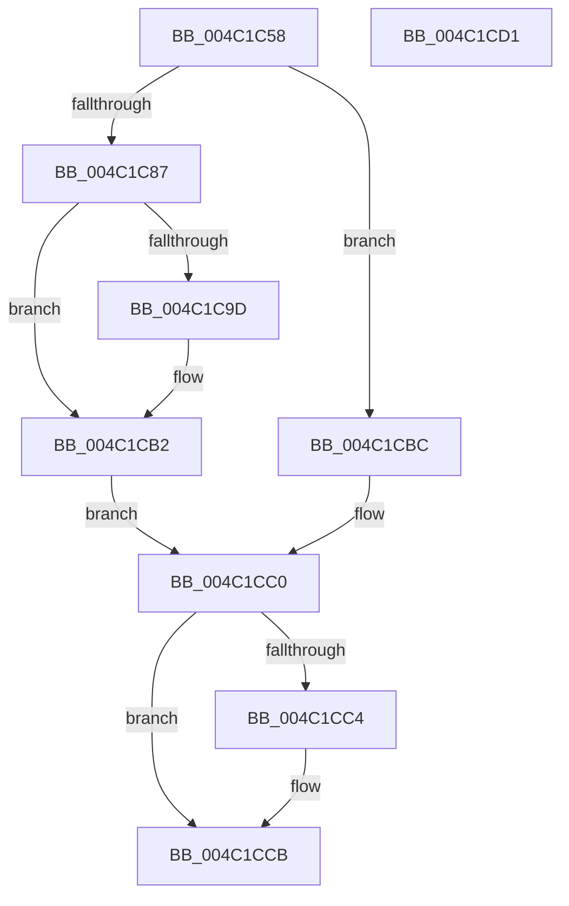

# PopPluginRequestComponentPerfState

- RVA: `0x004C1C58`–`0x004C1CD2` (길이 `122` bytes)
- VA: `0x00000001404C1C58`
- 실행 섹션: `.text`
- PDB 이름 있음: `예`; PDB Function 태그: `아니요`
- unwind 정보 RVA: `0x0007F554`
- 디코드: `38`개 명령, `122/122` bytes 표시
- 미해석 바이트: `0` (있으면 어셈블리에 `.byte`로 보존)

> 이 문서는 커널 이미지의 기계어와 PDB 기호를 분석해 생성했습니다. 4번과 5번은 함수 원형과 자료형을 바이너리 사용 방식에서 추정한 C 해석이며 원본 소스 복구 결과는 아닙니다.

## 1. Dependencies

- 직접 호출 지점: **2**; 고유 호출 대상: **2**
- 직접 호출자로 확인된 함수: **1**
- RIP 상대 이미지 참조: **0**

### Outgoing calls
- `0x004C1C94` → [guard_dispatch_icall](../6B/guard_dispatch_icall_function_006BAAD0.md) (function, `0x006BAAD0`)
- `0x004C1CAC` → [PopFxBugCheck](../2B/PopFxBugCheck_function_002BFC6C.md) (function, `0x002BFC6C`)

### Direct callers
- [PopFxIssueComponentPerfStateChanges](PopFxIssueComponentPerfStateChanges_function_004C1940.md) at `0x004C1A86`

### Static image references
- 디코드된 RIP-relative 메모리 참조가 없습니다.

## 2. Other-region calls and transfers

- 다른 실행 섹션으로 향하는 call: **0**
- 별도 외부 분기/꼬리 이동을 확인하지 못했습니다.

## 3. Assembly (complete function range)

```asm
004C1C58  4C 8B DC                        mov r11, rsp
004C1C5B  53                              push rbx
004C1C5C  48 83 EC 40                     sub rsp, 0x40
004C1C60  83 64 24 2C 00                  and dword ptr [rsp + 0x2c], 0
004C1C65  83 64 24 34 00                  and dword ptr [rsp + 0x34], 0
004C1C6A  48 8B 41 48                     mov rax, qword ptr [rcx + 0x48]
004C1C6E  48 8B 59 40                     mov rbx, qword ptr [rcx + 0x40]
004C1C72  49 89 43 D8                     mov qword ptr [r11 - 0x28], rax
004C1C76  89 54 24 28                     mov dword ptr [rsp + 0x28], edx
004C1C7A  45 89 43 E8                     mov dword ptr [r11 - 0x18], r8d
004C1C7E  4D 89 4B F0                     mov qword ptr [r11 - 0x10], r9
004C1C82  48 85 DB                        test rbx, rbx
004C1C85  74 35                           je 0x1404c1cbc
004C1C87  48 8B 43 60                     mov rax, qword ptr [rbx + 0x60]
004C1C8B  49 8D 53 D8                     lea rdx, [r11 - 0x28]
004C1C8F  B9 21 00 00 00                  mov ecx, 0x21
004C1C94  E8 37 8E 1F 00                  call 0x1406baad0
004C1C99  84 C0                           test al, al
004C1C9B  75 15                           jne 0x1404c1cb2
004C1C9D  45 33 C9                        xor r9d, r9d
004C1CA0  4C 8B C3                        mov r8, rbx
004C1CA3  B9 05 06 00 00                  mov ecx, 0x605
004C1CA8  41 8D 51 21                     lea edx, [r9 + 0x21]
004C1CAC  E8 BB DF DF FF                  call 0x1402bfc6c
004C1CB1  CC                              int3
004C1CB2  8A 54 24 2D                     mov dl, byte ptr [rsp + 0x2d]
004C1CB6  8A 44 24 2C                     mov al, byte ptr [rsp + 0x2c]
004C1CBA  EB 04                           jmp 0x1404c1cc0
004C1CBC  B2 01                           mov dl, 1
004C1CBE  8A C2                           mov al, dl
004C1CC0  84 C0                           test al, al
004C1CC2  74 07                           je 0x1404c1ccb
004C1CC4  48 8B 4C 24 70                  mov rcx, qword ptr [rsp + 0x70]
004C1CC9  88 11                           mov byte ptr [rcx], dl
004C1CCB  48 83 C4 40                     add rsp, 0x40
004C1CCF  5B                              pop rbx
004C1CD0  C3                              ret
004C1CD1  CC                              int3
```

## 4. C-style interpretation (structured pseudocode)

```c
__int64 __fastcall PopPluginRequestComponentPerfState(__int64 a1, int a2, int a3, __int64 a4, __int64 a5)
{
    __int64 result;
    __int64 v_rsp;
    unsigned int v_stack_m14;
    unsigned __int8 v_stack_m1B;
    unsigned int v_stack_m1C;
    unsigned int v_stack_m20;

    v_rsp = (v_rsp) - (64);
    *(unsigned __int64 *)(v_rsp - 40) = *(unsigned __int64 *)(a1 + 72);
    v_stack_m20 = a2;
    *(unsigned int *)(v_rsp - 24) = a3;
    *(unsigned __int64 *)(v_rsp - 16) = a4;
    if (*(unsigned __int64 *)(a1 + 64) == 0) goto loc_004C1CBC;
    result = guard_dispatch_icall(33, v_rsp - 40, a3, a4);
    if ((unsigned __int8)(result) == 0) {
        a4 = 0;
        a3 = *(unsigned __int64 *)(a1 + 64);
        a1 = 0x605ULL;
        a2 = a4 + 33;
        result = PopFxBugCheck(a1, a2, a3, a4);
    }
    goto loc_004C1CC0;
loc_004C1CBC:
loc_004C1CC0:
    if (1 != 0) {
        a1 = a5;
        *(unsigned __int8 *)(a1) = 1;
    }
    v_rsp = (v_rsp) + (64);
    return 1;
}
```

## 5. (Beta) C Style

```c
int64_t PopPluginRequestComponentPerfState(void *Arg1, int32_t Arg2, int32_t Arg3, int64_t Arg4, void *Arg5)
{
    uint8_t *arg1 = (uint8_t *)Arg1;
    uint8_t *arg5 = (uint8_t *)Arg5;

    int64_t result;
    int64_t local_rsp;
    uint32_t v_stack_m14;
    uint8_t v_stack_m1B;
    uint32_t v_stack_m1C;
    uint32_t v_stack_m20;

    local_rsp = (local_rsp) - (64);
    *(uint64_t *)(local_rsp - 0x28) = *(uint64_t *)(arg1 + 0x48);
    v_stack_m20 = Arg2;
    *(uint32_t *)(local_rsp - 0x18) = Arg3;
    *(uint64_t *)(local_rsp - 0x10) = Arg4;
    if (*(uint64_t *)(arg1 + 0x40) == 0) goto loc_004C1CBC;
    result = guard_dispatch_icall(33, local_rsp - 40, Arg3, Arg4);
    if ((uint8_t)(result) == 0) {
        Arg4 = 0;
        Arg3 = *(uint64_t *)(arg1 + 0x40);
        Arg1 = 0x605ULL;
        Arg2 = Arg4 + 33;
        result = PopFxBugCheck(Arg1, Arg2, Arg3, Arg4);
    }
    goto loc_004C1CC0;
loc_004C1CBC:
loc_004C1CC0:
    if (1 != 0) {
        Arg1 = Arg5;
        *(uint8_t *)(arg1) = 1;
    }
    local_rsp = (local_rsp) + (64);
    return 1;
}
```

### 관측된 메모리 오프셋

구조체 형식이 확인되지 않은 접근은 인자 기준의 오프셋으로만 기록했습니다.

| 기준 인자 | 오프셋 표현 | 폭 (bit) | 접근 |
|---|---:|---:|---|
| `Arg1` | `+ 0x40` | `64` | `R` |
| `Arg1` | `+ 0x48` | `64` | `R` |
| `Arg5` | `+ 0x0` | `8` | `W` |

## 6. Execution-region graph

[열기: 2D/3D 그래프와 함수 탐색 컨트롤 패널](../../../control-panel.html?section=text&rva=0x004C1C58&view=graph)

- 2D 그래프는 위에서 아래로 흐르고, 3D 그래프는 빈 공간을 드래그해 회전합니다. Shift+드래그는 이동, 휠은 확대·축소, 함수 노드 선택은 대상 보고서 이동입니다.

### Static fallback


