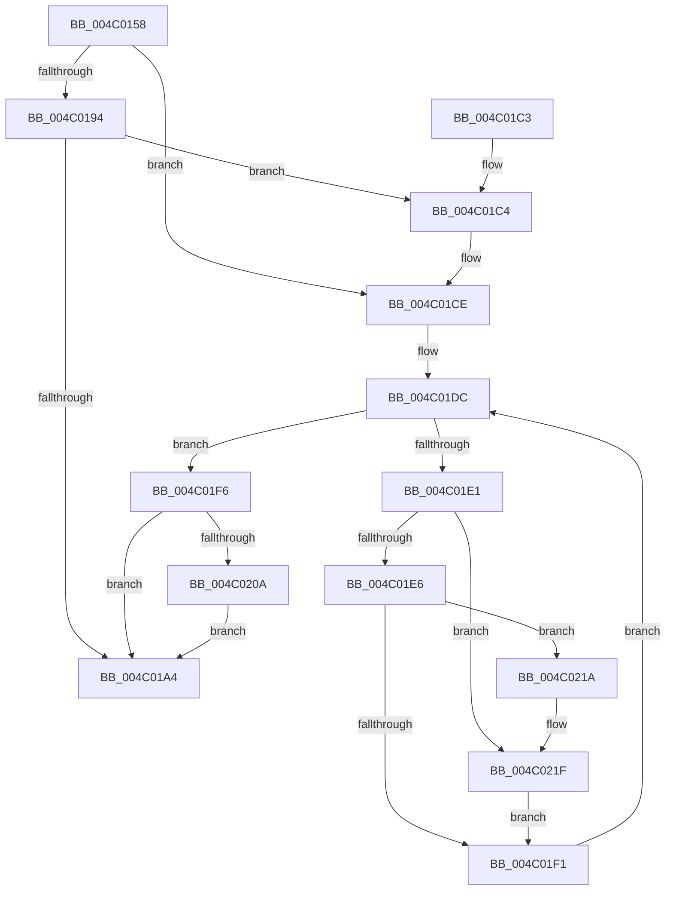

# PopPowerRequestRevokeRequests

- RVA: `0x004C0158`–`0x004C022B` (길이 `211` bytes)
- VA: `0x00000001404C0158`
- 실행 섹션: `.text`
- PDB 이름 있음: `예`; PDB Function 태그: `아니요`
- unwind 정보 RVA: `0x000878D0`
- 디코드: `61`개 명령, `211/211` bytes 표시
- 미해석 바이트: `0` (있으면 어셈블리에 `.byte`로 보존)

> 이 문서는 커널 이미지의 기계어와 PDB 기호를 분석해 생성했습니다. 4번과 5번은 함수 원형과 자료형을 바이너리 사용 방식에서 추정한 C 해석이며 원본 소스 복구 결과는 아닙니다.

## 1. Dependencies

- 직접 호출 지점: **4**; 고유 호출 대상: **4**
- 직접 호출자로 확인된 함수: **3**
- RIP 상대 이미지 참조: **6**

### Outgoing calls
- `0x004C018A` → [KeAcquireInStackQueuedSpinLock](../27/KeAcquireInStackQueuedSpinLock_function_002757A0.md) (function, `0x002757A0`)
- `0x004C01A9` → [KeReleaseInStackQueuedSpinLock](../34/KeReleaseInStackQueuedSpinLock_function_00342CE0.md) (function, `0x00342CE0`)
- `0x004C0213` → [ExQueueWorkItem](../2F/ExQueueWorkItem_function_002F9520.md) (function, `0x002F9520`)
- `0x004C0224` → [PopPowerRequestEvaluatePendingRequestStatus](../47/PopPowerRequestEvaluatePendingRequestStatus_function_00477914.md) (function, `0x00477914`)

### Direct callers
- [PopPowerRequestHandleExecutionEnablementUpdate](../../page/A4/PopPowerRequestHandleExecutionEnablementUpdate_function_00A4A624.md) at `0x00A4A64A`
- [PopPowerRequestRevokeRequestsForSleep](../../page/AC/PopPowerRequestRevokeRequestsForSleep_function_00AC68AC.md) at `0x00AC68C3`
- [PopPowerRequestNotifyTtmSessionUninitialized](../../page/AD/PopPowerRequestNotifyTtmSessionUninitialized_function_00AD2B30.md) at `0x00AD2B45`

### Static image references
- `0x004C017A` → RVA `0x00F0ED30` (`.data`; read)
- `0x004C0194` → RVA `0x00F0EE28` (`.data`; read)
- `0x004C01C7` → RVA `0x00F0EE28` (`.data`; write)
- `0x004C01CE` → RVA `0x00F0ED40` (`.data`; read)
- `0x004C01FB` → RVA `0x00F0EDA0` (`.data`; read/write)
- `0x004C020C` → RVA `0x00F0ED80` (`.data`; read)

## 2. Other-region calls and transfers

- 다른 실행 섹션으로 향하는 call: **0**
- 별도 외부 분기/꼬리 이동을 확인하지 못했습니다.

## 3. Assembly (complete function range)

```asm
004C0158  4C 8B DC                        mov r11, rsp
004C015B  49 89 5B 08                     mov qword ptr [r11 + 8], rbx
004C015F  49 89 6B 10                     mov qword ptr [r11 + 0x10], rbp
004C0163  49 89 73 18                     mov qword ptr [r11 + 0x18], rsi
004C0167  57                              push rdi
004C0168  48 83 EC 40                     sub rsp, 0x40
004C016C  0F 57 C0                        xorps xmm0, xmm0
004C016F  40 8A F2                        mov sil, dl
004C0172  8B F9                           mov edi, ecx
004C0174  49 8D 53 D8                     lea rdx, [r11 - 0x28]
004C0178  33 C0                           xor eax, eax
004C017A  48 8D 0D AF EB A4 00            lea rcx, [rip + 0xa4ebaf]
004C0181  0F 11 44 24 20                  movups xmmword ptr [rsp + 0x20], xmm0
004C0186  49 89 43 E8                     mov qword ptr [r11 - 0x18], rax
004C018A  E8 11 56 DB FF                  call 0x1402757a0
004C018F  40 84 F6                        test sil, sil
004C0192  75 3A                           jne 0x1404c01ce
004C0194  44 8B 05 8D EC A4 00            mov r8d, dword ptr [rip + 0xa4ec8d]
004C019B  41 8B C0                        mov eax, r8d
004C019E  F7 D0                           not eax
004C01A0  23 F8                           and edi, eax
004C01A2  75 20                           jne 0x1404c01c4
004C01A4  48 8D 4C 24 20                  lea rcx, [rsp + 0x20]
004C01A9  E8 32 2B E8 FF                  call 0x140342ce0
004C01AE  48 8B 5C 24 50                  mov rbx, qword ptr [rsp + 0x50]
004C01B3  48 8B 6C 24 58                  mov rbp, qword ptr [rsp + 0x58]
004C01B8  48 8B 74 24 60                  mov rsi, qword ptr [rsp + 0x60]
004C01BD  48 83 C4 40                     add rsp, 0x40
004C01C1  5F                              pop rdi
004C01C2  C3                              ret
004C01C3  CC                              int3
004C01C4  44 0B C7                        or r8d, edi
004C01C7  44 89 05 5A EC A4 00            mov dword ptr [rip + 0xa4ec5a], r8d
004C01CE  48 8B 1D 6B EB A4 00            mov rbx, qword ptr [rip + 0xa4eb6b]
004C01D5  48 8D 2D 64 EB A4 00            lea rbp, [rip + 0xa4eb64]
004C01DC  48 3B DD                        cmp rbx, rbp
004C01DF  74 15                           je 0x1404c01f6
004C01E1  40 84 F6                        test sil, sil
004C01E4  74 39                           je 0x1404c021f
004C01E6  8B 4B 1C                        mov ecx, dword ptr [rbx + 0x1c]
004C01E9  8B C1                           mov eax, ecx
004C01EB  23 C7                           and eax, edi
004C01ED  3B C7                           cmp eax, edi
004C01EF  75 29                           jne 0x1404c021a
004C01F1  48 8B 1B                        mov rbx, qword ptr [rbx]
004C01F4  EB E6                           jmp 0x1404c01dc
004C01F6  B8 01 00 00 00                  mov eax, 1
004C01FB  F0 0F C1 05 9D EB A4 00         lock xadd dword ptr [rip + 0xa4eb9d], eax
004C0203  FF C0                           inc eax
004C0205  83 F8 01                        cmp eax, 1
004C0208  75 9A                           jne 0x1404c01a4
004C020A  33 D2                           xor edx, edx
004C020C  48 8D 0D 6D EB A4 00            lea rcx, [rip + 0xa4eb6d]
004C0213  E8 08 93 E3 FF                  call 0x1402f9520
004C0218  EB 8A                           jmp 0x1404c01a4
004C021A  0B CF                           or ecx, edi
004C021C  89 4B 1C                        mov dword ptr [rbx + 0x1c], ecx
004C021F  33 D2                           xor edx, edx
004C0221  48 8B CB                        mov rcx, rbx
004C0224  E8 EB 76 FB FF                  call 0x140477914
004C0229  EB C6                           jmp 0x1404c01f1
```

## 4. C-style interpretation (structured pseudocode)

```c
__int64 __fastcall PopPowerRequestRevokeRequests(int a1, unsigned __int8 a2)
{
    __int64 result;
    __int64 v_rdi;
    __int64 v_rsp;
    unsigned __int64 v_stack_m28;
    unsigned __int64 v_stack_p10;
    unsigned __int64 v_stack_p18;
    unsigned __int64 v_stack_p8;

    *(unsigned __int64 *)(v_rsp + 8) = v_rbx;
    *(unsigned __int64 *)(v_rsp + 16) = v_rbp;
    *(unsigned __int64 *)(v_rsp + 24) = v_rsi;
    v_rsp = (v_rsp) - (64);
    result = 0;
    v_stack_m28 = v_xmm0;
    *(unsigned __int64 *)(v_rsp - 24) = 0;
    result = KeAcquireInStackQueuedSpinLock(v_rip + 10808239, v_rsp - 40, a3, a4);
    if (a2 != 0) goto loc_004C01CE;
    result = (unsigned int)(~((unsigned int)((unsigned int)((unsigned int)(*(unsigned int *)(v_rip + 10808461))))));
    v_rdi = (unsigned int)(((unsigned int)(a1)) & ((unsigned int)(result)));
    if (condition_is_not_equal) goto loc_004C01C4;
loc_004C01A4:
    result = KeReleaseInStackQueuedSpinLock(v_stack_m28, v_rsp - 40, (unsigned int)(*(unsigned int *)(v_rip + 10808461)), a4);
    v_rsp = (v_rsp) + (64);
    return result;
loc_004C01C4:
    a3 = (unsigned int)(((unsigned int)(*(unsigned int *)(v_rip + 10808461))) | ((unsigned int)(v_rdi)));
    *(unsigned int *)(v_rip + 10808410) = (unsigned int)(a3);
loc_004C01CE:
loc_004C01DC:
    if ((*(unsigned __int64 *)(v_rip + 10808171)) == (v_rip + 10808164)) goto loc_004C01F6;
    if ((unsigned __int8)(v_stack_p18) == 0) goto loc_004C021F;
    result = (unsigned int)(((unsigned int)((unsigned int)((unsigned int)(*(unsigned int *)(*(unsigned __int64 *)(v_rip + 10808171) + 28))))) & ((unsigned int)(v_rdi)));
    if (((unsigned int)(result)) != ((unsigned int)(v_rdi))) goto loc_004C021A;
loc_004C01F1:
    goto loc_004C01DC;
loc_004C01F6:
    result = (unsigned int)((1) + 1);
    if (((unsigned int)(result)) != 1) goto loc_004C01A4;
    a2 = 0;
    result = ExQueueWorkItem(v_rip + 10808173, a2, a3, a4);
    goto loc_004C01A4;
loc_004C021A:
    a1 = (unsigned int)((v_rip + 10808173) | ((unsigned int)(v_rdi)));
    *(unsigned int *)(*(unsigned __int64 *)(*(unsigned __int64 *)(v_rip + 10808171)) + 28) = a1;
loc_004C021F:
    a2 = 0;
    result = PopPowerRequestEvaluatePendingRequestStatus(*(unsigned __int64 *)(*(unsigned __int64 *)(v_rip + 10808171)), a2, a3, a4);
    goto loc_004C01F1;
}
```

## 5. (Beta) C Style

```c
int64_t PopPowerRequestRevokeRequests(int32_t Arg1, uint8_t Arg2)
{
    int64_t result;
    int64_t local_rdi;
    int64_t local_rsp;
    uint64_t v_stack_m28;
    uint64_t v_stack_p10;
    uint64_t v_stack_p18;
    uint64_t v_stack_p8;

    *(uint64_t *)(local_rsp + 0x8) = local_rbx;
    *(uint64_t *)(local_rsp + 0x10) = local_rbp;
    *(uint64_t *)(local_rsp + 0x18) = local_rsi;
    local_rsp = (local_rsp) - (64);
    result = 0;
    v_stack_m28 = v_xmm0;
    *(uint64_t *)(local_rsp - 0x18) = 0;
    result = KeAcquireInStackQueuedSpinLock(v_rip + 10808239, local_rsp - 40, a3, a4);
    if (Arg2 != 0) goto loc_004C01CE;
    result = (uint32_t)(~((uint32_t)((uint32_t)((uint32_t)(*(uint32_t *)(v_rip + 0xA4EC8D))))));
    local_rdi = (uint32_t)(((uint32_t)(Arg1)) & ((uint32_t)(result)));
    if (condition_is_not_equal) goto loc_004C01C4;
loc_004C01A4:
    result = KeReleaseInStackQueuedSpinLock(v_stack_m28, local_rsp - 40, (uint32_t)(*(uint32_t *)(v_rip + 0xA4EC8D)), a4);
    local_rsp = (local_rsp) + (64);
    return result;
loc_004C01C4:
    a3 = (uint32_t)(((uint32_t)(*(uint32_t *)(v_rip + 0xA4EC8D))) | ((uint32_t)(local_rdi)));
    *(uint32_t *)(v_rip + 0xA4EC5A) = (uint32_t)(a3);
loc_004C01CE:
loc_004C01DC:
    if ((*(uint64_t *)(v_rip + 0xA4EB6B)) == (v_rip + 10808164)) goto loc_004C01F6;
    if ((uint8_t)(v_stack_p18) == 0) goto loc_004C021F;
    result = (uint32_t)(((uint32_t)((uint32_t)((uint32_t)(*(uint32_t *)(*(uint64_t *)(v_rip + 0xA4EB6B) + 0x1C))))) & ((uint32_t)(local_rdi)));
    if (((uint32_t)(result)) != ((uint32_t)(local_rdi))) goto loc_004C021A;
loc_004C01F1:
    goto loc_004C01DC;
loc_004C01F6:
    result = (uint32_t)((1) + 1);
    if (((uint32_t)(result)) != 1) goto loc_004C01A4;
    Arg2 = 0;
    result = ExQueueWorkItem(v_rip + 10808173, Arg2, a3, a4);
    goto loc_004C01A4;
loc_004C021A:
    Arg1 = (uint32_t)((v_rip + 10808173) | ((uint32_t)(local_rdi)));
    *(uint32_t *)(*(uint64_t *)(*(uint64_t *)(v_rip + 0xA4EB6B)) + 0x1C) = Arg1;
loc_004C021F:
    Arg2 = 0;
    result = PopPowerRequestEvaluatePendingRequestStatus(*(uint64_t *)(*(uint64_t *)(v_rip + 0xA4EB6B)), Arg2, a3, a4);
    goto loc_004C01F1;
}
```

## 6. Execution-region graph

[열기: 2D/3D 그래프와 함수 탐색 컨트롤 패널](../../../control-panel.html?section=text&rva=0x004C0158&view=graph)

- 2D 그래프는 위에서 아래로 흐르고, 3D 그래프는 빈 공간을 드래그해 회전합니다. Shift+드래그는 이동, 휠은 확대·축소, 함수 노드 선택은 대상 보고서 이동입니다.

### Static fallback


