# PopPowerSourceChangeCallback

- RVA: `0x004C3A60`–`0x004C3CA6` (길이 `582` bytes)
- VA: `0x00000001404C3A60`
- 실행 섹션: `.text`
- PDB 이름 있음: `예`; PDB Function 태그: `아니요`
- unwind 정보 RVA: `0x000BCC50`
- 디코드: `156`개 명령, `582/582` bytes 표시
- 미해석 바이트: `0` (있으면 어셈블리에 `.byte`로 보존)

> 이 문서는 커널 이미지의 기계어와 PDB 기호를 분석해 생성했습니다. 4번과 5번은 함수 원형과 자료형을 바이너리 사용 방식에서 추정한 C 해석이며 원본 소스 복구 결과는 아닙니다.

## 1. Dependencies

- 직접 호출 지점: **9**; 고유 호출 대상: **9**
- 직접 호출자로 확인된 함수: **0**
- RIP 상대 이미지 참조: **11**

### Outgoing calls
- `0x004C3C00` → [PopBroadcastSessionInfo](../../page/91/PopBroadcastSessionInfo_function_00912598.md) (function, `0x00912598`)
- `0x004C3C13` → [PopGetSessionId](../../page/A6/PopGetSessionId_function_00A66D6C.md) (function, `0x00A66D6C`)
- `0x004C3C25` → [TtmIsEnabled](../../page/91/TtmIsEnabled_function_009143D8.md) (function, `0x009143D8`)
- `0x004C3C34` → [TtmNotifySessionDisplayBurst](../../page/98/TtmNotifySessionDisplayBurst_function_0098B300.md) (function, `0x0098B300`)
- `0x004C3C3B` → [PopAcquirePolicyLock](../../pagelk/B7/PopAcquirePolicyLock_function_00B783C0.md) (function, `0x00B783C0`)
- `0x004C3C43` → [PopPowerAggregatorForceSessionSwitch](../../page/76/PopPowerAggregatorForceSessionSwitch_function_007648D0.md) (function, `0x007648D0`)
- `0x004C3C48` → [PopReleasePolicyLock](../../pagelk/B7/PopReleasePolicyLock_function_00B78410.md) (function, `0x00B78410`)
- `0x004C3C6C` → [PopPowerAggregatorNotifyAcDcStateChange](../../page/6F/PopPowerAggregatorNotifyAcDcStateChange_function_006FE41C.md) (function, `0x006FE41C`)
- `0x004C3C82` → [_security_check_cookie](../6A/_security_check_cookie_function_006AC640.md) (function, `0x006AC640`)

### Direct callers
- 이 함수 시작 RVA로 연결되는 직접 call은 확인되지 않았습니다. 간접 호출은 완전히 역산할 수 없습니다.

### Static image references
- `0x004C3A7C` → RVA `0x00E0A740` (`.data`; read)
- `0x004C3A8B` → RVA `0x0001A610` (`.rdata`; read)
- `0x004C3A94` → RVA `0x0001A618` (`.rdata`; read)
- `0x004C3AC2` → RVA `0x0001E240` (`.rdata`; read)
- `0x004C3ACB` → RVA `0x0001E238` (`.rdata`; read)
- `0x004C3B02` → RVA `0x00E0B579` (`.data`; read)
- `0x004C3B11` → RVA `0x00E67A54` (`.data`; read)
- `0x004C3B2F` → RVA `0x00E673A0` (`.data`; read)
- `0x004C3B39` → RVA `0x00E6739C` (`.data`; read)
- `0x004C3B4C` → RVA `0x00F0E828` (`.data`; read)
- `0x004C3BC4` → RVA `0x000291D8` (`.rdata`; read)

## 2. Other-region calls and transfers

- 다른 실행 섹션으로 향하는 call: **8**
  - `0x004C3C00` → [PopBroadcastSessionInfo](../../page/91/PopBroadcastSessionInfo_function_00912598.md) (`.text` → `PAGE`)
  - `0x004C3C13` → [PopGetSessionId](../../page/A6/PopGetSessionId_function_00A66D6C.md) (`.text` → `PAGE`)
  - `0x004C3C25` → [TtmIsEnabled](../../page/91/TtmIsEnabled_function_009143D8.md) (`.text` → `PAGE`)
  - `0x004C3C34` → [TtmNotifySessionDisplayBurst](../../page/98/TtmNotifySessionDisplayBurst_function_0098B300.md) (`.text` → `PAGE`)
  - `0x004C3C3B` → [PopAcquirePolicyLock](../../pagelk/B7/PopAcquirePolicyLock_function_00B783C0.md) (`.text` → `PAGELK`)
  - `0x004C3C43` → [PopPowerAggregatorForceSessionSwitch](../../page/76/PopPowerAggregatorForceSessionSwitch_function_007648D0.md) (`.text` → `PAGE`)
  - `0x004C3C48` → [PopReleasePolicyLock](../../pagelk/B7/PopReleasePolicyLock_function_00B78410.md) (`.text` → `PAGELK`)
  - `0x004C3C6C` → [PopPowerAggregatorNotifyAcDcStateChange](../../page/6F/PopPowerAggregatorNotifyAcDcStateChange_function_006FE41C.md) (`.text` → `PAGE`)
- 별도 외부 분기/꼬리 이동을 확인하지 못했습니다.

## 3. Assembly (complete function range)

```asm
004C3A60  48 89 5C 24 08                  mov qword ptr [rsp + 8], rbx
004C3A65  48 89 6C 24 18                  mov qword ptr [rsp + 0x18], rbp
004C3A6A  48 89 74 24 20                  mov qword ptr [rsp + 0x20], rsi
004C3A6F  57                              push rdi
004C3A70  41 54                           push r12
004C3A72  41 55                           push r13
004C3A74  41 56                           push r14
004C3A76  41 57                           push r15
004C3A78  48 83 EC 50                     sub rsp, 0x50
004C3A7C  48 8B 05 BD 6C 94 00            mov rax, qword ptr [rip + 0x946cbd]
004C3A83  48 33 C4                        xor rax, rsp
004C3A86  48 89 44 24 40                  mov qword ptr [rsp + 0x40], rax
004C3A8B  48 8B 3D 7E 6B B5 FF            mov rdi, qword ptr [rip - 0x4a9482]
004C3A92  33 C0                           xor eax, eax
004C3A94  48 8B 2D 7D 6B B5 FF            mov rbp, qword ptr [rip - 0x4a9483]
004C3A9B  4C 8B CF                        mov r9, rdi
004C3A9E  89 44 24 38                     mov dword ptr [rsp + 0x38], eax
004C3AA2  0F 57 C0                        xorps xmm0, xmm0
004C3AA5  48 8B 01                        mov rax, qword ptr [rcx]
004C3AA8  45 8B D0                        mov r10d, r8d
004C3AAB  4C 8B DA                        mov r11, rdx
004C3AAE  4C 8B F1                        mov r14, rcx
004C3AB1  0F 11 44 24 28                  movups xmmword ptr [rsp + 0x28], xmm0
004C3AB6  4C 2B C8                        sub r9, rax
004C3AB9  75 07                           jne 0x1404c3ac2
004C3ABB  4C 8B CD                        mov r9, rbp
004C3ABE  4C 2B 49 08                     sub r9, qword ptr [rcx + 8]
004C3AC2  4C 8B 05 77 A7 B5 FF            mov r8, qword ptr [rip - 0x4a5889]
004C3AC9  33 DB                           xor ebx, ebx
004C3ACB  48 8B 0D 66 A7 B5 FF            mov rcx, qword ptr [rip - 0x4a589a]
004C3AD2  4D 85 C9                        test r9, r9
004C3AD5  74 18                           je 0x1404c3aef
004C3AD7  48 8B D1                        mov rdx, rcx
004C3ADA  48 2B D0                        sub rdx, rax
004C3ADD  75 07                           jne 0x1404c3ae6
004C3ADF  49 8B D0                        mov rdx, r8
004C3AE2  49 2B 56 08                     sub rdx, qword ptr [r14 + 8]
004C3AE6  48 85 D2                        test rdx, rdx
004C3AE9  0F 85 84 01 00 00               jne 0x1404c3c73
004C3AEF  41 83 FA 04                     cmp r10d, 4
004C3AF3  0F 85 7A 01 00 00               jne 0x1404c3c73
004C3AF9  4D 85 DB                        test r11, r11
004C3AFC  0F 84 71 01 00 00               je 0x1404c3c73
004C3B02  38 1D 71 7A 94 00               cmp byte ptr [rip + 0x947a71], bl
004C3B08  45 8D 4A FD                     lea r9d, [r10 - 3]
004C3B0C  0F B6 F3                        movzx esi, bl
004C3B0F  75 0A                           jne 0x1404c3b1b
004C3B11  38 1D 3D 3F 9A 00               cmp byte ptr [rip + 0x9a3f3d], bl
004C3B17  41 0F 44 F1                     cmove esi, r9d
004C3B1B  48 8B D7                        mov rdx, rdi
004C3B1E  48 2B D0                        sub rdx, rax
004C3B21  75 07                           jne 0x1404c3b2a
004C3B23  48 8B D5                        mov rdx, rbp
004C3B26  49 2B 56 08                     sub rdx, qword ptr [r14 + 8]
004C3B2A  48 85 D2                        test rdx, rdx
004C3B2D  75 46                           jne 0x1404c3b75
004C3B2F  8B 05 6B 38 9A 00               mov eax, dword ptr [rip + 0x9a386b]
004C3B35  85 C0                           test eax, eax
004C3B37  74 20                           je 0x1404c3b59
004C3B39  38 1D 5D 38 9A 00               cmp byte ptr [rip + 0x9a385d], bl
004C3B3F  74 18                           je 0x1404c3b59
004C3B41  45 39 0B                        cmp dword ptr [r11], r9d
004C3B44  40 0F B6 C6                     movzx eax, sil
004C3B48  41 0F 44 C1                     cmove eax, r9d
004C3B4C  39 1D D6 AC A4 00               cmp dword ptr [rip + 0xa4acd6], ebx
004C3B52  0F B6 F0                        movzx esi, al
004C3B55  41 0F 45 F1                     cmovne esi, r9d
004C3B59  48 8B 0D D8 A6 B5 FF            mov rcx, qword ptr [rip - 0x4a5928]
004C3B60  4C 8B 05 D9 A6 B5 FF            mov r8, qword ptr [rip - 0x4a5927]
004C3B67  48 8B 3D A2 6A B5 FF            mov rdi, qword ptr [rip - 0x4a955e]
004C3B6E  48 8B 2D A3 6A B5 FF            mov rbp, qword ptr [rip - 0x4a955d]
004C3B75  49 2B 0E                        sub rcx, qword ptr [r14]
004C3B78  75 07                           jne 0x1404c3b81
004C3B7A  49 8B C8                        mov rcx, r8
004C3B7D  49 2B 4E 08                     sub rcx, qword ptr [r14 + 8]
004C3B81  48 85 C9                        test rcx, rcx
004C3B84  75 39                           jne 0x1404c3bbf
004C3B86  40 84 F6                        test sil, sil
004C3B89  75 0D                           jne 0x1404c3b98
004C3B8B  0F 10 05 A6 A6 B5 FF            movups xmm0, xmmword ptr [rip - 0x4a595a]
004C3B92  F3 0F 7F 44 24 28               movdqu xmmword ptr [rsp + 0x28], xmm0
004C3B98  40 8A C6                        mov al, sil
004C3B9B  F6 D8                           neg al
004C3B9D  40 8A C6                        mov al, sil
004C3BA0  45 1B FF                        sbb r15d, r15d
004C3BA3  41 83 E7 1E                     and r15d, 0x1e
004C3BA7  41 83 C7 10                     add r15d, 0x10
004C3BAB  F6 D8                           neg al
004C3BAD  45 1B E4                        sbb r12d, r12d
004C3BB0  41 83 E4 21                     and r12d, 0x21
004C3BB4  41 83 C4 10                     add r12d, 0x10
004C3BB8  40 84 F6                        test sil, sil
004C3BBB  75 56                           jne 0x1404c3c13
004C3BBD  EB 2E                           jmp 0x1404c3bed
004C3BBF  40 84 F6                        test sil, sil
004C3BC2  74 13                           je 0x1404c3bd7
004C3BC4  0F 10 05 0D 56 B6 FF            movups xmm0, xmmword ptr [rip - 0x49a9f3]
004C3BCB  41 BF 2B 00 00 00               mov r15d, 0x2b
004C3BD1  45 8D 67 F1                     lea r12d, [r15 - 0xf]
004C3BD5  EB 10                           jmp 0x1404c3be7
004C3BD7  0F 10 05 32 6A B5 FF            movups xmm0, xmmword ptr [rip - 0x4a95ce]
004C3BDE  41 BF 05 00 00 00               mov r15d, 5
004C3BE4  45 8B E7                        mov r12d, r15d
004C3BE7  F3 0F 7F 44 24 28               movdqu xmmword ptr [rsp + 0x28], xmm0
004C3BED  41 8B 03                        mov eax, dword ptr [r11]
004C3BF0  4C 8D 44 24 28                  lea r8, [rsp + 0x28]
004C3BF5  BA 14 00 00 00                  mov edx, 0x14
004C3BFA  89 44 24 38                     mov dword ptr [rsp + 0x38], eax
004C3BFE  33 C9                           xor ecx, ecx
004C3C00  E8 93 E9 44 00                  call 0x140912598
004C3C05  48 8B 2D 0C 6A B5 FF            mov rbp, qword ptr [rip - 0x4a95f4]
004C3C0C  48 8B 3D FD 69 B5 FF            mov rdi, qword ptr [rip - 0x4a9603]
004C3C13  E8 54 31 5A 00                  call 0x140a66d6c
004C3C18  44 8B E8                        mov r13d, eax
004C3C1B  40 84 F6                        test sil, sil
004C3C1E  75 1B                           jne 0x1404c3c3b
004C3C20  83 F8 FF                        cmp eax, -1
004C3C23  74 36                           je 0x1404c3c5b
004C3C25  E8 AE 07 45 00                  call 0x1409143d8
004C3C2A  84 C0                           test al, al
004C3C2C  74 1F                           je 0x1404c3c4d
004C3C2E  41 8B D4                        mov edx, r12d
004C3C31  41 8B CD                        mov ecx, r13d
004C3C34  E8 C7 76 4C 00                  call 0x14098b300
004C3C39  EB 12                           jmp 0x1404c3c4d
004C3C3B  E8 80 47 6B 00                  call 0x140b783c0
004C3C40  41 8B CF                        mov ecx, r15d
004C3C43  E8 88 0C 2A 00                  call 0x1407648d0
004C3C48  E8 C3 47 6B 00                  call 0x140b78410
004C3C4D  48 8B 2D C4 69 B5 FF            mov rbp, qword ptr [rip - 0x4a963c]
004C3C54  48 8B 3D B5 69 B5 FF            mov rdi, qword ptr [rip - 0x4a964b]
004C3C5B  49 2B 3E                        sub rdi, qword ptr [r14]
004C3C5E  75 07                           jne 0x1404c3c67
004C3C60  48 8B FD                        mov rdi, rbp
004C3C63  49 2B 7E 08                     sub rdi, qword ptr [r14 + 8]
004C3C67  48 85 FF                        test rdi, rdi
004C3C6A  75 0C                           jne 0x1404c3c78
004C3C6C  E8 AB A7 23 00                  call 0x1406fe41c
004C3C71  EB 05                           jmp 0x1404c3c78
004C3C73  BB 0D 00 00 C0                  mov ebx, 0xc000000d
004C3C78  8B C3                           mov eax, ebx
004C3C7A  48 8B 4C 24 40                  mov rcx, qword ptr [rsp + 0x40]
004C3C7F  48 33 CC                        xor rcx, rsp
004C3C82  E8 B9 89 1E 00                  call 0x1406ac640
004C3C87  4C 8D 5C 24 50                  lea r11, [rsp + 0x50]
004C3C8C  49 8B 5B 30                     mov rbx, qword ptr [r11 + 0x30]
004C3C90  49 8B 6B 40                     mov rbp, qword ptr [r11 + 0x40]
004C3C94  49 8B 73 48                     mov rsi, qword ptr [r11 + 0x48]
004C3C98  49 8B E3                        mov rsp, r11
004C3C9B  41 5F                           pop r15
004C3C9D  41 5E                           pop r14
004C3C9F  41 5D                           pop r13
004C3CA1  41 5C                           pop r12
004C3CA3  5F                              pop rdi
004C3CA4  C3                              ret
004C3CA5  CC                              int3
```

## 4. C-style interpretation (structured pseudocode)

```c
__int64 __fastcall PopPowerSourceChangeCallback(__int64 a1, __int64 a2, int a3)
{
    __int64 result;
    __int64 v_r12;
    __int64 v_r15;
    __int64 v_rbx;
    __int64 v_rdi;
    __int64 v_rsi;
    __int64 v_rsp;
    unsigned __int64 v_stack_m28;
    unsigned __int64 v_stack_m38;
    unsigned int v_stack_m40;
    unsigned __int64 v_stack_m50;
    unsigned __int64 v_stack_p18;
    unsigned __int64 v_stack_p20;
    unsigned __int64 v_stack_p8;

    v_stack_p8 = v_rbx;
    v_stack_p18 = v_rbp;
    v_stack_p20 = v_rsi;
    v_rsp = (v_rsp) - (80);
    result = (*(unsigned __int64 *)(v_rip + 9727165)) ^ (v_rsp);
    v_stack_m38 = result;
    result = 0;
    v_stack_m40 = 0;
    v_stack_m50 = v_xmm0;
    a4 = (*(unsigned __int64 *)(v_rip - 4887682)) - (*(unsigned __int64 *)(a1));
    if (!(condition_is_not_equal)) {
        a4 = *(unsigned __int64 *)(v_rip - 4887683);
        a4 = (a4) - (*(unsigned __int64 *)(a1 + 8));
    }
    v_rbx = 0;
    if (a4 == 0) goto loc_004C3AEF;
    a2 = (*(unsigned __int64 *)(v_rip - 4872346)) - (*(unsigned __int64 *)(a1));
    if (!(condition_is_not_equal)) {
        a2 = *(unsigned __int64 *)(v_rip - 4872329);
        a2 = (a2) - (*(unsigned __int64 *)(a1 + 8));
    }
    if (a2 != 0) goto loc_004C3C73;
loc_004C3AEF:
    if (((unsigned int)((unsigned int)(a3))) != 4) goto loc_004C3C73;
    if (a2 == 0) goto loc_004C3C73;
    v_rsi = 0;
    if ((*(unsigned __int8 *)(v_rip + 9730673)) == 0) {
        v_rsi = 0;
        if ((*(unsigned __int8 *)(v_rip + 10108733)) == 0) { v_rsi = (unsigned int)((unsigned int)(a3) - 3); }
    }
    a2 = (*(unsigned __int64 *)(v_rip - 4887682)) - (*(unsigned __int64 *)(a1));
    if (!(condition_is_not_equal)) {
        a2 = *(unsigned __int64 *)(v_rip - 4887683);
        a2 = (a2) - (*(unsigned __int64 *)(a1 + 8));
    }
    if (a2 != 0) goto loc_004C3B75;
    if ((unsigned int)((unsigned int)(*(unsigned int *)(v_rip + 10106987))) == 0) goto loc_004C3B59;
    result = (unsigned int)(*(unsigned int *)(v_rip + 10106987));
    if ((*(unsigned __int8 *)(v_rip + 10106973)) != 0) {
        result = (unsigned __int8)(v_rsi);
        if ((*(unsigned int *)(a2)) == ((unsigned int)((unsigned int)(a3) - 3))) { result = (unsigned int)((unsigned int)(a3) - 3); }
        v_rsi = (unsigned __int8)(result);
        if ((*(unsigned int *)(v_rip + 10792150)) != 0) { v_rsi = (unsigned int)((unsigned int)(a3) - 3); }
    }
loc_004C3B75:
    a1 = (*(unsigned __int64 *)(v_rip - 4872488)) - (*(unsigned __int64 *)(a1));
    if (!(condition_is_not_equal)) {
        a1 = *(unsigned __int64 *)(v_rip - 4872487);
        a1 = (a1) - (*(unsigned __int64 *)(a1 + 8));
    }
    if (a1 != 0) goto loc_004C3BBF;
    if ((unsigned __int8)(v_rsi) == 0) {
        v_stack_m50 = v_xmm0;
    }
    result = (unsigned __int8)(-((unsigned __int8)(v_rsi)));
    v_r15 = (unsigned int)((v_r15) & (30));
    v_r15 = (unsigned int)((v_r15) + (16));
    result = (unsigned __int8)(-((unsigned __int8)(v_rsi)));
    v_r12 = (unsigned int)((v_r12) & (33));
    v_r12 = (unsigned int)((v_r12) + (16));
    if ((unsigned __int8)(v_rsi) != 0) goto loc_004C3C13;
    goto loc_004C3BED;
loc_004C3BBF:
    if ((unsigned __int8)(v_rsi) == 0) goto loc_004C3BD7;
    goto loc_004C3BE7;
loc_004C3BD7:
loc_004C3BE7:
    v_stack_m50 = v_xmm0;
loc_004C3BED:
    v_stack_m40 = (unsigned int)((unsigned int)(*(unsigned int *)(a2)));
    a1 = 0;
    result = PopBroadcastSessionInfo(a1, 20, v_stack_m50, (unsigned int)(a3) - 3);
loc_004C3C13:
    result = PopGetSessionId(a1, 20, v_stack_m50, (unsigned int)(a3) - 3);
    if ((unsigned __int8)(v_rsi) != 0) goto loc_004C3C3B;
    if (((unsigned int)(result)) == -1) goto loc_004C3C5B;
    result = TtmIsEnabled(a1, 20, v_stack_m50, (unsigned int)(a3) - 3);
    if ((unsigned __int8)(result) == 0) goto loc_004C3C4D;
    result = TtmNotifySessionDisplayBurst((unsigned int)((unsigned int)((unsigned int)((unsigned int)(result)))), 5, v_stack_m50, (unsigned int)(a3) - 3);
    goto loc_004C3C4D;
loc_004C3C3B:
    result = PopAcquirePolicyLock((unsigned int)((unsigned int)((unsigned int)((unsigned int)(result)))), 5, v_stack_m50, (unsigned int)(a3) - 3);
    result = PopPowerAggregatorForceSessionSwitch(5, 5, v_stack_m50, (unsigned int)(a3) - 3);
    result = PopReleasePolicyLock(5, 5, v_stack_m50, (unsigned int)(a3) - 3);
loc_004C3C4D:
loc_004C3C5B:
    v_rdi = (*(unsigned __int64 *)(v_rip - 4888139)) - (*(unsigned __int64 *)(a1));
    if (!(condition_is_not_equal)) {
        v_rdi = *(unsigned __int64 *)(v_rip - 4888124);
        v_rdi = (v_rdi) - (*(unsigned __int64 *)(a1 + 8));
    }
    if (v_rdi != 0) goto loc_004C3C78;
    result = PopPowerAggregatorNotifyAcDcStateChange(5, 5, v_stack_m50, (unsigned int)(a3) - 3);
    goto loc_004C3C78;
loc_004C3C73:
loc_004C3C78:
    a1 = (v_stack_m38) ^ (v_rsp);
    result = _security_check_cookie(a1, 5, v_stack_m50, (unsigned int)(a3) - 3);
    return result;
}
```

## 5. (Beta) C Style

```c
int64_t PopPowerSourceChangeCallback(void *Arg1, int64_t Arg2, int32_t Arg3)
{
    uint8_t *arg1 = (uint8_t *)Arg1;

    int64_t result;
    int64_t local_r12;
    int64_t local_r15;
    int64_t local_rbx;
    int64_t local_rdi;
    int64_t local_rsi;
    int64_t local_rsp;
    uint64_t v_stack_m28;
    uint64_t v_stack_m38;
    uint32_t v_stack_m40;
    uint64_t v_stack_m50;
    uint64_t v_stack_p18;
    uint64_t v_stack_p20;
    uint64_t v_stack_p8;

    v_stack_p8 = local_rbx;
    v_stack_p18 = local_rbp;
    v_stack_p20 = local_rsi;
    local_rsp = (local_rsp) - (80);
    result = (*(uint64_t *)(v_rip + 0x946CBD)) ^ (local_rsp);
    v_stack_m38 = result;
    result = 0;
    v_stack_m40 = 0;
    v_stack_m50 = v_xmm0;
    a4 = (*(uint64_t *)(v_rip - 0x4A9482)) - (*(uint64_t *)(arg1));
    if (!(condition_is_not_equal)) {
        a4 = *(uint64_t *)(v_rip - 0x4A9483);
        a4 = (a4) - (*(uint64_t *)(arg1 + 0x8));
    }
    local_rbx = 0;
    if (a4 == 0) goto loc_004C3AEF;
    Arg2 = (*(uint64_t *)(v_rip - 0x4A589A)) - (*(uint64_t *)(arg1));
    if (!(condition_is_not_equal)) {
        Arg2 = *(uint64_t *)(v_rip - 0x4A5889);
        Arg2 = (Arg2) - (*(uint64_t *)(arg1 + 0x8));
    }
    if (Arg2 != 0) goto loc_004C3C73;
loc_004C3AEF:
    if (((uint32_t)((uint32_t)(Arg3))) != 4) goto loc_004C3C73;
    if (Arg2 == 0) goto loc_004C3C73;
    local_rsi = 0;
    if ((*(uint8_t *)(v_rip + 0x947A71)) == 0) {
        local_rsi = 0;
        if ((*(uint8_t *)(v_rip + 0x9A3F3D)) == 0) { local_rsi = (uint32_t)((uint32_t)(Arg3) - 3); }
    }
    Arg2 = (*(uint64_t *)(v_rip - 0x4A9482)) - (*(uint64_t *)(arg1));
    if (!(condition_is_not_equal)) {
        Arg2 = *(uint64_t *)(v_rip - 0x4A9483);
        Arg2 = (Arg2) - (*(uint64_t *)(arg1 + 0x8));
    }
    if (Arg2 != 0) goto loc_004C3B75;
    if ((uint32_t)((uint32_t)(*(uint32_t *)(v_rip + 0x9A386B))) == 0) goto loc_004C3B59;
    result = (uint32_t)(*(uint32_t *)(v_rip + 0x9A386B));
    if ((*(uint8_t *)(v_rip + 0x9A385D)) != 0) {
        result = (uint8_t)(local_rsi);
        if ((*(uint32_t *)(Arg2)) == ((uint32_t)((uint32_t)(Arg3) - 3))) { result = (uint32_t)((uint32_t)(Arg3) - 3); }
        local_rsi = (uint8_t)(result);
        if ((*(uint32_t *)(v_rip + 0xA4ACD6)) != 0) { local_rsi = (uint32_t)((uint32_t)(Arg3) - 3); }
    }
loc_004C3B75:
    Arg1 = (*(uint64_t *)(v_rip - 0x4A5928)) - (*(uint64_t *)(arg1));
    if (!(condition_is_not_equal)) {
        Arg1 = *(uint64_t *)(v_rip - 0x4A5927);
        Arg1 = (Arg1) - (*(uint64_t *)(arg1 + 0x8));
    }
    if (Arg1 != NULL) goto loc_004C3BBF;
    if ((uint8_t)(local_rsi) == 0) {
        v_stack_m50 = v_xmm0;
    }
    result = (uint8_t)(-((uint8_t)(local_rsi)));
    local_r15 = (uint32_t)((local_r15) & (30));
    local_r15 = (uint32_t)((local_r15) + (16));
    result = (uint8_t)(-((uint8_t)(local_rsi)));
    local_r12 = (uint32_t)((local_r12) & (33));
    local_r12 = (uint32_t)((local_r12) + (16));
    if ((uint8_t)(local_rsi) != 0) goto loc_004C3C13;
    goto loc_004C3BED;
loc_004C3BBF:
    if ((uint8_t)(local_rsi) == 0) goto loc_004C3BD7;
    goto loc_004C3BE7;
loc_004C3BD7:
loc_004C3BE7:
    v_stack_m50 = v_xmm0;
loc_004C3BED:
    v_stack_m40 = (uint32_t)((uint32_t)(*(uint32_t *)(Arg2)));
    Arg1 = 0;
    result = PopBroadcastSessionInfo(Arg1, 20, v_stack_m50, (uint32_t)(Arg3) - 3);
loc_004C3C13:
    result = PopGetSessionId(Arg1, 20, v_stack_m50, (uint32_t)(Arg3) - 3);
    if ((uint8_t)(local_rsi) != 0) goto loc_004C3C3B;
    if (((uint32_t)(result)) == -1) goto loc_004C3C5B;
    result = TtmIsEnabled(Arg1, 20, v_stack_m50, (uint32_t)(Arg3) - 3);
    if ((uint8_t)(result) == 0) goto loc_004C3C4D;
    result = TtmNotifySessionDisplayBurst((uint32_t)((uint32_t)((uint32_t)((uint32_t)(result)))), 5, v_stack_m50, (uint32_t)(Arg3) - 3);
    goto loc_004C3C4D;
loc_004C3C3B:
    result = PopAcquirePolicyLock((uint32_t)((uint32_t)((uint32_t)((uint32_t)(result)))), 5, v_stack_m50, (uint32_t)(Arg3) - 3);
    result = PopPowerAggregatorForceSessionSwitch(5, 5, v_stack_m50, (uint32_t)(Arg3) - 3);
    result = PopReleasePolicyLock(5, 5, v_stack_m50, (uint32_t)(Arg3) - 3);
loc_004C3C4D:
loc_004C3C5B:
    local_rdi = (*(uint64_t *)(v_rip - 0x4A964B)) - (*(uint64_t *)(arg1));
    if (!(condition_is_not_equal)) {
        local_rdi = *(uint64_t *)(v_rip - 0x4A963C);
        local_rdi = (local_rdi) - (*(uint64_t *)(arg1 + 0x8));
    }
    if (local_rdi != 0) goto loc_004C3C78;
    result = PopPowerAggregatorNotifyAcDcStateChange(5, 5, v_stack_m50, (uint32_t)(Arg3) - 3);
    goto loc_004C3C78;
loc_004C3C73:
loc_004C3C78:
    Arg1 = (v_stack_m38) ^ (local_rsp);
    result = _security_check_cookie(Arg1, 5, v_stack_m50, (uint32_t)(Arg3) - 3);
    return result;
}
```

### 관측된 메모리 오프셋

구조체 형식이 확인되지 않은 접근은 인자 기준의 오프셋으로만 기록했습니다.

| 기준 인자 | 오프셋 표현 | 폭 (bit) | 접근 |
|---|---:|---:|---|
| `Arg1` | `+ 0x0` | `64` | `R` |
| `Arg1` | `+ 0x8` | `64` | `R` |

## 6. Execution-region graph

[열기: 2D/3D 그래프와 함수 탐색 컨트롤 패널](../../../control-panel.html?section=text&rva=0x004C3A60&view=graph)

- 2D 그래프는 위에서 아래로 흐르고, 3D 그래프는 빈 공간을 드래그해 회전합니다. Shift+드래그는 이동, 휠은 확대·축소, 함수 노드 선택은 대상 보고서 이동입니다.

### Static fallback

```mermaid
flowchart TD
  bb_004C3A60[BB_004C3A60]
  bb_004C3ABB[BB_004C3ABB]
  bb_004C3AC2[BB_004C3AC2]
  bb_004C3AD7[BB_004C3AD7]
  bb_004C3ADF[BB_004C3ADF]
  bb_004C3AE6[BB_004C3AE6]
  bb_004C3AEF[BB_004C3AEF]
  bb_004C3AF9[BB_004C3AF9]
  bb_004C3B02[BB_004C3B02]
  bb_004C3B11[BB_004C3B11]
  bb_004C3B1B[BB_004C3B1B]
  bb_004C3B23[BB_004C3B23]
  bb_004C3B2A[BB_004C3B2A]
  bb_004C3B2F[BB_004C3B2F]
  bb_004C3B39[BB_004C3B39]
  bb_004C3B41[BB_004C3B41]
  bb_004C3B59[BB_004C3B59]
  bb_004C3B75[BB_004C3B75]
  bb_004C3B7A[BB_004C3B7A]
  bb_004C3B81[BB_004C3B81]
  bb_004C3B86[BB_004C3B86]
  bb_004C3B8B[BB_004C3B8B]
  bb_004C3B98[BB_004C3B98]
  bb_004C3BBD[BB_004C3BBD]
  bb_004C3BBF[BB_004C3BBF]
  bb_004C3BC4[BB_004C3BC4]
  bb_004C3BD7[BB_004C3BD7]
  bb_004C3BE7[BB_004C3BE7]
  bb_004C3BED[BB_004C3BED]
  bb_004C3C13[BB_004C3C13]
  bb_004C3C20[BB_004C3C20]
  bb_004C3C25[BB_004C3C25]
  bb_004C3C2E[BB_004C3C2E]
  bb_004C3C3B[BB_004C3C3B]
  bb_004C3C4D[BB_004C3C4D]
  bb_004C3C5B[BB_004C3C5B]
  bb_004C3C60[BB_004C3C60]
  bb_004C3C67[BB_004C3C67]
  bb_004C3C6C[BB_004C3C6C]
  bb_004C3C73[BB_004C3C73]
  bb_004C3C78[BB_004C3C78]
  bb_004C3CA5[BB_004C3CA5]
  bb_004C3A60 -->|branch| bb_004C3AC2
  bb_004C3A60 -->|fallthrough| bb_004C3ABB
  bb_004C3ABB -->|flow| bb_004C3AC2
  bb_004C3AC2 -->|branch| bb_004C3AEF
  bb_004C3AC2 -->|fallthrough| bb_004C3AD7
  bb_004C3AD7 -->|branch| bb_004C3AE6
  bb_004C3AD7 -->|fallthrough| bb_004C3ADF
  bb_004C3ADF -->|flow| bb_004C3AE6
  bb_004C3AE6 -->|branch| bb_004C3C73
  bb_004C3AE6 -->|fallthrough| bb_004C3AEF
  bb_004C3AEF -->|branch| bb_004C3C73
  bb_004C3AEF -->|fallthrough| bb_004C3AF9
  bb_004C3AF9 -->|branch| bb_004C3C73
  bb_004C3AF9 -->|fallthrough| bb_004C3B02
  bb_004C3B02 -->|branch| bb_004C3B1B
  bb_004C3B02 -->|fallthrough| bb_004C3B11
  bb_004C3B11 -->|flow| bb_004C3B1B
  bb_004C3B1B -->|branch| bb_004C3B2A
  bb_004C3B1B -->|fallthrough| bb_004C3B23
  bb_004C3B23 -->|flow| bb_004C3B2A
  bb_004C3B2A -->|branch| bb_004C3B75
  bb_004C3B2A -->|fallthrough| bb_004C3B2F
  bb_004C3B2F -->|branch| bb_004C3B59
  bb_004C3B2F -->|fallthrough| bb_004C3B39
  bb_004C3B39 -->|branch| bb_004C3B59
  bb_004C3B39 -->|fallthrough| bb_004C3B41
  bb_004C3B41 -->|flow| bb_004C3B59
  bb_004C3B59 -->|flow| bb_004C3B75
  bb_004C3B75 -->|branch| bb_004C3B81
  bb_004C3B75 -->|fallthrough| bb_004C3B7A
  bb_004C3B7A -->|flow| bb_004C3B81
  bb_004C3B81 -->|branch| bb_004C3BBF
  bb_004C3B81 -->|fallthrough| bb_004C3B86
  bb_004C3B86 -->|branch| bb_004C3B98
  bb_004C3B86 -->|fallthrough| bb_004C3B8B
  bb_004C3B8B -->|flow| bb_004C3B98
  bb_004C3B98 -->|branch| bb_004C3C13
  bb_004C3B98 -->|fallthrough| bb_004C3BBD
  bb_004C3BBD -->|branch| bb_004C3BED
  bb_004C3BBF -->|branch| bb_004C3BD7
  bb_004C3BBF -->|fallthrough| bb_004C3BC4
  bb_004C3BC4 -->|branch| bb_004C3BE7
  bb_004C3BD7 -->|flow| bb_004C3BE7
  bb_004C3BE7 -->|flow| bb_004C3BED
  bb_004C3BED -->|flow| bb_004C3C13
  bb_004C3C13 -->|branch| bb_004C3C3B
  bb_004C3C13 -->|fallthrough| bb_004C3C20
  bb_004C3C20 -->|branch| bb_004C3C5B
  bb_004C3C20 -->|fallthrough| bb_004C3C25
  bb_004C3C25 -->|branch| bb_004C3C4D
  bb_004C3C25 -->|fallthrough| bb_004C3C2E
  bb_004C3C2E -->|branch| bb_004C3C4D
  bb_004C3C3B -->|flow| bb_004C3C4D
  bb_004C3C4D -->|flow| bb_004C3C5B
  bb_004C3C5B -->|branch| bb_004C3C67
  bb_004C3C5B -->|fallthrough| bb_004C3C60
  bb_004C3C60 -->|flow| bb_004C3C67
  bb_004C3C67 -->|branch| bb_004C3C78
  bb_004C3C67 -->|fallthrough| bb_004C3C6C
  bb_004C3C6C -->|branch| bb_004C3C78
  bb_004C3C73 -->|flow| bb_004C3C78
```


