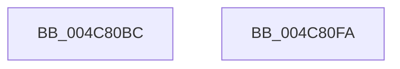

# PopPrepareSleep

- RVA: `0x004C80BC`–`0x004C80FB` (길이 `63` bytes)
- VA: `0x00000001404C80BC`
- 실행 섹션: `.text`
- PDB 이름 있음: `예`; PDB Function 태그: `아니요`
- unwind 정보 RVA: `0x0005CF00`
- 디코드: `17`개 명령, `63/63` bytes 표시
- 미해석 바이트: `0` (있으면 어셈블리에 `.byte`로 보존)

> 이 문서는 커널 이미지의 기계어와 PDB 기호를 분석해 생성했습니다. 4번과 5번은 함수 원형과 자료형을 바이너리 사용 방식에서 추정한 C 해석이며 원본 소스 복구 결과는 아닙니다.

## 1. Dependencies

- 직접 호출 지점: **5**; 고유 호출 대상: **4**
- 직접 호출자로 확인된 함수: **1**
- RIP 상대 이미지 참조: **0**

### Outgoing calls
- `0x004C80C5` → [PopDiagTracePrepareSleep](../../page/AD/PopDiagTracePrepareSleep_function_00AD9658.md) (function, `0x00AD9658`)
- `0x004C80CF` → [PopCheckpointSystemSleep](../../pagelk/B7/PopCheckpointSystemSleep_function_00B77C90.md) (function, `0x00B77C90`)
- `0x004C80E0` → [PopDispatchStateCallout](../../page/91/PopDispatchStateCallout_function_0091248C.md) (function, `0x0091248C`)
- `0x004C80E5` → [PopDiagTracePrepareSleepEnd](../../page/70/PopDiagTracePrepareSleepEnd_function_00705564.md) (function, `0x00705564`)
- `0x004C80EF` → [PopCheckpointSystemSleep](../../pagelk/B7/PopCheckpointSystemSleep_function_00B77C90.md) (function, `0x00B77C90`)

### Direct callers
- [PopIssueActionRequest](../../page/A9/PopIssueActionRequest_function_00A9CE54.md) at `0x00A9D108`

### Static image references
- 디코드된 RIP-relative 메모리 참조가 없습니다.

## 2. Other-region calls and transfers

- 다른 실행 섹션으로 향하는 call: **5**
  - `0x004C80C5` → [PopDiagTracePrepareSleep](../../page/AD/PopDiagTracePrepareSleep_function_00AD9658.md) (`.text` → `PAGE`)
  - `0x004C80CF` → [PopCheckpointSystemSleep](../../pagelk/B7/PopCheckpointSystemSleep_function_00B77C90.md) (`.text` → `PAGELK`)
  - `0x004C80E0` → [PopDispatchStateCallout](../../page/91/PopDispatchStateCallout_function_0091248C.md) (`.text` → `PAGE`)
  - `0x004C80E5` → [PopDiagTracePrepareSleepEnd](../../page/70/PopDiagTracePrepareSleepEnd_function_00705564.md) (`.text` → `PAGE`)
  - `0x004C80EF` → [PopCheckpointSystemSleep](../../pagelk/B7/PopCheckpointSystemSleep_function_00B77C90.md) (`.text` → `PAGELK`)
- 별도 외부 분기/꼬리 이동을 확인하지 못했습니다.

## 3. Assembly (complete function range)

```asm
004C80BC  40 53                           push rbx
004C80BE  48 83 EC 20                     sub rsp, 0x20
004C80C2  48 8B D9                        mov rbx, rcx
004C80C5  E8 8E 15 61 00                  call 0x140ad9658
004C80CA  B9 36 00 00 00                  mov ecx, 0x36
004C80CF  E8 BC FB 6A 00                  call 0x140b77c90
004C80D4  33 D2                           xor edx, edx
004C80D6  C7 43 20 0D 00 00 00            mov dword ptr [rbx + 0x20], 0xd
004C80DD  48 8B CB                        mov rcx, rbx
004C80E0  E8 A7 A3 44 00                  call 0x14091248c
004C80E5  E8 7A D4 23 00                  call 0x140705564
004C80EA  B9 37 00 00 00                  mov ecx, 0x37
004C80EF  E8 9C FB 6A 00                  call 0x140b77c90
004C80F4  48 83 C4 20                     add rsp, 0x20
004C80F8  5B                              pop rbx
004C80F9  C3                              ret
004C80FA  CC                              int3
```

## 4. C-style interpretation (structured pseudocode)

```c
__int64 __fastcall PopPrepareSleep(__int64 a1, int a2)
{
    __int64 result;
    __int64 v_rsp;

    v_rsp = (v_rsp) - (32);
    result = PopDiagTracePrepareSleep(a1, a2, a3, a4);
    result = PopCheckpointSystemSleep(54, a2, a3, a4);
    a2 = 0;
    *(unsigned int *)(a1 + 32) = 13;
    result = PopDispatchStateCallout(a1, a2, a3, a4);
    result = PopDiagTracePrepareSleepEnd(a1, a2, a3, a4);
    result = PopCheckpointSystemSleep(55, a2, a3, a4);
    v_rsp = (v_rsp) + (32);
    return result;
}
```

## 5. (Beta) C Style

```c
int64_t PopPrepareSleep(void *Arg1, int32_t Arg2)
{
    uint8_t *arg1 = (uint8_t *)Arg1;

    int64_t result;
    int64_t local_rsp;

    local_rsp = (local_rsp) - (32);
    result = PopDiagTracePrepareSleep(Arg1, Arg2, a3, a4);
    result = PopCheckpointSystemSleep(54, Arg2, a3, a4);
    Arg2 = 0;
    *(uint32_t *)(arg1 + 0x20) = 13;
    result = PopDispatchStateCallout(Arg1, Arg2, a3, a4);
    result = PopDiagTracePrepareSleepEnd(Arg1, Arg2, a3, a4);
    result = PopCheckpointSystemSleep(55, Arg2, a3, a4);
    local_rsp = (local_rsp) + (32);
    return result;
}
```

### 관측된 메모리 오프셋

구조체 형식이 확인되지 않은 접근은 인자 기준의 오프셋으로만 기록했습니다.

| 기준 인자 | 오프셋 표현 | 폭 (bit) | 접근 |
|---|---:|---:|---|
| `Arg1` | `+ 0x20` | `32` | `W` |

## 6. Execution-region graph

[열기: 2D/3D 그래프와 함수 탐색 컨트롤 패널](../../../control-panel.html?section=text&rva=0x004C80BC&view=graph)

- 2D 그래프는 위에서 아래로 흐르고, 3D 그래프는 빈 공간을 드래그해 회전합니다. Shift+드래그는 이동, 휠은 확대·축소, 함수 노드 선택은 대상 보고서 이동입니다.

### Static fallback


