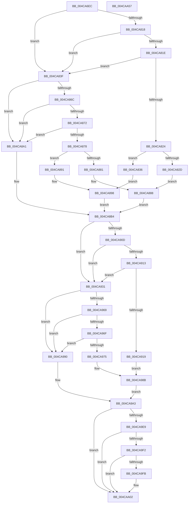

# PopQueryPowerButtonConfiguration

- RVA: `0x004CA6EC`–`0x004CAA58` (길이 `876` bytes)
- VA: `0x00000001404CA6EC`
- 실행 섹션: `.text`
- PDB 이름 있음: `예`; PDB Function 태그: `아니요`
- unwind 정보 RVA: `0x000BD58C`
- 디코드: `217`개 명령, `876/876` bytes 표시
- 미해석 바이트: `0` (있으면 어셈블리에 `.byte`로 보존)

> 이 문서는 커널 이미지의 기계어와 PDB 기호를 분석해 생성했습니다. 4번과 5번은 함수 원형과 자료형을 바이너리 사용 방식에서 추정한 C 해석이며 원본 소스 복구 결과는 아닙니다.

## 1. Dependencies

- 직접 호출 지점: **12**; 고유 호출 대상: **4**
- 직접 호출자로 확인된 함수: **1**
- RIP 상대 이미지 참조: **23**

### Outgoing calls
- `0x004CA741` → [wcslen](../50/wcslen_function_00501BA0.md) (function, `0x00501BA0`)
- `0x004CA779` → [wcslen](../50/wcslen_function_00501BA0.md) (function, `0x00501BA0`)
- `0x004CA7A3` → [wcslen](../50/wcslen_function_00501BA0.md) (function, `0x00501BA0`)
- `0x004CA7CD` → [wcslen](../50/wcslen_function_00501BA0.md) (function, `0x00501BA0`)
- `0x004CA808` → [ZwQueryValueKey](../6A/ZwQueryValueKey_function_006AD3B0.md) (function, `0x006AD3B0`)
- `0x004CA861` → [ZwQueryValueKey](../6A/ZwQueryValueKey_function_006AD3B0.md) (function, `0x006AD3B0`)
- `0x004CA8E2` → [DbgPrintEx](../35/DbgPrintEx_function_00359290.md) (function, `0x00359290`)
- `0x004CA902` → [ZwQueryValueKey](../6A/ZwQueryValueKey_function_006AD3B0.md) (function, `0x006AD3B0`)
- `0x004CA95E` → [ZwQueryValueKey](../6A/ZwQueryValueKey_function_006AD3B0.md) (function, `0x006AD3B0`)
- `0x004CA9D9` → [DbgPrintEx](../35/DbgPrintEx_function_00359290.md) (function, `0x00359290`)
- `0x004CAA29` → [DbgPrintEx](../35/DbgPrintEx_function_00359290.md) (function, `0x00359290`)
- `0x004CAA37` → [_security_check_cookie](../6A/_security_check_cookie_function_006AC640.md) (function, `0x006AC640`)

### Direct callers
- [PopPowerButtonBugcheckConfigure](../../page/76/PopPowerButtonBugcheckConfigure_function_00768F84.md) at `0x0076903E`

### Static image references
- `0x004CA708` → RVA `0x00E0A740` (`.data`; read)
- `0x004CA71C` → RVA `0x0001E4C0` (`.rdata`; read)
- `0x004CA752` → RVA `0x0001E440` (`.rdata`; read)
- `0x004CA788` → RVA `0x0001E4E8` (`.rdata`; read)
- `0x004CA7B2` → RVA `0x0001E480` (`.rdata`; read)
- `0x004CA82D` → RVA `0x00F08590` (`.data`; write)
- `0x004CA881` → RVA `0x00F08594` (`.data`; write)
- `0x004CA888` → RVA `0x00F086F4` (`.data`; write)
- `0x004CA8B4` → RVA `0x00F08594` (`.data`; read)
- `0x004CA8BA` → RVA `0x006CC1D0` (` ?? ::FNODOBFM::`string'`; read)
- `0x004CA8C5` → RVA `0x006CC160` (` ?? ::FNODOBFM::`string'`; read)
- `0x004CA8CC` → RVA `0x00F08590` (`.data`; read)
- `0x004CA922` → RVA `0x00F08599` (`.data`; write)
- `0x004CA929` → RVA `0x00F0859C` (`.data`; write)
- `0x004CA97E` → RVA `0x00F085A0` (`.data`; write)
- `0x004CA985` → RVA `0x00F085A4` (`.data`; write)
- `0x004CA9A3` → RVA `0x00F085A4` (`.data`; read)
- `0x004CA9B4` → RVA `0x006CC270` (` ?? ::FNODOBFM::`string'`; read)
- `0x004CA9BB` → RVA `0x00F0859C` (`.data`; read)
- `0x004CA9C4` → RVA `0x00F086F0` (`.data`; write)
- `0x004CA9F2` → RVA `0x00F086F4` (`.data`; read)
- `0x004CAA02` → RVA `0x00F086F0` (`.data`; read)
- `0x004CAA13` → RVA `0x006CC200` (` ?? ::FNODOBFM::`string'`; read)

## 2. Other-region calls and transfers

- 다른 실행 섹션으로 향하는 call: **0**
- 별도 외부 분기/꼬리 이동을 확인하지 못했습니다.

## 3. Assembly (complete function range)

```asm
004CA6EC  48 89 5C 24 18                  mov qword ptr [rsp + 0x18], rbx
004CA6F1  55                              push rbp
004CA6F2  56                              push rsi
004CA6F3  57                              push rdi
004CA6F4  41 54                           push r12
004CA6F6  41 55                           push r13
004CA6F8  41 56                           push r14
004CA6FA  41 57                           push r15
004CA6FC  48 8D 6C 24 D9                  lea rbp, [rsp - 0x27]
004CA701  48 81 EC B0 00 00 00            sub rsp, 0xb0
004CA708  48 8B 05 31 00 94 00            mov rax, qword ptr [rip + 0x940031]
004CA70F  48 33 C4                        xor rax, rsp
004CA712  48 89 45 17                     mov qword ptr [rbp + 0x17], rax
004CA716  45 33 E4                        xor r12d, r12d
004CA719  4C 8B F1                        mov r14, rcx
004CA71C  48 8D 0D 9D 3D B5 FF            lea rcx, [rip - 0x4ac263]
004CA723  44 89 65 B7                     mov dword ptr [rbp - 0x49], r12d
004CA727  0F 57 C0                        xorps xmm0, xmm0
004CA72A  48 89 4D C7                     mov qword ptr [rbp - 0x39], rcx
004CA72E  33 C0                           xor eax, eax
004CA730  44 89 65 C3                     mov dword ptr [rbp - 0x3d], r12d
004CA734  48 8B F2                        mov rsi, rdx
004CA737  89 45 0F                        mov dword ptr [rbp + 0xf], eax
004CA73A  0F 11 45 FF                     movups xmmword ptr [rbp - 1], xmm0
004CA73E  41 8B DC                        mov ebx, r12d
004CA741  E8 5A 74 03 00                  call 0x140501ba0
004CA746  48 03 C0                        add rax, rax
004CA749  44 89 65 D3                     mov dword ptr [rbp - 0x2d], r12d
004CA74D  BF FE FF 00 00                  mov edi, 0xfffe
004CA752  48 8D 0D E7 3C B5 FF            lea rcx, [rip - 0x4ac319]
004CA759  48 3B C7                        cmp rax, rdi
004CA75C  48 89 4D D7                     mov qword ptr [rbp - 0x29], rcx
004CA760  45 8D 6C 24 02                  lea r13d, [r12 + 2]
004CA765  44 8D 7F FE                     lea r15d, [rdi - 2]
004CA769  49 0F 43 C7                     cmovae rax, r15
004CA76D  66 89 45 BF                     mov word ptr [rbp - 0x41], ax
004CA771  66 41 03 C5                     add ax, r13w
004CA775  66 89 45 C1                     mov word ptr [rbp - 0x3f], ax
004CA779  E8 22 74 03 00                  call 0x140501ba0
004CA77E  48 03 C0                        add rax, rax
004CA781  44 89 65 E3                     mov dword ptr [rbp - 0x1d], r12d
004CA785  48 3B C7                        cmp rax, rdi
004CA788  48 8D 0D 59 3D B5 FF            lea rcx, [rip - 0x4ac2a7]
004CA78F  48 89 4D E7                     mov qword ptr [rbp - 0x19], rcx
004CA793  49 0F 43 C7                     cmovae rax, r15
004CA797  66 89 45 CF                     mov word ptr [rbp - 0x31], ax
004CA79B  66 41 03 C5                     add ax, r13w
004CA79F  66 89 45 D1                     mov word ptr [rbp - 0x2f], ax
004CA7A3  E8 F8 73 03 00                  call 0x140501ba0
004CA7A8  48 03 C0                        add rax, rax
004CA7AB  44 89 65 F3                     mov dword ptr [rbp - 0xd], r12d
004CA7AF  48 3B C7                        cmp rax, rdi
004CA7B2  48 8D 0D C7 3C B5 FF            lea rcx, [rip - 0x4ac339]
004CA7B9  48 89 4D F7                     mov qword ptr [rbp - 9], rcx
004CA7BD  49 0F 43 C7                     cmovae rax, r15
004CA7C1  66 89 45 DF                     mov word ptr [rbp - 0x21], ax
004CA7C5  66 41 03 C5                     add ax, r13w
004CA7C9  66 89 45 E1                     mov word ptr [rbp - 0x1f], ax
004CA7CD  E8 CE 73 03 00                  call 0x140501ba0
004CA7D2  48 03 C0                        add rax, rax
004CA7D5  4C 8D 4D FF                     lea r9, [rbp - 1]
004CA7D9  48 3B C7                        cmp rax, rdi
004CA7DC  48 8D 55 BF                     lea rdx, [rbp - 0x41]
004CA7E0  41 8D 7C 24 14                  lea edi, [r12 + 0x14]
004CA7E5  45 8B C5                        mov r8d, r13d
004CA7E8  49 0F 43 C7                     cmovae rax, r15
004CA7EC  49 8B CE                        mov rcx, r14
004CA7EF  66 89 45 EF                     mov word ptr [rbp - 0x11], ax
004CA7F3  66 41 03 C5                     add ax, r13w
004CA7F7  66 89 45 F1                     mov word ptr [rbp - 0xf], ax
004CA7FB  48 8D 45 B7                     lea rax, [rbp - 0x49]
004CA7FF  48 89 44 24 28                  mov qword ptr [rsp + 0x28], rax
004CA804  89 7C 24 20                     mov dword ptr [rsp + 0x20], edi
004CA808  E8 A3 2B 1E 00                  call 0x1406ad3b0
004CA80D  45 8D 7C 24 01                  lea r15d, [r12 + 1]
004CA812  8B C8                           mov ecx, eax
004CA814  85 C0                           test eax, eax
004CA816  78 27                           js 0x1404ca83f
004CA818  83 7D 03 04                     cmp dword ptr [rbp + 3], 4
004CA81C  75 21                           jne 0x1404ca83f
004CA81E  83 7D 07 04                     cmp dword ptr [rbp + 7], 4
004CA822  75 1B                           jne 0x1404ca83f
004CA824  44 88 3E                        mov byte ptr [rsi], r15b
004CA827  44 39 65 0B                     cmp dword ptr [rbp + 0xb], r12d
004CA82B  74 09                           je 0x1404ca836
004CA82D  44 89 2D 5C DD A3 00            mov dword ptr [rip + 0xa3dd5c], r13d
004CA834  EB 52                           jmp 0x1404ca888
004CA836  44 89 3D 53 DD A3 00            mov dword ptr [rip + 0xa3dd53], r15d
004CA83D  EB 59                           jmp 0x1404ca898
004CA83F  48 8D 45 B7                     lea rax, [rbp - 0x49]
004CA843  44 89 25 46 DD A3 00            mov dword ptr [rip + 0xa3dd46], r12d
004CA84A  48 89 44 24 28                  mov qword ptr [rsp + 0x28], rax
004CA84F  4C 8D 4D FF                     lea r9, [rbp - 1]
004CA853  45 8B C5                        mov r8d, r13d
004CA856  89 7C 24 20                     mov dword ptr [rsp + 0x20], edi
004CA85A  48 8D 55 CF                     lea rdx, [rbp - 0x31]
004CA85E  49 8B CE                        mov rcx, r14
004CA861  E8 4A 2B 1E 00                  call 0x1406ad3b0
004CA866  8B C8                           mov ecx, eax
004CA868  85 C0                           test eax, eax
004CA86A  78 35                           js 0x1404ca8a1
004CA86C  83 7D 03 04                     cmp dword ptr [rbp + 3], 4
004CA870  75 2F                           jne 0x1404ca8a1
004CA872  83 7D 07 04                     cmp dword ptr [rbp + 7], 4
004CA876  75 29                           jne 0x1404ca8a1
004CA878  44 88 3E                        mov byte ptr [rsi], r15b
004CA87B  44 39 65 0B                     cmp dword ptr [rbp + 0xb], r12d
004CA87F  74 10                           je 0x1404ca891
004CA881  44 89 2D 0C DD A3 00            mov dword ptr [rip + 0xa3dd0c], r13d
004CA888  44 89 2D 65 DE A3 00            mov dword ptr [rip + 0xa3de65], r13d
004CA88F  EB 23                           jmp 0x1404ca8b4
004CA891  44 89 3D FC DC A3 00            mov dword ptr [rip + 0xa3dcfc], r15d
004CA898  44 89 3D 55 DE A3 00            mov dword ptr [rip + 0xa3de55], r15d
004CA89F  EB 13                           jmp 0x1404ca8b4
004CA8A1  44 89 25 EC DC A3 00            mov dword ptr [rip + 0xa3dcec], r12d
004CA8A8  B9 01 00 00 C0                  mov ecx, 0xc0000001
004CA8AD  44 89 25 40 DE A3 00            mov dword ptr [rip + 0xa3de40], r12d
004CA8B4  8B 05 DA DC A3 00               mov eax, dword ptr [rip + 0xa3dcda]
004CA8BA  4C 8D 0D 0F 19 20 00            lea r9, [rip + 0x20190f]
004CA8C1  89 44 24 30                     mov dword ptr [rsp + 0x30], eax
004CA8C5  4C 8D 05 94 18 20 00            lea r8, [rip + 0x201894]
004CA8CC  8B 05 BE DC A3 00               mov eax, dword ptr [rip + 0xa3dcbe]
004CA8D2  41 8B D5                        mov edx, r13d
004CA8D5  89 44 24 28                     mov dword ptr [rsp + 0x28], eax
004CA8D9  89 4C 24 20                     mov dword ptr [rsp + 0x20], ecx
004CA8DD  B9 92 00 00 00                  mov ecx, 0x92
004CA8E2  E8 A9 E9 E8 FF                  call 0x140359290
004CA8E7  48 8D 45 B7                     lea rax, [rbp - 0x49]
004CA8EB  45 8B C5                        mov r8d, r13d
004CA8EE  48 89 44 24 28                  mov qword ptr [rsp + 0x28], rax
004CA8F3  4C 8D 4D FF                     lea r9, [rbp - 1]
004CA8F7  48 8D 55 DF                     lea rdx, [rbp - 0x21]
004CA8FB  89 7C 24 20                     mov dword ptr [rsp + 0x20], edi
004CA8FF  49 8B CE                        mov rcx, r14
004CA902  E8 A9 2A 1E 00                  call 0x1406ad3b0
004CA907  8B F8                           mov edi, eax
004CA909  85 C0                           test eax, eax
004CA90B  78 24                           js 0x1404ca931
004CA90D  83 7D 03 04                     cmp dword ptr [rbp + 3], 4
004CA911  75 1E                           jne 0x1404ca931
004CA913  83 7D 07 04                     cmp dword ptr [rbp + 7], 4
004CA917  75 18                           jne 0x1404ca931
004CA919  8B 5D 0B                        mov ebx, dword ptr [rbp + 0xb]
004CA91C  81 E3 FF 01 00 00               and ebx, 0x1ff
004CA922  44 88 3D 70 DC A3 00            mov byte ptr [rip + 0xa3dc70], r15b
004CA929  89 1D 6D DC A3 00               mov dword ptr [rip + 0xa3dc6d], ebx
004CA92F  EB 5A                           jmp 0x1404ca98b
004CA931  48 8D 45 B7                     lea rax, [rbp - 0x49]
004CA935  44 88 25 5D DC A3 00            mov byte ptr [rip + 0xa3dc5d], r12b
004CA93C  48 89 44 24 28                  mov qword ptr [rsp + 0x28], rax
004CA941  4C 8D 4D FF                     lea r9, [rbp - 1]
004CA945  45 8B C5                        mov r8d, r13d
004CA948  C7 44 24 20 14 00 00 00         mov dword ptr [rsp + 0x20], 0x14
004CA950  48 8D 55 EF                     lea rdx, [rbp - 0x11]
004CA954  44 89 25 41 DC A3 00            mov dword ptr [rip + 0xa3dc41], r12d
004CA95B  49 8B CE                        mov rcx, r14
004CA95E  E8 4D 2A 1E 00                  call 0x1406ad3b0
004CA963  8B F8                           mov edi, eax
004CA965  85 C0                           test eax, eax
004CA967  78 27                           js 0x1404ca990
004CA969  83 7D 03 04                     cmp dword ptr [rbp + 3], 4
004CA96D  75 21                           jne 0x1404ca990
004CA96F  83 7D 07 04                     cmp dword ptr [rbp + 7], 4
004CA973  75 1B                           jne 0x1404ca990
004CA975  8B 5D 0B                        mov ebx, dword ptr [rbp + 0xb]
004CA978  81 E3 FF 01 00 00               and ebx, 0x1ff
004CA97E  44 88 3D 1B DC A3 00            mov byte ptr [rip + 0xa3dc1b], r15b
004CA985  89 1D 19 DC A3 00               mov dword ptr [rip + 0xa3dc19], ebx
004CA98B  44 88 3E                        mov byte ptr [rsi], r15b
004CA98E  EB 13                           jmp 0x1404ca9a3
004CA990  44 88 25 09 DC A3 00            mov byte ptr [rip + 0xa3dc09], r12b
004CA997  BF 01 00 00 C0                  mov edi, 0xc0000001
004CA99C  44 89 25 01 DC A3 00            mov dword ptr [rip + 0xa3dc01], r12d
004CA9A3  8B 05 FB DB A3 00               mov eax, dword ptr [rip + 0xa3dbfb]
004CA9A9  4C 8D 0D 20 18 20 00            lea r9, [rip + 0x201820]
004CA9B0  89 44 24 30                     mov dword ptr [rsp + 0x30], eax
004CA9B4  4C 8D 05 B5 18 20 00            lea r8, [rip + 0x2018b5]
004CA9BB  8B 05 DB DB A3 00               mov eax, dword ptr [rip + 0xa3dbdb]
004CA9C1  41 8B D5                        mov edx, r13d
004CA9C4  89 1D 26 DD A3 00               mov dword ptr [rip + 0xa3dd26], ebx
004CA9CA  BB 92 00 00 00                  mov ebx, 0x92
004CA9CF  89 44 24 28                     mov dword ptr [rsp + 0x28], eax
004CA9D3  8B CB                           mov ecx, ebx
004CA9D5  89 7C 24 20                     mov dword ptr [rsp + 0x20], edi
004CA9D9  E8 B2 E8 E8 FF                  call 0x140359290
004CA9DE  8B 05 B8 DB A3 00               mov eax, dword ptr [rip + 0xa3dbb8]
004CA9E4  41 84 C7                        test r15b, al
004CA9E7  74 19                           je 0x1404caa02
004CA9E9  44 39 25 A0 DB A3 00            cmp dword ptr [rip + 0xa3dba0], r12d
004CA9F0  75 10                           jne 0x1404caa02
004CA9F2  44 39 2D FB DC A3 00            cmp dword ptr [rip + 0xa3dcfb], r13d
004CA9F9  75 07                           jne 0x1404caa02
004CA9FB  44 89 3D F2 DC A3 00            mov dword ptr [rip + 0xa3dcf2], r15d
004CAA02  8B 05 E8 DC A3 00               mov eax, dword ptr [rip + 0xa3dce8]
004CAA08  4C 8D 0D C1 17 20 00            lea r9, [rip + 0x2017c1]
004CAA0F  89 44 24 28                     mov dword ptr [rsp + 0x28], eax
004CAA13  4C 8D 05 E6 17 20 00            lea r8, [rip + 0x2017e6]
004CAA1A  8B 05 D4 DC A3 00               mov eax, dword ptr [rip + 0xa3dcd4]
004CAA20  41 8B D5                        mov edx, r13d
004CAA23  8B CB                           mov ecx, ebx
004CAA25  89 44 24 20                     mov dword ptr [rsp + 0x20], eax
004CAA29  E8 62 E8 E8 FF                  call 0x140359290
004CAA2E  8B C7                           mov eax, edi
004CAA30  48 8B 4D 17                     mov rcx, qword ptr [rbp + 0x17]
004CAA34  48 33 CC                        xor rcx, rsp
004CAA37  E8 04 1C 1E 00                  call 0x1406ac640
004CAA3C  48 8B 9C 24 00 01 00 00         mov rbx, qword ptr [rsp + 0x100]
004CAA44  48 81 C4 B0 00 00 00            add rsp, 0xb0
004CAA4B  41 5F                           pop r15
004CAA4D  41 5E                           pop r14
004CAA4F  41 5D                           pop r13
004CAA51  41 5C                           pop r12
004CAA53  5F                              pop rdi
004CAA54  5E                              pop rsi
004CAA55  5D                              pop rbp
004CAA56  C3                              ret
004CAA57  CC                              int3
```

## 4. C-style interpretation (structured pseudocode)

```c
__int64 __fastcall PopQueryPowerButtonConfiguration(__int64 a1, __int64 a2)
{
    __int64 result;
    __int64 v_r12;
    __int64 v_rbx;
    __int64 v_rsp;
    unsigned __int64 v_stack_m48;
    unsigned int v_stack_m50;
    unsigned int v_stack_m54;
    unsigned int v_stack_m58;
    unsigned int v_stack_m5C;
    unsigned __int64 v_stack_m5F;
    unsigned __int64 v_stack_m60;
    unsigned __int64 v_stack_m68;
    unsigned int v_stack_m6C;
    unsigned __int16 v_stack_m6E;
    unsigned __int16 v_stack_m70;
    unsigned __int64 v_stack_m78;
    unsigned int v_stack_m7C;
    unsigned __int16 v_stack_m7E;
    unsigned __int16 v_stack_m80;
    unsigned __int64 v_stack_m88;
    unsigned int v_stack_m8C;
    unsigned __int16 v_stack_m8E;
    unsigned __int16 v_stack_m90;
    unsigned __int64 v_stack_m98;
    unsigned int v_stack_m9C;
    unsigned __int16 v_stack_m9E;
    unsigned __int16 v_stack_mA0;
    unsigned int v_stack_mA8;
    unsigned int v_stack_mB8;
    unsigned __int64 v_stack_mC0;
    unsigned int v_stack_mC8;
    unsigned __int64 v_stack_p18;

    v_stack_p18 = v_rbx;
    v_rsp = (v_rsp) - (176);
    result = (*(unsigned __int64 *)(v_rip + 9699377)) ^ (v_rsp);
    v_stack_m48 = result;
    v_r12 = 0;
    v_stack_mA8 = 0;
    v_stack_m98 = v_rip - 4899427;
    result = 0;
    v_stack_m9C = 0;
    v_stack_m50 = 0;
    v_stack_m60 = v_xmm0;
    result = wcslen(v_rip - 4899427, a2, a3, a4);
    result = (result) + (result);
    v_stack_m8C = 0;
    v_stack_m88 = v_rip - 4899609;
    if (result >= ((unsigned int)(0xFFFEULL))) { result = (unsigned int)(0xFFFEULL) - 2; }
    v_stack_mA0 = (unsigned __int16)(result);
    result = (unsigned __int16)((result) + ((unsigned __int16)(v_r12 + 2)));
    v_stack_m9E = (unsigned __int16)(result);
    result = wcslen(v_rip - 4899609, a2, a3, a4);
    result = (result) + (result);
    v_stack_m7C = 0;
    v_stack_m78 = v_rip - 4899495;
    if (result >= ((unsigned int)(0xFFFEULL))) { result = (unsigned int)(0xFFFEULL) - 2; }
    v_stack_m90 = (unsigned __int16)(result);
    result = (unsigned __int16)((result) + ((unsigned __int16)(v_r12 + 2)));
    v_stack_m8E = (unsigned __int16)(result);
    result = wcslen(v_rip - 4899495, a2, a3, a4);
    result = (result) + (result);
    v_stack_m6C = 0;
    v_stack_m68 = v_rip - 4899641;
    if (result >= ((unsigned int)(0xFFFEULL))) { result = (unsigned int)(0xFFFEULL) - 2; }
    v_stack_m80 = (unsigned __int16)(result);
    result = (unsigned __int16)((result) + ((unsigned __int16)(v_r12 + 2)));
    v_stack_m7E = (unsigned __int16)(result);
    result = wcslen(v_rip - 4899641, a2, a3, a4);
    result = (result) + (result);
    if (result >= ((unsigned int)(0xFFFEULL))) { result = (unsigned int)(0xFFFEULL) - 2; }
    v_stack_m70 = (unsigned __int16)(result);
    result = (unsigned __int16)((result) + ((unsigned __int16)(v_r12 + 2)));
    v_stack_m6E = (unsigned __int16)(result);
    v_stack_mC0 = v_stack_mA8;
    v_stack_mC8 = (unsigned int)(v_r12 + 20);
    result = ZwQueryValueKey(a1, v_stack_mA0, (unsigned int)((unsigned int)(v_r12 + 2)), v_stack_m60);
    if (sign_flag) goto loc_004CA83F;
    if (v_stack_m5C != 4) goto loc_004CA83F;
    if (v_stack_m58 != 4) goto loc_004CA83F;
    *(unsigned __int8 *)(a2) = (unsigned __int8)(v_r12 + 1);
    if (v_stack_m54 == 0) goto loc_004CA836;
    *(unsigned int *)(v_rip + 10739036) = (unsigned int)(v_r12 + 2);
    goto loc_004CA888;
loc_004CA836:
    *(unsigned int *)(v_rip + 10739027) = (unsigned int)(v_r12 + 1);
    goto loc_004CA898;
loc_004CA83F:
    *(unsigned int *)(v_rip + 10739014) = 0;
    v_stack_mC0 = v_stack_mA8;
    v_stack_mC8 = (unsigned int)(v_r12 + 20);
    result = ZwQueryValueKey(a1, v_stack_m90, (unsigned int)((unsigned int)(v_r12 + 2)), v_stack_m60);
    if (sign_flag) goto loc_004CA8A1;
    if (v_stack_m5C != 4) goto loc_004CA8A1;
    if (v_stack_m58 != 4) goto loc_004CA8A1;
    *(unsigned __int8 *)(a2) = (unsigned __int8)(v_r12 + 1);
    if (v_stack_m54 == 0) goto loc_004CA891;
    *(unsigned int *)(v_rip + 10738956) = (unsigned int)(v_r12 + 2);
loc_004CA888:
    *(unsigned int *)(v_rip + 10739301) = (unsigned int)(v_r12 + 2);
    goto loc_004CA8B4;
loc_004CA891:
    *(unsigned int *)(v_rip + 10738940) = (unsigned int)(v_r12 + 1);
loc_004CA898:
    *(unsigned int *)(v_rip + 10739285) = (unsigned int)(v_r12 + 1);
    goto loc_004CA8B4;
loc_004CA8A1:
    *(unsigned int *)(v_rip + 10738924) = 0;
    *(unsigned int *)(v_rip + 10739264) = 0;
loc_004CA8B4:
    v_stack_mB8 = (unsigned int)((unsigned int)(*(unsigned int *)(v_rip + 10738906)));
    v_stack_mC0 = (unsigned int)((unsigned int)(*(unsigned int *)(v_rip + 10738878)));
    v_stack_mC8 = (unsigned int)((unsigned int)(0xC0000001ULL));
    result = DbgPrintEx(146, (unsigned int)((unsigned int)(v_r12 + 2)), v_rip + 2103444, v_rip + 2103567);
    v_stack_mC0 = v_stack_mA8;
    v_stack_mC8 = (unsigned int)(v_r12 + 20);
    result = ZwQueryValueKey(a1, v_stack_m80, (unsigned int)((unsigned int)(v_r12 + 2)), v_stack_m60);
    if (sign_flag) goto loc_004CA931;
    if (v_stack_m5C != 4) goto loc_004CA931;
    if (v_stack_m58 != 4) goto loc_004CA931;
    v_rbx = (unsigned int)(((unsigned int)(v_stack_m54)) & (511));
    *(unsigned __int8 *)(v_rip + 10738800) = (unsigned __int8)(v_r12 + 1);
    *(unsigned int *)(v_rip + 10738797) = (unsigned int)(v_rbx);
    goto loc_004CA98B;
loc_004CA931:
    *(unsigned __int8 *)(v_rip + 10738781) = 0;
    v_stack_mC0 = v_stack_mA8;
    v_stack_mC8 = 20;
    *(unsigned int *)(v_rip + 10738753) = 0;
    result = ZwQueryValueKey(a1, v_stack_m70, (unsigned int)((unsigned int)(v_r12 + 2)), v_stack_m60);
    if (sign_flag) goto loc_004CA990;
    if (v_stack_m5C != 4) goto loc_004CA990;
    if (v_stack_m58 != 4) goto loc_004CA990;
    v_rbx = (unsigned int)(((unsigned int)(v_stack_m54)) & (511));
    *(unsigned __int8 *)(v_rip + 10738715) = (unsigned __int8)(v_r12 + 1);
    *(unsigned int *)(v_rip + 10738713) = (unsigned int)(v_rbx);
loc_004CA98B:
    *(unsigned __int8 *)(a2) = (unsigned __int8)(v_r12 + 1);
    goto loc_004CA9A3;
loc_004CA990:
    *(unsigned __int8 *)(v_rip + 10738697) = 0;
    *(unsigned int *)(v_rip + 10738689) = 0;
loc_004CA9A3:
    v_stack_mB8 = (unsigned int)((unsigned int)(*(unsigned int *)(v_rip + 10738683)));
    *(unsigned int *)(v_rip + 10738982) = (unsigned int)(v_rbx);
    v_stack_mC0 = (unsigned int)((unsigned int)(*(unsigned int *)(v_rip + 10738651)));
    v_stack_mC8 = (unsigned int)((unsigned int)(0xC0000001ULL));
    result = DbgPrintEx(146, (unsigned int)((unsigned int)(v_r12 + 2)), v_rip + 2103477, v_rip + 2103328);
    if ((((unsigned __int8)(v_r12 + 1)) & ((unsigned __int8)((unsigned int)(*(unsigned int *)(v_rip + 10738616))))) == 0) goto loc_004CAA02;
    if ((*(unsigned int *)(v_rip + 10738592)) != 0) goto loc_004CAA02;
    if ((*(unsigned int *)(v_rip + 10738939)) == ((unsigned int)(v_r12 + 2))) {
        *(unsigned int *)(v_rip + 10738930) = (unsigned int)(v_r12 + 1);
    }
    v_stack_mC0 = (unsigned int)((unsigned int)(*(unsigned int *)(v_rip + 10738920)));
    v_stack_mC8 = (unsigned int)((unsigned int)(*(unsigned int *)(v_rip + 10738900)));
    result = DbgPrintEx(146, (unsigned int)((unsigned int)(v_r12 + 2)), v_rip + 2103270, v_rip + 2103233);
    a1 = (v_stack_m48) ^ (v_rsp);
    result = _security_check_cookie(a1, (unsigned int)((unsigned int)(v_r12 + 2)), v_rip + 2103270, v_rip + 2103233);
    v_rsp = (v_rsp) + (176);
    return result;
}
```

## 5. (Beta) C Style

```c
int64_t PopQueryPowerButtonConfiguration(int64_t Arg1, void *Arg2)
{
    uint8_t *arg2 = (uint8_t *)Arg2;

    int64_t result;
    int64_t local_r12;
    int64_t local_rbx;
    int64_t local_rsp;
    uint64_t v_stack_m48;
    uint32_t v_stack_m50;
    uint32_t v_stack_m54;
    uint32_t v_stack_m58;
    uint32_t v_stack_m5C;
    uint64_t v_stack_m5F;
    uint64_t v_stack_m60;
    uint64_t v_stack_m68;
    uint32_t v_stack_m6C;
    uint16_t v_stack_m6E;
    uint16_t v_stack_m70;
    uint64_t v_stack_m78;
    uint32_t v_stack_m7C;
    uint16_t v_stack_m7E;
    uint16_t v_stack_m80;
    uint64_t v_stack_m88;
    uint32_t v_stack_m8C;
    uint16_t v_stack_m8E;
    uint16_t v_stack_m90;
    uint64_t v_stack_m98;
    uint32_t v_stack_m9C;
    uint16_t v_stack_m9E;
    uint16_t v_stack_mA0;
    uint32_t v_stack_mA8;
    uint32_t v_stack_mB8;
    uint64_t v_stack_mC0;
    uint32_t v_stack_mC8;
    uint64_t v_stack_p18;

    v_stack_p18 = local_rbx;
    local_rsp = (local_rsp) - (176);
    result = (*(uint64_t *)(v_rip + 0x940031)) ^ (local_rsp);
    v_stack_m48 = result;
    local_r12 = 0;
    v_stack_mA8 = 0;
    v_stack_m98 = v_rip - 4899427;
    result = 0;
    v_stack_m9C = 0;
    v_stack_m50 = 0;
    v_stack_m60 = v_xmm0;
    result = wcslen(v_rip - 4899427, Arg2, a3, a4);
    result = (result) + (result);
    v_stack_m8C = 0;
    v_stack_m88 = v_rip - 4899609;
    if (result >= ((uint32_t)(0xFFFEULL))) { result = (uint32_t)(0xFFFEULL) - 2; }
    v_stack_mA0 = (uint16_t)(result);
    result = (uint16_t)((result) + ((uint16_t)(local_r12 + 2)));
    v_stack_m9E = (uint16_t)(result);
    result = wcslen(v_rip - 4899609, Arg2, a3, a4);
    result = (result) + (result);
    v_stack_m7C = 0;
    v_stack_m78 = v_rip - 4899495;
    if (result >= ((uint32_t)(0xFFFEULL))) { result = (uint32_t)(0xFFFEULL) - 2; }
    v_stack_m90 = (uint16_t)(result);
    result = (uint16_t)((result) + ((uint16_t)(local_r12 + 2)));
    v_stack_m8E = (uint16_t)(result);
    result = wcslen(v_rip - 4899495, Arg2, a3, a4);
    result = (result) + (result);
    v_stack_m6C = 0;
    v_stack_m68 = v_rip - 4899641;
    if (result >= ((uint32_t)(0xFFFEULL))) { result = (uint32_t)(0xFFFEULL) - 2; }
    v_stack_m80 = (uint16_t)(result);
    result = (uint16_t)((result) + ((uint16_t)(local_r12 + 2)));
    v_stack_m7E = (uint16_t)(result);
    result = wcslen(v_rip - 4899641, Arg2, a3, a4);
    result = (result) + (result);
    if (result >= ((uint32_t)(0xFFFEULL))) { result = (uint32_t)(0xFFFEULL) - 2; }
    v_stack_m70 = (uint16_t)(result);
    result = (uint16_t)((result) + ((uint16_t)(local_r12 + 2)));
    v_stack_m6E = (uint16_t)(result);
    v_stack_mC0 = v_stack_mA8;
    v_stack_mC8 = (uint32_t)(local_r12 + 20);
    result = ZwQueryValueKey(Arg1, v_stack_mA0, (uint32_t)((uint32_t)(local_r12 + 2)), v_stack_m60);
    if (sign_flag) goto loc_004CA83F;
    if (v_stack_m5C != 4) goto loc_004CA83F;
    if (v_stack_m58 != 4) goto loc_004CA83F;
    *(uint8_t *)(arg2) = (uint8_t)(local_r12 + 1);
    if (v_stack_m54 == 0) goto loc_004CA836;
    *(uint32_t *)(v_rip + 0xA3DD5C) = (uint32_t)(local_r12 + 2);
    goto loc_004CA888;
loc_004CA836:
    *(uint32_t *)(v_rip + 0xA3DD53) = (uint32_t)(local_r12 + 1);
    goto loc_004CA898;
loc_004CA83F:
    *(uint32_t *)(v_rip + 0xA3DD46) = 0;
    v_stack_mC0 = v_stack_mA8;
    v_stack_mC8 = (uint32_t)(local_r12 + 20);
    result = ZwQueryValueKey(Arg1, v_stack_m90, (uint32_t)((uint32_t)(local_r12 + 2)), v_stack_m60);
    if (sign_flag) goto loc_004CA8A1;
    if (v_stack_m5C != 4) goto loc_004CA8A1;
    if (v_stack_m58 != 4) goto loc_004CA8A1;
    *(uint8_t *)(arg2) = (uint8_t)(local_r12 + 1);
    if (v_stack_m54 == 0) goto loc_004CA891;
    *(uint32_t *)(v_rip + 0xA3DD0C) = (uint32_t)(local_r12 + 2);
loc_004CA888:
    *(uint32_t *)(v_rip + 0xA3DE65) = (uint32_t)(local_r12 + 2);
    goto loc_004CA8B4;
loc_004CA891:
    *(uint32_t *)(v_rip + 0xA3DCFC) = (uint32_t)(local_r12 + 1);
loc_004CA898:
    *(uint32_t *)(v_rip + 0xA3DE55) = (uint32_t)(local_r12 + 1);
    goto loc_004CA8B4;
loc_004CA8A1:
    *(uint32_t *)(v_rip + 0xA3DCEC) = 0;
    *(uint32_t *)(v_rip + 0xA3DE40) = 0;
loc_004CA8B4:
    v_stack_mB8 = (uint32_t)((uint32_t)(*(uint32_t *)(v_rip + 0xA3DCDA)));
    v_stack_mC0 = (uint32_t)((uint32_t)(*(uint32_t *)(v_rip + 0xA3DCBE)));
    v_stack_mC8 = (uint32_t)((uint32_t)(0xC0000001ULL));
    result = DbgPrintEx(146, (uint32_t)((uint32_t)(local_r12 + 2)), v_rip + 2103444, v_rip + 2103567);
    v_stack_mC0 = v_stack_mA8;
    v_stack_mC8 = (uint32_t)(local_r12 + 20);
    result = ZwQueryValueKey(Arg1, v_stack_m80, (uint32_t)((uint32_t)(local_r12 + 2)), v_stack_m60);
    if (sign_flag) goto loc_004CA931;
    if (v_stack_m5C != 4) goto loc_004CA931;
    if (v_stack_m58 != 4) goto loc_004CA931;
    local_rbx = (uint32_t)(((uint32_t)(v_stack_m54)) & (511));
    *(uint8_t *)(v_rip + 0xA3DC70) = (uint8_t)(local_r12 + 1);
    *(uint32_t *)(v_rip + 0xA3DC6D) = (uint32_t)(local_rbx);
    goto loc_004CA98B;
loc_004CA931:
    *(uint8_t *)(v_rip + 0xA3DC5D) = 0;
    v_stack_mC0 = v_stack_mA8;
    v_stack_mC8 = 20;
    *(uint32_t *)(v_rip + 0xA3DC41) = 0;
    result = ZwQueryValueKey(Arg1, v_stack_m70, (uint32_t)((uint32_t)(local_r12 + 2)), v_stack_m60);
    if (sign_flag) goto loc_004CA990;
    if (v_stack_m5C != 4) goto loc_004CA990;
    if (v_stack_m58 != 4) goto loc_004CA990;
    local_rbx = (uint32_t)(((uint32_t)(v_stack_m54)) & (511));
    *(uint8_t *)(v_rip + 0xA3DC1B) = (uint8_t)(local_r12 + 1);
    *(uint32_t *)(v_rip + 0xA3DC19) = (uint32_t)(local_rbx);
loc_004CA98B:
    *(uint8_t *)(arg2) = (uint8_t)(local_r12 + 1);
    goto loc_004CA9A3;
loc_004CA990:
    *(uint8_t *)(v_rip + 0xA3DC09) = 0;
    *(uint32_t *)(v_rip + 0xA3DC01) = 0;
loc_004CA9A3:
    v_stack_mB8 = (uint32_t)((uint32_t)(*(uint32_t *)(v_rip + 0xA3DBFB)));
    *(uint32_t *)(v_rip + 0xA3DD26) = (uint32_t)(local_rbx);
    v_stack_mC0 = (uint32_t)((uint32_t)(*(uint32_t *)(v_rip + 0xA3DBDB)));
    v_stack_mC8 = (uint32_t)((uint32_t)(0xC0000001ULL));
    result = DbgPrintEx(146, (uint32_t)((uint32_t)(local_r12 + 2)), v_rip + 2103477, v_rip + 2103328);
    if ((((uint8_t)(local_r12 + 1)) & ((uint8_t)((uint32_t)(*(uint32_t *)(v_rip + 0xA3DBB8))))) == 0) goto loc_004CAA02;
    if ((*(uint32_t *)(v_rip + 0xA3DBA0)) != 0) goto loc_004CAA02;
    if ((*(uint32_t *)(v_rip + 0xA3DCFB)) == ((uint32_t)(local_r12 + 2))) {
        *(uint32_t *)(v_rip + 0xA3DCF2) = (uint32_t)(local_r12 + 1);
    }
    v_stack_mC0 = (uint32_t)((uint32_t)(*(uint32_t *)(v_rip + 0xA3DCE8)));
    v_stack_mC8 = (uint32_t)((uint32_t)(*(uint32_t *)(v_rip + 0xA3DCD4)));
    result = DbgPrintEx(146, (uint32_t)((uint32_t)(local_r12 + 2)), v_rip + 2103270, v_rip + 2103233);
    Arg1 = (v_stack_m48) ^ (local_rsp);
    result = _security_check_cookie(Arg1, (uint32_t)((uint32_t)(local_r12 + 2)), v_rip + 2103270, v_rip + 2103233);
    local_rsp = (local_rsp) + (176);
    return result;
}
```

### 관측된 메모리 오프셋

구조체 형식이 확인되지 않은 접근은 인자 기준의 오프셋으로만 기록했습니다.

| 기준 인자 | 오프셋 표현 | 폭 (bit) | 접근 |
|---|---:|---:|---|
| `Arg2` | `+ 0x0` | `8` | `W` |

## 6. Execution-region graph

[열기: 2D/3D 그래프와 함수 탐색 컨트롤 패널](../../../control-panel.html?section=text&rva=0x004CA6EC&view=graph)

- 2D 그래프는 위에서 아래로 흐르고, 3D 그래프는 빈 공간을 드래그해 회전합니다. Shift+드래그는 이동, 휠은 확대·축소, 함수 노드 선택은 대상 보고서 이동입니다.

### Static fallback


