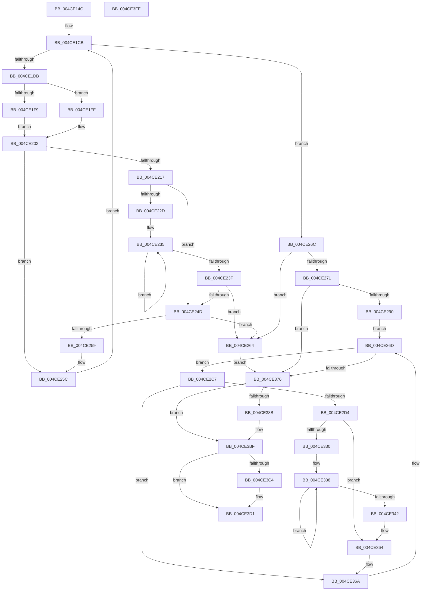

# PopRecordPoIrpBlackboxInformation

- RVA: `0x004CE14C`–`0x004CE3FF` (길이 `691` bytes)
- VA: `0x00000001404CE14C`
- 실행 섹션: `.text`
- PDB 이름 있음: `예`; PDB Function 태그: `아니요`
- unwind 정보 RVA: `0x000BDA1C`
- 디코드: `167`개 명령, `691/691` bytes 표시
- 미해석 바이트: `0` (있으면 어셈블리에 `.byte`로 보존)

> 이 문서는 커널 이미지의 기계어와 PDB 기호를 분석해 생성했습니다. 4번과 5번은 함수 원형과 자료형을 바이너리 사용 방식에서 추정한 C 해석이며 원본 소스 복구 결과는 아닙니다.

## 1. Dependencies

- 직접 호출 지점: **12**; 고유 호출 대상: **11**
- 직접 호출자로 확인된 함수: **1**
- RIP 상대 이미지 참조: **6**

### Outgoing calls
- `0x004CE1A2` → [KeAcquireInStackQueuedSpinLock](../27/KeAcquireInStackQueuedSpinLock_function_002757A0.md) (function, `0x002757A0`)
- `0x004CE1E5` → [KeAcquireSpinLockRaiseToDpc](../20/KeAcquireSpinLockRaiseToDpc_function_00208470.md) (function, `0x00208470`)
- `0x004CE20C` → [KeReleaseSpinLock](../39/KeReleaseSpinLock_function_00392BA0.md) (function, `0x00392BA0`)
- `0x004CE224` → [PopDiagGetDriverName](../47/PopDiagGetDriverName_function_0047FDB4.md) (function, `0x0047FDB4`)
- `0x004CE27F` → [ExAllocatePool2](../../poolcode/B8/ExAllocatePool2_function_00B820F0.md) (function, `0x00B820F0`)
- `0x004CE2F5` → [KiQueryUnbiasedInterruptTime](../42/KiQueryUnbiasedInterruptTime_function_0042D180.md) (function, `0x0042D180`)
- `0x004CE327` → [PopDiagGetDriverName](../47/PopDiagGetDriverName_function_0047FDB4.md) (function, `0x0047FDB4`)
- `0x004CE352` → [memcpy](../6C/memcpy_function_006C6840.md) (function, `0x006C6840`)
- `0x004CE381` → [KeReleaseInStackQueuedSpinLock](../34/KeReleaseInStackQueuedSpinLock_function_00342CE0.md) (function, `0x00342CE0`)
- `0x004CE3BA` → [NtPowerInformation](../../page/95/NtPowerInformation_function_00955D80.md) (function, `0x00955D80`)
- `0x004CE3CC` → [ExFreePoolWithTag](../../poolcode/B8/ExFreePoolWithTag_function_00B82870.md) (function, `0x00B82870`)
- `0x004CE3D8` → [_security_check_cookie](../6A/_security_check_cookie_function_006AC640.md) (function, `0x006AC640`)

### Direct callers
- [PopRecordPoBlackboxInformation](../../page/77/PopRecordPoBlackboxInformation_function_007731D8.md) at `0x007731DC`

### Static image references
- `0x004CE16F` → RVA `0x00E0A740` (`.data`; read)
- `0x004CE187` → RVA `0x00F0CA50` (`.data`; read)
- `0x004CE1B3` → RVA `0x00F0CA40` (`.data`; read)
- `0x004CE1BD` → RVA `0x00F0BD28` (`.data`; write)
- `0x004CE290` → RVA `0x00EFAAB8` (`.data`; read)
- `0x004CE2AC` → RVA `0x00F091F0` (`.data`; read)

## 2. Other-region calls and transfers

- 다른 실행 섹션으로 향하는 call: **3**
  - `0x004CE27F` → [ExAllocatePool2](../../poolcode/B8/ExAllocatePool2_function_00B820F0.md) (`.text` → `POOLCODE`)
  - `0x004CE3BA` → [NtPowerInformation](../../page/95/NtPowerInformation_function_00955D80.md) (`.text` → `PAGE`)
  - `0x004CE3CC` → [ExFreePoolWithTag](../../poolcode/B8/ExFreePoolWithTag_function_00B82870.md) (`.text` → `POOLCODE`)
- 별도 외부 분기/꼬리 이동을 확인하지 못했습니다.

## 3. Assembly (complete function range)

```asm
004CE14C  48 8B C4                        mov rax, rsp
004CE14F  48 89 58 08                     mov qword ptr [rax + 8], rbx
004CE153  48 89 70 10                     mov qword ptr [rax + 0x10], rsi
004CE157  48 89 78 18                     mov qword ptr [rax + 0x18], rdi
004CE15B  55                              push rbp
004CE15C  41 54                           push r12
004CE15E  41 55                           push r13
004CE160  41 56                           push r14
004CE162  41 57                           push r15
004CE164  48 8D 68 A1                     lea rbp, [rax - 0x5f]
004CE168  48 81 EC 00 01 00 00            sub rsp, 0x100
004CE16F  48 8B 05 CA C5 93 00            mov rax, qword ptr [rip + 0x93c5ca]
004CE176  48 33 C4                        xor rax, rsp
004CE179  48 89 45 27                     mov qword ptr [rbp + 0x27], rax
004CE17D  0F 57 C0                        xorps xmm0, xmm0
004CE180  48 8D 55 87                     lea rdx, [rbp - 0x79]
004CE184  0F 57 C9                        xorps xmm1, xmm1
004CE187  48 8D 0D C2 E8 A3 00            lea rcx, [rip + 0xa3e8c2]
004CE18E  33 C0                           xor eax, eax
004CE190  0F 11 44 24 30                  movups xmmword ptr [rsp + 0x30], xmm0
004CE195  48 89 45 97                     mov qword ptr [rbp - 0x69], rax
004CE199  0F 11 44 24 40                  movups xmmword ptr [rsp + 0x40], xmm0
004CE19E  0F 11 4D 87                     movups xmmword ptr [rbp - 0x79], xmm1
004CE1A2  E8 F9 75 DA FF                  call 0x1402757a0
004CE1A7  65 48 8B 04 25 88 01 00 00      mov rax, qword ptr gs:[0x188]
004CE1B0  45 33 ED                        xor r13d, r13d
004CE1B3  48 8B 35 86 E8 A3 00            mov rsi, qword ptr [rip + 0xa3e886]
004CE1BA  45 8B F5                        mov r14d, r13d
004CE1BD  48 89 05 64 DB A3 00            mov qword ptr [rip + 0xa3db64], rax
004CE1C4  41 8B FD                        mov edi, r13d
004CE1C7  41 8D 5D 40                     lea ebx, [r13 + 0x40]
004CE1CB  4C 8D 3D 6E E8 A3 00            lea r15, [rip + 0xa3e86e]
004CE1D2  49 3B F7                        cmp rsi, r15
004CE1D5  0F 84 91 00 00 00               je 0x1404ce26c
004CE1DB  4C 8D BE 20 01 00 00            lea r15, [rsi + 0x120]
004CE1E2  49 8B CF                        mov rcx, r15
004CE1E5  E8 86 A2 D3 FF                  call 0x140208470
004CE1EA  44 8B A6 28 01 00 00            mov r12d, dword ptr [rsi + 0x128]
004CE1F1  8A D0                           mov dl, al
004CE1F3  41 83 FC 01                     cmp r12d, 1
004CE1F7  75 06                           jne 0x1404ce1ff
004CE1F9  48 8B 46 30                     mov rax, qword ptr [rsi + 0x30]
004CE1FD  EB 03                           jmp 0x1404ce202
004CE1FF  49 8B C5                        mov rax, r13
004CE202  49 8B CF                        mov rcx, r15
004CE205  48 89 86 30 01 00 00            mov qword ptr [rsi + 0x130], rax
004CE20C  E8 8F 49 EC FF                  call 0x140392ba0
004CE211  41 83 FC 01                     cmp r12d, 1
004CE215  75 45                           jne 0x1404ce25c
004CE217  48 8B 4E 20                     mov rcx, qword ptr [rsi + 0x20]
004CE21B  48 8D 55 A7                     lea rdx, [rbp - 0x59]
004CE21F  45 8D 5C 24 17                  lea r11d, [r12 + 0x17]
004CE224  E8 8B 1B FB FF                  call 0x14047fdb4
004CE229  85 C0                           test eax, eax
004CE22B  78 20                           js 0x1404ce24d
004CE22D  48 8D 4D A7                     lea rcx, [rbp - 0x59]
004CE231  48 83 C8 FF                     or rax, 0xffffffffffffffff
004CE235  48 FF C0                        inc rax
004CE238  66 44 39 2C 41                  cmp word ptr [rcx + rax*2], r13w
004CE23D  75 F6                           jne 0x1404ce235
004CE23F  4C 8D 1C 45 1A 00 00 00         lea r11, [rax*2 + 0x1a]
004CE247  49 83 FB 18                     cmp r11, 0x18
004CE24B  72 17                           jb 0x1404ce264
004CE24D  41 FF C6                        inc r14d
004CE250  4A 8D 04 1B                     lea rax, [rbx + r11]
004CE254  48 3B C3                        cmp rax, rbx
004CE257  72 0B                           jb 0x1404ce264
004CE259  48 8B D8                        mov rbx, rax
004CE25C  48 8B 36                        mov rsi, qword ptr [rsi]
004CE25F  E9 67 FF FF FF                  jmp 0x1404ce1cb
004CE264  49 8B DD                        mov rbx, r13
004CE267  E9 0A 01 00 00                  jmp 0x1404ce376
004CE26C  45 85 F6                        test r14d, r14d
004CE26F  74 F3                           je 0x1404ce264
004CE271  41 B8 50 4F 42 42               mov r8d, 0x42424f50
004CE277  48 8B D3                        mov rdx, rbx
004CE27A  B9 40 00 00 00                  mov ecx, 0x40
004CE27F  E8 6C 3E 6B 00                  call 0x140b820f0
004CE284  48 8B F8                        mov rdi, rax
004CE287  48 85 C0                        test rax, rax
004CE28A  0F 84 E6 00 00 00               je 0x1404ce376
004CE290  48 8B 0D 21 C8 A2 00            mov rcx, qword ptr [rip + 0xa2c821]
004CE297  44 89 70 08                     mov dword ptr [rax + 8], r14d
004CE29B  4C 8D 77 28                     lea r14, [rdi + 0x28]
004CE29F  C7 40 04 01 00 00 00            mov dword ptr [rax + 4], 1
004CE2A6  89 18                           mov dword ptr [rax], ebx
004CE2A8  4C 89 78 10                     mov qword ptr [rax + 0x10], r15
004CE2AC  48 8D 05 3D AF A3 00            lea rax, [rip + 0xa3af3d]
004CE2B3  48 89 47 18                     mov qword ptr [rdi + 0x18], rax
004CE2B7  48 89 4F 20                     mov qword ptr [rdi + 0x20], rcx
004CE2BB  48 8B 35 7E E7 A3 00            mov rsi, qword ptr [rip + 0xa3e77e]
004CE2C2  E9 A6 00 00 00                  jmp 0x1404ce36d
004CE2C7  4C 39 AE 30 01 00 00            cmp qword ptr [rsi + 0x130], r13
004CE2CE  0F 84 96 00 00 00               je 0x1404ce36a
004CE2D4  0F B6 86 B8 00 00 00            movzx eax, byte ptr [rsi + 0xb8]
004CE2DB  B1 01                           mov cl, 1
004CE2DD  41 89 46 08                     mov dword ptr [r14 + 8], eax
004CE2E1  8B 86 BC 00 00 00               mov eax, dword ptr [rsi + 0xbc]
004CE2E7  41 89 46 0C                     mov dword ptr [r14 + 0xc], eax
004CE2EB  8B 86 C0 00 00 00               mov eax, dword ptr [rsi + 0xc0]
004CE2F1  41 89 46 10                     mov dword ptr [r14 + 0x10], eax
004CE2F5  E8 86 EE F5 FF                  call 0x14042d180
004CE2FA  48 8B C8                        mov rcx, rax
004CE2FD  41 BC 18 00 00 00               mov r12d, 0x18
004CE303  48 2B 8E 30 01 00 00            sub rcx, qword ptr [rsi + 0x130]
004CE30A  48 B8 4B 59 86 38 D6 C5 6D 34   movabs rax, 0x346dc5d63886594b
004CE314  48 F7 E1                        mul rcx
004CE317  48 C1 EA 0B                     shr rdx, 0xb
004CE31B  41 89 56 04                     mov dword ptr [r14 + 4], edx
004CE31F  48 8D 55 A7                     lea rdx, [rbp - 0x59]
004CE323  48 8B 4E 20                     mov rcx, qword ptr [rsi + 0x20]
004CE327  E8 88 1A FB FF                  call 0x14047fdb4
004CE32C  85 C0                           test eax, eax
004CE32E  78 34                           js 0x1404ce364
004CE330  48 8D 45 A7                     lea rax, [rbp - 0x59]
004CE334  49 83 CF FF                     or r15, 0xffffffffffffffff
004CE338  49 FF C7                        inc r15
004CE33B  66 46 39 2C 78                  cmp word ptr [rax + r15*2], r13w
004CE340  75 F6                           jne 0x1404ce338
004CE342  4F 8D 04 3F                     lea r8, [r15 + r15]
004CE346  49 8D 4E 14                     lea rcx, [r14 + 0x14]
004CE34A  48 8D 55 A7                     lea rdx, [rbp - 0x59]
004CE34E  4D 8D 60 1A                     lea r12, [r8 + 0x1a]
004CE352  E8 E9 84 1F 00                  call 0x1406c6840
004CE357  66 47 89 6C 7E 14               mov word ptr [r14 + r15*2 + 0x14], r13w
004CE35D  4C 8D 3D DC E6 A3 00            lea r15, [rip + 0xa3e6dc]
004CE364  45 89 26                        mov dword ptr [r14], r12d
004CE367  4D 03 F4                        add r14, r12
004CE36A  48 8B 36                        mov rsi, qword ptr [rsi]
004CE36D  49 3B F7                        cmp rsi, r15
004CE370  0F 85 51 FF FF FF               jne 0x1404ce2c7
004CE376  48 8D 4D 87                     lea rcx, [rbp - 0x79]
004CE37A  4C 89 2D A7 D9 A3 00            mov qword ptr [rip + 0xa3d9a7], r13
004CE381  E8 5A 49 E7 FF                  call 0x140342ce0
004CE386  48 85 DB                        test rbx, rbx
004CE389  74 34                           je 0x1404ce3bf
004CE38B  45 33 C9                        xor r9d, r9d
004CE38E  8B C3                           mov eax, ebx
004CE390  48 8D 54 24 30                  lea rdx, [rsp + 0x30]
004CE395  4C 89 6C 24 40                  mov qword ptr [rsp + 0x40], r13
004CE39A  48 C7 44 24 48 04 00 00 00      mov qword ptr [rsp + 0x48], 4
004CE3A3  48 89 7C 24 30                  mov qword ptr [rsp + 0x30], rdi
004CE3A8  45 8D 41 20                     lea r8d, [r9 + 0x20]
004CE3AC  48 89 44 24 38                  mov qword ptr [rsp + 0x38], rax
004CE3B1  41 8D 49 5E                     lea ecx, [r9 + 0x5e]
004CE3B5  44 89 6C 24 20                  mov dword ptr [rsp + 0x20], r13d
004CE3BA  E8 C1 79 48 00                  call 0x140955d80
004CE3BF  48 85 FF                        test rdi, rdi
004CE3C2  74 0D                           je 0x1404ce3d1
004CE3C4  BA 50 4F 42 42                  mov edx, 0x42424f50
004CE3C9  48 8B CF                        mov rcx, rdi
004CE3CC  E8 9F 44 6B 00                  call 0x140b82870
004CE3D1  48 8B 4D 27                     mov rcx, qword ptr [rbp + 0x27]
004CE3D5  48 33 CC                        xor rcx, rsp
004CE3D8  E8 63 E2 1D 00                  call 0x1406ac640
004CE3DD  4C 8D 9C 24 00 01 00 00         lea r11, [rsp + 0x100]
004CE3E5  49 8B 5B 30                     mov rbx, qword ptr [r11 + 0x30]
004CE3E9  49 8B 73 38                     mov rsi, qword ptr [r11 + 0x38]
004CE3ED  49 8B 7B 40                     mov rdi, qword ptr [r11 + 0x40]
004CE3F1  49 8B E3                        mov rsp, r11
004CE3F4  41 5F                           pop r15
004CE3F6  41 5E                           pop r14
004CE3F8  41 5D                           pop r13
004CE3FA  41 5C                           pop r12
004CE3FC  5D                              pop rbp
004CE3FD  C3                              ret
004CE3FE  CC                              int3
```

## 4. C-style interpretation (structured pseudocode)

```c
__int64 __fastcall PopRecordPoIrpBlackboxInformation(__int64 a1, __int64 a2, __int64 a3, int a4)
{
    __int64 result;
    __int64 v_r13;
    __int64 v_r14;
    __int64 v_r15;
    __int64 v_rsp;
    unsigned int v_stack_m108;
    unsigned __int64 v_stack_m28;
    unsigned __int64 v_stack_mE0;
    unsigned __int64 v_stack_mE8;
    unsigned __int64 v_stack_mF0;
    unsigned __int64 v_stack_mF8;

    *(unsigned __int64 *)(v_rsp + 8) = v_rbx;
    *(unsigned __int64 *)(v_rsp + 16) = v_rsi;
    *(unsigned __int64 *)(v_rsp + 24) = v_rdi;
    v_rsp = (v_rsp) - (256);
    result = (*(unsigned __int64 *)(v_rip + 9684426)) ^ (v_rsp);
    *(unsigned __int64 *)(v_rsp - 95 + 39) = result;
    result = 0;
    v_stack_mF8 = v_xmm0;
    *(unsigned __int64 *)(v_rsp - 95 - 105) = 0;
    v_stack_mE8 = v_xmm0;
    *(unsigned __int64 *)(v_rsp - 95 - 121) = v_xmm1;
    result = KeAcquireInStackQueuedSpinLock(v_rip + 10741954, v_rsp - 95 - 121, a3, a4);
    v_r13 = 0;
    *(unsigned __int64 *)(v_rip + 10738532) = *(unsigned __int64 *)(gs_base + (0 + 392));
loc_004CE1CB:
    if ((*(unsigned __int64 *)(v_rip + 10741894)) == (v_rip + 10741870)) goto loc_004CE26C;
    result = KeAcquireSpinLockRaiseToDpc(*(unsigned __int64 *)(v_rip + 10741894) + 288, v_rsp - 95 - 121, a3, a4);
    if (((unsigned int)((unsigned int)(*(unsigned int *)(*(unsigned __int64 *)(v_rip + 10741894) + 296)))) != 1) goto loc_004CE1FF;
    goto loc_004CE202;
loc_004CE1FF:
loc_004CE202:
    *(unsigned __int64 *)(*(unsigned __int64 *)(v_rip + 10741894) + 304) = 0;
    result = KeReleaseSpinLock(*(unsigned __int64 *)(v_rip + 10741894) + 288, (unsigned __int8)(result), a3, a4);
    if (((unsigned int)((unsigned int)(*(unsigned int *)(*(unsigned __int64 *)(v_rip + 10741894) + 296)))) != 1) goto loc_004CE25C;
    result = PopDiagGetDriverName(*(unsigned __int64 *)(*(unsigned __int64 *)(v_rip + 10741894) + 32), v_rsp - 95 - 89, a3, a4);
    if (sign_flag) goto loc_004CE24D;
    result = (result) | (-1);
loc_004CE235:
    result = (result) + 1;
    if ((*(unsigned __int16 *)(v_rsp - 95 - 89 + result * 2)) != 0) goto loc_004CE235;
    if ((result * 2 + 26) < 24) goto loc_004CE264;
loc_004CE24D:
    v_r14 = (unsigned int)((0) + 1);
    if ((v_r13 + 64 + result * 2 + 26 * 1) < (v_r13 + 64)) goto loc_004CE264;
loc_004CE25C:
    goto loc_004CE1CB;
loc_004CE264:
    goto loc_004CE376;
loc_004CE26C:
    if ((unsigned int)(v_r14) == 0) goto loc_004CE264;
    result = ExAllocatePool2(64, 0, (unsigned int)(0x42424F50ULL), a4);
    if (result == 0) goto loc_004CE376;
    *(unsigned int *)(result + 8) = (unsigned int)(v_r14);
    *(unsigned int *)(result + 4) = 1;
    *(unsigned int *)(result) = 0;
    *(unsigned __int64 *)(result + 16) = *(unsigned __int64 *)(v_rip + 10741894) + 288;
    *(unsigned __int64 *)(result + 24) = v_rip + 10727229;
    *(unsigned __int64 *)(result + 32) = *(unsigned __int64 *)(v_rip + 10668065);
    goto loc_004CE36D;
loc_004CE2C7:
    if ((*(unsigned __int64 *)(*(unsigned __int64 *)(v_rip + 10741630) + 304)) == 0) goto loc_004CE36A;
    *(unsigned int *)(result + 40 + 8) = (unsigned int)(*(unsigned __int8 *)(*(unsigned __int64 *)(v_rip + 10741630) + 184));
    *(unsigned int *)(result + 40 + 12) = (unsigned int)((unsigned int)(*(unsigned int *)(*(unsigned __int64 *)(v_rip + 10741630) + 188)));
    *(unsigned int *)(result + 40 + 16) = (unsigned int)((unsigned int)(*(unsigned int *)(*(unsigned __int64 *)(v_rip + 10741630) + 192)));
    result = KiQueryUnbiasedInterruptTime(1, 0, (unsigned int)(0x42424F50ULL), a4);
    a1 = (result) - (*(unsigned __int64 *)(*(unsigned __int64 *)(v_rip + 10741630) + 304));
    a2 = (0) >> (11);
    *(unsigned int *)(result + 40 + 4) = (unsigned int)(a2);
    result = PopDiagGetDriverName(*(unsigned __int64 *)(*(unsigned __int64 *)(v_rip + 10741630) + 32), v_rsp - 95 - 89, (unsigned int)(0x42424F50ULL), a4);
    if (sign_flag) goto loc_004CE364;
    v_r15 = (*(unsigned __int64 *)(v_rip + 10741894) + 288) | (-1);
loc_004CE338:
    v_r15 = (v_r15) + 1;
    if ((*(unsigned __int16 *)(v_rsp - 95 - 89 + v_r15 * 2)) != 0) goto loc_004CE338;
    result = memcpy(result + 40 + 20, v_rsp - 95 - 89, v_r15 + v_r15 * 1, a4);
    *(unsigned __int16 *)(result + 40 + v_r15 * 2 + 20) = 0;
loc_004CE364:
    *(unsigned int *)(result + 40) = (unsigned int)(v_r15 + v_r15 * 1 + 26);
    v_r14 = (result + 40) + (v_r15 + v_r15 * 1 + 26);
loc_004CE36A:
loc_004CE36D:
    if ((*(unsigned __int64 *)(*(unsigned __int64 *)(v_rip + 10741630))) != (v_rip + 10741468)) goto loc_004CE2C7;
loc_004CE376:
    *(unsigned __int64 *)(v_rip + 10738087) = 0;
    result = KeReleaseInStackQueuedSpinLock(v_rsp - 95 - 121, v_rsp - 95 - 89, v_r15 + v_r15 * 1, a4);
    if (0 != 0) {
        a4 = 0;
        result = 0;
        a2 = v_stack_mF8;
        v_stack_mE8 = 0;
        v_stack_mE0 = 4;
        v_stack_mF8 = result;
        a3 = a4 + 32;
        v_stack_mF0 = result;
        a1 = a4 + 94;
        v_stack_m108 = 0;
        result = NtPowerInformation(a1, a2, a3, a4);
    }
    if (result != 0) {
        a2 = 0x42424F50ULL;
        a1 = result;
        result = ExFreePoolWithTag(a1, a2, a3, a4);
    }
    a1 = (*(unsigned __int64 *)(v_rsp - 95 + 39)) ^ (v_rsp);
    result = _security_check_cookie(a1, a2, a3, a4);
    return result;
}
```

## 5. (Beta) C Style

```c
int64_t PopRecordPoIrpBlackboxInformation(int64_t Arg1, int64_t Arg2, int64_t Arg3, int32_t Arg4)
{
    int64_t result;
    int64_t local_r13;
    int64_t local_r14;
    int64_t local_r15;
    int64_t local_rsp;
    uint32_t v_stack_m108;
    uint64_t v_stack_m28;
    uint64_t v_stack_mE0;
    uint64_t v_stack_mE8;
    uint64_t v_stack_mF0;
    uint64_t v_stack_mF8;

    *(uint64_t *)(local_rsp + 0x8) = local_rbx;
    *(uint64_t *)(local_rsp + 0x10) = local_rsi;
    *(uint64_t *)(local_rsp + 0x18) = local_rdi;
    local_rsp = (local_rsp) - (256);
    result = (*(uint64_t *)(v_rip + 0x93C5CA)) ^ (local_rsp);
    *(uint64_t *)(local_rsp - 0x5F + 0x27) = result;
    result = 0;
    v_stack_mF8 = v_xmm0;
    *(uint64_t *)(local_rsp - 0x5F - 0x69) = 0;
    v_stack_mE8 = v_xmm0;
    *(uint64_t *)(local_rsp - 0x5F - 0x79) = v_xmm1;
    result = KeAcquireInStackQueuedSpinLock(v_rip + 10741954, local_rsp - 95 - 121, Arg3, Arg4);
    local_r13 = 0;
    *(uint64_t *)(v_rip + 0xA3DB64) = *(uint64_t *)(gs_base + (0 + 0x188));
loc_004CE1CB:
    if ((*(uint64_t *)(v_rip + 0xA3E886)) == (v_rip + 10741870)) goto loc_004CE26C;
    result = KeAcquireSpinLockRaiseToDpc(*(uint64_t *)(v_rip + 0xA3E886) + 288, local_rsp - 95 - 121, Arg3, Arg4);
    if (((uint32_t)((uint32_t)(*(uint32_t *)(*(uint64_t *)(v_rip + 0xA3E886) + 0x128)))) != 1) goto loc_004CE1FF;
    goto loc_004CE202;
loc_004CE1FF:
loc_004CE202:
    *(uint64_t *)(*(uint64_t *)(v_rip + 0xA3E886) + 0x130) = 0;
    result = KeReleaseSpinLock(*(uint64_t *)(v_rip + 0xA3E886) + 288, (uint8_t)(result), Arg3, Arg4);
    if (((uint32_t)((uint32_t)(*(uint32_t *)(*(uint64_t *)(v_rip + 0xA3E886) + 0x128)))) != 1) goto loc_004CE25C;
    result = PopDiagGetDriverName(*(uint64_t *)(*(uint64_t *)(v_rip + 0xA3E886) + 0x20), local_rsp - 95 - 89, Arg3, Arg4);
    if (sign_flag) goto loc_004CE24D;
    result = (result) | (-1);
loc_004CE235:
    result = (result) + 1;
    if ((*(uint16_t *)(local_rsp - 0x5F - 0x59 + result * 2)) != 0) goto loc_004CE235;
    if ((result * 2 + 26) < 24) goto loc_004CE264;
loc_004CE24D:
    local_r14 = (uint32_t)((0) + 1);
    if ((local_r13 + 64 + result * 2 + 26 * 1) < (local_r13 + 64)) goto loc_004CE264;
loc_004CE25C:
    goto loc_004CE1CB;
loc_004CE264:
    goto loc_004CE376;
loc_004CE26C:
    if ((uint32_t)(local_r14) == 0) goto loc_004CE264;
    result = ExAllocatePool2(64, 0, (uint32_t)(0x42424F50ULL), Arg4);
    if (result == 0) goto loc_004CE376;
    *(uint32_t *)(result + 0x8) = (uint32_t)(local_r14);
    *(uint32_t *)(result + 0x4) = 1;
    *(uint32_t *)(result) = 0;
    *(uint64_t *)(result + 0x10) = *(uint64_t *)(v_rip + 0xA3E886) + 288;
    *(uint64_t *)(result + 0x18) = v_rip + 10727229;
    *(uint64_t *)(result + 0x20) = *(uint64_t *)(v_rip + 0xA2C821);
    goto loc_004CE36D;
loc_004CE2C7:
    if ((*(uint64_t *)(*(uint64_t *)(v_rip + 0xA3E77E) + 0x130)) == 0) goto loc_004CE36A;
    *(uint32_t *)(result + 0x28 + 0x8) = (uint32_t)(*(uint8_t *)(*(uint64_t *)(v_rip + 0xA3E77E) + 0xB8));
    *(uint32_t *)(result + 0x28 + 0xC) = (uint32_t)((uint32_t)(*(uint32_t *)(*(uint64_t *)(v_rip + 0xA3E77E) + 0xBC)));
    *(uint32_t *)(result + 0x28 + 0x10) = (uint32_t)((uint32_t)(*(uint32_t *)(*(uint64_t *)(v_rip + 0xA3E77E) + 0xC0)));
    result = KiQueryUnbiasedInterruptTime(1, 0, (uint32_t)(0x42424F50ULL), Arg4);
    Arg1 = (result) - (*(uint64_t *)(*(uint64_t *)(v_rip + 0xA3E77E) + 0x130));
    Arg2 = (0) >> (11);
    *(uint32_t *)(result + 0x28 + 0x4) = (uint32_t)(Arg2);
    result = PopDiagGetDriverName(*(uint64_t *)(*(uint64_t *)(v_rip + 0xA3E77E) + 0x20), local_rsp - 95 - 89, (uint32_t)(0x42424F50ULL), Arg4);
    if (sign_flag) goto loc_004CE364;
    local_r15 = (*(uint64_t *)(v_rip + 0xA3E886) + 288) | (-1);
loc_004CE338:
    local_r15 = (local_r15) + 1;
    if ((*(uint16_t *)(local_rsp - 0x5F - 0x59 + local_r15 * 2)) != 0) goto loc_004CE338;
    result = memcpy(result + 40 + 20, local_rsp - 95 - 89, local_r15 + local_r15 * 1, Arg4);
    *(uint16_t *)(result + 0x28 + local_r15 * 2 + 0x14) = 0;
loc_004CE364:
    *(uint32_t *)(result + 0x28) = (uint32_t)(local_r15 + local_r15 * 1 + 26);
    local_r14 = (result + 40) + (local_r15 + local_r15 * 1 + 26);
loc_004CE36A:
loc_004CE36D:
    if ((*(uint64_t *)(*(uint64_t *)(v_rip + 0xA3E77E))) != (v_rip + 10741468)) goto loc_004CE2C7;
loc_004CE376:
    *(uint64_t *)(v_rip + 0xA3D9A7) = 0;
    result = KeReleaseInStackQueuedSpinLock(local_rsp - 95 - 121, local_rsp - 95 - 89, local_r15 + local_r15 * 1, Arg4);
    if (0 != 0) {
        Arg4 = 0;
        result = 0;
        Arg2 = v_stack_mF8;
        v_stack_mE8 = 0;
        v_stack_mE0 = 4;
        v_stack_mF8 = result;
        Arg3 = Arg4 + 32;
        v_stack_mF0 = result;
        Arg1 = Arg4 + 94;
        v_stack_m108 = 0;
        result = NtPowerInformation(Arg1, Arg2, Arg3, Arg4);
    }
    if (result != 0) {
        Arg2 = 0x42424F50ULL;
        Arg1 = result;
        result = ExFreePoolWithTag(Arg1, Arg2, Arg3, Arg4);
    }
    Arg1 = (*(uint64_t *)(local_rsp - 0x5F + 0x27)) ^ (local_rsp);
    result = _security_check_cookie(Arg1, Arg2, Arg3, Arg4);
    return result;
}
```

## 6. Execution-region graph

[열기: 2D/3D 그래프와 함수 탐색 컨트롤 패널](../../../control-panel.html?section=text&rva=0x004CE14C&view=graph)

- 2D 그래프는 위에서 아래로 흐르고, 3D 그래프는 빈 공간을 드래그해 회전합니다. Shift+드래그는 이동, 휠은 확대·축소, 함수 노드 선택은 대상 보고서 이동입니다.

### Static fallback


