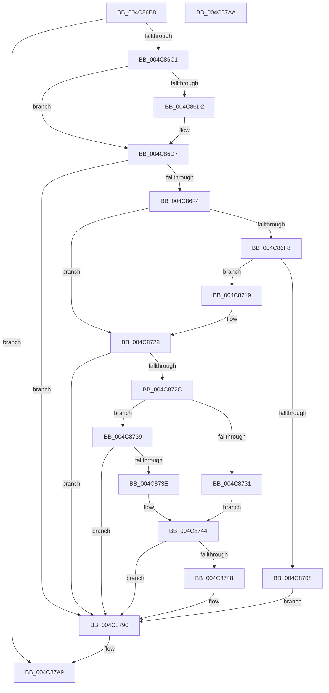

# PopSetPowerActionWatchdogState

- RVA: `0x004C86B8`–`0x004C87AB` (길이 `243` bytes)
- VA: `0x00000001404C86B8`
- 실행 섹션: `.text`
- PDB 이름 있음: `예`; PDB Function 태그: `아니요`
- unwind 정보 RVA: `0x000BD328`
- 디코드: `61`개 명령, `243/243` bytes 표시
- 미해석 바이트: `0` (있으면 어셈블리에 `.byte`로 보존)

> 이 문서는 커널 이미지의 기계어와 PDB 기호를 분석해 생성했습니다. 4번과 5번은 함수 원형과 자료형을 바이너리 사용 방식에서 추정한 C 해석이며 원본 소스 복구 결과는 아닙니다.

## 1. Dependencies

- 직접 호출 지점: **6**; 고유 호출 대상: **6**
- 직접 호출자로 확인된 함수: **2**
- RIP 상대 이미지 참조: **11**

### Outgoing calls
- `0x004C86D2` → [PopUpdatePowerActionWatchdogTimeouts](../../page/75/PopUpdatePowerActionWatchdogTimeouts_function_0075F0BC.md) (function, `0x0075F0BC`)
- `0x004C86DE` → [KeAcquireSpinLockRaiseToDpc](../20/KeAcquireSpinLockRaiseToDpc_function_00208470.md) (function, `0x00208470`)
- `0x004C86FF` → [KeCancelTimer](../23/KeCancelTimer_function_002327E0.md) (function, `0x002327E0`)
- `0x004C8712` → [PopPowerActionWatchdog](../5D/PopPowerActionWatchdog_function_005D51A0.md) (function, `0x005D51A0`)
- `0x004C878B` → [KiSetTimerEx](../23/KiSetTimerEx_function_00232CB0.md) (function, `0x00232CB0`)
- `0x004C879A` → [KeReleaseSpinLock](../39/KeReleaseSpinLock_function_00392BA0.md) (function, `0x00392BA0`)

### Direct callers
- [PopIssueActionRequest](../../page/A9/PopIssueActionRequest_function_00A9CE54.md) at `0x00A9CFA9`
- [PopIssueActionRequest](../../page/A9/PopIssueActionRequest_function_00A9CE54.md) at `0x00A9D30F`
- [PopTransitionSystemPowerStateEx](../../pagelk/B7/PopTransitionSystemPowerStateEx_function_00B7E8C0.md) at `0x00B7F715`

### Static image references
- `0x004C86D7` → RVA `0x00F0BE68` (`.data`; read)
- `0x004C86E3` → RVA `0x00F0BEF4` (`.data`; read)
- `0x004C86F8` → RVA `0x00F0BEB0` (`.data`; read)
- `0x004C8719` → RVA `0x00F0BEF8` (`.data`; read/write)
- `0x004C8721` → RVA `0x00F0BEF4` (`.data`; read/write)
- `0x004C8731` → RVA `0x00FC6E44` (`ALMOSTRO`; read)
- `0x004C873E` → RVA `0x00FC6E48` (`ALMOSTRO`; read)
- `0x004C875B` → RVA `0x00F0BEF8` (`.data`; write)
- `0x004C876C` → RVA `0x00F0BF00` (`.data`; write)
- `0x004C8772` → RVA `0x00F0BE70` (`.data`; read)
- `0x004C8780` → RVA `0x00F0BEF4` (`.data`; write)

## 2. Other-region calls and transfers

- 다른 실행 섹션으로 향하는 call: **1**
  - `0x004C86D2` → [PopUpdatePowerActionWatchdogTimeouts](../../page/75/PopUpdatePowerActionWatchdogTimeouts_function_0075F0BC.md) (`.text` → `PAGE`)
- 별도 외부 분기/꼬리 이동을 확인하지 못했습니다.

## 3. Assembly (complete function range)

```asm
004C86B8  83 F9 03                        cmp ecx, 3
004C86BB  0F 8D E8 00 00 00               jge 0x1404c87a9
004C86C1  48 89 5C 24 08                  mov qword ptr [rsp + 8], rbx
004C86C6  57                              push rdi
004C86C7  48 83 EC 30                     sub rsp, 0x30
004C86CB  8B D9                           mov ebx, ecx
004C86CD  83 F9 01                        cmp ecx, 1
004C86D0  75 05                           jne 0x1404c86d7
004C86D2  E8 E5 69 29 00                  call 0x14075f0bc
004C86D7  48 8D 0D 8A 37 A4 00            lea rcx, [rip + 0xa4378a]
004C86DE  E8 8D FD D3 FF                  call 0x140208470
004C86E3  8B 0D 0B 38 A4 00               mov ecx, dword ptr [rip + 0xa4380b]
004C86E9  40 8A F8                        mov dil, al
004C86EC  3B CB                           cmp ecx, ebx
004C86EE  0F 84 9C 00 00 00               je 0x1404c8790
004C86F4  85 C9                           test ecx, ecx
004C86F6  74 30                           je 0x1404c8728
004C86F8  48 8D 0D B1 37 A4 00            lea rcx, [rip + 0xa437b1]
004C86FF  E8 DC A0 D6 FF                  call 0x1402327e0
004C8704  84 C0                           test al, al
004C8706  75 11                           jne 0x1404c8719
004C8708  45 33 C9                        xor r9d, r9d
004C870B  45 33 C0                        xor r8d, r8d
004C870E  33 D2                           xor edx, edx
004C8710  33 C9                           xor ecx, ecx
004C8712  E8 89 CA 10 00                  call 0x1405d51a0
004C8717  EB 77                           jmp 0x1404c8790
004C8719  48 83 25 D7 37 A4 00 00         and qword ptr [rip + 0xa437d7], 0
004C8721  83 25 CC 37 A4 00 00            and dword ptr [rip + 0xa437cc], 0
004C8728  85 DB                           test ebx, ebx
004C872A  74 64                           je 0x1404c8790
004C872C  83 FB 01                        cmp ebx, 1
004C872F  75 08                           jne 0x1404c8739
004C8731  8B 0D 0D E7 AF 00               mov ecx, dword ptr [rip + 0xafe70d]
004C8737  EB 0B                           jmp 0x1404c8744
004C8739  83 FB 02                        cmp ebx, 2
004C873C  75 52                           jne 0x1404c8790
004C873E  8B 0D 04 E7 AF 00               mov ecx, dword ptr [rip + 0xafe704]
004C8744  85 C9                           test ecx, ecx
004C8746  74 48                           je 0x1404c8790
004C8748  48 B8 08 00 00 00 80 F7 FF FF   movabs rax, 0xfffff78000000008
004C8752  45 33 C9                        xor r9d, r9d
004C8755  45 33 C0                        xor r8d, r8d
004C8758  48 8B 00                        mov rax, qword ptr [rax]
004C875B  48 89 05 96 37 A4 00            mov qword ptr [rip + 0xa43796], rax
004C8762  48 63 C1                        movsxd rax, ecx
004C8765  48 69 D0 80 69 67 FF            imul rdx, rax, -0x989680
004C876C  89 0D 8E 37 A4 00               mov dword ptr [rip + 0xa4378e], ecx
004C8772  48 8D 05 F7 36 A4 00            lea rax, [rip + 0xa436f7]
004C8779  48 8D 0D 30 37 A4 00            lea rcx, [rip + 0xa43730]
004C8780  89 1D 6E 37 A4 00               mov dword ptr [rip + 0xa4376e], ebx
004C8786  48 89 44 24 20                  mov qword ptr [rsp + 0x20], rax
004C878B  E8 20 A5 D6 FF                  call 0x140232cb0
004C8790  40 8A D7                        mov dl, dil
004C8793  48 8D 0D CE 36 A4 00            lea rcx, [rip + 0xa436ce]
004C879A  E8 01 A4 EC FF                  call 0x140392ba0
004C879F  48 8B 5C 24 40                  mov rbx, qword ptr [rsp + 0x40]
004C87A4  48 83 C4 30                     add rsp, 0x30
004C87A8  5F                              pop rdi
004C87A9  C3                              ret
004C87AA  CC                              int3
```

## 4. C-style interpretation (structured pseudocode)

```c
__int64 __fastcall PopSetPowerActionWatchdogState(int a1, int a2, int a3, int a4)
{
    __int64 result;
    __int64 v_rsp;
    unsigned __int64 v_stack_m18;
    unsigned __int64 v_stack_p8;

    if (a1 >= 3) goto loc_004C87A9;
    v_stack_p8 = v_rbx;
    v_rsp = (v_rsp) - (48);
    if (a1 == 1) {
        result = PopUpdatePowerActionWatchdogTimeouts(a1, a2, a3, a4);
    }
    result = KeAcquireSpinLockRaiseToDpc(v_rip + 10762122, a2, a3, a4);
    if (((unsigned int)((unsigned int)(*(unsigned int *)(v_rip + 10762251)))) == ((unsigned int)((unsigned int)(a1)))) goto loc_004C8790;
    if ((unsigned int)((unsigned int)(*(unsigned int *)(v_rip + 10762251))) == 0) goto loc_004C8728;
    result = KeCancelTimer(v_rip + 10762161, a2, a3, a4);
    if ((unsigned __int8)(result) != 0) goto loc_004C8719;
    a4 = 0;
    a3 = 0;
    a2 = 0;
    a1 = 0;
    result = PopPowerActionWatchdog(a1, a2, a3, a4);
    goto loc_004C8790;
loc_004C8719:
loc_004C8728:
    if ((unsigned int)((unsigned int)(a1)) == 0) goto loc_004C8790;
    if (((unsigned int)((unsigned int)(a1))) != 1) goto loc_004C8739;
    goto loc_004C8744;
loc_004C8739:
    if (((unsigned int)((unsigned int)(a1))) != 2) goto loc_004C8790;
loc_004C8744:
    if ((unsigned int)((unsigned int)(*(unsigned int *)(v_rip + 11527940))) != 0) {
        a4 = 0;
        a3 = 0;
        result = *(unsigned __int64 *)(result);
        *(unsigned __int64 *)(v_rip + 10762134) = result;
        result = (int)((unsigned int)((unsigned int)(*(unsigned int *)(v_rip + 11527940))));
        a2 = (a2) * (result);
        *(unsigned int *)(v_rip + 10762126) = (unsigned int)((unsigned int)(*(unsigned int *)(v_rip + 11527940)));
        result = v_rip + 10761975;
        a1 = v_rip + 10762032;
        *(unsigned int *)(v_rip + 10762094) = (unsigned int)((unsigned int)(a1));
        v_stack_m18 = result;
        result = KiSetTimerEx(a1, a2, a3, a4);
    }
    result = KeReleaseSpinLock(v_rip + 10761934, (unsigned __int8)((unsigned __int8)(result)), a3, a4);
    v_rsp = (v_rsp) + (48);
loc_004C87A9:
    return result;
}
```

## 5. (Beta) C Style

```c
int64_t PopSetPowerActionWatchdogState(int32_t Arg1, int32_t Arg2, int32_t Arg3, int32_t Arg4)
{
    int64_t result;
    int64_t local_rsp;
    uint64_t v_stack_m18;
    uint64_t v_stack_p8;

    if (Arg1 >= 3) goto loc_004C87A9;
    v_stack_p8 = local_rbx;
    local_rsp = (local_rsp) - (48);
    if (Arg1 == 1) {
        result = PopUpdatePowerActionWatchdogTimeouts(Arg1, Arg2, Arg3, Arg4);
    }
    result = KeAcquireSpinLockRaiseToDpc(v_rip + 10762122, Arg2, Arg3, Arg4);
    if (((uint32_t)((uint32_t)(*(uint32_t *)(v_rip + 0xA4380B)))) == ((uint32_t)((uint32_t)(Arg1)))) goto loc_004C8790;
    if ((uint32_t)((uint32_t)(*(uint32_t *)(v_rip + 0xA4380B))) == 0) goto loc_004C8728;
    result = KeCancelTimer(v_rip + 10762161, Arg2, Arg3, Arg4);
    if ((uint8_t)(result) != 0) goto loc_004C8719;
    Arg4 = 0;
    Arg3 = 0;
    Arg2 = 0;
    Arg1 = 0;
    result = PopPowerActionWatchdog(Arg1, Arg2, Arg3, Arg4);
    goto loc_004C8790;
loc_004C8719:
loc_004C8728:
    if ((uint32_t)((uint32_t)(Arg1)) == 0) goto loc_004C8790;
    if (((uint32_t)((uint32_t)(Arg1))) != 1) goto loc_004C8739;
    goto loc_004C8744;
loc_004C8739:
    if (((uint32_t)((uint32_t)(Arg1))) != 2) goto loc_004C8790;
loc_004C8744:
    if ((uint32_t)((uint32_t)(*(uint32_t *)(v_rip + 0xAFE704))) != 0) {
        Arg4 = 0;
        Arg3 = 0;
        result = *(uint64_t *)(result);
        *(uint64_t *)(v_rip + 0xA43796) = result;
        result = (int32_t)((uint32_t)((uint32_t)(*(uint32_t *)(v_rip + 0xAFE704))));
        Arg2 = (Arg2) * (result);
        *(uint32_t *)(v_rip + 0xA4378E) = (uint32_t)((uint32_t)(*(uint32_t *)(v_rip + 0xAFE704)));
        result = v_rip + 10761975;
        Arg1 = v_rip + 10762032;
        *(uint32_t *)(v_rip + 0xA4376E) = (uint32_t)((uint32_t)(Arg1));
        v_stack_m18 = result;
        result = KiSetTimerEx(Arg1, Arg2, Arg3, Arg4);
    }
    result = KeReleaseSpinLock(v_rip + 10761934, (uint8_t)((uint8_t)(result)), Arg3, Arg4);
    local_rsp = (local_rsp) + (48);
loc_004C87A9:
    return result;
}
```

## 6. Execution-region graph

[열기: 2D/3D 그래프와 함수 탐색 컨트롤 패널](../../../control-panel.html?section=text&rva=0x004C86B8&view=graph)

- 2D 그래프는 위에서 아래로 흐르고, 3D 그래프는 빈 공간을 드래그해 회전합니다. Shift+드래그는 이동, 휠은 확대·축소, 함수 노드 선택은 대상 보고서 이동입니다.

### Static fallback


