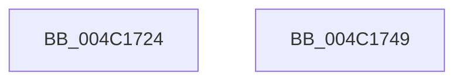

# PopSystemTimeToLocalTime

- RVA: `0x004C1724`–`0x004C174A` (길이 `38` bytes)
- VA: `0x00000001404C1724`
- 실행 섹션: `.text`
- PDB 이름 있음: `예`; PDB Function 태그: `아니요`
- unwind 정보 RVA: `0x0005C788`
- 디코드: `10`개 명령, `38/38` bytes 표시
- 미해석 바이트: `0` (있으면 어셈블리에 `.byte`로 보존)

> 이 문서는 커널 이미지의 기계어와 PDB 기호를 분석해 생성했습니다. 4번과 5번은 함수 원형과 자료형을 바이너리 사용 방식에서 추정한 C 해석이며 원본 소스 복구 결과는 아닙니다.

## 1. Dependencies

- 직접 호출 지점: **1**; 고유 호출 대상: **1**
- 직접 호출자로 확인된 함수: **2**
- RIP 상대 이미지 참조: **0**

### Outgoing calls
- `0x004C172E` → [PsGetCurrentServerSiloGlobals](../2F/PsGetCurrentServerSiloGlobals_function_002FE1F0.md) (function, `0x002FE1F0`)

### Direct callers
- [PopDiagTraceSmartSuspendPrediction](../../page/76/PopDiagTraceSmartSuspendPrediction_function_00763124.md) at `0x00763185`
- [PopDiagTraceSmartSuspendPrediction](../../page/76/PopDiagTraceSmartSuspendPrediction_function_00763124.md) at `0x00763193`
- [PopDiagTraceSmartSuspendPrediction](../../page/76/PopDiagTraceSmartSuspendPrediction_function_00763124.md) at `0x007631A1`
- [PopDiagTraceSmartSuspendPrediction](../../page/76/PopDiagTraceSmartSuspendPrediction_function_00763124.md) at `0x007631AF`
- [PopDiagTraceSmartSuspendPrediction](../../page/76/PopDiagTraceSmartSuspendPrediction_function_00763124.md) at `0x007631BD`
- [PopDiagTraceSmartSuspendPrediction](../../page/76/PopDiagTraceSmartSuspendPrediction_function_00763124.md) at `0x007631CB`
- [PopDiagTraceSmartSuspendPrediction](../../page/76/PopDiagTraceSmartSuspendPrediction_function_00763124.md) at `0x007631D8`
- [PopDiagTraceSmartSuspendPrediction](../../page/76/PopDiagTraceSmartSuspendPrediction_function_00763124.md) at `0x007631E5`
- [PopDiagTraceSmartSuspendPrediction](../../page/76/PopDiagTraceSmartSuspendPrediction_function_00763124.md) at `0x007631F2`
- [PopDiagTraceSmartSuspendValidation](../../page/AA/PopDiagTraceSmartSuspendValidation_function_00AA7254.md) at `0x00AA72A3`
- [PopDiagTraceSmartSuspendValidation](../../page/AA/PopDiagTraceSmartSuspendValidation_function_00AA7254.md) at `0x00AA72B1`
- [PopDiagTraceSmartSuspendValidation](../../page/AA/PopDiagTraceSmartSuspendValidation_function_00AA7254.md) at `0x00AA72BF`
- [PopDiagTraceSmartSuspendValidation](../../page/AA/PopDiagTraceSmartSuspendValidation_function_00AA7254.md) at `0x00AA72CD`
- [PopDiagTraceSmartSuspendValidation](../../page/AA/PopDiagTraceSmartSuspendValidation_function_00AA7254.md) at `0x00AA72DB`
- [PopDiagTraceSmartSuspendValidation](../../page/AA/PopDiagTraceSmartSuspendValidation_function_00AA7254.md) at `0x00AA72E9`

### Static image references
- 디코드된 RIP-relative 메모리 참조가 없습니다.

## 2. Other-region calls and transfers

- 다른 실행 섹션으로 향하는 call: **0**
- 별도 외부 분기/꼬리 이동을 확인하지 못했습니다.

## 3. Assembly (complete function range)

```asm
004C1724  48 83 EC 28                     sub rsp, 0x28
004C1728  48 8B 12                        mov rdx, qword ptr [rdx]
004C172B  4C 8B C9                        mov r9, rcx
004C172E  E8 BD CA E3 FF                  call 0x1402fe1f0
004C1733  4C 8B 80 C8 04 00 00            mov r8, qword ptr [rax + 0x4c8]
004C173A  49 2B 90 B8 01 00 00            sub rdx, qword ptr [r8 + 0x1b8]
004C1741  49 89 11                        mov qword ptr [r9], rdx
004C1744  48 83 C4 28                     add rsp, 0x28
004C1748  C3                              ret
004C1749  CC                              int3
```

## 4. C-style interpretation (structured pseudocode)

```c
__int64 __fastcall PopSystemTimeToLocalTime(__int64 a1, __int64 a2)
{
    __int64 result;
    __int64 v_rsp;

    v_rsp = (v_rsp) - (40);
    result = PsGetCurrentServerSiloGlobals(a1, *(unsigned __int64 *)(a2), a3, a1);
    a2 = (*(unsigned __int64 *)(a2)) - (*(unsigned __int64 *)(*(unsigned __int64 *)(result + 1224) + 440));
    *(unsigned __int64 *)(a1) = a2;
    v_rsp = (v_rsp) + (40);
    return result;
}
```

## 5. (Beta) C Style

```c
int64_t PopSystemTimeToLocalTime(int64_t Arg1, void *Arg2)
{
    uint8_t *arg2 = (uint8_t *)Arg2;

    int64_t result;
    int64_t local_rsp;

    local_rsp = (local_rsp) - (40);
    result = PsGetCurrentServerSiloGlobals(Arg1, *(uint64_t *)(arg2), a3, Arg1);
    Arg2 = (*(uint64_t *)(arg2)) - (*(uint64_t *)(*(uint64_t *)(result + 0x4C8) + 0x1B8));
    *(void **)(Arg1) = Arg2;
    local_rsp = (local_rsp) + (40);
    return result;
}
```

### 관측된 메모리 오프셋

구조체 형식이 확인되지 않은 접근은 인자 기준의 오프셋으로만 기록했습니다.

| 기준 인자 | 오프셋 표현 | 폭 (bit) | 접근 |
|---|---:|---:|---|
| `Arg2` | `+ 0x0` | `64` | `R` |

## 6. Execution-region graph

[열기: 2D/3D 그래프와 함수 탐색 컨트롤 패널](../../../control-panel.html?section=text&rva=0x004C1724&view=graph)

- 2D 그래프는 위에서 아래로 흐르고, 3D 그래프는 빈 공간을 드래그해 회전합니다. Shift+드래그는 이동, 휠은 확대·축소, 함수 노드 선택은 대상 보고서 이동입니다.

### Static fallback


