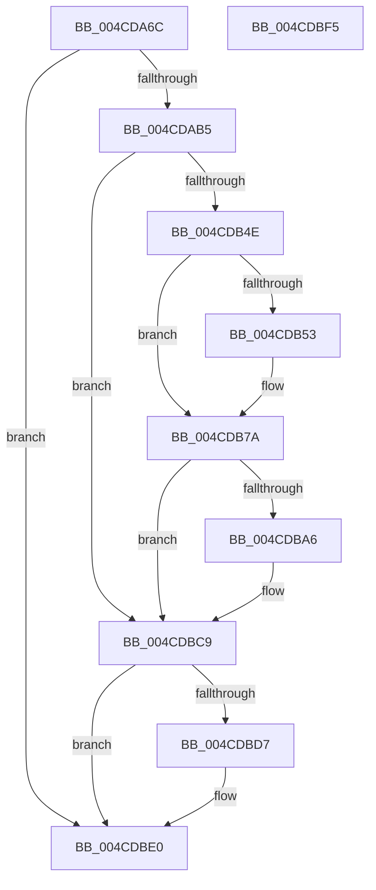

# PopThermalWriteShutdownToRegistry

- RVA: `0x004CDA6C`–`0x004CDBF6` (길이 `394` bytes)
- VA: `0x00000001404CDA6C`
- 실행 섹션: `.text`
- PDB 이름 있음: `예`; PDB Function 태그: `아니요`
- unwind 정보 RVA: `0x000BD9A4`
- 디코드: `88`개 명령, `394/394` bytes 표시
- 미해석 바이트: `0` (있으면 어셈블리에 `.byte`로 보존)

> 이 문서는 커널 이미지의 기계어와 PDB 기호를 분석해 생성했습니다. 4번과 5번은 함수 원형과 자료형을 바이너리 사용 방식에서 추정한 C 해석이며 원본 소스 복구 결과는 아닙니다.

## 1. Dependencies

- 직접 호출 지점: **10**; 고유 호출 대상: **4**
- 직접 호출자로 확인된 함수: **2**
- RIP 상대 이미지 참조: **6**

### Outgoing calls
- `0x004CDAA8` → [PopOpenThermalLoggingKey](PopOpenThermalLoggingKey_function_004CDBFC.md) (function, `0x004CDBFC`)
- `0x004CDAC0` → [RtlInitUnicodeString](../42/RtlInitUnicodeString_function_0042A780.md) (function, `0x0042A780`)
- `0x004CDAD0` → [RtlInitUnicodeString](../42/RtlInitUnicodeString_function_0042A780.md) (function, `0x0042A780`)
- `0x004CDAE0` → [RtlInitUnicodeString](../42/RtlInitUnicodeString_function_0042A780.md) (function, `0x0042A780`)
- `0x004CDAF0` → [RtlInitUnicodeString](../42/RtlInitUnicodeString_function_0042A780.md) (function, `0x0042A780`)
- `0x004CDB40` → [ZwSetValueKey](../6A/ZwSetValueKey_function_006ADCD0.md) (function, `0x006ADCD0`)
- `0x004CDB75` → [ZwSetValueKey](../6A/ZwSetValueKey_function_006ADCD0.md) (function, `0x006ADCD0`)
- `0x004CDB9C` → [ZwSetValueKey](../6A/ZwSetValueKey_function_006ADCD0.md) (function, `0x006ADCD0`)
- `0x004CDBC4` → [ZwSetValueKey](../6A/ZwSetValueKey_function_006ADCD0.md) (function, `0x006ADCD0`)
- `0x004CDBDB` → [ZwClose](../6A/ZwClose_function_006AD2B0.md) (function, `0x006AD2B0`)

### Direct callers
- [sub_006F9E40](../6F/Unknown_function_006F9E40.md) at `0x006F9E65`
- [PopThermalProcessUsermodeEvent](../../page/AB/PopThermalProcessUsermodeEvent_function_00AB7D58.md) at `0x00AB7DF9`

### Static image references
- `0x004CDAB5` → RVA `0x00029498` (`.rdata`; read)
- `0x004CDAC5` → RVA `0x000293B0` (`.rdata`; read)
- `0x004CDAD5` → RVA `0x000293D0` (`.rdata`; read)
- `0x004CDAE5` → RVA `0x00029388` (`.rdata`; read)
- `0x004CDB45` → RVA `0x00F0C920` (`.data`; read)
- `0x004CDBC9` → RVA `0x00F0C920` (`.data`; write)

## 2. Other-region calls and transfers

- 다른 실행 섹션으로 향하는 call: **0**
- 별도 외부 분기/꼬리 이동을 확인하지 못했습니다.

## 3. Assembly (complete function range)

```asm
004CDA6C  48 89 74 24 08                  mov qword ptr [rsp + 8], rsi
004CDA71  48 89 7C 24 10                  mov qword ptr [rsp + 0x10], rdi
004CDA76  55                              push rbp
004CDA77  48 8B EC                        mov rbp, rsp
004CDA7A  48 81 EC 80 00 00 00            sub rsp, 0x80
004CDA81  48 83 65 28 00                  and qword ptr [rbp + 0x28], 0
004CDA86  0F 57 C0                        xorps xmm0, xmm0
004CDA89  0F 57 C9                        xorps xmm1, xmm1
004CDA8C  48 8B F2                        mov rsi, rdx
004CDA8F  48 8B F9                        mov rdi, rcx
004CDA92  48 8D 55 28                     lea rdx, [rbp + 0x28]
004CDA96  33 C9                           xor ecx, ecx
004CDA98  0F 11 45 B8                     movups xmmword ptr [rbp - 0x48], xmm0
004CDA9C  0F 11 4D C8                     movups xmmword ptr [rbp - 0x38], xmm1
004CDAA0  0F 11 45 E8                     movups xmmword ptr [rbp - 0x18], xmm0
004CDAA4  0F 11 4D D8                     movups xmmword ptr [rbp - 0x28], xmm1
004CDAA8  E8 4F 01 00 00                  call 0x1404cdbfc
004CDAAD  85 C0                           test eax, eax
004CDAAF  0F 88 2B 01 00 00               js 0x1404cdbe0
004CDAB5  48 8D 15 DC B9 B5 FF            lea rdx, [rip - 0x4a4624]
004CDABC  48 8D 4D B8                     lea rcx, [rbp - 0x48]
004CDAC0  E8 BB CC F5 FF                  call 0x14042a780
004CDAC5  48 8D 15 E4 B8 B5 FF            lea rdx, [rip - 0x4a471c]
004CDACC  48 8D 4D C8                     lea rcx, [rbp - 0x38]
004CDAD0  E8 AB CC F5 FF                  call 0x14042a780
004CDAD5  48 8D 15 F4 B8 B5 FF            lea rdx, [rip - 0x4a470c]
004CDADC  48 8D 4D E8                     lea rcx, [rbp - 0x18]
004CDAE0  E8 9B CC F5 FF                  call 0x14042a780
004CDAE5  48 8D 15 9C B8 B5 FF            lea rdx, [rip - 0x4a4764]
004CDAEC  48 8D 4D D8                     lea rcx, [rbp - 0x28]
004CDAF0  E8 8B CC F5 FF                  call 0x14042a780
004CDAF5  48 B9 08 00 00 00 80 F7 FF FF   movabs rcx, 0xfffff78000000008
004CDAFF  C7 44 24 28 04 00 00 00         mov dword ptr [rsp + 0x28], 4
004CDB07  48 B8 4B 59 86 38 D6 C5 6D 34   movabs rax, 0x346dc5d63886594b
004CDB11  41 B9 04 00 00 00               mov r9d, 4
004CDB17  45 33 C0                        xor r8d, r8d
004CDB1A  48 8B 09                        mov rcx, qword ptr [rcx]
004CDB1D  48 F7 E1                        mul rcx
004CDB20  48 8B 4D 28                     mov rcx, qword ptr [rbp + 0x28]
004CDB24  48 8D 45 20                     lea rax, [rbp + 0x20]
004CDB28  48 C1 EA 0B                     shr rdx, 0xb
004CDB2C  48 89 55 B0                     mov qword ptr [rbp - 0x50], rdx
004CDB30  48 8D 55 B8                     lea rdx, [rbp - 0x48]
004CDB34  C7 45 20 01 00 00 00            mov dword ptr [rbp + 0x20], 1
004CDB3B  48 89 44 24 20                  mov qword ptr [rsp + 0x20], rax
004CDB40  E8 8B 01 1E 00                  call 0x1406adcd0
004CDB45  80 3D D4 ED A3 00 00            cmp byte ptr [rip + 0xa3edd4], 0
004CDB4C  75 7B                           jne 0x1404cdbc9
004CDB4E  48 85 FF                        test rdi, rdi
004CDB51  74 27                           je 0x1404cdb7a
004CDB53  0F B7 47 02                     movzx eax, word ptr [rdi + 2]
004CDB57  48 8D 55 C8                     lea rdx, [rbp - 0x38]
004CDB5B  48 8B 4D 28                     mov rcx, qword ptr [rbp + 0x28]
004CDB5F  41 B9 01 00 00 00               mov r9d, 1
004CDB65  89 44 24 28                     mov dword ptr [rsp + 0x28], eax
004CDB69  45 33 C0                        xor r8d, r8d
004CDB6C  48 8B 47 08                     mov rax, qword ptr [rdi + 8]
004CDB70  48 89 44 24 20                  mov qword ptr [rsp + 0x20], rax
004CDB75  E8 56 01 1E 00                  call 0x1406adcd0
004CDB7A  48 8B 4D 28                     mov rcx, qword ptr [rbp + 0x28]
004CDB7E  48 8D 45 B0                     lea rax, [rbp - 0x50]
004CDB82  C7 44 24 28 08 00 00 00         mov dword ptr [rsp + 0x28], 8
004CDB8A  48 8D 55 D8                     lea rdx, [rbp - 0x28]
004CDB8E  41 B9 0B 00 00 00               mov r9d, 0xb
004CDB94  48 89 44 24 20                  mov qword ptr [rsp + 0x20], rax
004CDB99  45 33 C0                        xor r8d, r8d
004CDB9C  E8 2F 01 1E 00                  call 0x1406adcd0
004CDBA1  48 85 F6                        test rsi, rsi
004CDBA4  74 23                           je 0x1404cdbc9
004CDBA6  48 8B 4D 28                     mov rcx, qword ptr [rbp + 0x28]
004CDBAA  48 8D 55 E8                     lea rdx, [rbp - 0x18]
004CDBAE  C7 44 24 28 04 00 00 00         mov dword ptr [rsp + 0x28], 4
004CDBB6  41 B9 04 00 00 00               mov r9d, 4
004CDBBC  45 33 C0                        xor r8d, r8d
004CDBBF  48 89 74 24 20                  mov qword ptr [rsp + 0x20], rsi
004CDBC4  E8 07 01 1E 00                  call 0x1406adcd0
004CDBC9  C6 05 50 ED A3 00 01            mov byte ptr [rip + 0xa3ed50], 1
004CDBD0  48 83 7D 28 00                  cmp qword ptr [rbp + 0x28], 0
004CDBD5  74 09                           je 0x1404cdbe0
004CDBD7  48 8B 4D 28                     mov rcx, qword ptr [rbp + 0x28]
004CDBDB  E8 D0 F6 1D 00                  call 0x1406ad2b0
004CDBE0  4C 8D 9C 24 80 00 00 00         lea r11, [rsp + 0x80]
004CDBE8  49 8B 73 10                     mov rsi, qword ptr [r11 + 0x10]
004CDBEC  49 8B 7B 18                     mov rdi, qword ptr [r11 + 0x18]
004CDBF0  49 8B E3                        mov rsp, r11
004CDBF3  5D                              pop rbp
004CDBF4  C3                              ret
004CDBF5  CC                              int3
```

## 4. C-style interpretation (structured pseudocode)

```c
__int64 __fastcall PopThermalWriteShutdownToRegistry(__int64 a1, __int64 a2, int a3)
{
    __int64 result;
    __int64 v_rsp;
    unsigned __int64 v_stack_m20;
    unsigned __int64 v_stack_m30;
    unsigned __int64 v_stack_m40;
    unsigned __int64 v_stack_m50;
    unsigned __int64 v_stack_m58;
    unsigned int v_stack_m60;
    unsigned __int64 v_stack_m68;
    unsigned __int64 v_stack_m8;
    unsigned __int64 v_stack_p10;
    unsigned __int64 v_stack_p18;
    unsigned __int64 v_stack_p20;
    unsigned __int64 v_stack_p8;

    v_stack_p8 = v_rsi;
    v_stack_p10 = v_rdi;
    v_rsp = (v_rsp) - (128);
    a1 = 0;
    v_stack_m50 = v_xmm0;
    v_stack_m40 = v_xmm1;
    v_stack_m20 = v_xmm0;
    v_stack_m30 = v_xmm1;
    result = PopOpenThermalLoggingKey(a1, v_stack_p20, a3, a4);
    if (sign_flag) goto loc_004CDBE0;
    result = RtlInitUnicodeString(v_stack_m50, v_rip - 4867620, a3, a4);
    result = RtlInitUnicodeString(v_stack_m40, v_rip - 4867868, a3, a4);
    result = RtlInitUnicodeString(v_stack_m20, v_rip - 4867852, a3, a4);
    result = RtlInitUnicodeString(v_stack_m30, v_rip - 4867940, a3, a4);
    v_stack_m60 = 4;
    a3 = 0;
    a2 = (v_rip - 4867940) >> (11);
    v_stack_m58 = a2;
    v_stack_p18 = 1;
    v_stack_m68 = v_stack_p18;
    result = ZwSetValueKey(v_stack_p20, v_stack_m50, a3, 4);
    if ((*(unsigned __int8 *)(v_rip + 10743252)) != 0) goto loc_004CDBC9;
    if (0 != 0) {
        result = *(unsigned __int16 *)(a1 + 2);
        a2 = v_stack_m40;
        a1 = v_stack_p20;
        a4 = 1;
        v_stack_m60 = (unsigned int)(result);
        a3 = 0;
        result = *(unsigned __int64 *)(a1 + 8);
        v_stack_m68 = result;
        result = ZwSetValueKey(a1, a2, a3, a4);
    }
    v_stack_m60 = 8;
    v_stack_m68 = v_stack_m58;
    a3 = 0;
    result = ZwSetValueKey(v_stack_p20, v_stack_m30, a3, 11);
    if (a2 != 0) {
        a1 = v_stack_p20;
        a2 = v_stack_m20;
        v_stack_m60 = 4;
        a4 = 4;
        a3 = 0;
        v_stack_m68 = a2;
        result = ZwSetValueKey(a1, a2, a3, a4);
    }
    *(unsigned __int8 *)(v_rip + 10743120) = 1;
    if (v_stack_p20 != 0) {
        a1 = v_stack_p20;
        result = ZwClose(a1, a2, a3, a4);
    }
    return result;
}
```

## 5. (Beta) C Style

```c
int64_t PopThermalWriteShutdownToRegistry(int64_t Arg1, int64_t Arg2, int32_t Arg3)
{
    int64_t result;
    int64_t local_rsp;
    uint64_t v_stack_m20;
    uint64_t v_stack_m30;
    uint64_t v_stack_m40;
    uint64_t v_stack_m50;
    uint64_t v_stack_m58;
    uint32_t v_stack_m60;
    uint64_t v_stack_m68;
    uint64_t v_stack_m8;
    uint64_t v_stack_p10;
    uint64_t v_stack_p18;
    uint64_t v_stack_p20;
    uint64_t v_stack_p8;

    v_stack_p8 = local_rsi;
    v_stack_p10 = local_rdi;
    local_rsp = (local_rsp) - (128);
    Arg1 = 0;
    v_stack_m50 = v_xmm0;
    v_stack_m40 = v_xmm1;
    v_stack_m20 = v_xmm0;
    v_stack_m30 = v_xmm1;
    result = PopOpenThermalLoggingKey(Arg1, v_stack_p20, Arg3, a4);
    if (sign_flag) goto loc_004CDBE0;
    result = RtlInitUnicodeString(v_stack_m50, v_rip - 4867620, Arg3, a4);
    result = RtlInitUnicodeString(v_stack_m40, v_rip - 4867868, Arg3, a4);
    result = RtlInitUnicodeString(v_stack_m20, v_rip - 4867852, Arg3, a4);
    result = RtlInitUnicodeString(v_stack_m30, v_rip - 4867940, Arg3, a4);
    v_stack_m60 = 4;
    Arg3 = 0;
    Arg2 = (v_rip - 4867940) >> (11);
    v_stack_m58 = Arg2;
    v_stack_p18 = 1;
    v_stack_m68 = v_stack_p18;
    result = ZwSetValueKey(v_stack_p20, v_stack_m50, Arg3, 4);
    if ((*(uint8_t *)(v_rip + 0xA3EDD4)) != 0) goto loc_004CDBC9;
    if (0 != 0) {
        result = *(uint16_t *)(Arg1 + 0x2);
        Arg2 = v_stack_m40;
        Arg1 = v_stack_p20;
        a4 = 1;
        v_stack_m60 = (uint32_t)(result);
        Arg3 = 0;
        result = *(uint64_t *)(Arg1 + 0x8);
        v_stack_m68 = result;
        result = ZwSetValueKey(Arg1, Arg2, Arg3, a4);
    }
    v_stack_m60 = 8;
    v_stack_m68 = v_stack_m58;
    Arg3 = 0;
    result = ZwSetValueKey(v_stack_p20, v_stack_m30, Arg3, 11);
    if (Arg2 != 0) {
        Arg1 = v_stack_p20;
        Arg2 = v_stack_m20;
        v_stack_m60 = 4;
        a4 = 4;
        Arg3 = 0;
        v_stack_m68 = Arg2;
        result = ZwSetValueKey(Arg1, Arg2, Arg3, a4);
    }
    *(uint8_t *)(v_rip + 0xA3ED50) = 1;
    if (v_stack_p20 != 0) {
        Arg1 = v_stack_p20;
        result = ZwClose(Arg1, Arg2, Arg3, a4);
    }
    return result;
}
```

## 6. Execution-region graph

[열기: 2D/3D 그래프와 함수 탐색 컨트롤 패널](../../../control-panel.html?section=text&rva=0x004CDA6C&view=graph)

- 2D 그래프는 위에서 아래로 흐르고, 3D 그래프는 빈 공간을 드래그해 회전합니다. Shift+드래그는 이동, 휠은 확대·축소, 함수 노드 선택은 대상 보고서 이동입니다.

### Static fallback


