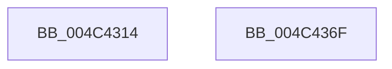

# PopUmpoSendFlushSleepStudyLoggerNotification

- RVA: `0x004C4314`–`0x004C4370` (길이 `92` bytes)
- VA: `0x00000001404C4314`
- 실행 섹션: `.text`
- PDB 이름 있음: `예`; PDB Function 태그: `아니요`
- unwind 정보 RVA: `0x000BCD28`
- 디코드: `22`개 명령, `92/92` bytes 표시
- 미해석 바이트: `0` (있으면 어셈블리에 `.byte`로 보존)

> 이 문서는 커널 이미지의 기계어와 PDB 기호를 분석해 생성했습니다. 4번과 5번은 함수 원형과 자료형을 바이너리 사용 방식에서 추정한 C 해석이며 원본 소스 복구 결과는 아닙니다.

## 1. Dependencies

- 직접 호출 지점: **6**; 고유 호출 대상: **5**
- 직접 호출자로 확인된 함수: **1**
- RIP 상대 이미지 참조: **2**

### Outgoing calls
- `0x004C431A` → [KeQueryPerformanceCounter](../37/KeQueryPerformanceCounter_function_0037E7E0.md) (function, `0x0037E7E0`)
- `0x004C4326` → [PopDiagTraceFlushSleepStudyLogger](../../pagelk/B5/PopDiagTraceFlushSleepStudyLogger_function_00B5B380.md) (function, `0x00B5B380`)
- `0x004C4336` → [memset](../6C/memset_function_006C6C40.md) (function, `0x006C6C40`)
- `0x004C4352` → [PopUmpoSendPowerMessage](../23/PopUmpoSendPowerMessage_function_00230730.md) (function, `0x00230730`)
- `0x004C4359` → [KeQueryPerformanceCounter](../37/KeQueryPerformanceCounter_function_0037E7E0.md) (function, `0x0037E7E0`)
- `0x004C4365` → [PopDiagTraceFlushSleepStudyLoggerEnd](../../pagelk/B7/PopDiagTraceFlushSleepStudyLoggerEnd_function_00B7D904.md) (function, `0x00B7D904`)

### Direct callers
- [PopTransitionSystemPowerStateEx](../../pagelk/B7/PopTransitionSystemPowerStateEx_function_00B7E8C0.md) at `0x00B7F0BC`

### Static image references
- `0x004C431F` → RVA `0x00F0C318` (`.data`; write)
- `0x004C435E` → RVA `0x00F0C320` (`.data`; write)

## 2. Other-region calls and transfers

- 다른 실행 섹션으로 향하는 call: **2**
  - `0x004C4326` → [PopDiagTraceFlushSleepStudyLogger](../../pagelk/B5/PopDiagTraceFlushSleepStudyLogger_function_00B5B380.md) (`.text` → `PAGELK`)
  - `0x004C4365` → [PopDiagTraceFlushSleepStudyLoggerEnd](../../pagelk/B7/PopDiagTraceFlushSleepStudyLoggerEnd_function_00B7D904.md) (`.text` → `PAGELK`)
- 별도 외부 분기/꼬리 이동을 확인하지 못했습니다.

## 3. Assembly (complete function range)

```asm
004C4314  48 83 EC 78                     sub rsp, 0x78
004C4318  33 C9                           xor ecx, ecx
004C431A  E8 C1 A4 EB FF                  call 0x14037e7e0
004C431F  48 89 05 F2 7F A4 00            mov qword ptr [rip + 0xa47ff2], rax
004C4326  E8 55 70 69 00                  call 0x140b5b380
004C432B  33 D2                           xor edx, edx
004C432D  48 8D 4C 24 20                  lea rcx, [rsp + 0x20]
004C4332  44 8D 42 48                     lea r8d, [rdx + 0x48]
004C4336  E8 05 29 20 00                  call 0x1406c6c40
004C433B  45 33 C9                        xor r9d, r9d
004C433E  C7 44 24 20 0D 00 00 00         mov dword ptr [rsp + 0x20], 0xd
004C4346  41 B0 01                        mov r8b, 1
004C4349  48 8D 4C 24 20                  lea rcx, [rsp + 0x20]
004C434E  41 8D 51 48                     lea edx, [r9 + 0x48]
004C4352  E8 D9 C3 D6 FF                  call 0x140230730
004C4357  33 C9                           xor ecx, ecx
004C4359  E8 82 A4 EB FF                  call 0x14037e7e0
004C435E  48 89 05 BB 7F A4 00            mov qword ptr [rip + 0xa47fbb], rax
004C4365  E8 9A 95 6B 00                  call 0x140b7d904
004C436A  48 83 C4 78                     add rsp, 0x78
004C436E  C3                              ret
004C436F  CC                              int3
```

## 4. C-style interpretation (structured pseudocode)

```c
__int64 __fastcall PopUmpoSendFlushSleepStudyLoggerNotification(int a1, int a2, __int64 a3, int a4)
{
    __int64 result;
    __int64 v_rsp;
    unsigned __int64 v_stack_m58;

    v_rsp = (v_rsp) - (120);
    a1 = 0;
    result = KeQueryPerformanceCounter(a1, a2, a3, a4);
    *(unsigned __int64 *)(v_rip + 10780658) = result;
    result = PopDiagTraceFlushSleepStudyLogger(a1, a2, a3, a4);
    a2 = 0;
    result = memset(v_stack_m58, a2, a2 + 72, a4);
    a4 = 0;
    v_stack_m58 = 13;
    result = PopUmpoSendPowerMessage(v_stack_m58, a4 + 72, 1, a4);
    a1 = 0;
    result = KeQueryPerformanceCounter(a1, a4 + 72, 1, a4);
    *(unsigned __int64 *)(v_rip + 10780603) = result;
    result = PopDiagTraceFlushSleepStudyLoggerEnd(a1, a4 + 72, 1, a4);
    v_rsp = (v_rsp) + (120);
    return result;
}
```

## 5. (Beta) C Style

```c
int64_t PopUmpoSendFlushSleepStudyLoggerNotification(int32_t Arg1, int32_t Arg2, int64_t Arg3, int32_t Arg4)
{
    int64_t result;
    int64_t local_rsp;
    uint64_t v_stack_m58;

    local_rsp = (local_rsp) - (120);
    Arg1 = 0;
    result = KeQueryPerformanceCounter(Arg1, Arg2, Arg3, Arg4);
    *(uint64_t *)(v_rip + 0xA47FF2) = result;
    result = PopDiagTraceFlushSleepStudyLogger(Arg1, Arg2, Arg3, Arg4);
    Arg2 = 0;
    result = memset(v_stack_m58, Arg2, Arg2 + 72, Arg4);
    Arg4 = 0;
    v_stack_m58 = 13;
    result = PopUmpoSendPowerMessage(v_stack_m58, Arg4 + 72, 1, Arg4);
    Arg1 = 0;
    result = KeQueryPerformanceCounter(Arg1, Arg4 + 72, 1, Arg4);
    *(uint64_t *)(v_rip + 0xA47FBB) = result;
    result = PopDiagTraceFlushSleepStudyLoggerEnd(Arg1, Arg4 + 72, 1, Arg4);
    local_rsp = (local_rsp) + (120);
    return result;
}
```

## 6. Execution-region graph

[열기: 2D/3D 그래프와 함수 탐색 컨트롤 패널](../../../control-panel.html?section=text&rva=0x004C4314&view=graph)

- 2D 그래프는 위에서 아래로 흐르고, 3D 그래프는 빈 공간을 드래그해 회전합니다. Shift+드래그는 이동, 휠은 확대·축소, 함수 노드 선택은 대상 보고서 이동입니다.

### Static fallback


