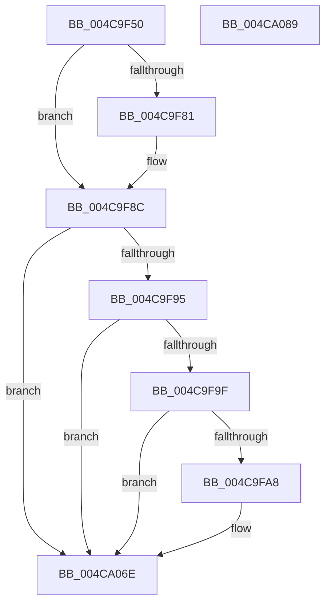

# PopVideoPowerSettingCallback

- RVA: `0x004C9F50`–`0x004CA08A` (길이 `314` bytes)
- VA: `0x00000001404C9F50`
- 실행 섹션: `.text`
- PDB 이름 있음: `예`; PDB Function 태그: `아니요`
- unwind 정보 RVA: `0x0008A0D8`
- 디코드: `79`개 명령, `314/314` bytes 표시
- 미해석 바이트: `0` (있으면 어셈블리에 `.byte`로 보존)

> 이 문서는 커널 이미지의 기계어와 PDB 기호를 분석해 생성했습니다. 4번과 5번은 함수 원형과 자료형을 바이너리 사용 방식에서 추정한 C 해석이며 원본 소스 복구 결과는 아닙니다.

## 1. Dependencies

- 직접 호출 지점: **4**; 고유 호출 대상: **4**
- 직접 호출자로 확인된 함수: **0**
- RIP 상대 이미지 참조: **3**

### Outgoing calls
- `0x004C9FA8` → [PopAcquirePolicyLock](../../pagelk/B7/PopAcquirePolicyLock_function_00B783C0.md) (function, `0x00B783C0`)
- `0x004CA04E` → [PopApplyPolicy](../../page/91/PopApplyPolicy_function_009107B0.md) (function, `0x009107B0`)
- `0x004CA055` → [PopReleasePolicyLock](../../pagelk/B7/PopReleasePolicyLock_function_00B78410.md) (function, `0x00B78410`)
- `0x004CA069` → [PopAdaptivePowerSettingCallback](../../page/76/PopAdaptivePowerSettingCallback_function_0076B7A0.md) (function, `0x0076B7A0`)

### Direct callers
- 이 함수 시작 RVA로 연결되는 직접 call은 확인되지 않았습니다. 간접 호출은 완전히 역산할 수 없습니다.

### Static image references
- `0x004C9F67` → RVA `0x0001E320` (`.rdata`; read)
- `0x004C9F81` → RVA `0x0001E328` (`.rdata`; read)
- `0x004C9FAD` → RVA `0x00F0CE68` (`.data`; read)

## 2. Other-region calls and transfers

- 다른 실행 섹션으로 향하는 call: **4**
  - `0x004C9FA8` → [PopAcquirePolicyLock](../../pagelk/B7/PopAcquirePolicyLock_function_00B783C0.md) (`.text` → `PAGELK`)
  - `0x004CA04E` → [PopApplyPolicy](../../page/91/PopApplyPolicy_function_009107B0.md) (`.text` → `PAGE`)
  - `0x004CA055` → [PopReleasePolicyLock](../../pagelk/B7/PopReleasePolicyLock_function_00B78410.md) (`.text` → `PAGELK`)
  - `0x004CA069` → [PopAdaptivePowerSettingCallback](../../page/76/PopAdaptivePowerSettingCallback_function_0076B7A0.md) (`.text` → `PAGE`)
- 별도 외부 분기/꼬리 이동을 확인하지 못했습니다.

## 3. Assembly (complete function range)

```asm
004C9F50  48 89 5C 24 08                  mov qword ptr [rsp + 8], rbx
004C9F55  48 89 6C 24 10                  mov qword ptr [rsp + 0x10], rbp
004C9F5A  48 89 74 24 18                  mov qword ptr [rsp + 0x18], rsi
004C9F5F  57                              push rdi
004C9F60  48 81 EC 10 01 00 00            sub rsp, 0x110
004C9F67  4C 8B 15 B2 43 B5 FF            mov r10, qword ptr [rip - 0x4abc4e]
004C9F6E  49 8B E9                        mov rbp, r9
004C9F71  48 8B F2                        mov rsi, rdx
004C9F74  48 8B D9                        mov rbx, rcx
004C9F77  BF 0D 00 00 C0                  mov edi, 0xc000000d
004C9F7C  4C 2B 11                        sub r10, qword ptr [rcx]
004C9F7F  75 0B                           jne 0x1404c9f8c
004C9F81  4C 8B 15 A0 43 B5 FF            mov r10, qword ptr [rip - 0x4abc60]
004C9F88  4C 2B 51 08                     sub r10, qword ptr [rcx + 8]
004C9F8C  4D 85 D2                        test r10, r10
004C9F8F  0F 85 D9 00 00 00               jne 0x1404ca06e
004C9F95  41 83 F8 04                     cmp r8d, 4
004C9F99  0F 85 CF 00 00 00               jne 0x1404ca06e
004C9F9F  48 85 F6                        test rsi, rsi
004C9FA2  0F 84 C6 00 00 00               je 0x1404ca06e
004C9FA8  E8 13 E4 6A 00                  call 0x140b783c0
004C9FAD  48 8B 05 B4 2E A4 00            mov rax, qword ptr [rip + 0xa42eb4]
004C9FB4  48 8D 4C 24 20                  lea rcx, [rsp + 0x20]
004C9FB9  BA 80 00 00 00                  mov edx, 0x80
004C9FBE  4C 8D 44 24 20                  lea r8, [rsp + 0x20]
004C9FC3  0F 10 00                        movups xmm0, xmmword ptr [rax]
004C9FC6  44 8D 4A 68                     lea r9d, [rdx + 0x68]
004C9FCA  0F 10 48 10                     movups xmm1, xmmword ptr [rax + 0x10]
004C9FCE  0F 11 01                        movups xmmword ptr [rcx], xmm0
004C9FD1  0F 10 40 20                     movups xmm0, xmmword ptr [rax + 0x20]
004C9FD5  0F 11 49 10                     movups xmmword ptr [rcx + 0x10], xmm1
004C9FD9  0F 10 48 30                     movups xmm1, xmmword ptr [rax + 0x30]
004C9FDD  0F 11 41 20                     movups xmmword ptr [rcx + 0x20], xmm0
004C9FE1  0F 10 40 40                     movups xmm0, xmmword ptr [rax + 0x40]
004C9FE5  0F 11 49 30                     movups xmmword ptr [rcx + 0x30], xmm1
004C9FE9  0F 10 48 50                     movups xmm1, xmmword ptr [rax + 0x50]
004C9FED  0F 11 41 40                     movups xmmword ptr [rcx + 0x40], xmm0
004C9FF1  0F 10 40 60                     movups xmm0, xmmword ptr [rax + 0x60]
004C9FF5  0F 11 49 50                     movups xmmword ptr [rcx + 0x50], xmm1
004C9FF9  0F 11 41 60                     movups xmmword ptr [rcx + 0x60], xmm0
004C9FFD  48 03 CA                        add rcx, rdx
004CA000  0F 10 40 70                     movups xmm0, xmmword ptr [rax + 0x70]
004CA004  48 03 C2                        add rax, rdx
004CA007  33 D2                           xor edx, edx
004CA009  0F 11 41 F0                     movups xmmword ptr [rcx - 0x10], xmm0
004CA00D  0F 10 08                        movups xmm1, xmmword ptr [rax]
004CA010  0F 10 40 10                     movups xmm0, xmmword ptr [rax + 0x10]
004CA014  0F 11 09                        movups xmmword ptr [rcx], xmm1
004CA017  0F 10 48 20                     movups xmm1, xmmword ptr [rax + 0x20]
004CA01B  0F 11 41 10                     movups xmmword ptr [rcx + 0x10], xmm0
004CA01F  0F 10 40 30                     movups xmm0, xmmword ptr [rax + 0x30]
004CA023  0F 11 49 20                     movups xmmword ptr [rcx + 0x20], xmm1
004CA027  0F 10 48 40                     movups xmm1, xmmword ptr [rax + 0x40]
004CA02B  0F 11 41 30                     movups xmmword ptr [rcx + 0x30], xmm0
004CA02F  0F 10 40 50                     movups xmm0, xmmword ptr [rax + 0x50]
004CA033  48 8B 40 60                     mov rax, qword ptr [rax + 0x60]
004CA037  0F 11 49 40                     movups xmmword ptr [rcx + 0x40], xmm1
004CA03B  0F 11 41 50                     movups xmmword ptr [rcx + 0x50], xmm0
004CA03F  48 89 41 60                     mov qword ptr [rcx + 0x60], rax
004CA043  B1 01                           mov cl, 1
004CA045  8B 06                           mov eax, dword ptr [rsi]
004CA047  89 84 24 E0 00 00 00            mov dword ptr [rsp + 0xe0], eax
004CA04E  E8 5D 67 44 00                  call 0x1409107b0
004CA053  8B F8                           mov edi, eax
004CA055  E8 B6 E3 6A 00                  call 0x140b78410
004CA05A  4C 8B CD                        mov r9, rbp
004CA05D  41 B8 04 00 00 00               mov r8d, 4
004CA063  48 8B D6                        mov rdx, rsi
004CA066  48 8B CB                        mov rcx, rbx
004CA069  E8 32 17 2A 00                  call 0x14076b7a0
004CA06E  4C 8D 9C 24 10 01 00 00         lea r11, [rsp + 0x110]
004CA076  8B C7                           mov eax, edi
004CA078  49 8B 5B 10                     mov rbx, qword ptr [r11 + 0x10]
004CA07C  49 8B 6B 18                     mov rbp, qword ptr [r11 + 0x18]
004CA080  49 8B 73 20                     mov rsi, qword ptr [r11 + 0x20]
004CA084  49 8B E3                        mov rsp, r11
004CA087  5F                              pop rdi
004CA088  C3                              ret
004CA089  CC                              int3
```

## 4. C-style interpretation (structured pseudocode)

```c
__int64 __fastcall PopVideoPowerSettingCallback(__int64 a1, __int64 a2, int a3, __int64 a4)
{
    __int64 result;
    __int64 v_r10;
    __int64 v_rdi;
    __int64 v_rsp;
    unsigned int v_stack_m38;
    unsigned __int64 v_stack_m8;
    unsigned __int64 v_stack_mF8;
    unsigned __int64 v_stack_p10;
    unsigned __int64 v_stack_p18;
    unsigned __int64 v_stack_p8;

    v_stack_p8 = v_rbx;
    v_stack_p10 = v_rbp;
    v_stack_p18 = v_rsi;
    v_rsp = (v_rsp) - (272);
    v_r10 = (*(unsigned __int64 *)(v_rip - 4897870)) - (*(unsigned __int64 *)(a1));
    if (!(condition_is_not_equal)) {
        v_r10 = *(unsigned __int64 *)(v_rip - 4897888);
        v_r10 = (v_r10) - (*(unsigned __int64 *)(a1 + 8));
    }
    if (v_r10 != 0) goto loc_004CA06E;
    if (a3 != 4) goto loc_004CA06E;
    v_rdi = (unsigned int)(0xC000000DULL);
    if (a2 != 0) {
        result = PopAcquirePolicyLock(a1, a2, a3, a4);
        result = *(unsigned __int64 *)(v_rip + 10759860);
        a1 = v_stack_mF8;
        a2 = 128;
        a3 = v_stack_mF8;
        a4 = a2 + 104;
        *(unsigned __int64 *)(a1) = v_xmm0;
        *(unsigned __int64 *)(a1 + 16) = v_xmm1;
        *(unsigned __int64 *)(a1 + 32) = v_xmm0;
        *(unsigned __int64 *)(a1 + 48) = v_xmm1;
        *(unsigned __int64 *)(a1 + 64) = v_xmm0;
        *(unsigned __int64 *)(a1 + 80) = v_xmm1;
        *(unsigned __int64 *)(a1 + 96) = v_xmm0;
        a1 = (a1) + (a2);
        result = (result) + (a2);
        a2 = 0;
        *(unsigned __int64 *)(a1 - 16) = v_xmm0;
        *(unsigned __int64 *)(a1) = v_xmm1;
        *(unsigned __int64 *)(a1 + 16) = v_xmm0;
        *(unsigned __int64 *)(a1 + 32) = v_xmm1;
        *(unsigned __int64 *)(a1 + 48) = v_xmm0;
        result = *(unsigned __int64 *)(result + 96);
        *(unsigned __int64 *)(a1 + 64) = v_xmm1;
        *(unsigned __int64 *)(a1 + 80) = v_xmm0;
        *(unsigned __int64 *)(a1 + 96) = result;
        a1 = 1;
        result = *(unsigned int *)(a2);
        v_stack_m38 = (unsigned int)(result);
        result = PopApplyPolicy(a1, a2, a3, a4);
        v_rdi = (unsigned int)(result);
        result = PopReleasePolicyLock(a1, a2, a3, a4);
        a4 = a4;
        a3 = 4;
        a2 = 0;
        a1 = a1;
        result = PopAdaptivePowerSettingCallback(a1, a2, a3, a4);
    }
    return (unsigned int)((unsigned int)(v_rdi));
}
```

## 5. (Beta) C Style

```c
int64_t PopVideoPowerSettingCallback(void *Arg1, int64_t Arg2, int32_t Arg3, int64_t Arg4)
{
    uint8_t *arg1 = (uint8_t *)Arg1;

    int64_t result;
    int64_t local_r10;
    int64_t local_rdi;
    int64_t local_rsp;
    uint32_t v_stack_m38;
    uint64_t v_stack_m8;
    uint64_t v_stack_mF8;
    uint64_t v_stack_p10;
    uint64_t v_stack_p18;
    uint64_t v_stack_p8;

    v_stack_p8 = local_rbx;
    v_stack_p10 = local_rbp;
    v_stack_p18 = local_rsi;
    local_rsp = (local_rsp) - (272);
    local_r10 = (*(uint64_t *)(v_rip - 0x4ABC4E)) - (*(uint64_t *)(arg1));
    if (!(condition_is_not_equal)) {
        local_r10 = *(uint64_t *)(v_rip - 0x4ABC60);
        local_r10 = (local_r10) - (*(uint64_t *)(arg1 + 0x8));
    }
    if (local_r10 != 0) goto loc_004CA06E;
    if (Arg3 != 4) goto loc_004CA06E;
    local_rdi = (uint32_t)(0xC000000DULL);
    if (Arg2 != 0) {
        result = PopAcquirePolicyLock(Arg1, Arg2, Arg3, Arg4);
        result = *(uint64_t *)(v_rip + 0xA42EB4);
        Arg1 = v_stack_mF8;
        Arg2 = 128;
        Arg3 = v_stack_mF8;
        Arg4 = Arg2 + 104;
        *(uint64_t *)(arg1) = v_xmm0;
        *(uint64_t *)(arg1 + 0x10) = v_xmm1;
        *(uint64_t *)(arg1 + 0x20) = v_xmm0;
        *(uint64_t *)(arg1 + 0x30) = v_xmm1;
        *(uint64_t *)(arg1 + 0x40) = v_xmm0;
        *(uint64_t *)(arg1 + 0x50) = v_xmm1;
        *(uint64_t *)(arg1 + 0x60) = v_xmm0;
        Arg1 = (Arg1) + (Arg2);
        result = (result) + (Arg2);
        Arg2 = 0;
        *(uint64_t *)(arg1 - 0x10) = v_xmm0;
        *(uint64_t *)(arg1) = v_xmm1;
        *(uint64_t *)(arg1 + 0x10) = v_xmm0;
        *(uint64_t *)(arg1 + 0x20) = v_xmm1;
        *(uint64_t *)(arg1 + 0x30) = v_xmm0;
        result = *(uint64_t *)(result + 0x60);
        *(uint64_t *)(arg1 + 0x40) = v_xmm1;
        *(uint64_t *)(arg1 + 0x50) = v_xmm0;
        *(uint64_t *)(arg1 + 0x60) = result;
        Arg1 = 1;
        result = *(uint32_t *)(Arg2);
        v_stack_m38 = (uint32_t)(result);
        result = PopApplyPolicy(Arg1, Arg2, Arg3, Arg4);
        local_rdi = (uint32_t)(result);
        result = PopReleasePolicyLock(Arg1, Arg2, Arg3, Arg4);
        Arg4 = Arg4;
        Arg3 = 4;
        Arg2 = 0;
        Arg1 = Arg1;
        result = PopAdaptivePowerSettingCallback(Arg1, Arg2, Arg3, Arg4);
    }
    return (uint32_t)((uint32_t)(local_rdi));
}
```

### 관측된 메모리 오프셋

구조체 형식이 확인되지 않은 접근은 인자 기준의 오프셋으로만 기록했습니다.

| 기준 인자 | 오프셋 표현 | 폭 (bit) | 접근 |
|---|---:|---:|---|
| `Arg1` | `+ 0x0` | `64` | `R` |
| `Arg1` | `+ 0x8` | `64` | `R` |

## 6. Execution-region graph

[열기: 2D/3D 그래프와 함수 탐색 컨트롤 패널](../../../control-panel.html?section=text&rva=0x004C9F50&view=graph)

- 2D 그래프는 위에서 아래로 흐르고, 3D 그래프는 빈 공간을 드래그해 회전합니다. Shift+드래그는 이동, 휠은 확대·축소, 함수 노드 선택은 대상 보고서 이동입니다.

### Static fallback


