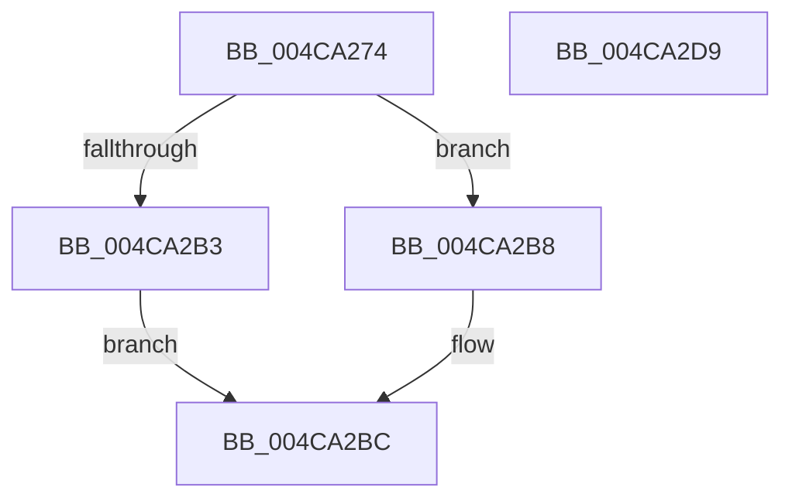

# PpDevNodeInsertIntoTree

- RVA: `0x004CA274`–`0x004CA2DA` (길이 `102` bytes)
- VA: `0x00000001404CA274`
- 실행 섹션: `.text`
- PDB 이름 있음: `예`; PDB Function 태그: `아니요`
- unwind 정보 RVA: `0x0005CAAC`
- 디코드: `27`개 명령, `102/102` bytes 표시
- 미해석 바이트: `0` (있으면 어셈블리에 `.byte`로 보존)

> 이 문서는 커널 이미지의 기계어와 PDB 기호를 분석해 생성했습니다. 4번과 5번은 함수 원형과 자료형을 바이너리 사용 방식에서 추정한 C 해석이며 원본 소스 복구 결과는 아닙니다.

## 1. Dependencies

- 직접 호출 지점: **2**; 고유 호출 대상: **2**
- 직접 호출자로 확인된 함수: **4**
- RIP 상대 이미지 참조: **1**

### Outgoing calls
- `0x004CA28B` → [KeAcquireSpinLockRaiseToDpc](../20/KeAcquireSpinLockRaiseToDpc_function_00208470.md) (function, `0x00208470`)
- `0x004CA2C9` → [KeReleaseSpinLock](../39/KeReleaseSpinLock_function_00392BA0.md) (function, `0x00392BA0`)

### Direct callers
- [IoReportDetectedDevice](../../page/72/IoReportDetectedDevice_function_00725CD0.md) at `0x0072646B`
- [PiInitializeDevice](../../page/73/PiInitializeDevice_function_0073EC5C.md) at `0x0073EFD2`
- [PipProcessEnumeratedChildDevice](../../page/8F/PipProcessEnumeratedChildDevice_function_008FBF4C.md) at `0x008FBFEB`
- [sub_00B420B0](../../page/B4/Unknown_function_00B420B0.md) at `0x00B421A0`

### Static image references
- `0x004CA284` → RVA `0x00F8AD90` (`.data`; read)

## 2. Other-region calls and transfers

- 다른 실행 섹션으로 향하는 call: **0**
- 별도 외부 분기/꼬리 이동을 확인하지 못했습니다.

## 3. Assembly (complete function range)

```asm
004CA274  48 89 5C 24 08                  mov qword ptr [rsp + 8], rbx
004CA279  57                              push rdi
004CA27A  48 83 EC 20                     sub rsp, 0x20
004CA27E  48 8B F9                        mov rdi, rcx
004CA281  48 8B DA                        mov rbx, rdx
004CA284  48 8D 0D 05 0B AC 00            lea rcx, [rip + 0xac0b05]
004CA28B  E8 E0 E1 D3 FF                  call 0x140208470
004CA290  44 8B 87 98 00 00 00            mov r8d, dword ptr [rdi + 0x98]
004CA297  41 FF C0                        inc r8d
004CA29A  48 89 7B 10                     mov qword ptr [rbx + 0x10], rdi
004CA29E  44 89 83 98 00 00 00            mov dword ptr [rbx + 0x98], r8d
004CA2A5  F0 83 0C 24 00                  lock or dword ptr [rsp], 0
004CA2AA  48 8B 4F 18                     mov rcx, qword ptr [rdi + 0x18]
004CA2AE  48 85 C9                        test rcx, rcx
004CA2B1  74 05                           je 0x1404ca2b8
004CA2B3  48 89 19                        mov qword ptr [rcx], rbx
004CA2B6  EB 04                           jmp 0x1404ca2bc
004CA2B8  48 89 5F 08                     mov qword ptr [rdi + 8], rbx
004CA2BC  8A D0                           mov dl, al
004CA2BE  48 89 5F 18                     mov qword ptr [rdi + 0x18], rbx
004CA2C2  48 8D 0D C7 0A AC 00            lea rcx, [rip + 0xac0ac7]
004CA2C9  E8 D2 88 EC FF                  call 0x140392ba0
004CA2CE  48 8B 5C 24 30                  mov rbx, qword ptr [rsp + 0x30]
004CA2D3  48 83 C4 20                     add rsp, 0x20
004CA2D7  5F                              pop rdi
004CA2D8  C3                              ret
004CA2D9  CC                              int3
```

## 4. C-style interpretation (structured pseudocode)

```c
__int64 __fastcall PpDevNodeInsertIntoTree(__int64 a1, __int64 a2)
{
    __int64 result;
    __int64 v_rsp;
    unsigned int v_stack_m28;
    unsigned __int64 v_stack_p8;

    v_stack_p8 = v_rbx;
    v_rsp = (v_rsp) - (32);
    result = KeAcquireSpinLockRaiseToDpc(v_rip + 11275013, a2, a3, a4);
    a3 = (unsigned int)(((unsigned int)(*(unsigned int *)(a1 + 152))) + 1);
    *(unsigned __int64 *)(a2 + 16) = a1;
    *(unsigned int *)(a2 + 152) = (unsigned int)(a3);
    if (*(unsigned __int64 *)(a1 + 24) == 0) goto loc_004CA2B8;
    *(unsigned __int64 *)(*(unsigned __int64 *)(a1 + 24)) = a2;
    goto loc_004CA2BC;
loc_004CA2B8:
    *(unsigned __int64 *)(a1 + 8) = a2;
loc_004CA2BC:
    *(unsigned __int64 *)(a1 + 24) = a2;
    result = KeReleaseSpinLock(v_rip + 11274951, (unsigned __int8)(result), a3, a4);
    v_rsp = (v_rsp) + (32);
    return result;
}
```

## 5. (Beta) C Style

```c
int64_t PpDevNodeInsertIntoTree(void *Arg1, void *Arg2)
{
    uint8_t *arg1 = (uint8_t *)Arg1;
    uint8_t *arg2 = (uint8_t *)Arg2;

    int64_t result;
    int64_t local_rsp;
    uint32_t v_stack_m28;
    uint64_t v_stack_p8;

    v_stack_p8 = local_rbx;
    local_rsp = (local_rsp) - (32);
    result = KeAcquireSpinLockRaiseToDpc(v_rip + 11275013, Arg2, a3, a4);
    a3 = (uint32_t)(((uint32_t)(*(uint32_t *)(arg1 + 0x98))) + 1);
    *(void **)(arg2 + 0x10) = Arg1;
    *(uint32_t *)(arg2 + 0x98) = (uint32_t)(a3);
    if (*(uint64_t *)(arg1 + 0x18) == 0) goto loc_004CA2B8;
    *(void **)(*(uint64_t *)(arg1 + 0x18)) = Arg2;
    goto loc_004CA2BC;
loc_004CA2B8:
    *(void **)(arg1 + 0x8) = Arg2;
loc_004CA2BC:
    *(void **)(arg1 + 0x18) = Arg2;
    result = KeReleaseSpinLock(v_rip + 11274951, (uint8_t)(result), a3, a4);
    local_rsp = (local_rsp) + (32);
    return result;
}
```

### 관측된 메모리 오프셋

구조체 형식이 확인되지 않은 접근은 인자 기준의 오프셋으로만 기록했습니다.

| 기준 인자 | 오프셋 표현 | 폭 (bit) | 접근 |
|---|---:|---:|---|
| `Arg1` | `+ 0x8` | `64` | `W` |
| `Arg1` | `+ 0x18` | `64` | `R` |
| `Arg1` | `+ 0x18` | `64` | `W` |
| `Arg1` | `+ 0x98` | `32` | `R` |
| `Arg2` | `+ 0x10` | `64` | `W` |
| `Arg2` | `+ 0x98` | `32` | `W` |

## 6. Execution-region graph

[열기: 2D/3D 그래프와 함수 탐색 컨트롤 패널](../../../control-panel.html?section=text&rva=0x004CA274&view=graph)

- 2D 그래프는 위에서 아래로 흐르고, 3D 그래프는 빈 공간을 드래그해 회전합니다. Shift+드래그는 이동, 휠은 확대·축소, 함수 노드 선택은 대상 보고서 이동입니다.

### Static fallback


